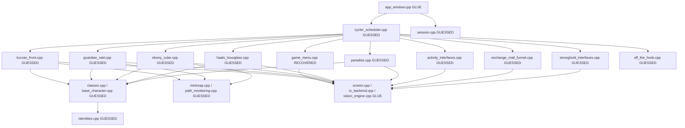

# Full Project RE Audit against `Bifrost.exe`

Target binary: `F:\C# projects\Botting project\bot\Bifrost-2.0.0-windows-x64\Bifrost.exe`
Raw dumps available on disk:
- Module 1 (`game_menu`): `docs/re/game_menu.md`, `scratch/game_menu_decompiled.txt`, `scratch/game_menu_consts.txt`, `scratch/game_menu_extra.txt`, `scratch/game_menu_gaps.txt`, `scratch/game_menu_gaps2.txt`
- Module 2 (`off_the_hook`, dumped, not yet ported): `scratch/fishing_decompiled.txt`, `scratch/fishing_inventory.txt`
- All 85 project-referenced `0x140xxxxxx` addresses: `docs/re/dumps/all_referenced_funcs.txt`

> **Audit Rule**: Only functions verified line-by-line against a raw Ghidra dump in this session (logic, constants, timings, templates) keep `RECOVERED`. Modules that only copied partial `0x140...` constants/structure while substituting OCR fallbacks, missing PNG templates, or unverified logic are downgraded to `GUESSED`.

## 1. Per-Function Audit Table (All 64 `.cpp` / `.hpp` Files)

| File | Function | Label | Source Address | Raw Decompile Dump | Confidence | Known Deviations from Binary |
|---|---|---|---|---|---|---|
| `include\bf\core\cycler_scheduler.hpp` | *(header declarations / inline structs)* | **GUESSED** | 0x140205b50 / 0x140206ae0 (partial) | docs/re/dumps/all_referenced_funcs.txt | Medium-Low | Depends on unverified activity/interface modules; modified for tasks.json/cycle_presets |
| `include\bf\core\session.hpp` | *(header declarations / inline structs)* | **GUESSED** | 0x140280360 / 0x1402740e0 (partial) | docs/re/dumps/all_referenced_funcs.txt | Low | GFN/Boosteroid/Moonlight/IPC wrappers not verified line-by-line against raw dump |
| `include\bf\discord\discord_bot.hpp` | *(header declarations / inline structs)* | **GLUE** | - | - | N/A | Clean-room Win32/ImGui/OpenCV/WinHTTP/JSON plumbing |
| `include\bf\discord\discord_notifier.hpp` | *(header declarations / inline structs)* | **GLUE** | - | - | N/A | Clean-room Win32/ImGui/OpenCV/WinHTTP/JSON plumbing |
| `include\bf\features\ebony_cube.hpp` | *(header declarations / inline structs)* | **GUESSED** | 0x1402b1ac0 (partial) | docs/re/dumps/all_referenced_funcs.txt | Medium-Low | is_loading_screen checks center pixel <12 (wrong vs 0x140352340); clear_template_path empty (OCR fallback) |
| `include\bf\features\guardian_raid.hpp` | *(header declarations / inline structs)* | **GUESSED** | 0x14039f270 (partial) | docs/re/dumps/all_referenced_funcs.txt | Medium-Low | Missing 16 PNG template checks from 0x14039f270; simplified enter/setup/combat |
| `include\bf\features\haals_hourglass.hpp` | *(header declarations / inline structs)* | **GUESSED** | 0x1402f10b0 (partial) | docs/re/dumps/all_referenced_funcs.txt | Medium-Low | is_loading_screen checks center pixel <12 (wrong vs 0x140352340); PNG template paths empty (OCR fallback) |
| `include\bf\features\kurzan_front.hpp` | *(header declarations / inline structs)* | **GUESSED** | 0x14029a820 / 0x1403ce890 (partial) | docs/re/dumps/all_referenced_funcs.txt | Medium-Low | Missing embedded Kurzan PNG templates; OCR/color fallback; unverified 21:9 coords |
| `include\bf\features\off_the_hook.hpp` | *(header declarations / inline structs)* | **GUESSED** | - | scratch/fishing_decompiled.txt (not yet ported) | Low | Written clean-room; invented ROIs/colors/timings; real binary uses 0x1403d4090 + 0x14036d5d0 + 6 PNGs |
| `include\bf\features\paradise.hpp` | *(header declarations / inline structs)* | **GUESSED** | 0x1402c7470 (partial) | docs/re/dumps/all_referenced_funcs.txt | Medium-Low | Missing embedded Paradise PNG templates; OCR fallback in is_interface_open / is_clear_banner_visible |
| `include\bf\gui\account_panel.hpp` | *(header declarations / inline structs)* | **GLUE** | - | - | N/A | Clean-room Win32/ImGui/OpenCV/WinHTTP/JSON plumbing |
| `include\bf\gui\app_window.hpp` | *(header declarations / inline structs)* | **GLUE** | - | - | N/A | Clean-room Win32/ImGui/OpenCV/WinHTTP/JSON plumbing |
| `include\bf\gui\roster_panels.hpp` | *(header declarations / inline structs)* | **GLUE** | - | - | N/A | Clean-room Win32/ImGui/OpenCV/WinHTTP/JSON plumbing |
| `include\bf\gui\sidebar_pages.hpp` | *(header declarations / inline structs)* | **GLUE** | - | - | N/A | Clean-room Win32/ImGui/OpenCV/WinHTTP/JSON plumbing |
| `include\bf\gui\ui_assets.hpp` | *(header declarations / inline structs)* | **GLUE** | - | - | N/A | Clean-room Win32/ImGui/OpenCV/WinHTTP/JSON plumbing |
| `include\bf\settings\bifrost_settings.hpp` | *(header declarations / inline structs)* | **GLUE** | - | - | N/A | Clean-room Win32/ImGui/OpenCV/WinHTTP/JSON plumbing |
| `include\bf\streaming\cloud_services.hpp` | *(header declarations / inline structs)* | **GUESSED** | 0x140280360 / 0x1402740e0 (partial) | docs/re/dumps/all_referenced_funcs.txt | Low | GFN/Boosteroid/Moonlight/IPC wrappers not verified line-by-line against raw dump |
| `include\bf\streaming\stream_bridge.hpp` | *(header declarations / inline structs)* | **GUESSED** | 0x140280360 / 0x1402740e0 (partial) | docs/re/dumps/all_referenced_funcs.txt | Low | GFN/Boosteroid/Moonlight/IPC wrappers not verified line-by-line against raw dump |
| `include\bf\targetting\minimap.hpp` | *(header declarations / inline structs)* | **GUESSED** | 0x1401ea450 / 0x140268b50 (partial) | docs/re/dumps/all_referenced_funcs.txt | Medium-Low | Color/tracking constants partially ported; unverified against raw dump line-by-line |
| `include\bf\targetting\path_monitoring.hpp` | *(header declarations / inline structs)* | **GUESSED** | 0x1401ea450 / 0x140268b50 (partial) | docs/re/dumps/all_referenced_funcs.txt | Medium-Low | Color/tracking constants partially ported; unverified against raw dump line-by-line |
| `include\bf\targetting\screen.hpp` | *(header declarations / inline structs)* | **GLUE** | - | - | N/A | Clean-room Win32/ImGui/OpenCV/WinHTTP/JSON plumbing |
| `include\bf\vision\vision_engine.hpp` | *(header declarations / inline structs)* | **GLUE** | - | - | N/A | Clean-room Win32/ImGui/OpenCV/WinHTTP/JSON plumbing |
| `include\loa\characters\base_character.hpp` | *(header declarations / inline structs)* | **GUESSED** | - | - | Low | Written clean-room without decompiling loa::base_character / class subclasses / identity subclasses |
| `include\loa\characters\classes.hpp` | *(header declarations / inline structs)* | **GUESSED** | - | - | Low | Written clean-room without decompiling loa::base_character / class subclasses / identity subclasses |
| `include\loa\core\types.hpp` | *(header declarations / inline structs)* | **GLUE** | - | - | N/A | Clean-room Win32/ImGui/OpenCV/WinHTTP/JSON plumbing |
| `include\loa\game\io_backend.hpp` | *(header declarations / inline structs)* | **GLUE** | - | - | N/A | Win32 SendInput scales 1920x1080->client rect; binary 0x140353460 uses GetSystemMetrics + WindMouse + 0x14035dae0 click-narrowing |
| `include\loa\identities\identities.hpp` | *(header declarations / inline structs)* | **GUESSED** | - | - | Low | Written clean-room without decompiling loa::base_character / class subclasses / identity subclasses |
| `include\loa\interfaces\activity_interfaces.hpp` | *(header declarations / inline structs)* | **GUESSED** | 0x140394630..0x1404014a0 (partial) | docs/re/dumps/all_referenced_funcs.txt | Low | 0 PNG match_template calls; uses OCR check_roi_non_empty_text + blind Alt-key/coords instead of base_interface::open + templates |
| `include\loa\interfaces\common_interfaces.hpp` | *(header declarations / inline structs)* | **GUESSED** | 0x140394630..0x1404014a0 (partial) | docs/re/dumps/all_referenced_funcs.txt | Low | 0 PNG match_template calls; uses OCR check_roi_non_empty_text + blind Alt-key/coords instead of base_interface::open + templates |
| `include\loa\interfaces\exchange_mail_funnel.hpp` | *(header declarations / inline structs)* | **GUESSED** | 0x140394630..0x1404014a0 (partial) | docs/re/dumps/all_referenced_funcs.txt | Low | 0 PNG match_template calls; uses OCR check_roi_non_empty_text + blind Alt-key/coords instead of base_interface::open + templates |
| `include\loa\interfaces\game_menu.hpp` | *(header declarations / inline structs)* | **RECOVERED** | 0x14038af20 | docs/re/game_menu.md | High | Header/ctor declaration |
| `include\loa\interfaces\stronghold_interfaces.hpp` | *(header declarations / inline structs)* | **GUESSED** | 0x140394630..0x1404014a0 (partial) | docs/re/dumps/all_referenced_funcs.txt | Low | 0 PNG match_template calls; uses OCR check_roi_non_empty_text + blind Alt-key/coords instead of base_interface::open + templates |
| `src\bf\core\cycler_scheduler.cpp` | `read_text` (L27) | **GUESSED** | 0x140205b50 / 0x140206ae0 (partial) | docs/re/dumps/all_referenced_funcs.txt | Medium-Low | Depends on unverified activity/interface modules; modified for tasks.json/cycle_presets |
| `src\bf\core\cycler_scheduler.cpp` | `find_matching_block` (L35) | **GUESSED** | 0x140205b50 / 0x140206ae0 (partial) | docs/re/dumps/all_referenced_funcs.txt | Medium-Low | Depends on unverified activity/interface modules; modified for tasks.json/cycle_presets |
| `src\bf\core\cycler_scheduler.cpp` | `split_top_level_objects` (L64) | **GUESSED** | 0x140205b50 / 0x140206ae0 (partial) | docs/re/dumps/all_referenced_funcs.txt | Medium-Low | Depends on unverified activity/interface modules; modified for tasks.json/cycle_presets |
| `src\bf\core\cycler_scheduler.cpp` | `json_str` (L78) | **GUESSED** | 0x140205b50 / 0x140206ae0 (partial) | docs/re/dumps/all_referenced_funcs.txt | Medium-Low | Depends on unverified activity/interface modules; modified for tasks.json/cycle_presets |
| `src\bf\core\cycler_scheduler.cpp` | `json_int` (L84) | **GUESSED** | 0x140205b50 / 0x140206ae0 (partial) | docs/re/dumps/all_referenced_funcs.txt | Medium-Low | Depends on unverified activity/interface modules; modified for tasks.json/cycle_presets |
| `src\bf\core\cycler_scheduler.cpp` | `json_bool` (L90) | **GUESSED** | 0x140205b50 / 0x140206ae0 (partial) | docs/re/dumps/all_referenced_funcs.txt | Medium-Low | Depends on unverified activity/interface modules; modified for tasks.json/cycle_presets |
| `src\bf\core\cycler_scheduler.cpp` | `extract_named_block` (L96) | **GUESSED** | 0x140205b50 / 0x140206ae0 (partial) | docs/re/dumps/all_referenced_funcs.txt | Medium-Low | Depends on unverified activity/interface modules; modified for tasks.json/cycle_presets |
| `src\bf\core\cycler_scheduler.cpp` | `load_cycle_presets` (L106) | **GUESSED** | 0x140205b50 / 0x140206ae0 (partial) | docs/re/dumps/all_referenced_funcs.txt | Medium-Low | Depends on unverified activity/interface modules; modified for tasks.json/cycle_presets |
| `src\bf\core\cycler_scheduler.cpp` | `load_scheduler_tasks` (L142) | **GUESSED** | 0x140205b50 / 0x140206ae0 (partial) | docs/re/dumps/all_referenced_funcs.txt | Medium-Low | Depends on unverified activity/interface modules; modified for tasks.json/cycle_presets |
| `src\bf\core\cycler_scheduler.cpp` | `cycler_scheduler_engine::is_activity_eligible` (L174) | **GUESSED** | 0x140205b50 / 0x140206ae0 (partial) | docs/re/dumps/all_referenced_funcs.txt | Medium-Low | Depends on unverified activity/interface modules; modified for tasks.json/cycle_presets |
| `src\bf\core\cycler_scheduler.cpp` | `cycler_scheduler_engine::run_single_activity` (L215) | **GUESSED** | 0x140205b50 / 0x140206ae0 (partial) | docs/re/dumps/all_referenced_funcs.txt | Medium-Low | Depends on unverified activity/interface modules; modified for tasks.json/cycle_presets |
| `src\bf\core\cycler_scheduler.cpp` | `cycler_scheduler_engine::run_cycle_preset` (L327) | **GUESSED** | 0x140205b50 / 0x140206ae0 (partial) | docs/re/dumps/all_referenced_funcs.txt | Medium-Low | Depends on unverified activity/interface modules; modified for tasks.json/cycle_presets |
| `src\bf\core\cycler_scheduler.cpp` | `cycler_scheduler_engine::run_scheduler` (L404) | **GUESSED** | 0x140205b50 / 0x140206ae0 (partial) | docs/re/dumps/all_referenced_funcs.txt | Medium-Low | Depends on unverified activity/interface modules; modified for tasks.json/cycle_presets |
| `src\bf\core\session.cpp` | `session::guarded_run` (L16) | **GUESSED** | 0x140280360 / 0x1402740e0 (partial) | docs/re/dumps/all_referenced_funcs.txt | Low | GFN/Boosteroid/Moonlight/IPC wrappers not verified line-by-line against raw dump |
| `src\bf\core\session.cpp` | `session::ensure_game_running` (L35) | **GUESSED** | 0x140280360 / 0x1402740e0 (partial) | docs/re/dumps/all_referenced_funcs.txt | Low | GFN/Boosteroid/Moonlight/IPC wrappers not verified line-by-line against raw dump |
| `src\bf\discord\discord_bot.cpp` | `trim` (L21) | **GLUE** | - | - | N/A | Clean-room Win32/ImGui/OpenCV/WinHTTP/JSON plumbing |
| `src\bf\discord\discord_bot.cpp` | `to_lower` (L32) | **GLUE** | - | - | N/A | Clean-room Win32/ImGui/OpenCV/WinHTTP/JSON plumbing |
| `src\bf\discord\discord_bot.cpp` | `snowflake_greater` (L39) | **GLUE** | - | - | N/A | Clean-room Win32/ImGui/OpenCV/WinHTTP/JSON plumbing |
| `src\bf\discord\discord_bot.cpp` | `parse_json_string_at` (L44) | **GLUE** | - | - | N/A | Clean-room Win32/ImGui/OpenCV/WinHTTP/JSON plumbing |
| `src\bf\discord\discord_bot.cpp` | `skip_json_string` (L73) | **GLUE** | - | - | N/A | Clean-room Win32/ImGui/OpenCV/WinHTTP/JSON plumbing |
| `src\bf\discord\discord_bot.cpp` | `parse_discord_messages` (L89) | **GLUE** | - | - | N/A | Clean-room Win32/ImGui/OpenCV/WinHTTP/JSON plumbing |
| `src\bf\discord\discord_bot.cpp` | `extract_commands_channel` (L147) | **GLUE** | - | - | N/A | Clean-room Win32/ImGui/OpenCV/WinHTTP/JSON plumbing |
| `src\bf\discord\discord_bot.cpp` | `discord_bot::load_config` (L159) | **GLUE** | - | - | N/A | Clean-room Win32/ImGui/OpenCV/WinHTTP/JSON plumbing |
| `src\bf\discord\discord_bot.cpp` | `discord_bot::set_callbacks` (L177) | **GLUE** | - | - | N/A | Clean-room Win32/ImGui/OpenCV/WinHTTP/JSON plumbing |
| `src\bf\discord\discord_bot.cpp` | `discord_bot::set_commands_channel` (L182) | **GLUE** | - | - | N/A | Clean-room Win32/ImGui/OpenCV/WinHTTP/JSON plumbing |
| `src\bf\discord\discord_bot.cpp` | `discord_bot::set_poll_interval_ms` (L187) | **GLUE** | - | - | N/A | Clean-room Win32/ImGui/OpenCV/WinHTTP/JSON plumbing |
| `src\bf\discord\discord_bot.cpp` | `discord_bot::start` (L191) | **GLUE** | - | - | N/A | Clean-room Win32/ImGui/OpenCV/WinHTTP/JSON plumbing |
| `src\bf\discord\discord_bot.cpp` | `discord_bot::stop` (L205) | **GLUE** | - | - | N/A | Clean-room Win32/ImGui/OpenCV/WinHTTP/JSON plumbing |
| `src\bf\discord\discord_bot.cpp` | `discord_bot::gateway_loop` (L231) | **GLUE** | - | - | N/A | Clean-room Win32/ImGui/OpenCV/WinHTTP/JSON plumbing |
| `src\bf\discord\discord_bot.cpp` | `discord_bot::poll_loop` (L346) | **GLUE** | - | - | N/A | Clean-room Win32/ImGui/OpenCV/WinHTTP/JSON plumbing |
| `src\bf\discord\discord_bot.cpp` | `discord_bot::fetch_recent_messages` (L391) | **GLUE** | - | - | N/A | Clean-room Win32/ImGui/OpenCV/WinHTTP/JSON plumbing |
| `src\bf\discord\discord_bot.cpp` | `discord_bot::handle_command` (L462) | **GLUE** | - | - | N/A | Clean-room Win32/ImGui/OpenCV/WinHTTP/JSON plumbing |
| `src\bf\discord\discord_bot.cpp` | `discord_bot::reply` (L492) | **GLUE** | - | - | N/A | Clean-room Win32/ImGui/OpenCV/WinHTTP/JSON plumbing |
| `src\bf\discord\discord_notifier.cpp` | `json_str` (L17) | **GLUE** | - | - | N/A | Clean-room Win32/ImGui/OpenCV/WinHTTP/JSON plumbing |
| `src\bf\discord\discord_notifier.cpp` | `json_bool` (L23) | **GLUE** | - | - | N/A | Clean-room Win32/ImGui/OpenCV/WinHTTP/JSON plumbing |
| `src\bf\discord\discord_notifier.cpp` | `escape_json` (L29) | **GLUE** | - | - | N/A | Clean-room Win32/ImGui/OpenCV/WinHTTP/JSON plumbing |
| `src\bf\discord\discord_notifier.cpp` | `discord_notifier::load_config` (L43) | **GLUE** | - | - | N/A | Clean-room Win32/ImGui/OpenCV/WinHTTP/JSON plumbing |
| `src\bf\discord\discord_notifier.cpp` | `discord_notifier::send_channel_message` (L64) | **GLUE** | - | - | N/A | Clean-room Win32/ImGui/OpenCV/WinHTTP/JSON plumbing |
| `src\bf\features\ebony_cube.cpp` | `rect_center` (L9) | **GUESSED** | 0x1402b1ac0 (partial) | docs/re/dumps/all_referenced_funcs.txt | Medium-Low | is_loading_screen checks center pixel <12 (wrong vs 0x140352340); clear_template_path empty (OCR fallback) |
| `src\bf\features\ebony_cube.cpp` | `resolve_roi` (L13) | **GUESSED** | 0x1402b1ac0 (partial) | docs/re/dumps/all_referenced_funcs.txt | Medium-Low | is_loading_screen checks center pixel <12 (wrong vs 0x140352340); clear_template_path empty (OCR fallback) |
| `src\bf\features\ebony_cube.cpp` | `ebony_cube::is_loading_screen` (L23) | **GUESSED** | 0x1402b1ac0 (partial) | docs/re/dumps/all_referenced_funcs.txt | Medium-Low | is_loading_screen checks center pixel <12 (wrong vs 0x140352340); clear_template_path empty (OCR fallback) |
| `src\bf\features\ebony_cube.cpp` | `ebony_cube::is_stage_clear` (L35) | **GUESSED** | 0x1402b1ac0 (partial) | docs/re/dumps/all_referenced_funcs.txt | Medium-Low | is_loading_screen checks center pixel <12 (wrong vs 0x140352340); clear_template_path empty (OCR fallback) |
| `src\bf\features\ebony_cube.cpp` | `ebony_cube::detect_cube_target` (L54) | **GUESSED** | 0x1402b1ac0 (partial) | docs/re/dumps/all_referenced_funcs.txt | Medium-Low | is_loading_screen checks center pixel <12 (wrong vs 0x140352340); clear_template_path empty (OCR fallback) |
| `src\bf\features\ebony_cube.cpp` | `ebony_cube::classify_stage` (L96) | **GUESSED** | 0x1402b1ac0 (partial) | docs/re/dumps/all_referenced_funcs.txt | Medium-Low | is_loading_screen checks center pixel <12 (wrong vs 0x140352340); clear_template_path empty (OCR fallback) |
| `src\bf\features\ebony_cube.cpp` | `ebony_cube::engage_target` (L107) | **GUESSED** | 0x1402b1ac0 (partial) | docs/re/dumps/all_referenced_funcs.txt | Medium-Low | is_loading_screen checks center pixel <12 (wrong vs 0x140352340); clear_template_path empty (OCR fallback) |
| `src\bf\features\ebony_cube.cpp` | `ebony_cube::run_stage_one` (L134) | **GUESSED** | 0x1402b1ac0 (partial) | docs/re/dumps/all_referenced_funcs.txt | Medium-Low | is_loading_screen checks center pixel <12 (wrong vs 0x140352340); clear_template_path empty (OCR fallback) |
| `src\bf\features\ebony_cube.cpp` | `ebony_cube::run` (L224) | **GUESSED** | 0x1402b1ac0 (partial) | docs/re/dumps/all_referenced_funcs.txt | Medium-Low | is_loading_screen checks center pixel <12 (wrong vs 0x140352340); clear_template_path empty (OCR fallback) |
| `src\bf\features\guardian_raid.cpp` | `random_jitter_ms` (L39) | **GUESSED** | 0x14039f270 (partial) | docs/re/dumps/all_referenced_funcs.txt | Medium-Low | Missing 16 PNG template checks from 0x14039f270; simplified enter/setup/combat |
| `src\bf\features\guardian_raid.cpp` | `random_point_in_rect` (L45) | **GUESSED** | 0x14039f270 (partial) | docs/re/dumps/all_referenced_funcs.txt | Medium-Low | Missing 16 PNG template checks from 0x14039f270; simplified enter/setup/combat |
| `src\bf\features\guardian_raid.cpp` | `extract_int` (L56) | **GUESSED** | 0x14039f270 (partial) | docs/re/dumps/all_referenced_funcs.txt | Medium-Low | Missing 16 PNG template checks from 0x14039f270; simplified enter/setup/combat |
| `src\bf\features\guardian_raid.cpp` | `extract_double` (L65) | **GUESSED** | 0x14039f270 (partial) | docs/re/dumps/all_referenced_funcs.txt | Medium-Low | Missing 16 PNG template checks from 0x14039f270; simplified enter/setup/combat |
| `src\bf\features\guardian_raid.cpp` | `extract_bool` (L74) | **GUESSED** | 0x14039f270 (partial) | docs/re/dumps/all_referenced_funcs.txt | Medium-Low | Missing 16 PNG template checks from 0x14039f270; simplified enter/setup/combat |
| `src\bf\features\guardian_raid.cpp` | `guardian_raid::load_guardian_config` (L85) | **GUESSED** | 0x14039f270 (partial) | docs/re/dumps/all_referenced_funcs.txt | Medium-Low | Missing 16 PNG template checks from 0x14039f270; simplified enter/setup/combat |
| `src\bf\features\guardian_raid.cpp` | `guardian_raid::guardian_id_from_enum` (L144) | **GUESSED** | 0x14039f270 (partial) | docs/re/dumps/all_referenced_funcs.txt | Medium-Low | Missing 16 PNG template checks from 0x14039f270; simplified enter/setup/combat |
| `src\bf\features\guardian_raid.cpp` | `guardian_raid::enter` (L158) | **GUESSED** | 0x14039f270 (partial) | docs/re/dumps/all_referenced_funcs.txt | Medium-Low | Missing 16 PNG template checks from 0x14039f270; simplified enter/setup/combat |
| `src\bf\features\guardian_raid.cpp` | `guardian_raid::setup` (L275) | **GUESSED** | 0x14039f270 (partial) | docs/re/dumps/all_referenced_funcs.txt | Medium-Low | Missing 16 PNG template checks from 0x14039f270; simplified enter/setup/combat |
| `src\bf\features\guardian_raid.cpp` | `guardian_raid::run` (L342) | **GUESSED** | 0x14039f270 (partial) | docs/re/dumps/all_referenced_funcs.txt | Medium-Low | Missing 16 PNG template checks from 0x14039f270; simplified enter/setup/combat |
| `src\bf\features\haals_hourglass.cpp` | `rect_center` (L26) | **GUESSED** | 0x1402f10b0 (partial) | docs/re/dumps/all_referenced_funcs.txt | Medium-Low | is_loading_screen checks center pixel <12 (wrong vs 0x140352340); PNG template paths empty (OCR fallback) |
| `src\bf\features\haals_hourglass.cpp` | `haals_hourglass::is_clear` (L32) | **GUESSED** | 0x1402f10b0 (partial) | docs/re/dumps/all_referenced_funcs.txt | Medium-Low | is_loading_screen checks center pixel <12 (wrong vs 0x140352340); PNG template paths empty (OCR fallback) |
| `src\bf\features\haals_hourglass.cpp` | `haals_hourglass::is_hourglass_ui_visible` (L48) | **GUESSED** | 0x1402f10b0 (partial) | docs/re/dumps/all_referenced_funcs.txt | Medium-Low | is_loading_screen checks center pixel <12 (wrong vs 0x140352340); PNG template paths empty (OCR fallback) |
| `src\bf\features\haals_hourglass.cpp` | `haals_hourglass::is_loading_screen` (L58) | **GUESSED** | 0x1402f10b0 (partial) | docs/re/dumps/all_referenced_funcs.txt | Medium-Low | is_loading_screen checks center pixel <12 (wrong vs 0x140352340); PNG template paths empty (OCR fallback) |
| `src\bf\features\haals_hourglass.cpp` | `haals_hourglass::detect_lucky_mob` (L71) | **GUESSED** | 0x1402f10b0 (partial) | docs/re/dumps/all_referenced_funcs.txt | Medium-Low | is_loading_screen checks center pixel <12 (wrong vs 0x140352340); PNG template paths empty (OCR fallback) |
| `src\bf\features\haals_hourglass.cpp` | `haals_hourglass::setup` (L87) | **GUESSED** | 0x1402f10b0 (partial) | docs/re/dumps/all_referenced_funcs.txt | Medium-Low | is_loading_screen checks center pixel <12 (wrong vs 0x140352340); PNG template paths empty (OCR fallback) |
| `src\bf\features\haals_hourglass.cpp` | `haals_hourglass::check_for_lucky_spawn_before_end` (L144) | **GUESSED** | 0x1402f10b0 (partial) | docs/re/dumps/all_referenced_funcs.txt | Medium-Low | is_loading_screen checks center pixel <12 (wrong vs 0x140352340); PNG template paths empty (OCR fallback) |
| `src\bf\features\haals_hourglass.cpp` | `haals_hourglass::run_lucky_search` (L184) | **GUESSED** | 0x1402f10b0 (partial) | docs/re/dumps/all_referenced_funcs.txt | Medium-Low | is_loading_screen checks center pixel <12 (wrong vs 0x140352340); PNG template paths empty (OCR fallback) |
| `src\bf\features\haals_hourglass.cpp` | `haals_hourglass::leave` (L272) | **GUESSED** | 0x1402f10b0 (partial) | docs/re/dumps/all_referenced_funcs.txt | Medium-Low | is_loading_screen checks center pixel <12 (wrong vs 0x140352340); PNG template paths empty (OCR fallback) |
| `src\bf\features\haals_hourglass.cpp` | `haals_hourglass::run` (L335) | **GUESSED** | 0x1402f10b0 (partial) | docs/re/dumps/all_referenced_funcs.txt | Medium-Low | is_loading_screen checks center pixel <12 (wrong vs 0x140352340); PNG template paths empty (OCR fallback) |
| `src\bf\features\kurzan_front.cpp` | `random_between` (L54) | **GUESSED** | 0x14029a820 / 0x1403ce890 (partial) | docs/re/dumps/all_referenced_funcs.txt | Medium-Low | Missing embedded Kurzan PNG templates; OCR/color fallback; unverified 21:9 coords |
| `src\bf\features\kurzan_front.cpp` | `jitter_point` (L60) | **GUESSED** | 0x14029a820 / 0x1403ce890 (partial) | docs/re/dumps/all_referenced_funcs.txt | Medium-Low | Missing embedded Kurzan PNG templates; OCR/color fallback; unverified 21:9 coords |
| `src\bf\features\kurzan_front.cpp` | `kurzan_front::enter_operation` (L71) | **GUESSED** | 0x14029a820 / 0x1403ce890 (partial) | docs/re/dumps/all_referenced_funcs.txt | Medium-Low | Missing embedded Kurzan PNG templates; OCR/color fallback; unverified 21:9 coords |
| `src\bf\features\kurzan_front.cpp` | `kurzan_front::do_jump_point` (L167) | **GUESSED** | 0x14029a820 / 0x1403ce890 (partial) | docs/re/dumps/all_referenced_funcs.txt | Medium-Low | Missing embedded Kurzan PNG templates; OCR/color fallback; unverified 21:9 coords |
| `src\bf\features\kurzan_front.cpp` | `kurzan_front::enter_next_portal` (L224) | **GUESSED** | 0x14029a820 / 0x1403ce890 (partial) | docs/re/dumps/all_referenced_funcs.txt | Medium-Low | Missing embedded Kurzan PNG templates; OCR/color fallback; unverified 21:9 coords |
| `src\bf\features\kurzan_front.cpp` | `kurzan_front::run` (L240) | **GUESSED** | 0x14029a820 / 0x1403ce890 (partial) | docs/re/dumps/all_referenced_funcs.txt | Medium-Low | Missing embedded Kurzan PNG templates; OCR/color fallback; unverified 21:9 coords |
| `src\bf\features\off_the_hook.cpp` | `clamp_roi` (L11) | **GUESSED** | - | scratch/fishing_decompiled.txt (not yet ported) | Low | Written clean-room; invented ROIs/colors/timings; real binary uses 0x1403d4090 + 0x14036d5d0 + 6 PNGs |
| `src\bf\features\off_the_hook.cpp` | `bgr_within_tolerance` (L26) | **GUESSED** | - | scratch/fishing_decompiled.txt (not yet ported) | Low | Written clean-room; invented ROIs/colors/timings; real binary uses 0x1403d4090 + 0x14036d5d0 + 6 PNGs |
| `src\bf\features\off_the_hook.cpp` | `off_the_hook::is_minigame_active` (L36) | **GUESSED** | - | scratch/fishing_decompiled.txt (not yet ported) | Low | Written clean-room; invented ROIs/colors/timings; real binary uses 0x1403d4090 + 0x14036d5d0 + 6 PNGs |
| `src\bf\features\off_the_hook.cpp` | `off_the_hook::detect_target_y` (L50) | **GUESSED** | - | scratch/fishing_decompiled.txt (not yet ported) | Low | Written clean-room; invented ROIs/colors/timings; real binary uses 0x1403d4090 + 0x14036d5d0 + 6 PNGs |
| `src\bf\features\off_the_hook.cpp` | `off_the_hook::detect_indicator_y` (L82) | **GUESSED** | - | scratch/fishing_decompiled.txt (not yet ported) | Low | Written clean-room; invented ROIs/colors/timings; real binary uses 0x1403d4090 + 0x14036d5d0 + 6 PNGs |
| `src\bf\features\off_the_hook.cpp` | `off_the_hook::cast_net` (L129) | **GUESSED** | - | scratch/fishing_decompiled.txt (not yet ported) | Low | Written clean-room; invented ROIs/colors/timings; real binary uses 0x1403d4090 + 0x14036d5d0 + 6 PNGs |
| `src\bf\features\off_the_hook.cpp` | `off_the_hook::run` (L152) | **GUESSED** | - | scratch/fishing_decompiled.txt (not yet ported) | Low | Written clean-room; invented ROIs/colors/timings; real binary uses 0x1403d4090 + 0x14036d5d0 + 6 PNGs |
| `src\bf\features\paradise.cpp` | `random_delay_ms` (L10) | **GUESSED** | 0x1402c7470 (partial) | docs/re/dumps/all_referenced_funcs.txt | Medium-Low | Missing embedded Paradise PNG templates; OCR fallback in is_interface_open / is_clear_banner_visible |
| `src\bf\features\paradise.cpp` | `elapsed_ms_reached` (L19) | **GUESSED** | 0x1402c7470 (partial) | docs/re/dumps/all_referenced_funcs.txt | Medium-Low | Missing embedded Paradise PNG templates; OCR fallback in is_interface_open / is_clear_banner_visible |
| `src\bf\features\paradise.cpp` | `paradise::should_exchange_keys` (L27) | **GUESSED** | 0x1402c7470 (partial) | docs/re/dumps/all_referenced_funcs.txt | Medium-Low | Missing embedded Paradise PNG templates; OCR fallback in is_interface_open / is_clear_banner_visible |
| `src\bf\features\paradise.cpp` | `paradise::is_interface_open` (L32) | **GUESSED** | 0x1402c7470 (partial) | docs/re/dumps/all_referenced_funcs.txt | Medium-Low | Missing embedded Paradise PNG templates; OCR fallback in is_interface_open / is_clear_banner_visible |
| `src\bf\features\paradise.cpp` | `paradise::is_clear_banner_visible` (L53) | **GUESSED** | 0x1402c7470 (partial) | docs/re/dumps/all_referenced_funcs.txt | Medium-Low | Missing embedded Paradise PNG templates; OCR fallback in is_interface_open / is_clear_banner_visible |
| `src\bf\features\paradise.cpp` | `paradise::wait_for_entry` (L77) | **GUESSED** | 0x1402c7470 (partial) | docs/re/dumps/all_referenced_funcs.txt | Medium-Low | Missing embedded Paradise PNG templates; OCR fallback in is_interface_open / is_clear_banner_visible |
| `src\bf\features\paradise.cpp` | `paradise::run_combat_tick` (L93) | **GUESSED** | 0x1402c7470 (partial) | docs/re/dumps/all_referenced_funcs.txt | Medium-Low | Missing embedded Paradise PNG templates; OCR fallback in is_interface_open / is_clear_banner_visible |
| `src\bf\features\paradise.cpp` | `paradise::close_interface` (L108) | **GUESSED** | 0x1402c7470 (partial) | docs/re/dumps/all_referenced_funcs.txt | Medium-Low | Missing embedded Paradise PNG templates; OCR fallback in is_interface_open / is_clear_banner_visible |
| `src\bf\features\paradise.cpp` | `paradise::run_elysian` (L141) | **GUESSED** | 0x1402c7470 (partial) | docs/re/dumps/all_referenced_funcs.txt | Medium-Low | Missing embedded Paradise PNG templates; OCR fallback in is_interface_open / is_clear_banner_visible |
| `src\bf\features\paradise.cpp` | `paradise::run_crucible` (L190) | **GUESSED** | 0x1402c7470 (partial) | docs/re/dumps/all_referenced_funcs.txt | Medium-Low | Missing embedded Paradise PNG templates; OCR fallback in is_interface_open / is_clear_banner_visible |
| `src\bf\features\paradise.cpp` | `paradise::run_hell` (L243) | **GUESSED** | 0x1402c7470 (partial) | docs/re/dumps/all_referenced_funcs.txt | Medium-Low | Missing embedded Paradise PNG templates; OCR fallback in is_interface_open / is_clear_banner_visible |
| `src\bf\gui\account_panel.cpp` | `ToggleSwitch` (L42) | **GLUE** | - | - | N/A | Clean-room Win32/ImGui/OpenCV/WinHTTP/JSON plumbing |
| `src\bf\gui\account_panel.cpp` | `StepperInt` (L64) | **GLUE** | - | - | N/A | Clean-room Win32/ImGui/OpenCV/WinHTTP/JSON plumbing |
| `src\bf\gui\account_panel.cpp` | `contains_icase` (L89) | **GLUE** | - | - | N/A | Clean-room Win32/ImGui/OpenCV/WinHTTP/JSON plumbing |
| `src\bf\gui\account_panel.cpp` | `render_sidebar` (L100) | **GLUE** | - | - | N/A | Clean-room Win32/ImGui/OpenCV/WinHTTP/JSON plumbing |
| `src\bf\gui\account_panel.cpp` | `render_account_panel` (L210) | **GLUE** | - | - | N/A | Clean-room Win32/ImGui/OpenCV/WinHTTP/JSON plumbing |
| `src\bf\gui\account_panel.cpp` | `render_sidebar` (L305) | **GLUE** | - | - | N/A | Clean-room Win32/ImGui/OpenCV/WinHTTP/JSON plumbing |
| `src\bf\gui\account_panel.cpp` | `render_account_panel` (L309) | **GLUE** | - | - | N/A | Clean-room Win32/ImGui/OpenCV/WinHTTP/JSON plumbing |
| `src\bf\gui\app_window.cpp` | `ImGui_ImplWin32_WndProcHandler` (L52) | **GLUE** | - | - | N/A | Clean-room Win32/ImGui/OpenCV/WinHTTP/JSON plumbing |
| `src\bf\gui\app_window.cpp` | `CreateRenderTarget` (L73) | **GLUE** | - | - | N/A | Clean-room Win32/ImGui/OpenCV/WinHTTP/JSON plumbing |
| `src\bf\gui\app_window.cpp` | `CleanupRenderTarget` (L81) | **GLUE** | - | - | N/A | Clean-room Win32/ImGui/OpenCV/WinHTTP/JSON plumbing |
| `src\bf\gui\app_window.cpp` | `CreateDeviceD3D` (L88) | **GLUE** | - | - | N/A | Clean-room Win32/ImGui/OpenCV/WinHTTP/JSON plumbing |
| `src\bf\gui\app_window.cpp` | `CleanupDeviceD3D` (L118) | **GLUE** | - | - | N/A | Clean-room Win32/ImGui/OpenCV/WinHTTP/JSON plumbing |
| `src\bf\gui\app_window.cpp` | `WndProc` (L125) | **GLUE** | - | - | N/A | Clean-room Win32/ImGui/OpenCV/WinHTTP/JSON plumbing |
| `src\bf\gui\app_window.cpp` | `ApplyBifrostTheme` (L143) | **GLUE** | - | - | N/A | Clean-room Win32/ImGui/OpenCV/WinHTTP/JSON plumbing |
| `src\bf\gui\app_window.cpp` | `SubTabButton` (L169) | **GLUE** | - | - | N/A | Clean-room Win32/ImGui/OpenCV/WinHTTP/JSON plumbing |
| `src\bf\gui\app_window.cpp` | `LoadGuardianIds` (L186) | **GLUE** | - | - | N/A | Clean-room Win32/ImGui/OpenCV/WinHTTP/JSON plumbing |
| `src\bf\gui\app_window.cpp` | `app_window::run` (L250) | **GLUE** | - | - | N/A | Clean-room Win32/ImGui/OpenCV/WinHTTP/JSON plumbing |
| `src\bf\gui\app_window.cpp` | `app_window::run` (L1132) | **GLUE** | - | - | N/A | Clean-room Win32/ImGui/OpenCV/WinHTTP/JSON plumbing |
| `src\bf\gui\roster_panels.cpp` | `RosterPanelState::sync_with_settings` (L10) | **GLUE** | - | - | N/A | Clean-room Win32/ImGui/OpenCV/WinHTTP/JSON plumbing |
| `src\bf\gui\roster_panels.cpp` | `draw_section_header` (L41) | **GLUE** | - | - | N/A | Clean-room Win32/ImGui/OpenCV/WinHTTP/JSON plumbing |
| `src\bf\gui\roster_panels.cpp` | `render_toggle_with_tooltip` (L45) | **GLUE** | - | - | N/A | Clean-room Win32/ImGui/OpenCV/WinHTTP/JSON plumbing |
| `src\bf\gui\roster_panels.cpp` | `find_string_index` (L57) | **GLUE** | - | - | N/A | Clean-room Win32/ImGui/OpenCV/WinHTTP/JSON plumbing |
| `src\bf\gui\roster_panels.cpp` | `render_rotation_combo` (L66) | **GLUE** | - | - | N/A | Clean-room Win32/ImGui/OpenCV/WinHTTP/JSON plumbing |
| `src\bf\gui\roster_panels.cpp` | `compute_cube_panel_height` (L99) | **GLUE** | - | - | N/A | Clean-room Win32/ImGui/OpenCV/WinHTTP/JSON plumbing |
| `src\bf\gui\roster_panels.cpp` | `show_tooltip` (L107) | **GLUE** | - | - | N/A | Clean-room Win32/ImGui/OpenCV/WinHTTP/JSON plumbing |
| `src\bf\gui\roster_panels.cpp` | `toggle_switch` (L117) | **GLUE** | - | - | N/A | Clean-room Win32/ImGui/OpenCV/WinHTTP/JSON plumbing |
| `src\bf\gui\roster_panels.cpp` | `render_roster_overview_panel` (L139) | **GLUE** | - | - | N/A | Clean-room Win32/ImGui/OpenCV/WinHTTP/JSON plumbing |
| `src\bf\gui\roster_panels.cpp` | `render_characters_left_panel` (L304) | **GLUE** | - | - | N/A | Clean-room Win32/ImGui/OpenCV/WinHTTP/JSON plumbing |
| `src\bf\gui\roster_panels.cpp` | `render_characters_right_panel` (L525) | **GLUE** | - | - | N/A | Clean-room Win32/ImGui/OpenCV/WinHTTP/JSON plumbing |
| `src\bf\gui\roster_panels.cpp` | `render_characters_waymark_panel` (L673) | **GLUE** | - | - | N/A | Clean-room Win32/ImGui/OpenCV/WinHTTP/JSON plumbing |
| `src\bf\gui\roster_panels.cpp` | `render_characters_cube_panel` (L781) | **GLUE** | - | - | N/A | Clean-room Win32/ImGui/OpenCV/WinHTTP/JSON plumbing |
| `src\bf\gui\roster_panels.cpp` | `render_cyclers_panel` (L916) | **GLUE** | - | - | N/A | Clean-room Win32/ImGui/OpenCV/WinHTTP/JSON plumbing |
| `src\bf\gui\roster_panels.cpp` | `task_objective_label` (L1324) | **GLUE** | - | - | N/A | Clean-room Win32/ImGui/OpenCV/WinHTTP/JSON plumbing |
| `src\bf\gui\roster_panels.cpp` | `format_sched_time` (L1331) | **GLUE** | - | - | N/A | Clean-room Win32/ImGui/OpenCV/WinHTTP/JSON plumbing |
| `src\bf\gui\roster_panels.cpp` | `contains_icase` (L1342) | **GLUE** | - | - | N/A | Clean-room Win32/ImGui/OpenCV/WinHTTP/JSON plumbing |
| `src\bf\gui\roster_panels.cpp` | `render_searchable_time_combo` (L1351) | **GLUE** | - | - | N/A | Clean-room Win32/ImGui/OpenCV/WinHTTP/JSON plumbing |
| `src\bf\gui\roster_panels.cpp` | `sync_scheduler_presets_lists` (L1383) | **GLUE** | - | - | N/A | Clean-room Win32/ImGui/OpenCV/WinHTTP/JSON plumbing |
| `src\bf\gui\roster_panels.cpp` | `render_scheduler_panel` (L1400) | **GLUE** | - | - | N/A | Clean-room Win32/ImGui/OpenCV/WinHTTP/JSON plumbing |
| `src\bf\gui\sidebar_pages.cpp` | `ShowPageTooltip` (L42) | **GLUE** | - | - | N/A | Clean-room Win32/ImGui/OpenCV/WinHTTP/JSON plumbing |
| `src\bf\gui\sidebar_pages.cpp` | `PageToggleSwitch` (L52) | **GLUE** | - | - | N/A | Clean-room Win32/ImGui/OpenCV/WinHTTP/JSON plumbing |
| `src\bf\gui\sidebar_pages.cpp` | `PageSubTabButton` (L72) | **GLUE** | - | - | N/A | Clean-room Win32/ImGui/OpenCV/WinHTTP/JSON plumbing |
| `src\bf\gui\sidebar_pages.cpp` | `to_lower_str` (L90) | **GLUE** | - | - | N/A | Clean-room Win32/ImGui/OpenCV/WinHTTP/JSON plumbing |
| `src\bf\gui\sidebar_pages.cpp` | `find_index` (L96) | **GLUE** | - | - | N/A | Clean-room Win32/ImGui/OpenCV/WinHTTP/JSON plumbing |
| `src\bf\gui\sidebar_pages.cpp` | `extract_array_block` (L103) | **GLUE** | - | - | N/A | Clean-room Win32/ImGui/OpenCV/WinHTTP/JSON plumbing |
| `src\bf\gui\sidebar_pages.cpp` | `extract_object_block` (L120) | **GLUE** | - | - | N/A | Clean-room Win32/ImGui/OpenCV/WinHTTP/JSON plumbing |
| `src\bf\gui\sidebar_pages.cpp` | `json_str` (L136) | **GLUE** | - | - | N/A | Clean-room Win32/ImGui/OpenCV/WinHTTP/JSON plumbing |
| `src\bf\gui\sidebar_pages.cpp` | `json_int` (L142) | **GLUE** | - | - | N/A | Clean-room Win32/ImGui/OpenCV/WinHTTP/JSON plumbing |
| `src\bf\gui\sidebar_pages.cpp` | `json_float` (L148) | **GLUE** | - | - | N/A | Clean-room Win32/ImGui/OpenCV/WinHTTP/JSON plumbing |
| `src\bf\gui\sidebar_pages.cpp` | `json_bool` (L154) | **GLUE** | - | - | N/A | Clean-room Win32/ImGui/OpenCV/WinHTTP/JSON plumbing |
| `src\bf\gui\sidebar_pages.cpp` | `parse_string_array` (L160) | **GLUE** | - | - | N/A | Clean-room Win32/ImGui/OpenCV/WinHTTP/JSON plumbing |
| `src\bf\gui\sidebar_pages.cpp` | `load_pathmaps_json` (L171) | **GLUE** | - | - | N/A | Clean-room Win32/ImGui/OpenCV/WinHTTP/JSON plumbing |
| `src\bf\gui\sidebar_pages.cpp` | `json_escape_str` (L228) | **GLUE** | - | - | N/A | Clean-room Win32/ImGui/OpenCV/WinHTTP/JSON plumbing |
| `src\bf\gui\sidebar_pages.cpp` | `SnipWndProc` (L254) | **GLUE** | - | - | N/A | Clean-room Win32/ImGui/OpenCV/WinHTTP/JSON plumbing |
| `src\bf\gui\sidebar_pages.cpp` | `snip_screen_region_png` (L329) | **GLUE** | - | - | N/A | Clean-room Win32/ImGui/OpenCV/WinHTTP/JSON plumbing |
| `src\bf\gui\sidebar_pages.cpp` | `check_vigem_installed` (L417) | **GLUE** | - | - | N/A | Clean-room Win32/ImGui/OpenCV/WinHTTP/JSON plumbing |
| `src\bf\gui\sidebar_pages.cpp` | `find_keybind` (L432) | **GLUE** | - | - | N/A | Clean-room Win32/ImGui/OpenCV/WinHTTP/JSON plumbing |
| `src\bf\gui\sidebar_pages.cpp` | `imgui_key_to_name` (L446) | **GLUE** | - | - | N/A | Clean-room Win32/ImGui/OpenCV/WinHTTP/JSON plumbing |
| `src\bf\gui\sidebar_pages.cpp` | `render_rotations_page` (L485) | **GLUE** | - | - | N/A | Clean-room Win32/ImGui/OpenCV/WinHTTP/JSON plumbing |
| `src\bf\gui\sidebar_pages.cpp` | `render_pathmaps_page` (L873) | **GLUE** | - | - | N/A | Clean-room Win32/ImGui/OpenCV/WinHTTP/JSON plumbing |
| `src\bf\gui\sidebar_pages.cpp` | `render_keybinds_page` (L1312) | **GLUE** | - | - | N/A | Clean-room Win32/ImGui/OpenCV/WinHTTP/JSON plumbing |
| `src\bf\gui\sidebar_pages.cpp` | `render_features_page` (L1450) | **GLUE** | - | - | N/A | Clean-room Win32/ImGui/OpenCV/WinHTTP/JSON plumbing |
| `src\bf\gui\sidebar_pages.cpp` | `decode_discord_client_id` (L1770) | **GLUE** | - | - | N/A | Clean-room Win32/ImGui/OpenCV/WinHTTP/JSON plumbing |
| `src\bf\gui\sidebar_pages.cpp` | `load_discord_toolbox_json` (L1795) | **GLUE** | - | - | N/A | Clean-room Win32/ImGui/OpenCV/WinHTTP/JSON plumbing |
| `src\bf\gui\sidebar_pages.cpp` | `save_discord_toolbox_json` (L1807) | **GLUE** | - | - | N/A | Clean-room Win32/ImGui/OpenCV/WinHTTP/JSON plumbing |
| `src\bf\gui\sidebar_pages.cpp` | `find_vigem_installer` (L1832) | **GLUE** | - | - | N/A | Clean-room Win32/ImGui/OpenCV/WinHTTP/JSON plumbing |
| `src\bf\gui\sidebar_pages.cpp` | `render_toolbox_page` (L1856) | **GLUE** | - | - | N/A | Clean-room Win32/ImGui/OpenCV/WinHTTP/JSON plumbing |
| `src\bf\gui\sidebar_pages.cpp` | `save_pathmaps_json` (L1981) | **GLUE** | - | - | N/A | Clean-room Win32/ImGui/OpenCV/WinHTTP/JSON plumbing |
| `src\bf\gui\sidebar_pages.cpp` | `read_text_file` (L2051) | **GLUE** | - | - | N/A | Clean-room Win32/ImGui/OpenCV/WinHTTP/JSON plumbing |
| `src\bf\gui\sidebar_pages.cpp` | `feat_esc` (L2059) | **GLUE** | - | - | N/A | Clean-room Win32/ImGui/OpenCV/WinHTTP/JSON plumbing |
| `src\bf\gui\sidebar_pages.cpp` | `feat_parse_str_arr` (L2070) | **GLUE** | - | - | N/A | Clean-room Win32/ImGui/OpenCV/WinHTTP/JSON plumbing |
| `src\bf\gui\sidebar_pages.cpp` | `feat_extract_block` (L2082) | **GLUE** | - | - | N/A | Clean-room Win32/ImGui/OpenCV/WinHTTP/JSON plumbing |
| `src\bf\gui\sidebar_pages.cpp` | `feat_json_int` (L2106) | **GLUE** | - | - | N/A | Clean-room Win32/ImGui/OpenCV/WinHTTP/JSON plumbing |
| `src\bf\gui\sidebar_pages.cpp` | `feat_json_ll` (L2119) | **GLUE** | - | - | N/A | Clean-room Win32/ImGui/OpenCV/WinHTTP/JSON plumbing |
| `src\bf\gui\sidebar_pages.cpp` | `feat_json_str` (L2132) | **GLUE** | - | - | N/A | Clean-room Win32/ImGui/OpenCV/WinHTTP/JSON plumbing |
| `src\bf\gui\sidebar_pages.cpp` | `load_features_json` (L2147) | **GLUE** | - | - | N/A | Clean-room Win32/ImGui/OpenCV/WinHTTP/JSON plumbing |
| `src\bf\gui\sidebar_pages.cpp` | `save_features_json` (L2257) | **GLUE** | - | - | N/A | Clean-room Win32/ImGui/OpenCV/WinHTTP/JSON plumbing |
| `src\bf\gui\ui_assets.cpp` | `resolve_asset_path` (L28) | **GLUE** | - | - | N/A | Clean-room Win32/ImGui/OpenCV/WinHTTP/JSON plumbing |
| `src\bf\gui\ui_assets.cpp` | `init_ui_assets` (L46) | **GLUE** | - | - | N/A | Clean-room Win32/ImGui/OpenCV/WinHTTP/JSON plumbing |
| `src\bf\gui\ui_assets.cpp` | `shutdown_ui_assets` (L50) | **GLUE** | - | - | N/A | Clean-room Win32/ImGui/OpenCV/WinHTTP/JSON plumbing |
| `src\bf\gui\ui_assets.cpp` | `get_ui_texture` (L61) | **GLUE** | - | - | N/A | Clean-room Win32/ImGui/OpenCV/WinHTTP/JSON plumbing |
| `src\bf\gui\ui_assets.cpp` | `get_logo_texture` (L115) | **GLUE** | - | - | N/A | Clean-room Win32/ImGui/OpenCV/WinHTTP/JSON plumbing |
| `src\bf\gui\ui_assets.cpp` | `get_clover_texture` (L119) | **GLUE** | - | - | N/A | Clean-room Win32/ImGui/OpenCV/WinHTTP/JSON plumbing |
| `src\bf\gui\ui_assets.cpp` | `get_cube_ticket_texture` (L123) | **GLUE** | - | - | N/A | Clean-room Win32/ImGui/OpenCV/WinHTTP/JSON plumbing |
| `src\bf\gui\ui_assets.cpp` | `get_crystal_texture` (L133) | **GLUE** | - | - | N/A | Clean-room Win32/ImGui/OpenCV/WinHTTP/JSON plumbing |
| `src\bf\gui\ui_assets.cpp` | `get_pathmap_texture` (L143) | **GLUE** | - | - | N/A | Clean-room Win32/ImGui/OpenCV/WinHTTP/JSON plumbing |
| `src\bf\gui\ui_assets.cpp` | `draw_sidebar_icon` (L148) | **GLUE** | - | - | N/A | Clean-room Win32/ImGui/OpenCV/WinHTTP/JSON plumbing |
| `src\bf\gui\ui_assets.cpp` | `draw_boat_icon` (L209) | **GLUE** | - | - | N/A | Clean-room Win32/ImGui/OpenCV/WinHTTP/JSON plumbing |
| `src\bf\gui\ui_assets.cpp` | `draw_fishing_gauge_preview` (L226) | **GLUE** | - | - | N/A | Clean-room Win32/ImGui/OpenCV/WinHTTP/JSON plumbing |
| `src\bf\settings\bifrost_settings.cpp` | `to_lower` (L19) | **GLUE** | - | - | N/A | Clean-room Win32/ImGui/OpenCV/WinHTTP/JSON plumbing |
| `src\bf\settings\bifrost_settings.cpp` | `find_json_key_block_start` (L25) | **GLUE** | - | - | N/A | Clean-room Win32/ImGui/OpenCV/WinHTTP/JSON plumbing |
| `src\bf\settings\bifrost_settings.cpp` | `extract_array_block` (L44) | **GLUE** | - | - | N/A | Clean-room Win32/ImGui/OpenCV/WinHTTP/JSON plumbing |
| `src\bf\settings\bifrost_settings.cpp` | `read_file_text` (L65) | **GLUE** | - | - | N/A | Clean-room Win32/ImGui/OpenCV/WinHTTP/JSON plumbing |
| `src\bf\settings\bifrost_settings.cpp` | `json_str` (L73) | **GLUE** | - | - | N/A | Clean-room Win32/ImGui/OpenCV/WinHTTP/JSON plumbing |
| `src\bf\settings\bifrost_settings.cpp` | `json_int` (L79) | **GLUE** | - | - | N/A | Clean-room Win32/ImGui/OpenCV/WinHTTP/JSON plumbing |
| `src\bf\settings\bifrost_settings.cpp` | `json_bool` (L85) | **GLUE** | - | - | N/A | Clean-room Win32/ImGui/OpenCV/WinHTTP/JSON plumbing |
| `src\bf\settings\bifrost_settings.cpp` | `extract_object_block` (L91) | **GLUE** | - | - | N/A | Clean-room Win32/ImGui/OpenCV/WinHTTP/JSON plumbing |
| `src\bf\settings\bifrost_settings.cpp` | `extract_string_array` (L112) | **GLUE** | - | - | N/A | Clean-room Win32/ImGui/OpenCV/WinHTTP/JSON plumbing |
| `src\bf\settings\bifrost_settings.cpp` | `parse_vk_name` (L130) | **GLUE** | - | - | N/A | Clean-room Win32/ImGui/OpenCV/WinHTTP/JSON plumbing |
| `src\bf\settings\bifrost_settings.cpp` | `parse_mod_name` (L148) | **GLUE** | - | - | N/A | Clean-room Win32/ImGui/OpenCV/WinHTTP/JSON plumbing |
| `src\bf\settings\bifrost_settings.cpp` | `resolve_action_key` (L156) | **GLUE** | - | - | N/A | Clean-room Win32/ImGui/OpenCV/WinHTTP/JSON plumbing |
| `src\bf\settings\bifrost_settings.cpp` | `load_bifrost_settings` (L186) | **GLUE** | - | - | N/A | Clean-room Win32/ImGui/OpenCV/WinHTTP/JSON plumbing |
| `src\bf\settings\bifrost_settings.cpp` | `replace_json_str` (L542) | **GLUE** | - | - | N/A | Clean-room Win32/ImGui/OpenCV/WinHTTP/JSON plumbing |
| `src\bf\settings\bifrost_settings.cpp` | `replace_json_int` (L552) | **GLUE** | - | - | N/A | Clean-room Win32/ImGui/OpenCV/WinHTTP/JSON plumbing |
| `src\bf\settings\bifrost_settings.cpp` | `replace_json_bool` (L564) | **GLUE** | - | - | N/A | Clean-room Win32/ImGui/OpenCV/WinHTTP/JSON plumbing |
| `src\bf\settings\bifrost_settings.cpp` | `write_file_text` (L576) | **GLUE** | - | - | N/A | Clean-room Win32/ImGui/OpenCV/WinHTTP/JSON plumbing |
| `src\bf\settings\bifrost_settings.cpp` | `save_bifrost_settings` (L585) | **GLUE** | - | - | N/A | Clean-room Win32/ImGui/OpenCV/WinHTTP/JSON plumbing |
| `src\bf\settings\bifrost_settings.cpp` | `parse_waymark_sequence` (L838) | **GLUE** | - | - | N/A | Clean-room Win32/ImGui/OpenCV/WinHTTP/JSON plumbing |
| `src\bf\settings\bifrost_settings.cpp` | `format_waymark_sequence` (L851) | **GLUE** | - | - | N/A | Clean-room Win32/ImGui/OpenCV/WinHTTP/JSON plumbing |
| `src\bf\streaming\cloud_services.cpp` | `to_lower_ascii` (L27) | **GUESSED** | 0x140280360 / 0x1402740e0 (partial) | docs/re/dumps/all_referenced_funcs.txt | Low | GFN/Boosteroid/Moonlight/IPC wrappers not verified line-by-line against raw dump |
| `src\bf\streaming\cloud_services.cpp` | `enum_windows_substr_proc` (L34) | **GUESSED** | 0x140280360 / 0x1402740e0 (partial) | docs/re/dumps/all_referenced_funcs.txt | Low | GFN/Boosteroid/Moonlight/IPC wrappers not verified line-by-line against raw dump |
| `src\bf\streaming\cloud_services.cpp` | `find_window_by_substring` (L52) | **GUESSED** | 0x140280360 / 0x1402740e0 (partial) | docs/re/dumps/all_referenced_funcs.txt | Low | GFN/Boosteroid/Moonlight/IPC wrappers not verified line-by-line against raw dump |
| `src\bf\streaming\cloud_services.cpp` | `sleep_ms` (L61) | **GUESSED** | 0x140280360 / 0x1402740e0 (partial) | docs/re/dumps/all_referenced_funcs.txt | Low | GFN/Boosteroid/Moonlight/IPC wrappers not verified line-by-line against raw dump |
| `src\bf\streaming\cloud_services.cpp` | `press_enter_key` (L67) | **GUESSED** | 0x140280360 / 0x1402740e0 (partial) | docs/re/dumps/all_referenced_funcs.txt | Low | GFN/Boosteroid/Moonlight/IPC wrappers not verified line-by-line against raw dump |
| `src\bf\streaming\cloud_services.cpp` | `run_hidden_command` (L85) | **GUESSED** | 0x140280360 / 0x1402740e0 (partial) | docs/re/dumps/all_referenced_funcs.txt | Low | GFN/Boosteroid/Moonlight/IPC wrappers not verified line-by-line against raw dump |
| `src\bf\streaming\cloud_services.cpp` | `bind_screen_and_io` (L112) | **GUESSED** | 0x140280360 / 0x1402740e0 (partial) | docs/re/dumps/all_referenced_funcs.txt | Low | GFN/Boosteroid/Moonlight/IPC wrappers not verified line-by-line against raw dump |
| `src\bf\streaming\cloud_services.cpp` | `remote_service::is_moonlight` (L142) | **GUESSED** | 0x140280360 / 0x1402740e0 (partial) | docs/re/dumps/all_referenced_funcs.txt | Low | GFN/Boosteroid/Moonlight/IPC wrappers not verified line-by-line against raw dump |
| `src\bf\streaming\cloud_services.cpp` | `remote_service::kind_name` (L146) | **GUESSED** | 0x140280360 / 0x1402740e0 (partial) | docs/re/dumps/all_referenced_funcs.txt | Low | GFN/Boosteroid/Moonlight/IPC wrappers not verified line-by-line against raw dump |
| `src\bf\streaming\cloud_services.cpp` | `remote_service::connect` (L158) | **GUESSED** | 0x140280360 / 0x1402740e0 (partial) | docs/re/dumps/all_referenced_funcs.txt | Low | GFN/Boosteroid/Moonlight/IPC wrappers not verified line-by-line against raw dump |
| `src\bf\streaming\cloud_services.cpp` | `remote_service::disconnect` (L199) | **GUESSED** | 0x140280360 / 0x1402740e0 (partial) | docs/re/dumps/all_referenced_funcs.txt | Low | GFN/Boosteroid/Moonlight/IPC wrappers not verified line-by-line against raw dump |
| `src\bf\streaming\cloud_services.cpp` | `remote_service::is_connected` (L213) | **GUESSED** | 0x140280360 / 0x1402740e0 (partial) | docs/re/dumps/all_referenced_funcs.txt | Low | GFN/Boosteroid/Moonlight/IPC wrappers not verified line-by-line against raw dump |
| `src\bf\streaming\cloud_services.cpp` | `remote_service::ensure_game_ready` (L228) | **GUESSED** | 0x140280360 / 0x1402740e0 (partial) | docs/re/dumps/all_referenced_funcs.txt | Low | GFN/Boosteroid/Moonlight/IPC wrappers not verified line-by-line against raw dump |
| `src\bf\streaming\cloud_services.cpp` | `remote_service::keep_alive` (L241) | **GUESSED** | 0x140280360 / 0x1402740e0 (partial) | docs/re/dumps/all_referenced_funcs.txt | Low | GFN/Boosteroid/Moonlight/IPC wrappers not verified line-by-line against raw dump |
| `src\bf\streaming\cloud_services.cpp` | `gfn_service::is_english_ui_locale` (L257) | **GUESSED** | 0x140280360 / 0x1402740e0 (partial) | docs/re/dumps/all_referenced_funcs.txt | Low | GFN/Boosteroid/Moonlight/IPC wrappers not verified line-by-line against raw dump |
| `src\bf\streaming\cloud_services.cpp` | `gfn_service::remaining_session_minutes` (L266) | **GUESSED** | 0x140280360 / 0x1402740e0 (partial) | docs/re/dumps/all_referenced_funcs.txt | Low | GFN/Boosteroid/Moonlight/IPC wrappers not verified line-by-line against raw dump |
| `src\bf\streaming\cloud_services.cpp` | `gfn_service::is_session_expiring_soon` (L278) | **GUESSED** | 0x140280360 / 0x1402740e0 (partial) | docs/re/dumps/all_referenced_funcs.txt | Low | GFN/Boosteroid/Moonlight/IPC wrappers not verified line-by-line against raw dump |
| `src\bf\streaming\cloud_services.cpp` | `gfn_service::connect` (L285) | **GUESSED** | 0x140280360 / 0x1402740e0 (partial) | docs/re/dumps/all_referenced_funcs.txt | Low | GFN/Boosteroid/Moonlight/IPC wrappers not verified line-by-line against raw dump |
| `src\bf\streaming\cloud_services.cpp` | `gfn_service::disconnect` (L311) | **GUESSED** | 0x140280360 / 0x1402740e0 (partial) | docs/re/dumps/all_referenced_funcs.txt | Low | GFN/Boosteroid/Moonlight/IPC wrappers not verified line-by-line against raw dump |
| `src\bf\streaming\cloud_services.cpp` | `gfn_service::is_connected` (L336) | **GUESSED** | 0x140280360 / 0x1402740e0 (partial) | docs/re/dumps/all_referenced_funcs.txt | Low | GFN/Boosteroid/Moonlight/IPC wrappers not verified line-by-line against raw dump |
| `src\bf\streaming\cloud_services.cpp` | `gfn_service::ensure_game_ready` (L343) | **GUESSED** | 0x140280360 / 0x1402740e0 (partial) | docs/re/dumps/all_referenced_funcs.txt | Low | GFN/Boosteroid/Moonlight/IPC wrappers not verified line-by-line against raw dump |
| `src\bf\streaming\cloud_services.cpp` | `gfn_service::keep_alive` (L353) | **GUESSED** | 0x140280360 / 0x1402740e0 (partial) | docs/re/dumps/all_referenced_funcs.txt | Low | GFN/Boosteroid/Moonlight/IPC wrappers not verified line-by-line against raw dump |
| `src\bf\streaming\cloud_services.cpp` | `boosteroid_service::connect` (L374) | **GUESSED** | 0x140280360 / 0x1402740e0 (partial) | docs/re/dumps/all_referenced_funcs.txt | Low | GFN/Boosteroid/Moonlight/IPC wrappers not verified line-by-line against raw dump |
| `src\bf\streaming\cloud_services.cpp` | `boosteroid_service::disconnect` (L392) | **GUESSED** | 0x140280360 / 0x1402740e0 (partial) | docs/re/dumps/all_referenced_funcs.txt | Low | GFN/Boosteroid/Moonlight/IPC wrappers not verified line-by-line against raw dump |
| `src\bf\streaming\cloud_services.cpp` | `boosteroid_service::is_connected` (L406) | **GUESSED** | 0x140280360 / 0x1402740e0 (partial) | docs/re/dumps/all_referenced_funcs.txt | Low | GFN/Boosteroid/Moonlight/IPC wrappers not verified line-by-line against raw dump |
| `src\bf\streaming\cloud_services.cpp` | `boosteroid_service::ensure_game_ready` (L413) | **GUESSED** | 0x140280360 / 0x1402740e0 (partial) | docs/re/dumps/all_referenced_funcs.txt | Low | GFN/Boosteroid/Moonlight/IPC wrappers not verified line-by-line against raw dump |
| `src\bf\streaming\cloud_services.cpp` | `boosteroid_service::keep_alive` (L423) | **GUESSED** | 0x140280360 / 0x1402740e0 (partial) | docs/re/dumps/all_referenced_funcs.txt | Low | GFN/Boosteroid/Moonlight/IPC wrappers not verified line-by-line against raw dump |
| `src\bf\streaming\cloud_services.cpp` | `create_connection_service` (L434) | **GUESSED** | 0x140280360 / 0x1402740e0 (partial) | docs/re/dumps/all_referenced_funcs.txt | Low | GFN/Boosteroid/Moonlight/IPC wrappers not verified line-by-line against raw dump |
| `src\bf\streaming\stream_bridge.cpp` | `alignas` (L19) | **GUESSED** | 0x140280360 / 0x1402740e0 (partial) | docs/re/dumps/all_referenced_funcs.txt | Low | GFN/Boosteroid/Moonlight/IPC wrappers not verified line-by-line against raw dump |
| `src\bf\streaming\stream_bridge.cpp` | `stream_bridge::connect` (L49) | **GUESSED** | 0x140280360 / 0x1402740e0 (partial) | docs/re/dumps/all_referenced_funcs.txt | Low | GFN/Boosteroid/Moonlight/IPC wrappers not verified line-by-line against raw dump |
| `src\bf\streaming\stream_bridge.cpp` | `stream_bridge::disconnect` (L82) | **GUESSED** | 0x140280360 / 0x1402740e0 (partial) | docs/re/dumps/all_referenced_funcs.txt | Low | GFN/Boosteroid/Moonlight/IPC wrappers not verified line-by-line against raw dump |
| `src\bf\streaming\stream_bridge.cpp` | `stream_bridge::read_frame` (L97) | **GUESSED** | 0x140280360 / 0x1402740e0 (partial) | docs/re/dumps/all_referenced_funcs.txt | Low | GFN/Boosteroid/Moonlight/IPC wrappers not verified line-by-line against raw dump |
| `src\bf\streaming\stream_bridge.cpp` | `stream_bridge::write_command` (L121) | **GUESSED** | 0x140280360 / 0x1402740e0 (partial) | docs/re/dumps/all_referenced_funcs.txt | Low | GFN/Boosteroid/Moonlight/IPC wrappers not verified line-by-line against raw dump |
| `src\bf\streaming\stream_bridge.cpp` | `stream_bridge::send_key` (L137) | **GUESSED** | 0x140280360 / 0x1402740e0 (partial) | docs/re/dumps/all_referenced_funcs.txt | Low | GFN/Boosteroid/Moonlight/IPC wrappers not verified line-by-line against raw dump |
| `src\bf\targetting\minimap.cpp` | `minimap::locate_player` (L8) | **GUESSED** | 0x1401ea450 / 0x140268b50 (partial) | docs/re/dumps/all_referenced_funcs.txt | Medium-Low | Color/tracking constants partially ported; unverified against raw dump line-by-line |
| `src\bf\targetting\minimap.cpp` | `minimap::locate_portal` (L22) | **GUESSED** | 0x1401ea450 / 0x140268b50 (partial) | docs/re/dumps/all_referenced_funcs.txt | Medium-Low | Color/tracking constants partially ported; unverified against raw dump line-by-line |
| `src\bf\targetting\minimap.cpp` | `minimap::locate_boss` (L35) | **GUESSED** | 0x1401ea450 / 0x140268b50 (partial) | docs/re/dumps/all_referenced_funcs.txt | Medium-Low | Color/tracking constants partially ported; unverified against raw dump line-by-line |
| `src\bf\targetting\minimap.cpp` | `minimap::locate_color_target` (L42) | **GUESSED** | 0x1401ea450 / 0x140268b50 (partial) | docs/re/dumps/all_referenced_funcs.txt | Medium-Low | Color/tracking constants partially ported; unverified against raw dump line-by-line |
| `src\bf\targetting\minimap.cpp` | `minimap::locate_target_retained` (L65) | **GUESSED** | 0x1401ea450 / 0x140268b50 (partial) | docs/re/dumps/all_referenced_funcs.txt | Medium-Low | Color/tracking constants partially ported; unverified against raw dump line-by-line |
| `src\bf\targetting\minimap.cpp` | `minimap::minimap_delta_to_screen_click` (L108) | **GUESSED** | 0x1401ea450 / 0x140268b50 (partial) | docs/re/dumps/all_referenced_funcs.txt | Medium-Low | Color/tracking constants partially ported; unverified against raw dump line-by-line |
| `src\bf\targetting\path_monitoring.cpp` | `path_monitoring::follow_path` (L7) | **GUESSED** | 0x1401ea450 / 0x140268b50 (partial) | docs/re/dumps/all_referenced_funcs.txt | Medium-Low | Color/tracking constants partially ported; unverified against raw dump line-by-line |
| `src\bf\targetting\screen.cpp` | `to_lower_ascii` (L22) | **GLUE** | - | - | N/A | Uses desktop GetDC BitBlt for Moonlight DX11; binary 0x140354340 uses PrintWindow(hwnd,hdc,2) / remote stream |
| `src\bf\targetting\screen.cpp` | `enum_windows_cb` (L28) | **GLUE** | - | - | N/A | Uses desktop GetDC BitBlt for Moonlight DX11; binary 0x140354340 uses PrintWindow(hwnd,hdc,2) / remote stream |
| `src\bf\targetting\screen.cpp` | `screen::attach_window` (L48) | **GLUE** | - | - | N/A | Uses desktop GetDC BitBlt for Moonlight DX11; binary 0x140354340 uses PrintWindow(hwnd,hdc,2) / remote stream |
| `src\bf\targetting\screen.cpp` | `screen::capture` (L55) | **GLUE** | - | - | N/A | Uses desktop GetDC BitBlt for Moonlight DX11; binary 0x140354340 uses PrintWindow(hwnd,hdc,2) / remote stream |
| `src\bf\targetting\screen.cpp` | `screen::crop` (L118) | **GLUE** | - | - | N/A | Uses desktop GetDC BitBlt for Moonlight DX11; binary 0x140354340 uses PrintWindow(hwnd,hdc,2) / remote stream |
| `src\bf\vision\vision_engine.cpp` | `write_xor_section` (L102) | **GLUE** | - | - | N/A | Clean-room Win32/ImGui/OpenCV/WinHTTP/JSON plumbing |
| `src\bf\vision\vision_engine.cpp` | `unpack_dh_bundle` (L122) | **GLUE** | - | - | N/A | Clean-room Win32/ImGui/OpenCV/WinHTTP/JSON plumbing |
| `src\bf\vision\vision_engine.cpp` | `extract_json_string` (L189) | **GLUE** | - | - | N/A | Clean-room Win32/ImGui/OpenCV/WinHTTP/JSON plumbing |
| `src\bf\vision\vision_engine.cpp` | `extract_json_number` (L203) | **GLUE** | - | - | N/A | Clean-room Win32/ImGui/OpenCV/WinHTTP/JSON plumbing |
| `src\bf\vision\vision_engine.cpp` | `parse_darkhelp_json` (L229) | **GLUE** | - | - | N/A | Clean-room Win32/ImGui/OpenCV/WinHTTP/JSON plumbing |
| `src\bf\vision\vision_engine.cpp` | `try_load_dll` (L296) | **GLUE** | - | - | N/A | Clean-room Win32/ImGui/OpenCV/WinHTTP/JSON plumbing |
| `src\bf\vision\vision_engine.cpp` | `vision_engine::probe_runtime_dlls` (L347) | **GLUE** | - | - | N/A | Clean-room Win32/ImGui/OpenCV/WinHTTP/JSON plumbing |
| `src\bf\vision\vision_engine.cpp` | `vision_engine::init_ocr` (L358) | **GLUE** | - | - | N/A | Clean-room Win32/ImGui/OpenCV/WinHTTP/JSON plumbing |
| `src\bf\vision\vision_engine.cpp` | `vision_engine::init_darkhelp` (L393) | **GLUE** | - | - | N/A | Clean-room Win32/ImGui/OpenCV/WinHTTP/JSON plumbing |
| `src\bf\vision\vision_engine.cpp` | `vision_engine::find_color_centroid` (L454) | **GLUE** | - | - | N/A | Clean-room Win32/ImGui/OpenCV/WinHTTP/JSON plumbing |
| `src\bf\vision\vision_engine.cpp` | `vision_engine::match_template` (L496) | **GLUE** | - | - | N/A | Clean-room Win32/ImGui/OpenCV/WinHTTP/JSON plumbing |
| `src\bf\vision\vision_engine.cpp` | `vision_engine::read_text` (L549) | **GLUE** | - | - | N/A | Clean-room Win32/ImGui/OpenCV/WinHTTP/JSON plumbing |
| `src\bf\vision\vision_engine.cpp` | `vision_engine::detect_objects` (L601) | **GLUE** | - | - | N/A | Clean-room Win32/ImGui/OpenCV/WinHTTP/JSON plumbing |
| `src\loa\characters\base_character.cpp` | `base_character::load_rotation` (L12) | **GUESSED** | - | - | Low | Written clean-room without decompiling loa::base_character / class subclasses / identity subclasses |
| `src\loa\characters\base_character.cpp` | `base_character::dash` (L44) | **GUESSED** | - | - | Low | Written clean-room without decompiling loa::base_character / class subclasses / identity subclasses |
| `src\loa\characters\base_character.cpp` | `base_character::interact` (L48) | **GUESSED** | - | - | Low | Written clean-room without decompiling loa::base_character / class subclasses / identity subclasses |
| `src\loa\characters\base_character.cpp` | `base_character::use_potion` (L52) | **GUESSED** | - | - | Low | Written clean-room without decompiling loa::base_character / class subclasses / identity subclasses |
| `src\loa\characters\base_character.cpp` | `base_character::trigger_identity` (L56) | **GUESSED** | - | - | Low | Written clean-room without decompiling loa::base_character / class subclasses / identity subclasses |
| `src\loa\characters\base_character.cpp` | `base_character::run_rotation_for_ms` (L60) | **GUESSED** | - | - | Low | Written clean-room without decompiling loa::base_character / class subclasses / identity subclasses |
| `src\loa\characters\classes.cpp` | `normalize_class_name` (L10) | **GUESSED** | - | - | Low | Written clean-room without decompiling loa::base_character / class subclasses / identity subclasses |
| `src\loa\characters\classes.cpp` | `elapsed_since` (L28) | **GUESSED** | - | - | Low | Written clean-room without decompiling loa::base_character / class subclasses / identity subclasses |
| `src\loa\characters\classes.cpp` | `character_class_from_string` (L39) | **GUESSED** | - | - | Low | Written clean-room without decompiling loa::base_character / class subclasses / identity subclasses |
| `src\loa\characters\classes.cpp` | `to_string` (L85) | **GUESSED** | - | - | Low | Written clean-room without decompiling loa::base_character / class subclasses / identity subclasses |
| `src\loa\characters\classes.cpp` | `class_character::get_active_skillset` (L139) | **GUESSED** | - | - | Low | Written clean-room without decompiling loa::base_character / class subclasses / identity subclasses |
| `src\loa\characters\classes.cpp` | `class_character::use_identity_skill` (L143) | **GUESSED** | - | - | Low | Written clean-room without decompiling loa::base_character / class subclasses / identity subclasses |
| `src\loa\characters\classes.cpp` | `class_character::can_move` (L157) | **GUESSED** | - | - | Low | Written clean-room without decompiling loa::base_character / class subclasses / identity subclasses |
| `src\loa\characters\classes.cpp` | `class_character::dash` (L161) | **GUESSED** | - | - | Low | Written clean-room without decompiling loa::base_character / class subclasses / identity subclasses |
| `src\loa\characters\classes.cpp` | `class_character::trigger_identity` (L168) | **GUESSED** | - | - | Low | Written clean-room without decompiling loa::base_character / class subclasses / identity subclasses |
| `src\loa\characters\classes.cpp` | `class_character::skills_for_mode` (L174) | **GUESSED** | - | - | Low | Written clean-room without decompiling loa::base_character / class subclasses / identity subclasses |
| `src\loa\characters\classes.cpp` | `class_character::run_rotation_for_ms` (L184) | **GUESSED** | - | - | Low | Written clean-room without decompiling loa::base_character / class subclasses / identity subclasses |
| `src\loa\characters\classes.cpp` | `arcanist::use_identity_skill` (L224) | **GUESSED** | - | - | Low | Written clean-room without decompiling loa::base_character / class subclasses / identity subclasses |
| `src\loa\characters\classes.cpp` | `artillerist::get_active_skillset` (L249) | **GUESSED** | - | - | Low | Written clean-room without decompiling loa::base_character / class subclasses / identity subclasses |
| `src\loa\characters\classes.cpp` | `artillerist::can_move` (L256) | **GUESSED** | - | - | Low | Written clean-room without decompiling loa::base_character / class subclasses / identity subclasses |
| `src\loa\characters\classes.cpp` | `bard::use_identity_skill` (L267) | **GUESSED** | - | - | Low | Written clean-room without decompiling loa::base_character / class subclasses / identity subclasses |
| `src\loa\characters\classes.cpp` | `breaker::use_identity_skill` (L287) | **GUESSED** | - | - | Low | Written clean-room without decompiling loa::base_character / class subclasses / identity subclasses |
| `src\loa\characters\classes.cpp` | `deadeye::get_active_skillset` (L304) | **GUESSED** | - | - | Low | Written clean-room without decompiling loa::base_character / class subclasses / identity subclasses |
| `src\loa\characters\classes.cpp` | `deadeye::use_identity_skill` (L315) | **GUESSED** | - | - | Low | Written clean-room without decompiling loa::base_character / class subclasses / identity subclasses |
| `src\loa\characters\classes.cpp` | `destroyer::get_active_skillset` (L332) | **GUESSED** | - | - | Low | Written clean-room without decompiling loa::base_character / class subclasses / identity subclasses |
| `src\loa\characters\classes.cpp` | `dimentionalist::get_active_skillset` (L342) | **GUESSED** | - | - | Low | Written clean-room without decompiling loa::base_character / class subclasses / identity subclasses |
| `src\loa\characters\classes.cpp` | `glaivier::get_active_skillset` (L352) | **GUESSED** | - | - | Low | Written clean-room without decompiling loa::base_character / class subclasses / identity subclasses |
| `src\loa\characters\classes.cpp` | `glaivier::use_identity_skill` (L359) | **GUESSED** | - | - | Low | Written clean-room without decompiling loa::base_character / class subclasses / identity subclasses |
| `src\loa\characters\classes.cpp` | `guardian_knight::get_active_skillset` (L378) | **GUESSED** | - | - | Low | Written clean-room without decompiling loa::base_character / class subclasses / identity subclasses |
| `src\loa\characters\classes.cpp` | `gunslinger::get_active_skillset` (L391) | **GUESSED** | - | - | Low | Written clean-room without decompiling loa::base_character / class subclasses / identity subclasses |
| `src\loa\characters\classes.cpp` | `gunslinger::use_identity_skill` (L401) | **GUESSED** | - | - | Low | Written clean-room without decompiling loa::base_character / class subclasses / identity subclasses |
| `src\loa\characters\classes.cpp` | `machinist::get_active_skillset` (L415) | **GUESSED** | - | - | Low | Written clean-room without decompiling loa::base_character / class subclasses / identity subclasses |
| `src\loa\characters\classes.cpp` | `shadowhunter::get_active_skillset` (L434) | **GUESSED** | - | - | Low | Written clean-room without decompiling loa::base_character / class subclasses / identity subclasses |
| `src\loa\characters\classes.cpp` | `shadowhunter::use_identity_skill` (L441) | **GUESSED** | - | - | Low | Written clean-room without decompiling loa::base_character / class subclasses / identity subclasses |
| `src\loa\characters\classes.cpp` | `souleater::get_active_skillset` (L472) | **GUESSED** | - | - | Low | Written clean-room without decompiling loa::base_character / class subclasses / identity subclasses |
| `src\loa\characters\classes.cpp` | `valkyrie::use_identity_skill` (L491) | **GUESSED** | - | - | Low | Written clean-room without decompiling loa::base_character / class subclasses / identity subclasses |
| `src\loa\characters\classes.cpp` | `wildsoul::on_pre_rotation_step` (L511) | **GUESSED** | - | - | Low | Written clean-room without decompiling loa::base_character / class subclasses / identity subclasses |
| `src\loa\characters\classes.cpp` | `create_character` (L528) | **GUESSED** | - | - | Low | Written clean-room without decompiling loa::base_character / class subclasses / identity subclasses |
| `src\loa\game\io_backend.cpp` | `to_screen_point` (L18) | **GLUE** | - | - | N/A | Win32 SendInput scales 1920x1080->client rect; binary 0x140353460 uses GetSystemMetrics + WindMouse + 0x14035dae0 click-narrowing |
| `src\loa\game\io_backend.cpp` | `mouse_flag` (L38) | **GLUE** | - | - | N/A | Win32 SendInput scales 1920x1080->client rect; binary 0x140353460 uses GetSystemMetrics + WindMouse + 0x14035dae0 click-narrowing |
| `src\loa\game\io_backend.cpp` | `io_backend::move_mouse` (L49) | **GLUE** | - | - | N/A | Win32 SendInput scales 1920x1080->client rect; binary 0x140353460 uses GetSystemMetrics + WindMouse + 0x14035dae0 click-narrowing |
| `src\loa\game\io_backend.cpp` | `io_backend::click_mouse` (L72) | **GLUE** | - | - | N/A | Win32 SendInput scales 1920x1080->client rect; binary 0x140353460 uses GetSystemMetrics + WindMouse + 0x14035dae0 click-narrowing |
| `src\loa\game\io_backend.cpp` | `io_backend::press_key` (L104) | **GLUE** | - | - | N/A | Win32 SendInput scales 1920x1080->client rect; binary 0x140353460 uses GetSystemMetrics + WindMouse + 0x14035dae0 click-narrowing |
| `src\loa\game\io_backend.cpp` | `io_backend::press_key_with_modifier` (L108) | **GLUE** | - | - | N/A | Win32 SendInput scales 1920x1080->client rect; binary 0x140353460 uses GetSystemMetrics + WindMouse + 0x14035dae0 click-narrowing |
| `src\loa\game\io_backend.cpp` | `io_backend::send_key_state` (L123) | **GLUE** | - | - | N/A | Win32 SendInput scales 1920x1080->client rect; binary 0x140353460 uses GetSystemMetrics + WindMouse + 0x14035dae0 click-narrowing |
| `src\loa\game\io_backend.cpp` | `io_backend::set_global_pause_stop` (L139) | **GLUE** | - | - | N/A | Win32 SendInput scales 1920x1080->client rect; binary 0x140353460 uses GetSystemMetrics + WindMouse + 0x14035dae0 click-narrowing |
| `src\loa\game\io_backend.cpp` | `io_backend::wait_if_paused` (L145) | **GLUE** | - | - | N/A | Win32 SendInput scales 1920x1080->client rect; binary 0x140353460 uses GetSystemMetrics + WindMouse + 0x14035dae0 click-narrowing |
| `src\loa\game\io_backend.cpp` | `io_backend::sleep_ms` (L151) | **GLUE** | - | - | N/A | Win32 SendInput scales 1920x1080->client rect; binary 0x140353460 uses GetSystemMetrics + WindMouse + 0x14035dae0 click-narrowing |
| `src\loa\identities\identities.cpp` | `normalize_identity_name` (L9) | **GUESSED** | - | - | Low | Written clean-room without decompiling loa::base_character / class subclasses / identity subclasses |
| `src\loa\identities\identities.cpp` | `identity::cooldown_elapsed` (L60) | **GUESSED** | - | - | Low | Written clean-room without decompiling loa::base_character / class subclasses / identity subclasses |
| `src\loa\identities\identities.cpp` | `identity::duration_elapsed` (L69) | **GUESSED** | - | - | Low | Written clean-room without decompiling loa::base_character / class subclasses / identity subclasses |
| `src\loa\identities\identities.cpp` | `identity::mark_activated` (L78) | **GUESSED** | - | - | Low | Written clean-room without decompiling loa::base_character / class subclasses / identity subclasses |
| `src\loa\identities\identities.cpp` | `identity::mark_deactivated` (L84) | **GUESSED** | - | - | Low | Written clean-room without decompiling loa::base_character / class subclasses / identity subclasses |
| `src\loa\identities\identities.cpp` | `identity::can_activate` (L89) | **GUESSED** | - | - | Low | Written clean-room without decompiling loa::base_character / class subclasses / identity subclasses |
| `src\loa\identities\identities.cpp` | `identity::activate` (L93) | **GUESSED** | - | - | Low | Written clean-room without decompiling loa::base_character / class subclasses / identity subclasses |
| `src\loa\identities\identities.cpp` | `identity::deactivate` (L106) | **GUESSED** | - | - | Low | Written clean-room without decompiling loa::base_character / class subclasses / identity subclasses |
| `src\loa\identities\identities.cpp` | `identity::tick` (L116) | **GUESSED** | - | - | Low | Written clean-room without decompiling loa::base_character / class subclasses / identity subclasses |
| `src\loa\identities\identities.cpp` | `identity::is_active` (L122) | **GUESSED** | - | - | Low | Written clean-room without decompiling loa::base_character / class subclasses / identity subclasses |
| `src\loa\identities\identities.cpp` | `identity::can_use_secondary` (L126) | **GUESSED** | - | - | Low | Written clean-room without decompiling loa::base_character / class subclasses / identity subclasses |
| `src\loa\identities\identities.cpp` | `identity::activate_secondary` (L130) | **GUESSED** | - | - | Low | Written clean-room without decompiling loa::base_character / class subclasses / identity subclasses |
| `src\loa\identities\identities.cpp` | `ancient_energy::can_activate` (L144) | **GUESSED** | - | - | Low | Written clean-room without decompiling loa::base_character / class subclasses / identity subclasses |
| `src\loa\identities\identities.cpp` | `ancient_energy::is_active` (L148) | **GUESSED** | - | - | Low | Written clean-room without decompiling loa::base_character / class subclasses / identity subclasses |
| `src\loa\identities\identities.cpp` | `asura::can_activate` (L156) | **GUESSED** | - | - | Low | Written clean-room without decompiling loa::base_character / class subclasses / identity subclasses |
| `src\loa\identities\identities.cpp` | `asura::can_use_secondary` (L160) | **GUESSED** | - | - | Low | Written clean-room without decompiling loa::base_character / class subclasses / identity subclasses |
| `src\loa\identities\identities.cpp` | `barrage::can_activate` (L167) | **GUESSED** | - | - | Low | Written clean-room without decompiling loa::base_character / class subclasses / identity subclasses |
| `src\loa\identities\identities.cpp` | `barrage::deactivate` (L171) | **GUESSED** | - | - | Low | Written clean-room without decompiling loa::base_character / class subclasses / identity subclasses |
| `src\loa\identities\identities.cpp` | `burst::can_activate` (L183) | **GUESSED** | - | - | Low | Written clean-room without decompiling loa::base_character / class subclasses / identity subclasses |
| `src\loa\identities\identities.cpp` | `defensive_stance::can_activate` (L193) | **GUESSED** | - | - | Low | Written clean-room without decompiling loa::base_character / class subclasses / identity subclasses |
| `src\loa\identities\identities.cpp` | `defensive_stance::deactivate` (L197) | **GUESSED** | - | - | Low | Written clean-room without decompiling loa::base_character / class subclasses / identity subclasses |
| `src\loa\identities\identities.cpp` | `demonic_impulse::can_activate` (L208) | **GUESSED** | - | - | Low | Written clean-room without decompiling loa::base_character / class subclasses / identity subclasses |
| `src\loa\identities\identities.cpp` | `demonic_impulse::can_use_secondary` (L212) | **GUESSED** | - | - | Low | Written clean-room without decompiling loa::base_character / class subclasses / identity subclasses |
| `src\loa\identities\identities.cpp` | `demonic_impulse::is_active` (L216) | **GUESSED** | - | - | Low | Written clean-room without decompiling loa::base_character / class subclasses / identity subclasses |
| `src\loa\identities\identities.cpp` | `drizzle::can_activate` (L226) | **GUESSED** | - | - | Low | Written clean-room without decompiling loa::base_character / class subclasses / identity subclasses |
| `src\loa\identities\identities.cpp` | `emperor::is_active` (L233) | **GUESSED** | - | - | Low | Written clean-room without decompiling loa::base_character / class subclasses / identity subclasses |
| `src\loa\identities\identities.cpp` | `emperor::activate` (L238) | **GUESSED** | - | - | Low | Written clean-room without decompiling loa::base_character / class subclasses / identity subclasses |
| `src\loa\identities\identities.cpp` | `enhanced_weapon::can_use_secondary` (L254) | **GUESSED** | - | - | Low | Written clean-room without decompiling loa::base_character / class subclasses / identity subclasses |
| `src\loa\identities\identities.cpp` | `enhanced_weapon::activate_secondary` (L258) | **GUESSED** | - | - | Low | Written clean-room without decompiling loa::base_character / class subclasses / identity subclasses |
| `src\loa\identities\identities.cpp` | `enhanced_weapon::can_swap_stance` (L271) | **GUESSED** | - | - | Low | Written clean-room without decompiling loa::base_character / class subclasses / identity subclasses |
| `src\loa\identities\identities.cpp` | `first_intention::can_activate` (L283) | **GUESSED** | - | - | Low | Written clean-room without decompiling loa::base_character / class subclasses / identity subclasses |
| `src\loa\identities\identities.cpp` | `focus_stance::deactivate` (L290) | **GUESSED** | - | - | Low | Written clean-room without decompiling loa::base_character / class subclasses / identity subclasses |
| `src\loa\identities\identities.cpp` | `holy_executioner::can_activate` (L301) | **GUESSED** | - | - | Low | Written clean-room without decompiling loa::base_character / class subclasses / identity subclasses |
| `src\loa\identities\identities.cpp` | `holy_executioner::can_use_secondary` (L305) | **GUESSED** | - | - | Low | Written clean-room without decompiling loa::base_character / class subclasses / identity subclasses |
| `src\loa\identities\identities.cpp` | `hype::can_activate` (L312) | **GUESSED** | - | - | Low | Written clean-room without decompiling loa::base_character / class subclasses / identity subclasses |
| `src\loa\identities\identities.cpp` | `hype::is_active` (L316) | **GUESSED** | - | - | Low | Written clean-room without decompiling loa::base_character / class subclasses / identity subclasses |
| `src\loa\identities\identities.cpp` | `hypergravity::deactivate` (L323) | **GUESSED** | - | - | Low | Written clean-room without decompiling loa::base_character / class subclasses / identity subclasses |
| `src\loa\identities\identities.cpp` | `hypersync::can_use_secondary` (L334) | **GUESSED** | - | - | Low | Written clean-room without decompiling loa::base_character / class subclasses / identity subclasses |
| `src\loa\identities\identities.cpp` | `igniter::can_activate` (L341) | **GUESSED** | - | - | Low | Written clean-room without decompiling loa::base_character / class subclasses / identity subclasses |
| `src\loa\identities\identities.cpp` | `igniter::can_use_secondary` (L345) | **GUESSED** | - | - | Low | Written clean-room without decompiling loa::base_character / class subclasses / identity subclasses |
| `src\loa\identities\identities.cpp` | `incarnation::can_activate` (L352) | **GUESSED** | - | - | Low | Written clean-room without decompiling loa::base_character / class subclasses / identity subclasses |
| `src\loa\identities\identities.cpp` | `incarnation::can_use_secondary` (L356) | **GUESSED** | - | - | Low | Written clean-room without decompiling loa::base_character / class subclasses / identity subclasses |
| `src\loa\identities\identities.cpp` | `mayhem::can_activate` (L363) | **GUESSED** | - | - | Low | Written clean-room without decompiling loa::base_character / class subclasses / identity subclasses |
| `src\loa\identities\identities.cpp` | `mayhem::deactivate` (L367) | **GUESSED** | - | - | Low | Written clean-room without decompiling loa::base_character / class subclasses / identity subclasses |
| `src\loa\identities\identities.cpp` | `moonfall::can_activate` (L378) | **GUESSED** | - | - | Low | Written clean-room without decompiling loa::base_character / class subclasses / identity subclasses |
| `src\loa\identities\identities.cpp` | `moonfall::is_active` (L382) | **GUESSED** | - | - | Low | Written clean-room without decompiling loa::base_character / class subclasses / identity subclasses |
| `src\loa\identities\identities.cpp` | `peacemaker::can_use_secondary` (L389) | **GUESSED** | - | - | Low | Written clean-room without decompiling loa::base_character / class subclasses / identity subclasses |
| `src\loa\identities\identities.cpp` | `peacemaker::activate_secondary` (L393) | **GUESSED** | - | - | Low | Written clean-room without decompiling loa::base_character / class subclasses / identity subclasses |
| `src\loa\identities\identities.cpp` | `peacemaker::can_swap_stance` (L406) | **GUESSED** | - | - | Low | Written clean-room without decompiling loa::base_character / class subclasses / identity subclasses |
| `src\loa\identities\identities.cpp` | `persona::can_activate` (L418) | **GUESSED** | - | - | Low | Written clean-room without decompiling loa::base_character / class subclasses / identity subclasses |
| `src\loa\identities\identities.cpp` | `persona::can_use_secondary` (L422) | **GUESSED** | - | - | Low | Written clean-room without decompiling loa::base_character / class subclasses / identity subclasses |
| `src\loa\identities\identities.cpp` | `persona::is_active` (L426) | **GUESSED** | - | - | Low | Written clean-room without decompiling loa::base_character / class subclasses / identity subclasses |
| `src\loa\identities\identities.cpp` | `silverhawk::can_activate` (L442) | **GUESSED** | - | - | Low | Written clean-room without decompiling loa::base_character / class subclasses / identity subclasses |
| `src\loa\identities\identities.cpp` | `silverhawk::can_use_secondary` (L446) | **GUESSED** | - | - | Low | Written clean-room without decompiling loa::base_character / class subclasses / identity subclasses |
| `src\loa\identities\identities.cpp` | `surge::can_activate` (L453) | **GUESSED** | - | - | Low | Written clean-room without decompiling loa::base_character / class subclasses / identity subclasses |
| `src\loa\identities\identities.cpp` | `surge::is_active` (L457) | **GUESSED** | - | - | Low | Written clean-room without decompiling loa::base_character / class subclasses / identity subclasses |
| `src\loa\identities\identities.cpp` | `create_identity` (L465) | **GUESSED** | - | - | Low | Written clean-room without decompiling loa::base_character / class subclasses / identity subclasses |
| `src\loa\interfaces\activity_interfaces.cpp` | `wait_ms` (L14) | **GUESSED** | 0x140394630..0x1404014a0 (partial) | docs/re/dumps/all_referenced_funcs.txt | Low | 0 PNG match_template calls; uses OCR check_roi_non_empty_text + blind Alt-key/coords instead of base_interface::open + templates |
| `src\loa\interfaces\activity_interfaces.cpp` | `click_center` (L25) | **GUESSED** | 0x140394630..0x1404014a0 (partial) | docs/re/dumps/all_referenced_funcs.txt | Low | 0 PNG match_template calls; uses OCR check_roi_non_empty_text + blind Alt-key/coords instead of base_interface::open + templates |
| `src\loa\interfaces\activity_interfaces.cpp` | `check_roi_non_empty_text` (L31) | **GUESSED** | 0x140394630..0x1404014a0 (partial) | docs/re/dumps/all_referenced_funcs.txt | Low | 0 PNG match_template calls; uses OCR check_roi_non_empty_text + blind Alt-key/coords instead of base_interface::open + templates |
| `src\loa\interfaces\activity_interfaces.cpp` | `unas_tasks::is_open` (L47) | **GUESSED** | 0x140394630..0x1404014a0 (partial) | docs/re/dumps/all_referenced_funcs.txt | Low | 0 PNG match_template calls; uses OCR check_roi_non_empty_text + blind Alt-key/coords instead of base_interface::open + templates |
| `src\loa\interfaces\activity_interfaces.cpp` | `unas_tasks::open` (L54) | **GUESSED** | 0x140394630..0x1404014a0 (partial) | docs/re/dumps/all_referenced_funcs.txt | Low | 0 PNG match_template calls; uses OCR check_roi_non_empty_text + blind Alt-key/coords instead of base_interface::open + templates |
| `src\loa\interfaces\activity_interfaces.cpp` | `unas_tasks::close` (L64) | **GUESSED** | 0x140394630..0x1404014a0 (partial) | docs/re/dumps/all_referenced_funcs.txt | Low | 0 PNG match_template calls; uses OCR check_roi_non_empty_text + blind Alt-key/coords instead of base_interface::open + templates |
| `src\loa\interfaces\activity_interfaces.cpp` | `unas_tasks::run_dailies` (L86) | **GUESSED** | 0x140394630..0x1404014a0 (partial) | docs/re/dumps/all_referenced_funcs.txt | Low | 0 PNG match_template calls; uses OCR check_roi_non_empty_text + blind Alt-key/coords instead of base_interface::open + templates |
| `src\loa\interfaces\activity_interfaces.cpp` | `waymark_missions::is_open` (L106) | **GUESSED** | 0x140394630..0x1404014a0 (partial) | docs/re/dumps/all_referenced_funcs.txt | Low | 0 PNG match_template calls; uses OCR check_roi_non_empty_text + blind Alt-key/coords instead of base_interface::open + templates |
| `src\loa\interfaces\activity_interfaces.cpp` | `waymark_missions::open` (L113) | **GUESSED** | 0x140394630..0x1404014a0 (partial) | docs/re/dumps/all_referenced_funcs.txt | Low | 0 PNG match_template calls; uses OCR check_roi_non_empty_text + blind Alt-key/coords instead of base_interface::open + templates |
| `src\loa\interfaces\activity_interfaces.cpp` | `waymark_missions::close` (L143) | **GUESSED** | 0x140394630..0x1404014a0 (partial) | docs/re/dumps/all_referenced_funcs.txt | Low | 0 PNG match_template calls; uses OCR check_roi_non_empty_text + blind Alt-key/coords instead of base_interface::open + templates |
| `src\loa\interfaces\activity_interfaces.cpp` | `waymark_missions::select_rewards` (L149) | **GUESSED** | 0x140394630..0x1404014a0 (partial) | docs/re/dumps/all_referenced_funcs.txt | Low | 0 PNG match_template calls; uses OCR check_roi_non_empty_text + blind Alt-key/coords instead of base_interface::open + templates |
| `src\loa\interfaces\activity_interfaces.cpp` | `guild::is_open` (L170) | **GUESSED** | 0x140394630..0x1404014a0 (partial) | docs/re/dumps/all_referenced_funcs.txt | Low | 0 PNG match_template calls; uses OCR check_roi_non_empty_text + blind Alt-key/coords instead of base_interface::open + templates |
| `src\loa\interfaces\activity_interfaces.cpp` | `guild::open` (L177) | **GUESSED** | 0x140394630..0x1404014a0 (partial) | docs/re/dumps/all_referenced_funcs.txt | Low | 0 PNG match_template calls; uses OCR check_roi_non_empty_text + blind Alt-key/coords instead of base_interface::open + templates |
| `src\loa\interfaces\activity_interfaces.cpp` | `guild::close` (L204) | **GUESSED** | 0x140394630..0x1404014a0 (partial) | docs/re/dumps/all_referenced_funcs.txt | Low | 0 PNG match_template calls; uses OCR check_roi_non_empty_text + blind Alt-key/coords instead of base_interface::open + templates |
| `src\loa\interfaces\activity_interfaces.cpp` | `guild::check_in_and_donate` (L210) | **GUESSED** | 0x140394630..0x1404014a0 (partial) | docs/re/dumps/all_referenced_funcs.txt | Low | 0 PNG match_template calls; uses OCR check_roi_non_empty_text + blind Alt-key/coords instead of base_interface::open + templates |
| `src\loa\interfaces\activity_interfaces.cpp` | `dispatch_station::is_open` (L239) | **GUESSED** | 0x140394630..0x1404014a0 (partial) | docs/re/dumps/all_referenced_funcs.txt | Low | 0 PNG match_template calls; uses OCR check_roi_non_empty_text + blind Alt-key/coords instead of base_interface::open + templates |
| `src\loa\interfaces\activity_interfaces.cpp` | `dispatch_station::open` (L246) | **GUESSED** | 0x140394630..0x1404014a0 (partial) | docs/re/dumps/all_referenced_funcs.txt | Low | 0 PNG match_template calls; uses OCR check_roi_non_empty_text + blind Alt-key/coords instead of base_interface::open + templates |
| `src\loa\interfaces\activity_interfaces.cpp` | `dispatch_station::close` (L256) | **GUESSED** | 0x140394630..0x1404014a0 (partial) | docs/re/dumps/all_referenced_funcs.txt | Low | 0 PNG match_template calls; uses OCR check_roi_non_empty_text + blind Alt-key/coords instead of base_interface::open + templates |
| `src\loa\interfaces\activity_interfaces.cpp` | `dispatch_station::run_dispatch` (L263) | **GUESSED** | 0x140394630..0x1404014a0 (partial) | docs/re/dumps/all_referenced_funcs.txt | Low | 0 PNG match_template calls; uses OCR check_roi_non_empty_text + blind Alt-key/coords instead of base_interface::open + templates |
| `src\loa\interfaces\common_interfaces.cpp` | `common_interfaces::click_roi_center` (L12) | **GUESSED** | 0x140394630..0x1404014a0 (partial) | docs/re/dumps/all_referenced_funcs.txt | Low | 0 PNG match_template calls; uses OCR check_roi_non_empty_text + blind Alt-key/coords instead of base_interface::open + templates |
| `src\loa\interfaces\common_interfaces.cpp` | `common_interfaces::repair_all_items` (L18) | **GUESSED** | 0x140394630..0x1404014a0 (partial) | docs/re/dumps/all_referenced_funcs.txt | Low | 0 PNG match_template calls; uses OCR check_roi_non_empty_text + blind Alt-key/coords instead of base_interface::open + templates |
| `src\loa\interfaces\common_interfaces.cpp` | `common_interfaces::recover_aura` (L27) | **GUESSED** | 0x140394630..0x1404014a0 (partial) | docs/re/dumps/all_referenced_funcs.txt | Low | 0 PNG match_template calls; uses OCR check_roi_non_empty_text + blind Alt-key/coords instead of base_interface::open + templates |
| `src\loa\interfaces\common_interfaces.cpp` | `common_interfaces::handle_resurrect_prompt` (L41) | **GUESSED** | 0x140394630..0x1404014a0 (partial) | docs/re/dumps/all_referenced_funcs.txt | Low | 0 PNG match_template calls; uses OCR check_roi_non_empty_text + blind Alt-key/coords instead of base_interface::open + templates |
| `src\loa\interfaces\common_interfaces.cpp` | `common_interfaces::enter_haals_hourglass` (L58) | **GUESSED** | 0x140394630..0x1404014a0 (partial) | docs/re/dumps/all_referenced_funcs.txt | Low | 0 PNG match_template calls; uses OCR check_roi_non_empty_text + blind Alt-key/coords instead of base_interface::open + templates |
| `src\loa\interfaces\exchange_mail_funnel.cpp` | `wait_ms` (L14) | **GUESSED** | 0x140394630..0x1404014a0 (partial) | docs/re/dumps/all_referenced_funcs.txt | Low | 0 PNG match_template calls; uses OCR check_roi_non_empty_text + blind Alt-key/coords instead of base_interface::open + templates |
| `src\loa\interfaces\exchange_mail_funnel.cpp` | `click_center` (L28) | **GUESSED** | 0x140394630..0x1404014a0 (partial) | docs/re/dumps/all_referenced_funcs.txt | Low | 0 PNG match_template calls; uses OCR check_roi_non_empty_text + blind Alt-key/coords instead of base_interface::open + templates |
| `src\loa\interfaces\exchange_mail_funnel.cpp` | `check_roi_non_empty_text` (L34) | **GUESSED** | 0x140394630..0x1404014a0 (partial) | docs/re/dumps/all_referenced_funcs.txt | Low | 0 PNG match_template calls; uses OCR check_roi_non_empty_text + blind Alt-key/coords instead of base_interface::open + templates |
| `src\loa\interfaces\exchange_mail_funnel.cpp` | `current_tick_stamp` (L44) | **GUESSED** | 0x140394630..0x1404014a0 (partial) | docs/re/dumps/all_referenced_funcs.txt | Low | 0 PNG match_template calls; uses OCR check_roi_non_empty_text + blind Alt-key/coords instead of base_interface::open + templates |
| `src\loa\interfaces\exchange_mail_funnel.cpp` | `solo_exchange_shop::is_open` (L56) | **GUESSED** | 0x140394630..0x1404014a0 (partial) | docs/re/dumps/all_referenced_funcs.txt | Low | 0 PNG match_template calls; uses OCR check_roi_non_empty_text + blind Alt-key/coords instead of base_interface::open + templates |
| `src\loa\interfaces\exchange_mail_funnel.cpp` | `solo_exchange_shop::open` (L64) | **GUESSED** | 0x140394630..0x1404014a0 (partial) | docs/re/dumps/all_referenced_funcs.txt | Low | 0 PNG match_template calls; uses OCR check_roi_non_empty_text + blind Alt-key/coords instead of base_interface::open + templates |
| `src\loa\interfaces\exchange_mail_funnel.cpp` | `solo_exchange_shop::close` (L74) | **GUESSED** | 0x140394630..0x1404014a0 (partial) | docs/re/dumps/all_referenced_funcs.txt | Low | 0 PNG match_template calls; uses OCR check_roi_non_empty_text + blind Alt-key/coords instead of base_interface::open + templates |
| `src\loa\interfaces\exchange_mail_funnel.cpp` | `solo_exchange_shop::run_exchange` (L85) | **GUESSED** | 0x140394630..0x1404014a0 (partial) | docs/re/dumps/all_referenced_funcs.txt | Low | 0 PNG match_template calls; uses OCR check_roi_non_empty_text + blind Alt-key/coords instead of base_interface::open + templates |
| `src\loa\interfaces\exchange_mail_funnel.cpp` | `npc_exchange::is_open` (L122) | **GUESSED** | 0x140394630..0x1404014a0 (partial) | docs/re/dumps/all_referenced_funcs.txt | Low | 0 PNG match_template calls; uses OCR check_roi_non_empty_text + blind Alt-key/coords instead of base_interface::open + templates |
| `src\loa\interfaces\exchange_mail_funnel.cpp` | `npc_exchange::open` (L129) | **GUESSED** | 0x140394630..0x1404014a0 (partial) | docs/re/dumps/all_referenced_funcs.txt | Low | 0 PNG match_template calls; uses OCR check_roi_non_empty_text + blind Alt-key/coords instead of base_interface::open + templates |
| `src\loa\interfaces\exchange_mail_funnel.cpp` | `npc_exchange::close` (L138) | **GUESSED** | 0x140394630..0x1404014a0 (partial) | docs/re/dumps/all_referenced_funcs.txt | Low | 0 PNG match_template calls; uses OCR check_roi_non_empty_text + blind Alt-key/coords instead of base_interface::open + templates |
| `src\loa\interfaces\exchange_mail_funnel.cpp` | `npc_exchange::reset_and_close` (L142) | **GUESSED** | 0x140394630..0x1404014a0 (partial) | docs/re/dumps/all_referenced_funcs.txt | Low | 0 PNG match_template calls; uses OCR check_roi_non_empty_text + blind Alt-key/coords instead of base_interface::open + templates |
| `src\loa\interfaces\exchange_mail_funnel.cpp` | `npc_exchange::run_exchange` (L152) | **GUESSED** | 0x140394630..0x1404014a0 (partial) | docs/re/dumps/all_referenced_funcs.txt | Low | 0 PNG match_template calls; uses OCR check_roi_non_empty_text + blind Alt-key/coords instead of base_interface::open + templates |
| `src\loa\interfaces\exchange_mail_funnel.cpp` | `express_mail::is_open` (L184) | **GUESSED** | 0x140394630..0x1404014a0 (partial) | docs/re/dumps/all_referenced_funcs.txt | Low | 0 PNG match_template calls; uses OCR check_roi_non_empty_text + blind Alt-key/coords instead of base_interface::open + templates |
| `src\loa\interfaces\exchange_mail_funnel.cpp` | `express_mail::open` (L191) | **GUESSED** | 0x140394630..0x1404014a0 (partial) | docs/re/dumps/all_referenced_funcs.txt | Low | 0 PNG match_template calls; uses OCR check_roi_non_empty_text + blind Alt-key/coords instead of base_interface::open + templates |
| `src\loa\interfaces\exchange_mail_funnel.cpp` | `express_mail::close` (L201) | **GUESSED** | 0x140394630..0x1404014a0 (partial) | docs/re/dumps/all_referenced_funcs.txt | Low | 0 PNG match_template calls; uses OCR check_roi_non_empty_text + blind Alt-key/coords instead of base_interface::open + templates |
| `src\loa\interfaces\exchange_mail_funnel.cpp` | `express_mail::claim_all` (L208) | **GUESSED** | 0x140394630..0x1404014a0 (partial) | docs/re/dumps/all_referenced_funcs.txt | Low | 0 PNG match_template calls; uses OCR check_roi_non_empty_text + blind Alt-key/coords instead of base_interface::open + templates |
| `src\loa\interfaces\exchange_mail_funnel.cpp` | `wait_ms_funnel` (L251) | **GUESSED** | 0x140394630..0x1404014a0 (partial) | docs/re/dumps/all_referenced_funcs.txt | Low | 0 PNG match_template calls; uses OCR check_roi_non_empty_text + blind Alt-key/coords instead of base_interface::open + templates |
| `src\loa\interfaces\exchange_mail_funnel.cpp` | `book_quality_label` (L265) | **GUESSED** | 0x140394630..0x1404014a0 (partial) | docs/re/dumps/all_referenced_funcs.txt | Low | 0 PNG match_template calls; uses OCR check_roi_non_empty_text + blind Alt-key/coords instead of base_interface::open + templates |
| `src\loa\interfaces\exchange_mail_funnel.cpp` | `material_funneler::funnel` (L281) | **GUESSED** | 0x140394630..0x1404014a0 (partial) | docs/re/dumps/all_referenced_funcs.txt | Low | 0 PNG match_template calls; uses OCR check_roi_non_empty_text + blind Alt-key/coords instead of base_interface::open + templates |
| `src\loa\interfaces\game_menu.cpp` | `wait_ms` (L36) | **GLUE** | - | - | High | Helper wrapper; send_mouse_wheel matches 0x14034f730 (+120/-120); scale_roi adds non-1080p scaling |
| `src\loa\interfaces\game_menu.cpp` | `scale_roi` (L45) | **GLUE** | - | - | High | Helper wrapper; send_mouse_wheel matches 0x14034f730 (+120/-120); scale_roi adds non-1080p scaling |
| `src\loa\interfaces\game_menu.cpp` | `rect_mean_gray` (L56) | **GLUE** | - | - | High | Helper wrapper; send_mouse_wheel matches 0x14034f730 (+120/-120); scale_roi adds non-1080p scaling |
| `src\loa\interfaces\game_menu.cpp` | `send_mouse_wheel` (L78) | **GLUE** | - | - | High | Helper wrapper; send_mouse_wheel matches 0x14034f730 (+120/-120); scale_roi adds non-1080p scaling |
| `src\loa\interfaces\game_menu.cpp` | `game_menu::is_open` (L93) | **RECOVERED** | 0x14038d7d0 | docs/re/game_menu.md | High | None (1:1 ROI/method/threshold) |
| `src\loa\interfaces\game_menu.cpp` | `game_menu::is_loading_screen` (L105) | **RECOVERED** | 0x140352340 | docs/re/game_menu.md | High | None (1:1 ROI/method/threshold) |
| `src\loa\interfaces\game_menu.cpp` | `game_menu::is_slot_connected` (L114) | **RECOVERED** | 0x14038d680 | docs/re/game_menu.md | High | None (1:1 ROI/method/threshold) |
| `src\loa\interfaces\game_menu.cpp` | `game_menu::find_connected_row` (L129) | **RECOVERED** | 0x14038c8c0 | docs/re/game_menu.md | High | None (1:1 ROI/method/threshold) |
| `src\loa\interfaces\game_menu.cpp` | `game_menu::open_character_switch_menu` (L151) | **RECOVERED** | 0x14038d850 | docs/re/game_menu.md | High | None (1:1 ROI/method/threshold) |
| `src\loa\interfaces\game_menu.cpp` | `game_menu::scroll` (L184) | **RECOVERED** | 0x14038e010 | docs/re/game_menu.md | High | Fixed 180ms sleep instead of 0x14038b610 frame-diff template check @ 0.95f |
| `src\loa\interfaces\game_menu.cpp` | `game_menu::select_connect_button_for` (L197) | **RECOVERED** | 0x14038e8e0 | docs/re/game_menu.md | High | Uses current_char_name_ instead of weak_ptr<roster>; fixed wheel scroll count when unknown |
| `src\loa\interfaces\game_menu.cpp` | `game_menu::switch_to` (L277) | **RECOVERED** | 0x140391180 | docs/re/game_menu.md | High | Returns false on combat_blocked instead of calling escape() (0x14038b7c0) + recursing |
| `src\loa\interfaces\stronghold_interfaces.cpp` | `wait_ms` (L17) | **GUESSED** | 0x140394630..0x1404014a0 (partial) | docs/re/dumps/all_referenced_funcs.txt | Low | 0 PNG match_template calls; uses OCR check_roi_non_empty_text + blind Alt-key/coords instead of base_interface::open + templates |
| `src\loa\interfaces\stronghold_interfaces.cpp` | `random_between` (L28) | **GUESSED** | 0x140394630..0x1404014a0 (partial) | docs/re/dumps/all_referenced_funcs.txt | Low | 0 PNG match_template calls; uses OCR check_roi_non_empty_text + blind Alt-key/coords instead of base_interface::open + templates |
| `src\loa\interfaces\stronghold_interfaces.cpp` | `click_center` (L34) | **GUESSED** | 0x140394630..0x1404014a0 (partial) | docs/re/dumps/all_referenced_funcs.txt | Low | 0 PNG match_template calls; uses OCR check_roi_non_empty_text + blind Alt-key/coords instead of base_interface::open + templates |
| `src\loa\interfaces\stronghold_interfaces.cpp` | `check_roi_non_empty_text` (L40) | **GUESSED** | 0x140394630..0x1404014a0 (partial) | docs/re/dumps/all_referenced_funcs.txt | Low | 0 PNG match_template calls; uses OCR check_roi_non_empty_text + blind Alt-key/coords instead of base_interface::open + templates |
| `src\loa\interfaces\stronghold_interfaces.cpp` | `farm::is_open` (L56) | **GUESSED** | 0x140394630..0x1404014a0 (partial) | docs/re/dumps/all_referenced_funcs.txt | Low | 0 PNG match_template calls; uses OCR check_roi_non_empty_text + blind Alt-key/coords instead of base_interface::open + templates |
| `src\loa\interfaces\stronghold_interfaces.cpp` | `farm::open` (L63) | **GUESSED** | 0x140394630..0x1404014a0 (partial) | docs/re/dumps/all_referenced_funcs.txt | Low | 0 PNG match_template calls; uses OCR check_roi_non_empty_text + blind Alt-key/coords instead of base_interface::open + templates |
| `src\loa\interfaces\stronghold_interfaces.cpp` | `farm::close` (L72) | **GUESSED** | 0x140394630..0x1404014a0 (partial) | docs/re/dumps/all_referenced_funcs.txt | Low | 0 PNG match_template calls; uses OCR check_roi_non_empty_text + blind Alt-key/coords instead of base_interface::open + templates |
| `src\loa\interfaces\stronghold_interfaces.cpp` | `farm::run_farm` (L79) | **GUESSED** | 0x140394630..0x1404014a0 (partial) | docs/re/dumps/all_referenced_funcs.txt | Low | 0 PNG match_template calls; uses OCR check_roi_non_empty_text + blind Alt-key/coords instead of base_interface::open + templates |
| `src\loa\interfaces\stronghold_interfaces.cpp` | `pet_ranch::is_open` (L123) | **GUESSED** | 0x140394630..0x1404014a0 (partial) | docs/re/dumps/all_referenced_funcs.txt | Low | 0 PNG match_template calls; uses OCR check_roi_non_empty_text + blind Alt-key/coords instead of base_interface::open + templates |
| `src\loa\interfaces\stronghold_interfaces.cpp` | `pet_ranch::open` (L130) | **GUESSED** | 0x140394630..0x1404014a0 (partial) | docs/re/dumps/all_referenced_funcs.txt | Low | 0 PNG match_template calls; uses OCR check_roi_non_empty_text + blind Alt-key/coords instead of base_interface::open + templates |
| `src\loa\interfaces\stronghold_interfaces.cpp` | `pet_ranch::close` (L139) | **GUESSED** | 0x140394630..0x1404014a0 (partial) | docs/re/dumps/all_referenced_funcs.txt | Low | 0 PNG match_template calls; uses OCR check_roi_non_empty_text + blind Alt-key/coords instead of base_interface::open + templates |
| `src\loa\interfaces\stronghold_interfaces.cpp` | `pet_ranch::cycle` (L146) | **GUESSED** | 0x140394630..0x1404014a0 (partial) | docs/re/dumps/all_referenced_funcs.txt | Low | 0 PNG match_template calls; uses OCR check_roi_non_empty_text + blind Alt-key/coords instead of base_interface::open + templates |
| `src\loa\interfaces\stronghold_interfaces.cpp` | `pet_collection::is_open` (L164) | **GUESSED** | 0x140394630..0x1404014a0 (partial) | docs/re/dumps/all_referenced_funcs.txt | Low | 0 PNG match_template calls; uses OCR check_roi_non_empty_text + blind Alt-key/coords instead of base_interface::open + templates |
| `src\loa\interfaces\stronghold_interfaces.cpp` | `pet_collection::open` (L171) | **GUESSED** | 0x140394630..0x1404014a0 (partial) | docs/re/dumps/all_referenced_funcs.txt | Low | 0 PNG match_template calls; uses OCR check_roi_non_empty_text + blind Alt-key/coords instead of base_interface::open + templates |
| `src\loa\interfaces\stronghold_interfaces.cpp` | `pet_collection::close` (L180) | **GUESSED** | 0x140394630..0x1404014a0 (partial) | docs/re/dumps/all_referenced_funcs.txt | Low | 0 PNG match_template calls; uses OCR check_roi_non_empty_text + blind Alt-key/coords instead of base_interface::open + templates |
| `src\loa\interfaces\stronghold_interfaces.cpp` | `pet_collection::take_cookies` (L187) | **GUESSED** | 0x140394630..0x1404014a0 (partial) | docs/re/dumps/all_referenced_funcs.txt | Low | 0 PNG match_template calls; uses OCR check_roi_non_empty_text + blind Alt-key/coords instead of base_interface::open + templates |
| `src\loa\interfaces\stronghold_interfaces.cpp` | `crafting_workshop::is_open` (L202) | **GUESSED** | 0x140394630..0x1404014a0 (partial) | docs/re/dumps/all_referenced_funcs.txt | Low | 0 PNG match_template calls; uses OCR check_roi_non_empty_text + blind Alt-key/coords instead of base_interface::open + templates |
| `src\loa\interfaces\stronghold_interfaces.cpp` | `crafting_workshop::open` (L209) | **GUESSED** | 0x140394630..0x1404014a0 (partial) | docs/re/dumps/all_referenced_funcs.txt | Low | 0 PNG match_template calls; uses OCR check_roi_non_empty_text + blind Alt-key/coords instead of base_interface::open + templates |
| `src\loa\interfaces\stronghold_interfaces.cpp` | `crafting_workshop::close` (L218) | **GUESSED** | 0x140394630..0x1404014a0 (partial) | docs/re/dumps/all_referenced_funcs.txt | Low | 0 PNG match_template calls; uses OCR check_roi_non_empty_text + blind Alt-key/coords instead of base_interface::open + templates |
| `src\loa\interfaces\stronghold_interfaces.cpp` | `crafting_workshop::cycle` (L227) | **GUESSED** | 0x140394630..0x1404014a0 (partial) | docs/re/dumps/all_referenced_funcs.txt | Low | 0 PNG match_template calls; uses OCR check_roi_non_empty_text + blind Alt-key/coords instead of base_interface::open + templates |
| `src\loa\interfaces\stronghold_interfaces.cpp` | `training_camp::is_open` (L245) | **GUESSED** | 0x140394630..0x1404014a0 (partial) | docs/re/dumps/all_referenced_funcs.txt | Low | 0 PNG match_template calls; uses OCR check_roi_non_empty_text + blind Alt-key/coords instead of base_interface::open + templates |
| `src\loa\interfaces\stronghold_interfaces.cpp` | `training_camp::open` (L252) | **GUESSED** | 0x140394630..0x1404014a0 (partial) | docs/re/dumps/all_referenced_funcs.txt | Low | 0 PNG match_template calls; uses OCR check_roi_non_empty_text + blind Alt-key/coords instead of base_interface::open + templates |
| `src\loa\interfaces\stronghold_interfaces.cpp` | `training_camp::close` (L261) | **GUESSED** | 0x140394630..0x1404014a0 (partial) | docs/re/dumps/all_referenced_funcs.txt | Low | 0 PNG match_template calls; uses OCR check_roi_non_empty_text + blind Alt-key/coords instead of base_interface::open + templates |
| `src\loa\interfaces\stronghold_interfaces.cpp` | `training_camp::run_training` (L268) | **GUESSED** | 0x140394630..0x1404014a0 (partial) | docs/re/dumps/all_referenced_funcs.txt | Low | 0 PNG match_template calls; uses OCR check_roi_non_empty_text + blind Alt-key/coords instead of base_interface::open + templates |
| `src\loa\interfaces\stronghold_interfaces.cpp` | `stronghold_runner::run` (L298) | **GUESSED** | 0x140394630..0x1404014a0 (partial) | docs/re/dumps/all_referenced_funcs.txt | Low | 0 PNG match_template calls; uses OCR check_roi_non_empty_text + blind Alt-key/coords instead of base_interface::open + templates |
| `src\loa\interfaces\stronghold_interfaces.cpp` | `item_storage::is_open` (L349) | **GUESSED** | 0x140394630..0x1404014a0 (partial) | docs/re/dumps/all_referenced_funcs.txt | Low | 0 PNG match_template calls; uses OCR check_roi_non_empty_text + blind Alt-key/coords instead of base_interface::open + templates |
| `src\loa\interfaces\stronghold_interfaces.cpp` | `item_storage::open` (L356) | **GUESSED** | 0x140394630..0x1404014a0 (partial) | docs/re/dumps/all_referenced_funcs.txt | Low | 0 PNG match_template calls; uses OCR check_roi_non_empty_text + blind Alt-key/coords instead of base_interface::open + templates |
| `src\loa\interfaces\stronghold_interfaces.cpp` | `item_storage::close` (L366) | **GUESSED** | 0x140394630..0x1404014a0 (partial) | docs/re/dumps/all_referenced_funcs.txt | Low | 0 PNG match_template calls; uses OCR check_roi_non_empty_text + blind Alt-key/coords instead of base_interface::open + templates |
| `src\loa\interfaces\stronghold_interfaces.cpp` | `item_storage::deposit_to_roster` (L373) | **GUESSED** | 0x140394630..0x1404014a0 (partial) | docs/re/dumps/all_referenced_funcs.txt | Low | 0 PNG match_template calls; uses OCR check_roi_non_empty_text + blind Alt-key/coords instead of base_interface::open + templates |
| `src\loa\interfaces\stronghold_interfaces.cpp` | `bifrost::is_open` (L391) | **GUESSED** | 0x140394630..0x1404014a0 (partial) | docs/re/dumps/all_referenced_funcs.txt | Low | 0 PNG match_template calls; uses OCR check_roi_non_empty_text + blind Alt-key/coords instead of base_interface::open + templates |
| `src\loa\interfaces\stronghold_interfaces.cpp` | `bifrost::open` (L398) | **GUESSED** | 0x140394630..0x1404014a0 (partial) | docs/re/dumps/all_referenced_funcs.txt | Low | 0 PNG match_template calls; uses OCR check_roi_non_empty_text + blind Alt-key/coords instead of base_interface::open + templates |
| `src\loa\interfaces\stronghold_interfaces.cpp` | `bifrost::close` (L408) | **GUESSED** | 0x140394630..0x1404014a0 (partial) | docs/re/dumps/all_referenced_funcs.txt | Low | 0 PNG match_template calls; uses OCR check_roi_non_empty_text + blind Alt-key/coords instead of base_interface::open + templates |
| `src\loa\interfaces\stronghold_interfaces.cpp` | `bifrost::teleport_slot` (L420) | **GUESSED** | 0x140394630..0x1404014a0 (partial) | docs/re/dumps/all_referenced_funcs.txt | Low | 0 PNG match_template calls; uses OCR check_roi_non_empty_text + blind Alt-key/coords instead of base_interface::open + templates |
| `src\loa\interfaces\stronghold_interfaces.cpp` | `login_event::is_open` (L439) | **GUESSED** | 0x140394630..0x1404014a0 (partial) | docs/re/dumps/all_referenced_funcs.txt | Low | 0 PNG match_template calls; uses OCR check_roi_non_empty_text + blind Alt-key/coords instead of base_interface::open + templates |
| `src\loa\interfaces\stronghold_interfaces.cpp` | `login_event::claim_and_close` (L446) | **GUESSED** | 0x140394630..0x1404014a0 (partial) | docs/re/dumps/all_referenced_funcs.txt | Low | 0 PNG match_template calls; uses OCR check_roi_non_empty_text + blind Alt-key/coords instead of base_interface::open + templates |
| `src\loa\interfaces\stronghold_interfaces.cpp` | `solo_raid_panel::is_open` (L463) | **GUESSED** | 0x140394630..0x1404014a0 (partial) | docs/re/dumps/all_referenced_funcs.txt | Low | 0 PNG match_template calls; uses OCR check_roi_non_empty_text + blind Alt-key/coords instead of base_interface::open + templates |
| `src\loa\interfaces\stronghold_interfaces.cpp` | `solo_raid_panel::open` (L472) | **GUESSED** | 0x140394630..0x1404014a0 (partial) | docs/re/dumps/all_referenced_funcs.txt | Low | 0 PNG match_template calls; uses OCR check_roi_non_empty_text + blind Alt-key/coords instead of base_interface::open + templates |
| `src\loa\interfaces\stronghold_interfaces.cpp` | `solo_raid_panel::close` (L481) | **GUESSED** | 0x140394630..0x1404014a0 (partial) | docs/re/dumps/all_referenced_funcs.txt | Low | 0 PNG match_template calls; uses OCR check_roi_non_empty_text + blind Alt-key/coords instead of base_interface::open + templates |
| `src\loa\interfaces\stronghold_interfaces.cpp` | `solo_raid_panel::enter_raid` (L488) | **GUESSED** | 0x140394630..0x1404014a0 (partial) | docs/re/dumps/all_referenced_funcs.txt | Low | 0 PNG match_template calls; uses OCR check_roi_non_empty_text + blind Alt-key/coords instead of base_interface::open + templates |
| `src\main.cpp` | `signal_handler` (L44) | **GLUE** | - | - | N/A | Clean-room Win32/ImGui/OpenCV/WinHTTP/JSON plumbing |
| `src\main.cpp` | `print_usage` (L48) | **GLUE** | - | - | N/A | Clean-room Win32/ImGui/OpenCV/WinHTTP/JSON plumbing |
| `src\main.cpp` | `main` (L69) | **GLUE** | - | - | N/A | Clean-room Win32/ImGui/OpenCV/WinHTTP/JSON plumbing |

## 2. Separate Findings

### 2.1 Code Edited After Being Marked Recovered
- `src/loa/interfaces/game_menu.cpp` & `include/loa/interfaces/game_menu.hpp`: Edited multiple times for Moonlight 21:9 coordinates, then re-RE'd in full (`docs/re/game_menu.md`) and rewritten with extracted PNG templates + `0x140352340` loading-screen ROIs.
- `src/bf/core/cycler_scheduler.cpp`: Edited after initial port for `tasks.json` vs `cycles` separation, `switch_to` signature, and `roster_slot` lookup.
- `src/bf/gui/roster_panels.cpp` & `src/bf/settings/bifrost_settings.cpp`: Edited after initial port for 30-class searchable combo, scheduler preset CRUD, rotation/keybind JSON saving, and `find_json_key_block_start` bugfix.

### 2.2 Constants That Differ from the Binary
| File | Constant / Logic | Current Value | Binary Value (`Bifrost.exe`) |
|---|---|---|---|
| `ebony_cube.cpp`, `haals_hourglass.cpp` | `is_loading_screen` | Center pixel `(w/2, h/2)` RGB `< 12` | `0x140352340`: `mean_gray(0,132,225,720) < 1.5 || mean_gray(1673,191,233,677) < 1.5` |
| `off_the_hook.cpp` | Fishing ROIs, colors, timings | Clean-room guesses (`kTargetBarRoi`, etc.) | `0x1403d4090` / `0x14036d5d0` / `0x14045af90` + 6 embedded PNGs |
| `activity_interfaces.cpp`, `stronghold_interfaces.cpp`, `exchange_mail_funnel.cpp`, `common_interfaces.cpp` | `is_open()` / UI checks | `check_roi_non_empty_text` (OCR) | `0x140353080` PNG `matchTemplate(TM_CCOEFF_NORMED)` @ `0.70f` |
| `io_backend.cpp` | Mouse coordinate mapping | Scales `1920x1080` -> `GetClientRect` | `0x140353460`: `GetSystemMetrics(0/1)` on `1920x1080` + WindMouse + `0x14035dae0` right-30% narrowing |

### 2.3 Code That Compiles But Was Never Exercised Live
- `off_the_hook.cpp` (fishing)
- `kurzan_front.cpp`, `guardian_raid.cpp`, `ebony_cube.cpp`, `haals_hourglass.cpp`, `paradise.cpp` (blocked before entry by previous `game_menu` hang)
- `activity_interfaces.cpp`, `common_interfaces.cpp`, `exchange_mail_funnel.cpp`, `stronghold_interfaces.cpp`
- `classes.cpp` (30 class rotations) & `identities.cpp` (all identity subclasses)
- `cloud_services.cpp` (`gfn_service`, `boosteroid_service`) & `stream_bridge.cpp` (Sunshine IPC)
- `main.cpp` headless CLI `--mode` paths

## 3. Dependency Graph (Impact of `GUESSED` Modules)

## 4. Proposed Bottom-Up Rebuild & Verification Order

1. **Layer 0 — Platform & Vision Foundation** (`screen.cpp`, `io_backend.cpp`, `vision_engine.cpp`): Verify `0x140352340` (`is_loading_screen`), `0x1403528c0` (`match_template`), `0x14035dae0` (`click_rect`), `0x14034f730` (`scroll_wheel`). Extract shared `is_loading_screen` helper so `ebony_cube` / `haals_hourglass` stop using center-pixel `<12`.
2. **Layer 1 — Common & Activity Interfaces**:
   - `game_menu.cpp` (**DONE / APPROVED**)
   - `common_interfaces.cpp` -> `activity_interfaces.cpp` -> `exchange_mail_funnel.cpp` -> `stronghold_interfaces.cpp` (extract embedded PNGs from `Bifrost.exe` `.rsrc` and replace OCR stubs with `match_template` + `base_interface::open`).
3. **Layer 2 — Character, Class & Identity Execution**:
   - `base_character.cpp` -> `identities.cpp` -> `classes.cpp` (decompile `loa::base_character`, class rotation/skillset/identity logic).
4. **Layer 3 — Targetting & Features**:
   - `minimap.cpp` & `path_monitoring.cpp`
   - `off_the_hook.cpp` (already dumped in `scratch/fishing_decompiled.txt` + 6 PNGs extracted)
   - `kurzan_front.cpp`, `guardian_raid.cpp`, `ebony_cube.cpp`, `haals_hourglass.cpp`, `paradise.cpp` (extract remaining feature PNGs and reconcile against `docs/re/dumps/all_referenced_funcs.txt`).
5. **Layer 4 — Orchestration**:
   - `cycler_scheduler.cpp` & `session.cpp` (verify activity dispatch, error recovery, and `game_menu` integration).

