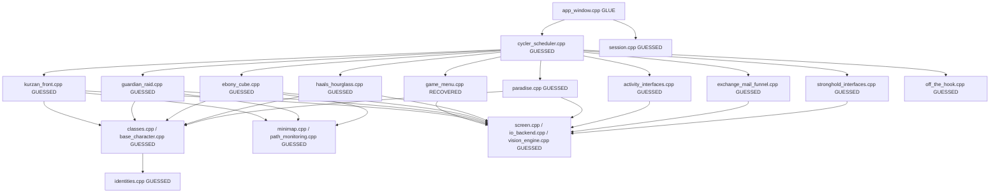

# Full Project RE Audit against `Bifrost.exe`

Target binary: `F:\C# projects\Botting project\bot\Bifrost-2.0.0-windows-x64\Bifrost.exe`
Raw dumps available on disk:
- Module 1 (`game_menu`): `docs/re/game_menu.md`, `scratch/game_menu_decompiled.txt`, `scratch/game_menu_consts.txt`, `scratch/game_menu_extra.txt`, `scratch/game_menu_gaps.txt`, `scratch/game_menu_gaps2.txt`
- Module 2 (`off_the_hook`, dumped, not yet ported): `scratch/fishing_decompiled.txt`, `scratch/fishing_inventory.txt`
- All 85 project-referenced `0x140xxxxxx` addresses: `docs/re/dumps/all_referenced_funcs.txt`

> **Audit Rule**: Only functions verified line-by-line against a raw Ghidra dump in this session (logic, constants, timings, templates) keep `RECOVERED`. Modules that only copied partial `0x140...` constants/structure while substituting OCR fallbacks, missing PNG templates, or unverified logic are downgraded to `GUESSED`.

## 1. Per-Function Audit Table (All 64 `.cpp` / `.hpp` Files)

| File | Function | Label | Source Address | Raw Decompile Dump | Confidence | Known Deviations from Binary |
|---|---|---|---|---|---|---|
| `include\bf\core\cycler_scheduler.hpp` | *(header declarations / inline structs)* | **GUESSED** | 0x140205b50 / 0x140206ae0 (partial) | docs/re/dumps/all_referenced_funcs.txt | Medium-Low | Depends on unverified activity/interface modules; modified for tasks.json/cycle_presets |
| `include\bf\core\session.hpp` | *(header declarations / inline structs)* | **GUESSED** | 0x140280360 / 0x1402740e0 (partial) | docs/re/dumps/all_referenced_funcs.txt | Low | GFN/Boosteroid/Moonlight/IPC wrappers not verified line-by-line against raw dump |
| `include\bf\discord\discord_bot.hpp` | *(header declarations / inline structs)* | **GLUE** | - | - | N/A | Clean-room Win32/ImGui/OpenCV/WinHTTP/JSON plumbing |
| `include\bf\discord\discord_notifier.hpp` | *(header declarations / inline structs)* | **GLUE** | - | - | N/A | Clean-room Win32/ImGui/OpenCV/WinHTTP/JSON plumbing |
| `include\bf\features\ebony_cube.hpp` | *(header declarations / inline structs)* | **GUESSED** | 0x1402b1ac0 (partial) | docs/re/dumps/all_referenced_funcs.txt | Medium-Low | is_loading_screen checks center pixel <12 (wrong vs 0x140352340); clear_template_path empty (OCR fallback) |
| `include\bf\features\guardian_raid.hpp` | *(header declarations / inline structs)* | **GUESSED** | 0x14039f270 (partial) | docs/re/dumps/all_referenced_funcs.txt | Medium-Low | Missing 16 PNG template checks from 0x14039f270; simplified enter/setup/combat |
| `include\bf\features\haals_hourglass.hpp` | *(header declarations / inline structs)* | **GUESSED** | 0x1402f10b0 (partial) | docs/re/dumps/all_referenced_funcs.txt | Medium-Low | is_loading_screen checks center pixel <12 (wrong vs 0x140352340); PNG template paths empty (OCR fallback) |
| `include\bf\features\kurzan_front.hpp` | *(header declarations / inline structs)* | **GUESSED** | 0x14029a820 / 0x1403ce890 (partial) | docs/re/dumps/all_referenced_funcs.txt | Medium-Low | Missing embedded Kurzan PNG templates; OCR/color fallback; unverified 21:9 coords |
| `include\bf\features\off_the_hook.hpp` | *(header declarations / inline structs)* | **GUESSED** | - | scratch/fishing_decompiled.txt (not yet ported) | Low | Written clean-room; invented ROIs/colors/timings; real binary uses 0x1403d4090 + 0x14036d5d0 + 6 PNGs |
| `include\bf\features\paradise.hpp` | *(header declarations / inline structs)* | **GUESSED** | 0x1402c7470 (partial) | docs/re/dumps/all_referenced_funcs.txt | Medium-Low | Missing embedded Paradise PNG templates; OCR fallback in is_interface_open / is_clear_banner_visible |
| `include\bf\gui\account_panel.hpp` | *(header declarations / inline structs)* | **GLUE** | - | - | N/A | Clean-room Win32/ImGui/OpenCV/WinHTTP/JSON plumbing |
| `include\bf\gui\app_window.hpp` | *(header declarations / inline structs)* | **GLUE** | - | - | N/A | Clean-room Win32/ImGui/OpenCV/WinHTTP/JSON plumbing |
| `include\bf\gui\roster_panels.hpp` | *(header declarations / inline structs)* | **GLUE** | - | - | N/A | Clean-room Win32/ImGui/OpenCV/WinHTTP/JSON plumbing |
| `include\bf\gui\sidebar_pages.hpp` | *(header declarations / inline structs)* | **GLUE** | - | - | N/A | Clean-room Win32/ImGui/OpenCV/WinHTTP/JSON plumbing |
| `include\bf\gui\ui_assets.hpp` | *(header declarations / inline structs)* | **GLUE** | - | - | N/A | Clean-room Win32/ImGui/OpenCV/WinHTTP/JSON plumbing |
| `include\bf\settings\bifrost_settings.hpp` | *(header declarations / inline structs)* | **GLUE** | - | - | N/A | Clean-room Win32/ImGui/OpenCV/WinHTTP/JSON plumbing |
| `include\bf\streaming\cloud_services.hpp` | *(header declarations / inline structs)* | **GUESSED** | 0x140280360 / 0x1402740e0 (partial) | docs/re/dumps/all_referenced_funcs.txt | Low | GFN/Boosteroid/Moonlight/IPC wrappers not verified line-by-line against raw dump |
| `include\bf\streaming\stream_bridge.hpp` | *(header declarations / inline structs)* | **GUESSED** | 0x140280360 / 0x1402740e0 (partial) | docs/re/dumps/all_referenced_funcs.txt | Low | GFN/Boosteroid/Moonlight/IPC wrappers not verified line-by-line against raw dump |
| `include\bf\targetting\minimap.hpp` | *(header declarations / inline structs)* | **GUESSED** | 0x1401ea450 / 0x140268b50 (partial) | docs/re/dumps/all_referenced_funcs.txt | Medium-Low | Color/tracking constants partially ported; unverified against raw dump line-by-line |
| `include\bf\targetting\path_monitoring.hpp` | *(header declarations / inline structs)* | **GUESSED** | 0x1401ea450 / 0x140268b50 (partial) | docs/re/dumps/all_referenced_funcs.txt | Medium-Low | Color/tracking constants partially ported; unverified against raw dump line-by-line |
| `include\bf\targetting\screen.hpp` | *(header declarations / inline structs)* | **GUESSED** | - | - | N/A | Clean-room Win32/ImGui/OpenCV/WinHTTP/JSON plumbing |
| `include\bf\vision\vision_engine.hpp` | *(header declarations / inline structs)* | **GUESSED** | - | - | N/A | Clean-room Win32/ImGui/OpenCV/WinHTTP/JSON plumbing |
| `include\loa\characters\base_character.hpp` | *(header declarations / inline structs)* | **GUESSED** | - | - | Low | Written clean-room without decompiling loa::base_character / class subclasses / identity subclasses |
| `include\loa\characters\classes.hpp` | *(header declarations / inline structs)* | **GUESSED** | - | - | Low | Written clean-room without decompiling loa::base_character / class subclasses / identity subclasses |
| `include\loa\core\types.hpp` | *(header declarations / inline structs)* | **GLUE** | - | - | N/A | Clean-room Win32/ImGui/OpenCV/WinHTTP/JSON plumbing |
| `include\loa\game\io_backend.hpp` | *(header declarations / inline structs)* | **GUESSED** | - | - | N/A | Win32 SendInput scales 1920x1080->client rect; binary 0x140353460 uses GetSystemMetrics + WindMouse + 0x14035dae0 click-narrowing |
| `include\loa\identities\identities.hpp` | *(header declarations / inline structs)* | **GUESSED** | - | - | Low | Written clean-room without decompiling loa::base_character / class subclasses / identity subclasses |
| `include\loa\interfaces\activity_interfaces.hpp` | *(header declarations / inline structs)* | **GUESSED** | 0x140394630..0x1404014a0 (partial) | docs/re/dumps/all_referenced_funcs.txt | Low | 0 PNG match_template calls; uses OCR check_roi_non_empty_text + blind Alt-key/coords instead of base_interface::open + templates |
| `include\loa\interfaces\common_interfaces.hpp` | *(header declarations / inline structs)* | **GUESSED** | 0x140394630..0x1404014a0 (partial) | docs/re/dumps/all_referenced_funcs.txt | Low | 0 PNG match_template calls; uses OCR check_roi_non_empty_text + blind Alt-key/coords instead of base_interface::open + templates |
| `include\loa\interfaces\exchange_mail_funnel.hpp` | *(header declarations / inline structs)* | **GUESSED** | 0x140394630..0x1404014a0 (partial) | docs/re/dumps/all_referenced_funcs.txt | Low | 0 PNG match_template calls; uses OCR check_roi_non_empty_text + blind Alt-key/coords instead of base_interface::open + templates |
| `include\loa\interfaces\game_menu.hpp` | *(header declarations / inline structs)* | **RECOVERED** | 0x14038af20 | docs/re/game_menu.md | High | Header/ctor declaration |
| `include\loa\interfaces\stronghold_interfaces.hpp` | *(header declarations / inline structs)* | **GUESSED** | 0x140394630..0x1404014a0 (partial) | docs/re/dumps/all_referenced_funcs.txt | Low | 0 PNG match_template calls; uses OCR check_roi_non_empty_text + blind Alt-key/coords instead of base_interface::open + templates |
| `src\bf\core\cycler_scheduler.cpp` | `read_text` (L27) | **GUESSED** | 0x140205b50 / 0x140206ae0 (partial) | docs/re/dumps/all_referenced_funcs.txt | Medium-Low | Depends on unverified activity/interface modules; modified for tasks.json/cycle_presets |
| `src\bf\core\cycler_scheduler.cpp` | `find_matching_block` (L35) | **GUESSED** | 0x140205b50 / 0x140206ae0 (partial) | docs/re/dumps/all_referenced_funcs.txt | Medium-Low | Depends on unverified activity/interface modules; modified for tasks.json/cycle_presets |
| `src\bf\core\cycler_scheduler.cpp` | `split_top_level_objects` (L64) | **GUESSED** | 0x140205b50 / 0x140206ae0 (partial) | docs/re/dumps/all_referenced_funcs.txt | Medium-Low | Depends on unverified activity/interface modules; modified for tasks.json/cycle_presets |
| `src\bf\core\cycler_scheduler.cpp` | `json_str` (L78) | **GUESSED** | 0x140205b50 / 0x140206ae0 (partial) | docs/re/dumps/all_referenced_funcs.txt | Medium-Low | Depends on unverified activity/interface modules; modified for tasks.json/cycle_presets |
| `src\bf\core\cycler_scheduler.cpp` | `json_int` (L84) | **GUESSED** | 0x140205b50 / 0x140206ae0 (partial) | docs/re/dumps/all_referenced_funcs.txt | Medium-Low | Depends on unverified activity/interface modules; modified for tasks.json/cycle_presets |
| `src\bf\core\cycler_scheduler.cpp` | `json_bool` (L90) | **GUESSED** | 0x140205b50 / 0x140206ae0 (partial) | docs/re/dumps/all_referenced_funcs.txt | Medium-Low | Depends on unverified activity/interface modules; modified for tasks.json/cycle_presets |
| `src\bf\core\cycler_scheduler.cpp` | `extract_named_block` (L96) | **GUESSED** | 0x140205b50 / 0x140206ae0 (partial) | docs/re/dumps/all_referenced_funcs.txt | Medium-Low | Depends on unverified activity/interface modules; modified for tasks.json/cycle_presets |
| `src\bf\core\cycler_scheduler.cpp` | `load_cycle_presets` (L106) | **GUESSED** | 0x140205b50 / 0x140206ae0 (partial) | docs/re/dumps/all_referenced_funcs.txt | Medium-Low | Depends on unverified activity/interface modules; modified for tasks.json/cycle_presets |
| `src\bf\core\cycler_scheduler.cpp` | `load_scheduler_tasks` (L142) | **GUESSED** | 0x140205b50 / 0x140206ae0 (partial) | docs/re/dumps/all_referenced_funcs.txt | Medium-Low | Depends on unverified activity/interface modules; modified for tasks.json/cycle_presets |
| `src\bf\core\cycler_scheduler.cpp` | `cycler_scheduler_engine::is_activity_eligible` (L174) | **GUESSED** | 0x140205b50 / 0x140206ae0 (partial) | docs/re/dumps/all_referenced_funcs.txt | Medium-Low | Depends on unverified activity/interface modules; modified for tasks.json/cycle_presets |
| `src\bf\core\cycler_scheduler.cpp` | `cycler_scheduler_engine::run_single_activity` (L215) | **GUESSED** | 0x140205b50 / 0x140206ae0 (partial) | docs/re/dumps/all_referenced_funcs.txt | Medium-Low | Depends on unverified activity/interface modules; modified for tasks.json/cycle_presets |
| `src\bf\core\cycler_scheduler.cpp` | `cycler_scheduler_engine::run_cycle_preset` (L327) | **GUESSED** | 0x140205b50 / 0x140206ae0 (partial) | docs/re/dumps/all_referenced_funcs.txt | Medium-Low | Depends on unverified activity/interface modules; modified for tasks.json/cycle_presets |
| `src\bf\core\cycler_scheduler.cpp` | `cycler_scheduler_engine::run_scheduler` (L404) | **GUESSED** | 0x140205b50 / 0x140206ae0 (partial) | docs/re/dumps/all_referenced_funcs.txt | Medium-Low | Depends on unverified activity/interface modules; modified for tasks.json/cycle_presets |
| `src\bf\core\session.cpp` | `session::guarded_run` (L16) | **GUESSED** | 0x140280360 / 0x1402740e0 (partial) | docs/re/dumps/all_referenced_funcs.txt | Low | GFN/Boosteroid/Moonlight/IPC wrappers not verified line-by-line against raw dump |
| `src\bf\core\session.cpp` | `session::ensure_game_running` (L35) | **GUESSED** | 0x140280360 / 0x1402740e0 (partial) | docs/re/dumps/all_referenced_funcs.txt | Low | GFN/Boosteroid/Moonlight/IPC wrappers not verified line-by-line against raw dump |
| `src\bf\discord\discord_bot.cpp` | `trim` (L21) | **GLUE** | - | - | N/A | Clean-room Win32/ImGui/OpenCV/WinHTTP/JSON plumbing |
| `src\bf\discord\discord_bot.cpp` | `to_lower` (L32) | **GLUE** | - | - | N/A | Clean-room Win32/ImGui/OpenCV/WinHTTP/JSON plumbing |
| `src\bf\discord\discord_bot.cpp` | `snowflake_greater` (L39) | **GLUE** | - | - | N/A | Clean-room Win32/ImGui/OpenCV/WinHTTP/JSON plumbing |
| `src\bf\discord\discord_bot.cpp` | `parse_json_string_at` (L44) | **GLUE** | - | - | N/A | Clean-room Win32/ImGui/OpenCV/WinHTTP/JSON plumbing |
| `src\bf\discord\discord_bot.cpp` | `skip_json_string` (L73) | **GLUE** | - | - | N/A | Clean-room Win32/ImGui/OpenCV/WinHTTP/JSON plumbing |
| `src\bf\discord\discord_bot.cpp` | `parse_discord_messages` (L89) | **GLUE** | - | - | N/A | Clean-room Win32/ImGui/OpenCV/WinHTTP/JSON plumbing |
| `src\bf\discord\discord_bot.cpp` | `extract_commands_channel` (L147) | **GLUE** | - | - | N/A | Clean-room Win32/ImGui/OpenCV/WinHTTP/JSON plumbing |
| `src\bf\discord\discord_bot.cpp` | `discord_bot::load_config` (L159) | **GLUE** | - | - | N/A | Clean-room Win32/ImGui/OpenCV/WinHTTP/JSON plumbing |
| `src\bf\discord\discord_bot.cpp` | `discord_bot::set_callbacks` (L177) | **GLUE** | - | - | N/A | Clean-room Win32/ImGui/OpenCV/WinHTTP/JSON plumbing |
| `src\bf\discord\discord_bot.cpp` | `discord_bot::set_commands_channel` (L182) | **GLUE** | - | - | N/A | Clean-room Win32/ImGui/OpenCV/WinHTTP/JSON plumbing |
| `src\bf\discord\discord_bot.cpp` | `discord_bot::set_poll_interval_ms` (L187) | **GLUE** | - | - | N/A | Clean-room Win32/ImGui/OpenCV/WinHTTP/JSON plumbing |
| `src\bf\discord\discord_bot.cpp` | `discord_bot::start` (L191) | **GLUE** | - | - | N/A | Clean-room Win32/ImGui/OpenCV/WinHTTP/JSON plumbing |
| `src\bf\discord\discord_bot.cpp` | `discord_bot::stop` (L205) | **GLUE** | - | - | N/A | Clean-room Win32/ImGui/OpenCV/WinHTTP/JSON plumbing |
| `src\bf\discord\discord_bot.cpp` | `discord_bot::gateway_loop` (L231) | **GLUE** | - | - | N/A | Clean-room Win32/ImGui/OpenCV/WinHTTP/JSON plumbing |
| `src\bf\discord\discord_bot.cpp` | `discord_bot::poll_loop` (L346) | **GLUE** | - | - | N/A | Clean-room Win32/ImGui/OpenCV/WinHTTP/JSON plumbing |
| `src\bf\discord\discord_bot.cpp` | `discord_bot::fetch_recent_messages` (L391) | **GLUE** | - | - | N/A | Clean-room Win32/ImGui/OpenCV/WinHTTP/JSON plumbing |
| `src\bf\discord\discord_bot.cpp` | `discord_bot::handle_command` (L462) | **GLUE** | - | - | N/A | Clean-room Win32/ImGui/OpenCV/WinHTTP/JSON plumbing |
| `src\bf\discord\discord_bot.cpp` | `discord_bot::reply` (L492) | **GLUE** | - | - | N/A | Clean-room Win32/ImGui/OpenCV/WinHTTP/JSON plumbing |
| `src\bf\discord\discord_notifier.cpp` | `json_str` (L17) | **GLUE** | - | - | N/A | Clean-room Win32/ImGui/OpenCV/WinHTTP/JSON plumbing |
| `src\bf\discord\discord_notifier.cpp` | `json_bool` (L23) | **GLUE** | - | - | N/A | Clean-room Win32/ImGui/OpenCV/WinHTTP/JSON plumbing |
| `src\bf\discord\discord_notifier.cpp` | `escape_json` (L29) | **GLUE** | - | - | N/A | Clean-room Win32/ImGui/OpenCV/WinHTTP/JSON plumbing |
| `src\bf\discord\discord_notifier.cpp` | `discord_notifier::load_config` (L43) | **GLUE** | - | - | N/A | Clean-room Win32/ImGui/OpenCV/WinHTTP/JSON plumbing |
| `src\bf\discord\discord_notifier.cpp` | `discord_notifier::send_channel_message` (L64) | **GLUE** | - | - | N/A | Clean-room Win32/ImGui/OpenCV/WinHTTP/JSON plumbing |
| `src\bf\features\ebony_cube.cpp` | `rect_center` (L9) | **GUESSED** | 0x1402b1ac0 (partial) | docs/re/dumps/all_referenced_funcs.txt | Medium-Low | is_loading_screen checks center pixel <12 (wrong vs 0x140352340); clear_template_path empty (OCR fallback) |
| `src\bf\features\ebony_cube.cpp` | `resolve_roi` (L13) | **GUESSED** | 0x1402b1ac0 (partial) | docs/re/dumps/all_referenced_funcs.txt | Medium-Low | is_loading_screen checks center pixel <12 (wrong vs 0x140352340); clear_template_path empty (OCR fallback) |
| `src\bf\features\ebony_cube.cpp` | `ebony_cube::is_loading_screen` (L23) | **GUESSED** | 0x1402b1ac0 (partial) | docs/re/dumps/all_referenced_funcs.txt | Medium-Low | is_loading_screen checks center pixel <12 (wrong vs 0x140352340); clear_template_path empty (OCR fallback) |
| `src\bf\features\ebony_cube.cpp` | `ebony_cube::is_stage_clear` (L35) | **GUESSED** | 0x1402b1ac0 (partial) | docs/re/dumps/all_referenced_funcs.txt | Medium-Low | is_loading_screen checks center pixel <12 (wrong vs 0x140352340); clear_template_path empty (OCR fallback) |
| `src\bf\features\ebony_cube.cpp` | `ebony_cube::detect_cube_target` (L54) | **GUESSED** | 0x1402b1ac0 (partial) | docs/re/dumps/all_referenced_funcs.txt | Medium-Low | is_loading_screen checks center pixel <12 (wrong vs 0x140352340); clear_template_path empty (OCR fallback) |
| `src\bf\features\ebony_cube.cpp` | `ebony_cube::classify_stage` (L96) | **GUESSED** | 0x1402b1ac0 (partial) | docs/re/dumps/all_referenced_funcs.txt | Medium-Low | is_loading_screen checks center pixel <12 (wrong vs 0x140352340); clear_template_path empty (OCR fallback) |
| `src\bf\features\ebony_cube.cpp` | `ebony_cube::engage_target` (L107) | **GUESSED** | 0x1402b1ac0 (partial) | docs/re/dumps/all_referenced_funcs.txt | Medium-Low | is_loading_screen checks center pixel <12 (wrong vs 0x140352340); clear_template_path empty (OCR fallback) |
| `src\bf\features\ebony_cube.cpp` | `ebony_cube::run_stage_one` (L134) | **GUESSED** | 0x1402b1ac0 (partial) | docs/re/dumps/all_referenced_funcs.txt | Medium-Low | is_loading_screen checks center pixel <12 (wrong vs 0x140352340); clear_template_path empty (OCR fallback) |
| `src\bf\features\ebony_cube.cpp` | `ebony_cube::run` (L224) | **GUESSED** | 0x1402b1ac0 (partial) | docs/re/dumps/all_referenced_funcs.txt | Medium-Low | is_loading_screen checks center pixel <12 (wrong vs 0x140352340); clear_template_path empty (OCR fallback) |
| `src\bf\features\guardian_raid.cpp` | `random_jitter_ms` (L39) | **GUESSED** | 0x14039f270 (partial) | docs/re/dumps/all_referenced_funcs.txt | Medium-Low | Missing 16 PNG template checks from 0x14039f270; simplified enter/setup/combat |
| `src\bf\features\guardian_raid.cpp` | `random_point_in_rect` (L45) | **GUESSED** | 0x14039f270 (partial) | docs/re/dumps/all_referenced_funcs.txt | Medium-Low | Missing 16 PNG template checks from 0x14039f270; simplified enter/setup/combat |
| `src\bf\features\guardian_raid.cpp` | `extract_int` (L56) | **GUESSED** | 0x14039f270 (partial) | docs/re/dumps/all_referenced_funcs.txt | Medium-Low | Missing 16 PNG template checks from 0x14039f270; simplified enter/setup/combat |
| `src\bf\features\guardian_raid.cpp` | `extract_double` (L65) | **GUESSED** | 0x14039f270 (partial) | docs/re/dumps/all_referenced_funcs.txt | Medium-Low | Missing 16 PNG template checks from 0x14039f270; simplified enter/setup/combat |
| `src\bf\features\guardian_raid.cpp` | `extract_bool` (L74) | **GUESSED** | 0x14039f270 (partial) | docs/re/dumps/all_referenced_funcs.txt | Medium-Low | Missing 16 PNG template checks from 0x14039f270; simplified enter/setup/combat |
| `src\bf\features\guardian_raid.cpp` | `guardian_raid::load_guardian_config` (L85) | **GUESSED** | 0x14039f270 (partial) | docs/re/dumps/all_referenced_funcs.txt | Medium-Low | Missing 16 PNG template checks from 0x14039f270; simplified enter/setup/combat |
| `src\bf\features\guardian_raid.cpp` | `guardian_raid::guardian_id_from_enum` (L144) | **GUESSED** | 0x14039f270 (partial) | docs/re/dumps/all_referenced_funcs.txt | Medium-Low | Missing 16 PNG template checks from 0x14039f270; simplified enter/setup/combat |
| `src\bf\features\guardian_raid.cpp` | `guardian_raid::enter` (L158) | **GUESSED** | 0x14039f270 (partial) | docs/re/dumps/all_referenced_funcs.txt | Medium-Low | Missing 16 PNG template checks from 0x14039f270; simplified enter/setup/combat |
| `src\bf\features\guardian_raid.cpp` | `guardian_raid::setup` (L275) | **GUESSED** | 0x14039f270 (partial) | docs/re/dumps/all_referenced_funcs.txt | Medium-Low | Missing 16 PNG template checks from 0x14039f270; simplified enter/setup/combat |
| `src\bf\features\guardian_raid.cpp` | `guardian_raid::run` (L342) | **GUESSED** | 0x14039f270 (partial) | docs/re/dumps/all_referenced_funcs.txt | Medium-Low | Missing 16 PNG template checks from 0x14039f270; simplified enter/setup/combat |
| `src\bf\features\haals_hourglass.cpp` | `rect_center` (L26) | **GUESSED** | 0x1402f10b0 (partial) | docs/re/dumps/all_referenced_funcs.txt | Medium-Low | is_loading_screen checks center pixel <12 (wrong vs 0x140352340); PNG template paths empty (OCR fallback) |
| `src\bf\features\haals_hourglass.cpp` | `haals_hourglass::is_clear` (L32) | **GUESSED** | 0x1402f10b0 (partial) | docs/re/dumps/all_referenced_funcs.txt | Medium-Low | is_loading_screen checks center pixel <12 (wrong vs 0x140352340); PNG template paths empty (OCR fallback) |
| `src\bf\features\haals_hourglass.cpp` | `haals_hourglass::is_hourglass_ui_visible` (L48) | **GUESSED** | 0x1402f10b0 (partial) | docs/re/dumps/all_referenced_funcs.txt | Medium-Low | is_loading_screen checks center pixel <12 (wrong vs 0x140352340); PNG template paths empty (OCR fallback) |
| `src\bf\features\haals_hourglass.cpp` | `haals_hourglass::is_loading_screen` (L58) | **GUESSED** | 0x1402f10b0 (partial) | docs/re/dumps/all_referenced_funcs.txt | Medium-Low | is_loading_screen checks center pixel <12 (wrong vs 0x140352340); PNG template paths empty (OCR fallback) |
| `src\bf\features\haals_hourglass.cpp` | `haals_hourglass::detect_lucky_mob` (L71) | **GUESSED** | 0x1402f10b0 (partial) | docs/re/dumps/all_referenced_funcs.txt | Medium-Low | is_loading_screen checks center pixel <12 (wrong vs 0x140352340); PNG template paths empty (OCR fallback) |
| `src\bf\features\haals_hourglass.cpp` | `haals_hourglass::setup` (L87) | **GUESSED** | 0x1402f10b0 (partial) | docs/re/dumps/all_referenced_funcs.txt | Medium-Low | is_loading_screen checks center pixel <12 (wrong vs 0x140352340); PNG template paths empty (OCR fallback) |
| `src\bf\features\haals_hourglass.cpp` | `haals_hourglass::check_for_lucky_spawn_before_end` (L144) | **GUESSED** | 0x1402f10b0 (partial) | docs/re/dumps/all_referenced_funcs.txt | Medium-Low | is_loading_screen checks center pixel <12 (wrong vs 0x140352340); PNG template paths empty (OCR fallback) |
| `src\bf\features\haals_hourglass.cpp` | `haals_hourglass::run_lucky_search` (L184) | **GUESSED** | 0x1402f10b0 (partial) | docs/re/dumps/all_referenced_funcs.txt | Medium-Low | is_loading_screen checks center pixel <12 (wrong vs 0x140352340); PNG template paths empty (OCR fallback) |
| `src\bf\features\haals_hourglass.cpp` | `haals_hourglass::leave` (L272) | **GUESSED** | 0x1402f10b0 (partial) | docs/re/dumps/all_referenced_funcs.txt | Medium-Low | is_loading_screen checks center pixel <12 (wrong vs 0x140352340); PNG template paths empty (OCR fallback) |
| `src\bf\features\haals_hourglass.cpp` | `haals_hourglass::run` (L335) | **GUESSED** | 0x1402f10b0 (partial) | docs/re/dumps/all_referenced_funcs.txt | Medium-Low | is_loading_screen checks center pixel <12 (wrong vs 0x140352340); PNG template paths empty (OCR fallback) |
| `src\bf\features\kurzan_front.cpp` | `random_between` (L54) | **GUESSED** | 0x14029a820 / 0x1403ce890 (partial) | docs/re/dumps/all_referenced_funcs.txt | Medium-Low | Missing embedded Kurzan PNG templates; OCR/color fallback; unverified 21:9 coords |
| `src\bf\features\kurzan_front.cpp` | `jitter_point` (L60) | **GUESSED** | 0x14029a820 / 0x1403ce890 (partial) | docs/re/dumps/all_referenced_funcs.txt | Medium-Low | Missing embedded Kurzan PNG templates; OCR/color fallback; unverified 21:9 coords |
| `src\bf\features\kurzan_front.cpp` | `kurzan_front::enter_operation` (L71) | **GUESSED** | 0x14029a820 / 0x1403ce890 (partial) | docs/re/dumps/all_referenced_funcs.txt | Medium-Low | Missing embedded Kurzan PNG templates; OCR/color fallback; unverified 21:9 coords |
| `src\bf\features\kurzan_front.cpp` | `kurzan_front::do_jump_point` (L167) | **GUESSED** | 0x14029a820 / 0x1403ce890 (partial) | docs/re/dumps/all_referenced_funcs.txt | Medium-Low | Missing embedded Kurzan PNG templates; OCR/color fallback; unverified 21:9 coords |
| `src\bf\features\kurzan_front.cpp` | `kurzan_front::enter_next_portal` (L224) | **GUESSED** | 0x14029a820 / 0x1403ce890 (partial) | docs/re/dumps/all_referenced_funcs.txt | Medium-Low | Missing embedded Kurzan PNG templates; OCR/color fallback; unverified 21:9 coords |
| `src\bf\features\kurzan_front.cpp` | `kurzan_front::run` (L240) | **GUESSED** | 0x14029a820 / 0x1403ce890 (partial) | docs/re/dumps/all_referenced_funcs.txt | Medium-Low | Missing embedded Kurzan PNG templates; OCR/color fallback; unverified 21:9 coords |
| `src\bf\features\off_the_hook.cpp` | `clamp_roi` (L11) | **GUESSED** | - | scratch/fishing_decompiled.txt (not yet ported) | Low | Written clean-room; invented ROIs/colors/timings; real binary uses 0x1403d4090 + 0x14036d5d0 + 6 PNGs |
| `src\bf\features\off_the_hook.cpp` | `bgr_within_tolerance` (L26) | **GUESSED** | - | scratch/fishing_decompiled.txt (not yet ported) | Low | Written clean-room; invented ROIs/colors/timings; real binary uses 0x1403d4090 + 0x14036d5d0 + 6 PNGs |
| `src\bf\features\off_the_hook.cpp` | `off_the_hook::is_minigame_active` (L36) | **GUESSED** | - | scratch/fishing_decompiled.txt (not yet ported) | Low | Written clean-room; invented ROIs/colors/timings; real binary uses 0x1403d4090 + 0x14036d5d0 + 6 PNGs |
| `src\bf\features\off_the_hook.cpp` | `off_the_hook::detect_target_y` (L50) | **GUESSED** | - | scratch/fishing_decompiled.txt (not yet ported) | Low | Written clean-room; invented ROIs/colors/timings; real binary uses 0x1403d4090 + 0x14036d5d0 + 6 PNGs |
| `src\bf\features\off_the_hook.cpp` | `off_the_hook::detect_indicator_y` (L82) | **GUESSED** | - | scratch/fishing_decompiled.txt (not yet ported) | Low | Written clean-room; invented ROIs/colors/timings; real binary uses 0x1403d4090 + 0x14036d5d0 + 6 PNGs |
| `src\bf\features\off_the_hook.cpp` | `off_the_hook::cast_net` (L129) | **GUESSED** | - | scratch/fishing_decompiled.txt (not yet ported) | Low | Written clean-room; invented ROIs/colors/timings; real binary uses 0x1403d4090 + 0x14036d5d0 + 6 PNGs |
| `src\bf\features\off_the_hook.cpp` | `off_the_hook::run` (L152) | **GUESSED** | - | scratch/fishing_decompiled.txt (not yet ported) | Low | Written clean-room; invented ROIs/colors/timings; real binary uses 0x1403d4090 + 0x14036d5d0 + 6 PNGs |
| `src\bf\features\paradise.cpp` | `random_delay_ms` (L10) | **GUESSED** | 0x1402c7470 (partial) | docs/re/dumps/all_referenced_funcs.txt | Medium-Low | Missing embedded Paradise PNG templates; OCR fallback in is_interface_open / is_clear_banner_visible |
| `src\bf\features\paradise.cpp` | `elapsed_ms_reached` (L19) | **GUESSED** | 0x1402c7470 (partial) | docs/re/dumps/all_referenced_funcs.txt | Medium-Low | Missing embedded Paradise PNG templates; OCR fallback in is_interface_open / is_clear_banner_visible |
| `src\bf\features\paradise.cpp` | `paradise::should_exchange_keys` (L27) | **GUESSED** | 0x1402c7470 (partial) | docs/re/dumps/all_referenced_funcs.txt | Medium-Low | Missing embedded Paradise PNG templates; OCR fallback in is_interface_open / is_clear_banner_visible |
| `src\bf\features\paradise.cpp` | `paradise::is_interface_open` (L32) | **GUESSED** | 0x1402c7470 (partial) | docs/re/dumps/all_referenced_funcs.txt | Medium-Low | Missing embedded Paradise PNG templates; OCR fallback in is_interface_open / is_clear_banner_visible |
| `src\bf\features\paradise.cpp` | `paradise::is_clear_banner_visible` (L53) | **GUESSED** | 0x1402c7470 (partial) | docs/re/dumps/all_referenced_funcs.txt | Medium-Low | Missing embedded Paradise PNG templates; OCR fallback in is_interface_open / is_clear_banner_visible |
| `src\bf\features\paradise.cpp` | `paradise::wait_for_entry` (L77) | **GUESSED** | 0x1402c7470 (partial) | docs/re/dumps/all_referenced_funcs.txt | Medium-Low | Missing embedded Paradise PNG templates; OCR fallback in is_interface_open / is_clear_banner_visible |
| `src\bf\features\paradise.cpp` | `paradise::run_combat_tick` (L93) | **GUESSED** | 0x1402c7470 (partial) | docs/re/dumps/all_referenced_funcs.txt | Medium-Low | Missing embedded Paradise PNG templates; OCR fallback in is_interface_open / is_clear_banner_visible |
| `src\bf\features\paradise.cpp` | `paradise::close_interface` (L108) | **GUESSED** | 0x1402c7470 (partial) | docs/re/dumps/all_referenced_funcs.txt | Medium-Low | Missing embedded Paradise PNG templates; OCR fallback in is_interface_open / is_clear_banner_visible |
| `src\bf\features\paradise.cpp` | `paradise::run_elysian` (L141) | **GUESSED** | 0x1402c7470 (partial) | docs/re/dumps/all_referenced_funcs.txt | Medium-Low | Missing embedded Paradise PNG templates; OCR fallback in is_interface_open / is_clear_banner_visible |
| `src\bf\features\paradise.cpp` | `paradise::run_crucible` (L190) | **GUESSED** | 0x1402c7470 (partial) | docs/re/dumps/all_referenced_funcs.txt | Medium-Low | Missing embedded Paradise PNG templates; OCR fallback in is_interface_open / is_clear_banner_visible |
| `src\bf\features\paradise.cpp` | `paradise::run_hell` (L243) | **GUESSED** | 0x1402c7470 (partial) | docs/re/dumps/all_referenced_funcs.txt | Medium-Low | Missing embedded Paradise PNG templates; OCR fallback in is_interface_open / is_clear_banner_visible |
| `src\bf\gui\account_panel.cpp` | `ToggleSwitch` (L42) | **GLUE** | - | - | N/A | Clean-room Win32/ImGui/OpenCV/WinHTTP/JSON plumbing |
| `src\bf\gui\account_panel.cpp` | `StepperInt` (L64) | **GLUE** | - | - | N/A | Clean-room Win32/ImGui/OpenCV/WinHTTP/JSON plumbing |
| `src\bf\gui\account_panel.cpp` | `contains_icase` (L89) | **GLUE** | - | - | N/A | Clean-room Win32/ImGui/OpenCV/WinHTTP/JSON plumbing |
| `src\bf\gui\account_panel.cpp` | `render_sidebar` (L100) | **GLUE** | - | - | N/A | Clean-room Win32/ImGui/OpenCV/WinHTTP/JSON plumbing |
| `src\bf\gui\account_panel.cpp` | `render_account_panel` (L210) | **GLUE** | - | - | N/A | Clean-room Win32/ImGui/OpenCV/WinHTTP/JSON plumbing |
| `src\bf\gui\account_panel.cpp` | `render_sidebar` (L305) | **GLUE** | - | - | N/A | Clean-room Win32/ImGui/OpenCV/WinHTTP/JSON plumbing |
| `src\bf\gui\account_panel.cpp` | `render_account_panel` (L309) | **GLUE** | - | - | N/A | Clean-room Win32/ImGui/OpenCV/WinHTTP/JSON plumbing |
| `src\bf\gui\app_window.cpp` | `ImGui_ImplWin32_WndProcHandler` (L52) | **GLUE** | - | - | N/A | Clean-room Win32/ImGui/OpenCV/WinHTTP/JSON plumbing |
| `src\bf\gui\app_window.cpp` | `CreateRenderTarget` (L73) | **GLUE** | - | - | N/A | Clean-room Win32/ImGui/OpenCV/WinHTTP/JSON plumbing |
| `src\bf\gui\app_window.cpp` | `CleanupRenderTarget` (L81) | **GLUE** | - | - | N/A | Clean-room Win32/ImGui/OpenCV/WinHTTP/JSON plumbing |
| `src\bf\gui\app_window.cpp` | `CreateDeviceD3D` (L88) | **GLUE** | - | - | N/A | Clean-room Win32/ImGui/OpenCV/WinHTTP/JSON plumbing |
| `src\bf\gui\app_window.cpp` | `CleanupDeviceD3D` (L118) | **GLUE** | - | - | N/A | Clean-room Win32/ImGui/OpenCV/WinHTTP/JSON plumbing |
| `src\bf\gui\app_window.cpp` | `WndProc` (L125) | **GLUE** | - | - | N/A | Clean-room Win32/ImGui/OpenCV/WinHTTP/JSON plumbing |
| `src\bf\gui\app_window.cpp` | `ApplyBifrostTheme` (L143) | **GLUE** | - | - | N/A | Clean-room Win32/ImGui/OpenCV/WinHTTP/JSON plumbing |
| `src\bf\gui\app_window.cpp` | `SubTabButton` (L169) | **GLUE** | - | - | N/A | Clean-room Win32/ImGui/OpenCV/WinHTTP/JSON plumbing |
| `src\bf\gui\app_window.cpp` | `LoadGuardianIds` (L186) | **GLUE** | - | - | N/A | Clean-room Win32/ImGui/OpenCV/WinHTTP/JSON plumbing |
| `src\bf\gui\app_window.cpp` | `app_window::run` (L250) | **GLUE** | - | - | N/A | Clean-room Win32/ImGui/OpenCV/WinHTTP/JSON plumbing |
| `src\bf\gui\app_window.cpp` | `app_window::run` (L1132) | **GLUE** | - | - | N/A | Clean-room Win32/ImGui/OpenCV/WinHTTP/JSON plumbing |
| `src\bf\gui\roster_panels.cpp` | `RosterPanelState::sync_with_settings` (L10) | **GLUE** | - | - | N/A | Clean-room Win32/ImGui/OpenCV/WinHTTP/JSON plumbing |
| `src\bf\gui\roster_panels.cpp` | `draw_section_header` (L41) | **GLUE** | - | - | N/A | Clean-room Win32/ImGui/OpenCV/WinHTTP/JSON plumbing |
| `src\bf\gui\roster_panels.cpp` | `render_toggle_with_tooltip` (L45) | **GLUE** | - | - | N/A | Clean-room Win32/ImGui/OpenCV/WinHTTP/JSON plumbing |
| `src\bf\gui\roster_panels.cpp` | `find_string_index` (L57) | **GLUE** | - | - | N/A | Clean-room Win32/ImGui/OpenCV/WinHTTP/JSON plumbing |
| `src\bf\gui\roster_panels.cpp` | `render_rotation_combo` (L66) | **GLUE** | - | - | N/A | Clean-room Win32/ImGui/OpenCV/WinHTTP/JSON plumbing |
| `src\bf\gui\roster_panels.cpp` | `compute_cube_panel_height` (L99) | **GLUE** | - | - | N/A | Clean-room Win32/ImGui/OpenCV/WinHTTP/JSON plumbing |
| `src\bf\gui\roster_panels.cpp` | `show_tooltip` (L107) | **GLUE** | - | - | N/A | Clean-room Win32/ImGui/OpenCV/WinHTTP/JSON plumbing |
| `src\bf\gui\roster_panels.cpp` | `toggle_switch` (L117) | **GLUE** | - | - | N/A | Clean-room Win32/ImGui/OpenCV/WinHTTP/JSON plumbing |
| `src\bf\gui\roster_panels.cpp` | `render_roster_overview_panel` (L139) | **GLUE** | - | - | N/A | Clean-room Win32/ImGui/OpenCV/WinHTTP/JSON plumbing |
| `src\bf\gui\roster_panels.cpp` | `render_characters_left_panel` (L304) | **GLUE** | - | - | N/A | Clean-room Win32/ImGui/OpenCV/WinHTTP/JSON plumbing |
| `src\bf\gui\roster_panels.cpp` | `render_characters_right_panel` (L525) | **GLUE** | - | - | N/A | Clean-room Win32/ImGui/OpenCV/WinHTTP/JSON plumbing |
| `src\bf\gui\roster_panels.cpp` | `render_characters_waymark_panel` (L673) | **GLUE** | - | - | N/A | Clean-room Win32/ImGui/OpenCV/WinHTTP/JSON plumbing |
| `src\bf\gui\roster_panels.cpp` | `render_characters_cube_panel` (L781) | **GLUE** | - | - | N/A | Clean-room Win32/ImGui/OpenCV/WinHTTP/JSON plumbing |
| `src\bf\gui\roster_panels.cpp` | `render_cyclers_panel` (L916) | **GLUE** | - | - | N/A | Clean-room Win32/ImGui/OpenCV/WinHTTP/JSON plumbing |
| `src\bf\gui\roster_panels.cpp` | `task_objective_label` (L1324) | **GLUE** | - | - | N/A | Clean-room Win32/ImGui/OpenCV/WinHTTP/JSON plumbing |
| `src\bf\gui\roster_panels.cpp` | `format_sched_time` (L1331) | **GLUE** | - | - | N/A | Clean-room Win32/ImGui/OpenCV/WinHTTP/JSON plumbing |
| `src\bf\gui\roster_panels.cpp` | `contains_icase` (L1342) | **GLUE** | - | - | N/A | Clean-room Win32/ImGui/OpenCV/WinHTTP/JSON plumbing |
| `src\bf\gui\roster_panels.cpp` | `render_searchable_time_combo` (L1351) | **GLUE** | - | - | N/A | Clean-room Win32/ImGui/OpenCV/WinHTTP/JSON plumbing |
| `src\bf\gui\roster_panels.cpp` | `sync_scheduler_presets_lists` (L1383) | **GLUE** | - | - | N/A | Clean-room Win32/ImGui/OpenCV/WinHTTP/JSON plumbing |
| `src\bf\gui\roster_panels.cpp` | `render_scheduler_panel` (L1400) | **GLUE** | - | - | N/A | Clean-room Win32/ImGui/OpenCV/WinHTTP/JSON plumbing |
| `src\bf\gui\sidebar_pages.cpp` | `ShowPageTooltip` (L42) | **GLUE** | - | - | N/A | Clean-room Win32/ImGui/OpenCV/WinHTTP/JSON plumbing |
| `src\bf\gui\sidebar_pages.cpp` | `PageToggleSwitch` (L52) | **GLUE** | - | - | N/A | Clean-room Win32/ImGui/OpenCV/WinHTTP/JSON plumbing |
| `src\bf\gui\sidebar_pages.cpp` | `PageSubTabButton` (L72) | **GLUE** | - | - | N/A | Clean-room Win32/ImGui/OpenCV/WinHTTP/JSON plumbing |
| `src\bf\gui\sidebar_pages.cpp` | `to_lower_str` (L90) | **GLUE** | - | - | N/A | Clean-room Win32/ImGui/OpenCV/WinHTTP/JSON plumbing |
| `src\bf\gui\sidebar_pages.cpp` | `find_index` (L96) | **GLUE** | - | - | N/A | Clean-room Win32/ImGui/OpenCV/WinHTTP/JSON plumbing |
| `src\bf\gui\sidebar_pages.cpp` | `extract_array_block` (L103) | **GLUE** | - | - | N/A | Clean-room Win32/ImGui/OpenCV/WinHTTP/JSON plumbing |
| `src\bf\gui\sidebar_pages.cpp` | `extract_object_block` (L120) | **GLUE** | - | - | N/A | Clean-room Win32/ImGui/OpenCV/WinHTTP/JSON plumbing |
| `src\bf\gui\sidebar_pages.cpp` | `json_str` (L136) | **GLUE** | - | - | N/A | Clean-room Win32/ImGui/OpenCV/WinHTTP/JSON plumbing |
| `src\bf\gui\sidebar_pages.cpp` | `json_int` (L142) | **GLUE** | - | - | N/A | Clean-room Win32/ImGui/OpenCV/WinHTTP/JSON plumbing |
| `src\bf\gui\sidebar_pages.cpp` | `json_float` (L148) | **GLUE** | - | - | N/A | Clean-room Win32/ImGui/OpenCV/WinHTTP/JSON plumbing |
| `src\bf\gui\sidebar_pages.cpp` | `json_bool` (L154) | **GLUE** | - | - | N/A | Clean-room Win32/ImGui/OpenCV/WinHTTP/JSON plumbing |
| `src\bf\gui\sidebar_pages.cpp` | `parse_string_array` (L160) | **GLUE** | - | - | N/A | Clean-room Win32/ImGui/OpenCV/WinHTTP/JSON plumbing |
| `src\bf\gui\sidebar_pages.cpp` | `load_pathmaps_json` (L171) | **GLUE** | - | - | N/A | Clean-room Win32/ImGui/OpenCV/WinHTTP/JSON plumbing |
| `src\bf\gui\sidebar_pages.cpp` | `json_escape_str` (L228) | **GLUE** | - | - | N/A | Clean-room Win32/ImGui/OpenCV/WinHTTP/JSON plumbing |
| `src\bf\gui\sidebar_pages.cpp` | `SnipWndProc` (L254) | **GLUE** | - | - | N/A | Clean-room Win32/ImGui/OpenCV/WinHTTP/JSON plumbing |
| `src\bf\gui\sidebar_pages.cpp` | `snip_screen_region_png` (L329) | **GLUE** | - | - | N/A | Clean-room Win32/ImGui/OpenCV/WinHTTP/JSON plumbing |
| `src\bf\gui\sidebar_pages.cpp` | `check_vigem_installed` (L417) | **GLUE** | - | - | N/A | Clean-room Win32/ImGui/OpenCV/WinHTTP/JSON plumbing |
| `src\bf\gui\sidebar_pages.cpp` | `find_keybind` (L432) | **GLUE** | - | - | N/A | Clean-room Win32/ImGui/OpenCV/WinHTTP/JSON plumbing |
| `src\bf\gui\sidebar_pages.cpp` | `imgui_key_to_name` (L446) | **GLUE** | - | - | N/A | Clean-room Win32/ImGui/OpenCV/WinHTTP/JSON plumbing |
| `src\bf\gui\sidebar_pages.cpp` | `render_rotations_page` (L485) | **GLUE** | - | - | N/A | Clean-room Win32/ImGui/OpenCV/WinHTTP/JSON plumbing |
| `src\bf\gui\sidebar_pages.cpp` | `render_pathmaps_page` (L873) | **GLUE** | - | - | N/A | Clean-room Win32/ImGui/OpenCV/WinHTTP/JSON plumbing |
| `src\bf\gui\sidebar_pages.cpp` | `render_keybinds_page` (L1312) | **GLUE** | - | - | N/A | Clean-room Win32/ImGui/OpenCV/WinHTTP/JSON plumbing |
| `src\bf\gui\sidebar_pages.cpp` | `render_features_page` (L1450) | **GLUE** | - | - | N/A | Clean-room Win32/ImGui/OpenCV/WinHTTP/JSON plumbing |
| `src\bf\gui\sidebar_pages.cpp` | `decode_discord_client_id` (L1770) | **GLUE** | - | - | N/A | Clean-room Win32/ImGui/OpenCV/WinHTTP/JSON plumbing |
| `src\bf\gui\sidebar_pages.cpp` | `load_discord_toolbox_json` (L1795) | **GLUE** | - | - | N/A | Clean-room Win32/ImGui/OpenCV/WinHTTP/JSON plumbing |
| `src\bf\gui\sidebar_pages.cpp` | `save_discord_toolbox_json` (L1807) | **GLUE** | - | - | N/A | Clean-room Win32/ImGui/OpenCV/WinHTTP/JSON plumbing |
| `src\bf\gui\sidebar_pages.cpp` | `find_vigem_installer` (L1832) | **GLUE** | - | - | N/A | Clean-room Win32/ImGui/OpenCV/WinHTTP/JSON plumbing |
| `src\bf\gui\sidebar_pages.cpp` | `render_toolbox_page` (L1856) | **GLUE** | - | - | N/A | Clean-room Win32/ImGui/OpenCV/WinHTTP/JSON plumbing |
| `src\bf\gui\sidebar_pages.cpp` | `save_pathmaps_json` (L1981) | **GLUE** | - | - | N/A | Clean-room Win32/ImGui/OpenCV/WinHTTP/JSON plumbing |
| `src\bf\gui\sidebar_pages.cpp` | `read_text_file` (L2051) | **GLUE** | - | - | N/A | Clean-room Win32/ImGui/OpenCV/WinHTTP/JSON plumbing |
| `src\bf\gui\sidebar_pages.cpp` | `feat_esc` (L2059) | **GLUE** | - | - | N/A | Clean-room Win32/ImGui/OpenCV/WinHTTP/JSON plumbing |
| `src\bf\gui\sidebar_pages.cpp` | `feat_parse_str_arr` (L2070) | **GLUE** | - | - | N/A | Clean-room Win32/ImGui/OpenCV/WinHTTP/JSON plumbing |
| `src\bf\gui\sidebar_pages.cpp` | `feat_extract_block` (L2082) | **GLUE** | - | - | N/A | Clean-room Win32/ImGui/OpenCV/WinHTTP/JSON plumbing |
| `src\bf\gui\sidebar_pages.cpp` | `feat_json_int` (L2106) | **GLUE** | - | - | N/A | Clean-room Win32/ImGui/OpenCV/WinHTTP/JSON plumbing |
| `src\bf\gui\sidebar_pages.cpp` | `feat_json_ll` (L2119) | **GLUE** | - | - | N/A | Clean-room Win32/ImGui/OpenCV/WinHTTP/JSON plumbing |
| `src\bf\gui\sidebar_pages.cpp` | `feat_json_str` (L2132) | **GLUE** | - | - | N/A | Clean-room Win32/ImGui/OpenCV/WinHTTP/JSON plumbing |
| `src\bf\gui\sidebar_pages.cpp` | `load_features_json` (L2147) | **GLUE** | - | - | N/A | Clean-room Win32/ImGui/OpenCV/WinHTTP/JSON plumbing |
| `src\bf\gui\sidebar_pages.cpp` | `save_features_json` (L2257) | **GLUE** | - | - | N/A | Clean-room Win32/ImGui/OpenCV/WinHTTP/JSON plumbing |
| `src\bf\gui\ui_assets.cpp` | `resolve_asset_path` (L28) | **GLUE** | - | - | N/A | Clean-room Win32/ImGui/OpenCV/WinHTTP/JSON plumbing |
| `src\bf\gui\ui_assets.cpp` | `init_ui_assets` (L46) | **GLUE** | - | - | N/A | Clean-room Win32/ImGui/OpenCV/WinHTTP/JSON plumbing |
| `src\bf\gui\ui_assets.cpp` | `shutdown_ui_assets` (L50) | **GLUE** | - | - | N/A | Clean-room Win32/ImGui/OpenCV/WinHTTP/JSON plumbing |
| `src\bf\gui\ui_assets.cpp` | `get_ui_texture` (L61) | **GLUE** | - | - | N/A | Clean-room Win32/ImGui/OpenCV/WinHTTP/JSON plumbing |
| `src\bf\gui\ui_assets.cpp` | `get_logo_texture` (L115) | **GLUE** | - | - | N/A | Clean-room Win32/ImGui/OpenCV/WinHTTP/JSON plumbing |
| `src\bf\gui\ui_assets.cpp` | `get_clover_texture` (L119) | **GLUE** | - | - | N/A | Clean-room Win32/ImGui/OpenCV/WinHTTP/JSON plumbing |
| `src\bf\gui\ui_assets.cpp` | `get_cube_ticket_texture` (L123) | **GLUE** | - | - | N/A | Clean-room Win32/ImGui/OpenCV/WinHTTP/JSON plumbing |
| `src\bf\gui\ui_assets.cpp` | `get_crystal_texture` (L133) | **GLUE** | - | - | N/A | Clean-room Win32/ImGui/OpenCV/WinHTTP/JSON plumbing |
| `src\bf\gui\ui_assets.cpp` | `get_pathmap_texture` (L143) | **GLUE** | - | - | N/A | Clean-room Win32/ImGui/OpenCV/WinHTTP/JSON plumbing |
| `src\bf\gui\ui_assets.cpp` | `draw_sidebar_icon` (L148) | **GLUE** | - | - | N/A | Clean-room Win32/ImGui/OpenCV/WinHTTP/JSON plumbing |
| `src\bf\gui\ui_assets.cpp` | `draw_boat_icon` (L209) | **GLUE** | - | - | N/A | Clean-room Win32/ImGui/OpenCV/WinHTTP/JSON plumbing |
| `src\bf\gui\ui_assets.cpp` | `draw_fishing_gauge_preview` (L226) | **GLUE** | - | - | N/A | Clean-room Win32/ImGui/OpenCV/WinHTTP/JSON plumbing |
| `src\bf\settings\bifrost_settings.cpp` | `to_lower` (L19) | **GLUE** | - | - | N/A | Clean-room Win32/ImGui/OpenCV/WinHTTP/JSON plumbing |
| `src\bf\settings\bifrost_settings.cpp` | `find_json_key_block_start` (L25) | **GLUE** | - | - | N/A | Clean-room Win32/ImGui/OpenCV/WinHTTP/JSON plumbing |
| `src\bf\settings\bifrost_settings.cpp` | `extract_array_block` (L44) | **GLUE** | - | - | N/A | Clean-room Win32/ImGui/OpenCV/WinHTTP/JSON plumbing |
| `src\bf\settings\bifrost_settings.cpp` | `read_file_text` (L65) | **GLUE** | - | - | N/A | Clean-room Win32/ImGui/OpenCV/WinHTTP/JSON plumbing |
| `src\bf\settings\bifrost_settings.cpp` | `json_str` (L73) | **GLUE** | - | - | N/A | Clean-room Win32/ImGui/OpenCV/WinHTTP/JSON plumbing |
| `src\bf\settings\bifrost_settings.cpp` | `json_int` (L79) | **GLUE** | - | - | N/A | Clean-room Win32/ImGui/OpenCV/WinHTTP/JSON plumbing |
| `src\bf\settings\bifrost_settings.cpp` | `json_bool` (L85) | **GLUE** | - | - | N/A | Clean-room Win32/ImGui/OpenCV/WinHTTP/JSON plumbing |
| `src\bf\settings\bifrost_settings.cpp` | `extract_object_block` (L91) | **GLUE** | - | - | N/A | Clean-room Win32/ImGui/OpenCV/WinHTTP/JSON plumbing |
| `src\bf\settings\bifrost_settings.cpp` | `extract_string_array` (L112) | **GLUE** | - | - | N/A | Clean-room Win32/ImGui/OpenCV/WinHTTP/JSON plumbing |
| `src\bf\settings\bifrost_settings.cpp` | `parse_vk_name` (L130) | **GLUE** | - | - | N/A | Clean-room Win32/ImGui/OpenCV/WinHTTP/JSON plumbing |
| `src\bf\settings\bifrost_settings.cpp` | `parse_mod_name` (L148) | **GLUE** | - | - | N/A | Clean-room Win32/ImGui/OpenCV/WinHTTP/JSON plumbing |
| `src\bf\settings\bifrost_settings.cpp` | `resolve_action_key` (L156) | **GLUE** | - | - | N/A | Clean-room Win32/ImGui/OpenCV/WinHTTP/JSON plumbing |
| `src\bf\settings\bifrost_settings.cpp` | `load_bifrost_settings` (L186) | **GLUE** | - | - | N/A | Clean-room Win32/ImGui/OpenCV/WinHTTP/JSON plumbing |
| `src\bf\settings\bifrost_settings.cpp` | `replace_json_str` (L542) | **GLUE** | - | - | N/A | Clean-room Win32/ImGui/OpenCV/WinHTTP/JSON plumbing |
| `src\bf\settings\bifrost_settings.cpp` | `replace_json_int` (L552) | **GLUE** | - | - | N/A | Clean-room Win32/ImGui/OpenCV/WinHTTP/JSON plumbing |
| `src\bf\settings\bifrost_settings.cpp` | `replace_json_bool` (L564) | **GLUE** | - | - | N/A | Clean-room Win32/ImGui/OpenCV/WinHTTP/JSON plumbing |
| `src\bf\settings\bifrost_settings.cpp` | `write_file_text` (L576) | **GLUE** | - | - | N/A | Clean-room Win32/ImGui/OpenCV/WinHTTP/JSON plumbing |
| `src\bf\settings\bifrost_settings.cpp` | `save_bifrost_settings` (L585) | **GLUE** | - | - | N/A | Clean-room Win32/ImGui/OpenCV/WinHTTP/JSON plumbing |
| `src\bf\settings\bifrost_settings.cpp` | `parse_waymark_sequence` (L838) | **GLUE** | - | - | N/A | Clean-room Win32/ImGui/OpenCV/WinHTTP/JSON plumbing |
| `src\bf\settings\bifrost_settings.cpp` | `format_waymark_sequence` (L851) | **GLUE** | - | - | N/A | Clean-room Win32/ImGui/OpenCV/WinHTTP/JSON plumbing |
| `src\bf\streaming\cloud_services.cpp` | `to_lower_ascii` (L27) | **GUESSED** | 0x140280360 / 0x1402740e0 (partial) | docs/re/dumps/all_referenced_funcs.txt | Low | GFN/Boosteroid/Moonlight/IPC wrappers not verified line-by-line against raw dump |
| `src\bf\streaming\cloud_services.cpp` | `enum_windows_substr_proc` (L34) | **GUESSED** | 0x140280360 / 0x1402740e0 (partial) | docs/re/dumps/all_referenced_funcs.txt | Low | GFN/Boosteroid/Moonlight/IPC wrappers not verified line-by-line against raw dump |
| `src\bf\streaming\cloud_services.cpp` | `find_window_by_substring` (L52) | **GUESSED** | 0x140280360 / 0x1402740e0 (partial) | docs/re/dumps/all_referenced_funcs.txt | Low | GFN/Boosteroid/Moonlight/IPC wrappers not verified line-by-line against raw dump |
| `src\bf\streaming\cloud_services.cpp` | `sleep_ms` (L61) | **GUESSED** | 0x140280360 / 0x1402740e0 (partial) | docs/re/dumps/all_referenced_funcs.txt | Low | GFN/Boosteroid/Moonlight/IPC wrappers not verified line-by-line against raw dump |
| `src\bf\streaming\cloud_services.cpp` | `press_enter_key` (L67) | **GUESSED** | 0x140280360 / 0x1402740e0 (partial) | docs/re/dumps/all_referenced_funcs.txt | Low | GFN/Boosteroid/Moonlight/IPC wrappers not verified line-by-line against raw dump |
| `src\bf\streaming\cloud_services.cpp` | `run_hidden_command` (L85) | **GUESSED** | 0x140280360 / 0x1402740e0 (partial) | docs/re/dumps/all_referenced_funcs.txt | Low | GFN/Boosteroid/Moonlight/IPC wrappers not verified line-by-line against raw dump |
| `src\bf\streaming\cloud_services.cpp` | `bind_screen_and_io` (L112) | **GUESSED** | 0x140280360 / 0x1402740e0 (partial) | docs/re/dumps/all_referenced_funcs.txt | Low | GFN/Boosteroid/Moonlight/IPC wrappers not verified line-by-line against raw dump |
| `src\bf\streaming\cloud_services.cpp` | `remote_service::is_moonlight` (L142) | **GUESSED** | 0x140280360 / 0x1402740e0 (partial) | docs/re/dumps/all_referenced_funcs.txt | Low | GFN/Boosteroid/Moonlight/IPC wrappers not verified line-by-line against raw dump |
| `src\bf\streaming\cloud_services.cpp` | `remote_service::kind_name` (L146) | **GUESSED** | 0x140280360 / 0x1402740e0 (partial) | docs/re/dumps/all_referenced_funcs.txt | Low | GFN/Boosteroid/Moonlight/IPC wrappers not verified line-by-line against raw dump |
| `src\bf\streaming\cloud_services.cpp` | `remote_service::connect` (L158) | **GUESSED** | 0x140280360 / 0x1402740e0 (partial) | docs/re/dumps/all_referenced_funcs.txt | Low | GFN/Boosteroid/Moonlight/IPC wrappers not verified line-by-line against raw dump |
| `src\bf\streaming\cloud_services.cpp` | `remote_service::disconnect` (L199) | **GUESSED** | 0x140280360 / 0x1402740e0 (partial) | docs/re/dumps/all_referenced_funcs.txt | Low | GFN/Boosteroid/Moonlight/IPC wrappers not verified line-by-line against raw dump |
| `src\bf\streaming\cloud_services.cpp` | `remote_service::is_connected` (L213) | **GUESSED** | 0x140280360 / 0x1402740e0 (partial) | docs/re/dumps/all_referenced_funcs.txt | Low | GFN/Boosteroid/Moonlight/IPC wrappers not verified line-by-line against raw dump |
| `src\bf\streaming\cloud_services.cpp` | `remote_service::ensure_game_ready` (L228) | **GUESSED** | 0x140280360 / 0x1402740e0 (partial) | docs/re/dumps/all_referenced_funcs.txt | Low | GFN/Boosteroid/Moonlight/IPC wrappers not verified line-by-line against raw dump |
| `src\bf\streaming\cloud_services.cpp` | `remote_service::keep_alive` (L241) | **GUESSED** | 0x140280360 / 0x1402740e0 (partial) | docs/re/dumps/all_referenced_funcs.txt | Low | GFN/Boosteroid/Moonlight/IPC wrappers not verified line-by-line against raw dump |
| `src\bf\streaming\cloud_services.cpp` | `gfn_service::is_english_ui_locale` (L257) | **GUESSED** | 0x140280360 / 0x1402740e0 (partial) | docs/re/dumps/all_referenced_funcs.txt | Low | GFN/Boosteroid/Moonlight/IPC wrappers not verified line-by-line against raw dump |
| `src\bf\streaming\cloud_services.cpp` | `gfn_service::remaining_session_minutes` (L266) | **GUESSED** | 0x140280360 / 0x1402740e0 (partial) | docs/re/dumps/all_referenced_funcs.txt | Low | GFN/Boosteroid/Moonlight/IPC wrappers not verified line-by-line against raw dump |
| `src\bf\streaming\cloud_services.cpp` | `gfn_service::is_session_expiring_soon` (L278) | **GUESSED** | 0x140280360 / 0x1402740e0 (partial) | docs/re/dumps/all_referenced_funcs.txt | Low | GFN/Boosteroid/Moonlight/IPC wrappers not verified line-by-line against raw dump |
| `src\bf\streaming\cloud_services.cpp` | `gfn_service::connect` (L285) | **GUESSED** | 0x140280360 / 0x1402740e0 (partial) | docs/re/dumps/all_referenced_funcs.txt | Low | GFN/Boosteroid/Moonlight/IPC wrappers not verified line-by-line against raw dump |
| `src\bf\streaming\cloud_services.cpp` | `gfn_service::disconnect` (L311) | **GUESSED** | 0x140280360 / 0x1402740e0 (partial) | docs/re/dumps/all_referenced_funcs.txt | Low | GFN/Boosteroid/Moonlight/IPC wrappers not verified line-by-line against raw dump |
| `src\bf\streaming\cloud_services.cpp` | `gfn_service::is_connected` (L336) | **GUESSED** | 0x140280360 / 0x1402740e0 (partial) | docs/re/dumps/all_referenced_funcs.txt | Low | GFN/Boosteroid/Moonlight/IPC wrappers not verified line-by-line against raw dump |
| `src\bf\streaming\cloud_services.cpp` | `gfn_service::ensure_game_ready` (L343) | **GUESSED** | 0x140280360 / 0x1402740e0 (partial) | docs/re/dumps/all_referenced_funcs.txt | Low | GFN/Boosteroid/Moonlight/IPC wrappers not verified line-by-line against raw dump |
| `src\bf\streaming\cloud_services.cpp` | `gfn_service::keep_alive` (L353) | **GUESSED** | 0x140280360 / 0x1402740e0 (partial) | docs/re/dumps/all_referenced_funcs.txt | Low | GFN/Boosteroid/Moonlight/IPC wrappers not verified line-by-line against raw dump |
| `src\bf\streaming\cloud_services.cpp` | `boosteroid_service::connect` (L374) | **GUESSED** | 0x140280360 / 0x1402740e0 (partial) | docs/re/dumps/all_referenced_funcs.txt | Low | GFN/Boosteroid/Moonlight/IPC wrappers not verified line-by-line against raw dump |
| `src\bf\streaming\cloud_services.cpp` | `boosteroid_service::disconnect` (L392) | **GUESSED** | 0x140280360 / 0x1402740e0 (partial) | docs/re/dumps/all_referenced_funcs.txt | Low | GFN/Boosteroid/Moonlight/IPC wrappers not verified line-by-line against raw dump |
| `src\bf\streaming\cloud_services.cpp` | `boosteroid_service::is_connected` (L406) | **GUESSED** | 0x140280360 / 0x1402740e0 (partial) | docs/re/dumps/all_referenced_funcs.txt | Low | GFN/Boosteroid/Moonlight/IPC wrappers not verified line-by-line against raw dump |
| `src\bf\streaming\cloud_services.cpp` | `boosteroid_service::ensure_game_ready` (L413) | **GUESSED** | 0x140280360 / 0x1402740e0 (partial) | docs/re/dumps/all_referenced_funcs.txt | Low | GFN/Boosteroid/Moonlight/IPC wrappers not verified line-by-line against raw dump |
| `src\bf\streaming\cloud_services.cpp` | `boosteroid_service::keep_alive` (L423) | **GUESSED** | 0x140280360 / 0x1402740e0 (partial) | docs/re/dumps/all_referenced_funcs.txt | Low | GFN/Boosteroid/Moonlight/IPC wrappers not verified line-by-line against raw dump |
| `src\bf\streaming\cloud_services.cpp` | `create_connection_service` (L434) | **GUESSED** | 0x140280360 / 0x1402740e0 (partial) | docs/re/dumps/all_referenced_funcs.txt | Low | GFN/Boosteroid/Moonlight/IPC wrappers not verified line-by-line against raw dump |
| `src\bf\streaming\stream_bridge.cpp` | `alignas` (L19) | **GUESSED** | 0x140280360 / 0x1402740e0 (partial) | docs/re/dumps/all_referenced_funcs.txt | Low | GFN/Boosteroid/Moonlight/IPC wrappers not verified line-by-line against raw dump |
| `src\bf\streaming\stream_bridge.cpp` | `stream_bridge::connect` (L49) | **GUESSED** | 0x140280360 / 0x1402740e0 (partial) | docs/re/dumps/all_referenced_funcs.txt | Low | GFN/Boosteroid/Moonlight/IPC wrappers not verified line-by-line against raw dump |
| `src\bf\streaming\stream_bridge.cpp` | `stream_bridge::disconnect` (L82) | **GUESSED** | 0x140280360 / 0x1402740e0 (partial) | docs/re/dumps/all_referenced_funcs.txt | Low | GFN/Boosteroid/Moonlight/IPC wrappers not verified line-by-line against raw dump |
| `src\bf\streaming\stream_bridge.cpp` | `stream_bridge::read_frame` (L97) | **GUESSED** | 0x140280360 / 0x1402740e0 (partial) | docs/re/dumps/all_referenced_funcs.txt | Low | GFN/Boosteroid/Moonlight/IPC wrappers not verified line-by-line against raw dump |
| `src\bf\streaming\stream_bridge.cpp` | `stream_bridge::write_command` (L121) | **GUESSED** | 0x140280360 / 0x1402740e0 (partial) | docs/re/dumps/all_referenced_funcs.txt | Low | GFN/Boosteroid/Moonlight/IPC wrappers not verified line-by-line against raw dump |
| `src\bf\streaming\stream_bridge.cpp` | `stream_bridge::send_key` (L137) | **GUESSED** | 0x140280360 / 0x1402740e0 (partial) | docs/re/dumps/all_referenced_funcs.txt | Low | GFN/Boosteroid/Moonlight/IPC wrappers not verified line-by-line against raw dump |
| `src\bf\targetting\minimap.cpp` | `minimap::locate_player` (L8) | **GUESSED** | 0x1401ea450 / 0x140268b50 (partial) | docs/re/dumps/all_referenced_funcs.txt | Medium-Low | Color/tracking constants partially ported; unverified against raw dump line-by-line |
| `src\bf\targetting\minimap.cpp` | `minimap::locate_portal` (L22) | **GUESSED** | 0x1401ea450 / 0x140268b50 (partial) | docs/re/dumps/all_referenced_funcs.txt | Medium-Low | Color/tracking constants partially ported; unverified against raw dump line-by-line |
| `src\bf\targetting\minimap.cpp` | `minimap::locate_boss` (L35) | **GUESSED** | 0x1401ea450 / 0x140268b50 (partial) | docs/re/dumps/all_referenced_funcs.txt | Medium-Low | Color/tracking constants partially ported; unverified against raw dump line-by-line |
| `src\bf\targetting\minimap.cpp` | `minimap::locate_color_target` (L42) | **GUESSED** | 0x1401ea450 / 0x140268b50 (partial) | docs/re/dumps/all_referenced_funcs.txt | Medium-Low | Color/tracking constants partially ported; unverified against raw dump line-by-line |
| `src\bf\targetting\minimap.cpp` | `minimap::locate_target_retained` (L65) | **GUESSED** | 0x1401ea450 / 0x140268b50 (partial) | docs/re/dumps/all_referenced_funcs.txt | Medium-Low | Color/tracking constants partially ported; unverified against raw dump line-by-line |
| `src\bf\targetting\minimap.cpp` | `minimap::minimap_delta_to_screen_click` (L108) | **GUESSED** | 0x1401ea450 / 0x140268b50 (partial) | docs/re/dumps/all_referenced_funcs.txt | Medium-Low | Color/tracking constants partially ported; unverified against raw dump line-by-line |
| `src\bf\targetting\path_monitoring.cpp` | `path_monitoring::follow_path` (L7) | **GUESSED** | 0x1401ea450 / 0x140268b50 (partial) | docs/re/dumps/all_referenced_funcs.txt | Medium-Low | Color/tracking constants partially ported; unverified against raw dump line-by-line |
| `src\bf\targetting\screen.cpp` | `to_lower_ascii` (L22) | **GUESSED** | - | - | N/A | Uses desktop GetDC BitBlt for Moonlight DX11; binary 0x140354340 uses PrintWindow(hwnd,hdc,2) / remote stream |
| `src\bf\targetting\screen.cpp` | `enum_windows_cb` (L28) | **GUESSED** | - | - | N/A | Uses desktop GetDC BitBlt for Moonlight DX11; binary 0x140354340 uses PrintWindow(hwnd,hdc,2) / remote stream |
| `src\bf\targetting\screen.cpp` | `screen::attach_window` (L48) | **GUESSED** | - | - | N/A | Uses desktop GetDC BitBlt for Moonlight DX11; binary 0x140354340 uses PrintWindow(hwnd,hdc,2) / remote stream |
| `src\bf\targetting\screen.cpp` | `screen::capture` (L55) | **GUESSED** | - | - | N/A | Uses desktop GetDC BitBlt for Moonlight DX11; binary 0x140354340 uses PrintWindow(hwnd,hdc,2) / remote stream |
| `src\bf\targetting\screen.cpp` | `screen::crop` (L118) | **GUESSED** | - | - | N/A | Uses desktop GetDC BitBlt for Moonlight DX11; binary 0x140354340 uses PrintWindow(hwnd,hdc,2) / remote stream |
| `src\bf\vision\vision_engine.cpp` | `write_xor_section` (L102) | **GUESSED** | - | - | N/A | Clean-room Win32/ImGui/OpenCV/WinHTTP/JSON plumbing |
| `src\bf\vision\vision_engine.cpp` | `unpack_dh_bundle` (L122) | **GUESSED** | - | - | N/A | Clean-room Win32/ImGui/OpenCV/WinHTTP/JSON plumbing |
| `src\bf\vision\vision_engine.cpp` | `extract_json_string` (L189) | **GUESSED** | - | - | N/A | Clean-room Win32/ImGui/OpenCV/WinHTTP/JSON plumbing |
| `src\bf\vision\vision_engine.cpp` | `extract_json_number` (L203) | **GUESSED** | - | - | N/A | Clean-room Win32/ImGui/OpenCV/WinHTTP/JSON plumbing |
| `src\bf\vision\vision_engine.cpp` | `parse_darkhelp_json` (L229) | **GUESSED** | - | - | N/A | Clean-room Win32/ImGui/OpenCV/WinHTTP/JSON plumbing |
| `src\bf\vision\vision_engine.cpp` | `try_load_dll` (L296) | **GUESSED** | - | - | N/A | Clean-room Win32/ImGui/OpenCV/WinHTTP/JSON plumbing |
| `src\bf\vision\vision_engine.cpp` | `vision_engine::probe_runtime_dlls` (L347) | **GUESSED** | - | - | N/A | Clean-room Win32/ImGui/OpenCV/WinHTTP/JSON plumbing |
| `src\bf\vision\vision_engine.cpp` | `vision_engine::init_ocr` (L358) | **GUESSED** | - | - | N/A | Clean-room Win32/ImGui/OpenCV/WinHTTP/JSON plumbing |
| `src\bf\vision\vision_engine.cpp` | `vision_engine::init_darkhelp` (L393) | **GUESSED** | - | - | N/A | Clean-room Win32/ImGui/OpenCV/WinHTTP/JSON plumbing |
| `src\bf\vision\vision_engine.cpp` | `vision_engine::find_color_centroid` (L454) | **GUESSED** | - | - | N/A | Clean-room Win32/ImGui/OpenCV/WinHTTP/JSON plumbing |
| `src\bf\vision\vision_engine.cpp` | `vision_engine::match_template` (L496) | **GUESSED** | - | - | N/A | Clean-room Win32/ImGui/OpenCV/WinHTTP/JSON plumbing |
| `src\bf\vision\vision_engine.cpp` | `vision_engine::read_text` (L549) | **GUESSED** | - | - | N/A | Clean-room Win32/ImGui/OpenCV/WinHTTP/JSON plumbing |
| `src\bf\vision\vision_engine.cpp` | `vision_engine::detect_objects` (L601) | **GUESSED** | - | - | N/A | Clean-room Win32/ImGui/OpenCV/WinHTTP/JSON plumbing |
| `src\loa\characters\base_character.cpp` | `base_character::load_rotation` (L12) | **GUESSED** | - | - | Low | Written clean-room without decompiling loa::base_character / class subclasses / identity subclasses |
| `src\loa\characters\base_character.cpp` | `base_character::dash` (L44) | **GUESSED** | - | - | Low | Written clean-room without decompiling loa::base_character / class subclasses / identity subclasses |
| `src\loa\characters\base_character.cpp` | `base_character::interact` (L48) | **GUESSED** | - | - | Low | Written clean-room without decompiling loa::base_character / class subclasses / identity subclasses |
| `src\loa\characters\base_character.cpp` | `base_character::use_potion` (L52) | **GUESSED** | - | - | Low | Written clean-room without decompiling loa::base_character / class subclasses / identity subclasses |
| `src\loa\characters\base_character.cpp` | `base_character::trigger_identity` (L56) | **GUESSED** | - | - | Low | Written clean-room without decompiling loa::base_character / class subclasses / identity subclasses |
| `src\loa\characters\base_character.cpp` | `base_character::run_rotation_for_ms` (L60) | **GUESSED** | - | - | Low | Written clean-room without decompiling loa::base_character / class subclasses / identity subclasses |
| `src\loa\characters\classes.cpp` | `normalize_class_name` (L10) | **GUESSED** | - | - | Low | Written clean-room without decompiling loa::base_character / class subclasses / identity subclasses |
| `src\loa\characters\classes.cpp` | `elapsed_since` (L28) | **GUESSED** | - | - | Low | Written clean-room without decompiling loa::base_character / class subclasses / identity subclasses |
| `src\loa\characters\classes.cpp` | `character_class_from_string` (L39) | **GUESSED** | - | - | Low | Written clean-room without decompiling loa::base_character / class subclasses / identity subclasses |
| `src\loa\characters\classes.cpp` | `to_string` (L85) | **GUESSED** | - | - | Low | Written clean-room without decompiling loa::base_character / class subclasses / identity subclasses |
| `src\loa\characters\classes.cpp` | `class_character::get_active_skillset` (L139) | **GUESSED** | - | - | Low | Written clean-room without decompiling loa::base_character / class subclasses / identity subclasses |
| `src\loa\characters\classes.cpp` | `class_character::use_identity_skill` (L143) | **GUESSED** | - | - | Low | Written clean-room without decompiling loa::base_character / class subclasses / identity subclasses |
| `src\loa\characters\classes.cpp` | `class_character::can_move` (L157) | **GUESSED** | - | - | Low | Written clean-room without decompiling loa::base_character / class subclasses / identity subclasses |
| `src\loa\characters\classes.cpp` | `class_character::dash` (L161) | **GUESSED** | - | - | Low | Written clean-room without decompiling loa::base_character / class subclasses / identity subclasses |
| `src\loa\characters\classes.cpp` | `class_character::trigger_identity` (L168) | **GUESSED** | - | - | Low | Written clean-room without decompiling loa::base_character / class subclasses / identity subclasses |
| `src\loa\characters\classes.cpp` | `class_character::skills_for_mode` (L174) | **GUESSED** | - | - | Low | Written clean-room without decompiling loa::base_character / class subclasses / identity subclasses |
| `src\loa\characters\classes.cpp` | `class_character::run_rotation_for_ms` (L184) | **GUESSED** | - | - | Low | Written clean-room without decompiling loa::base_character / class subclasses / identity subclasses |
| `src\loa\characters\classes.cpp` | `arcanist::use_identity_skill` (L224) | **GUESSED** | - | - | Low | Written clean-room without decompiling loa::base_character / class subclasses / identity subclasses |
| `src\loa\characters\classes.cpp` | `artillerist::get_active_skillset` (L249) | **GUESSED** | - | - | Low | Written clean-room without decompiling loa::base_character / class subclasses / identity subclasses |
| `src\loa\characters\classes.cpp` | `artillerist::can_move` (L256) | **GUESSED** | - | - | Low | Written clean-room without decompiling loa::base_character / class subclasses / identity subclasses |
| `src\loa\characters\classes.cpp` | `bard::use_identity_skill` (L267) | **GUESSED** | - | - | Low | Written clean-room without decompiling loa::base_character / class subclasses / identity subclasses |
| `src\loa\characters\classes.cpp` | `breaker::use_identity_skill` (L287) | **GUESSED** | - | - | Low | Written clean-room without decompiling loa::base_character / class subclasses / identity subclasses |
| `src\loa\characters\classes.cpp` | `deadeye::get_active_skillset` (L304) | **GUESSED** | - | - | Low | Written clean-room without decompiling loa::base_character / class subclasses / identity subclasses |
| `src\loa\characters\classes.cpp` | `deadeye::use_identity_skill` (L315) | **GUESSED** | - | - | Low | Written clean-room without decompiling loa::base_character / class subclasses / identity subclasses |
| `src\loa\characters\classes.cpp` | `destroyer::get_active_skillset` (L332) | **GUESSED** | - | - | Low | Written clean-room without decompiling loa::base_character / class subclasses / identity subclasses |
| `src\loa\characters\classes.cpp` | `dimentionalist::get_active_skillset` (L342) | **GUESSED** | - | - | Low | Written clean-room without decompiling loa::base_character / class subclasses / identity subclasses |
| `src\loa\characters\classes.cpp` | `glaivier::get_active_skillset` (L352) | **GUESSED** | - | - | Low | Written clean-room without decompiling loa::base_character / class subclasses / identity subclasses |
| `src\loa\characters\classes.cpp` | `glaivier::use_identity_skill` (L359) | **GUESSED** | - | - | Low | Written clean-room without decompiling loa::base_character / class subclasses / identity subclasses |
| `src\loa\characters\classes.cpp` | `guardian_knight::get_active_skillset` (L378) | **GUESSED** | - | - | Low | Written clean-room without decompiling loa::base_character / class subclasses / identity subclasses |
| `src\loa\characters\classes.cpp` | `gunslinger::get_active_skillset` (L391) | **GUESSED** | - | - | Low | Written clean-room without decompiling loa::base_character / class subclasses / identity subclasses |
| `src\loa\characters\classes.cpp` | `gunslinger::use_identity_skill` (L401) | **GUESSED** | - | - | Low | Written clean-room without decompiling loa::base_character / class subclasses / identity subclasses |
| `src\loa\characters\classes.cpp` | `machinist::get_active_skillset` (L415) | **GUESSED** | - | - | Low | Written clean-room without decompiling loa::base_character / class subclasses / identity subclasses |
| `src\loa\characters\classes.cpp` | `shadowhunter::get_active_skillset` (L434) | **GUESSED** | - | - | Low | Written clean-room without decompiling loa::base_character / class subclasses / identity subclasses |
| `src\loa\characters\classes.cpp` | `shadowhunter::use_identity_skill` (L441) | **GUESSED** | - | - | Low | Written clean-room without decompiling loa::base_character / class subclasses / identity subclasses |
| `src\loa\characters\classes.cpp` | `souleater::get_active_skillset` (L472) | **GUESSED** | - | - | Low | Written clean-room without decompiling loa::base_character / class subclasses / identity subclasses |
| `src\loa\characters\classes.cpp` | `valkyrie::use_identity_skill` (L491) | **GUESSED** | - | - | Low | Written clean-room without decompiling loa::base_character / class subclasses / identity subclasses |
| `src\loa\characters\classes.cpp` | `wildsoul::on_pre_rotation_step` (L511) | **GUESSED** | - | - | Low | Written clean-room without decompiling loa::base_character / class subclasses / identity subclasses |
| `src\loa\characters\classes.cpp` | `create_character` (L528) | **GUESSED** | - | - | Low | Written clean-room without decompiling loa::base_character / class subclasses / identity subclasses |
| `src\loa\game\io_backend.cpp` | `to_screen_point` (L18) | **GUESSED** | - | - | N/A | Win32 SendInput scales 1920x1080->client rect; binary 0x140353460 uses GetSystemMetrics + WindMouse + 0x14035dae0 click-narrowing |
| `src\loa\game\io_backend.cpp` | `mouse_flag` (L38) | **GUESSED** | - | - | N/A | Win32 SendInput scales 1920x1080->client rect; binary 0x140353460 uses GetSystemMetrics + WindMouse + 0x14035dae0 click-narrowing |
| `src\loa\game\io_backend.cpp` | `io_backend::move_mouse` (L49) | **GUESSED** | - | - | N/A | Win32 SendInput scales 1920x1080->client rect; binary 0x140353460 uses GetSystemMetrics + WindMouse + 0x14035dae0 click-narrowing |
| `src\loa\game\io_backend.cpp` | `io_backend::click_mouse` (L72) | **GUESSED** | - | - | N/A | Win32 SendInput scales 1920x1080->client rect; binary 0x140353460 uses GetSystemMetrics + WindMouse + 0x14035dae0 click-narrowing |
| `src\loa\game\io_backend.cpp` | `io_backend::press_key` (L104) | **GUESSED** | - | - | N/A | Win32 SendInput scales 1920x1080->client rect; binary 0x140353460 uses GetSystemMetrics + WindMouse + 0x14035dae0 click-narrowing |
| `src\loa\game\io_backend.cpp` | `io_backend::press_key_with_modifier` (L108) | **GUESSED** | - | - | N/A | Win32 SendInput scales 1920x1080->client rect; binary 0x140353460 uses GetSystemMetrics + WindMouse + 0x14035dae0 click-narrowing |
| `src\loa\game\io_backend.cpp` | `io_backend::send_key_state` (L123) | **GUESSED** | - | - | N/A | Win32 SendInput scales 1920x1080->client rect; binary 0x140353460 uses GetSystemMetrics + WindMouse + 0x14035dae0 click-narrowing |
| `src\loa\game\io_backend.cpp` | `io_backend::set_global_pause_stop` (L139) | **GUESSED** | - | - | N/A | Win32 SendInput scales 1920x1080->client rect; binary 0x140353460 uses GetSystemMetrics + WindMouse + 0x14035dae0 click-narrowing |
| `src\loa\game\io_backend.cpp` | `io_backend::wait_if_paused` (L145) | **GUESSED** | - | - | N/A | Win32 SendInput scales 1920x1080->client rect; binary 0x140353460 uses GetSystemMetrics + WindMouse + 0x14035dae0 click-narrowing |
| `src\loa\game\io_backend.cpp` | `io_backend::sleep_ms` (L151) | **GUESSED** | - | - | N/A | Win32 SendInput scales 1920x1080->client rect; binary 0x140353460 uses GetSystemMetrics + WindMouse + 0x14035dae0 click-narrowing |
| `src\loa\identities\identities.cpp` | `normalize_identity_name` (L9) | **GUESSED** | - | - | Low | Written clean-room without decompiling loa::base_character / class subclasses / identity subclasses |
| `src\loa\identities\identities.cpp` | `identity::cooldown_elapsed` (L60) | **GUESSED** | - | - | Low | Written clean-room without decompiling loa::base_character / class subclasses / identity subclasses |
| `src\loa\identities\identities.cpp` | `identity::duration_elapsed` (L69) | **GUESSED** | - | - | Low | Written clean-room without decompiling loa::base_character / class subclasses / identity subclasses |
| `src\loa\identities\identities.cpp` | `identity::mark_activated` (L78) | **GUESSED** | - | - | Low | Written clean-room without decompiling loa::base_character / class subclasses / identity subclasses |
| `src\loa\identities\identities.cpp` | `identity::mark_deactivated` (L84) | **GUESSED** | - | - | Low | Written clean-room without decompiling loa::base_character / class subclasses / identity subclasses |
| `src\loa\identities\identities.cpp` | `identity::can_activate` (L89) | **GUESSED** | - | - | Low | Written clean-room without decompiling loa::base_character / class subclasses / identity subclasses |
| `src\loa\identities\identities.cpp` | `identity::activate` (L93) | **GUESSED** | - | - | Low | Written clean-room without decompiling loa::base_character / class subclasses / identity subclasses |
| `src\loa\identities\identities.cpp` | `identity::deactivate` (L106) | **GUESSED** | - | - | Low | Written clean-room without decompiling loa::base_character / class subclasses / identity subclasses |
| `src\loa\identities\identities.cpp` | `identity::tick` (L116) | **GUESSED** | - | - | Low | Written clean-room without decompiling loa::base_character / class subclasses / identity subclasses |
| `src\loa\identities\identities.cpp` | `identity::is_active` (L122) | **GUESSED** | - | - | Low | Written clean-room without decompiling loa::base_character / class subclasses / identity subclasses |
| `src\loa\identities\identities.cpp` | `identity::can_use_secondary` (L126) | **GUESSED** | - | - | Low | Written clean-room without decompiling loa::base_character / class subclasses / identity subclasses |
| `src\loa\identities\identities.cpp` | `identity::activate_secondary` (L130) | **GUESSED** | - | - | Low | Written clean-room without decompiling loa::base_character / class subclasses / identity subclasses |
| `src\loa\identities\identities.cpp` | `ancient_energy::can_activate` (L144) | **GUESSED** | - | - | Low | Written clean-room without decompiling loa::base_character / class subclasses / identity subclasses |
| `src\loa\identities\identities.cpp` | `ancient_energy::is_active` (L148) | **GUESSED** | - | - | Low | Written clean-room without decompiling loa::base_character / class subclasses / identity subclasses |
| `src\loa\identities\identities.cpp` | `asura::can_activate` (L156) | **GUESSED** | - | - | Low | Written clean-room without decompiling loa::base_character / class subclasses / identity subclasses |
| `src\loa\identities\identities.cpp` | `asura::can_use_secondary` (L160) | **GUESSED** | - | - | Low | Written clean-room without decompiling loa::base_character / class subclasses / identity subclasses |
| `src\loa\identities\identities.cpp` | `barrage::can_activate` (L167) | **GUESSED** | - | - | Low | Written clean-room without decompiling loa::base_character / class subclasses / identity subclasses |
| `src\loa\identities\identities.cpp` | `barrage::deactivate` (L171) | **GUESSED** | - | - | Low | Written clean-room without decompiling loa::base_character / class subclasses / identity subclasses |
| `src\loa\identities\identities.cpp` | `burst::can_activate` (L183) | **GUESSED** | - | - | Low | Written clean-room without decompiling loa::base_character / class subclasses / identity subclasses |
| `src\loa\identities\identities.cpp` | `defensive_stance::can_activate` (L193) | **GUESSED** | - | - | Low | Written clean-room without decompiling loa::base_character / class subclasses / identity subclasses |
| `src\loa\identities\identities.cpp` | `defensive_stance::deactivate` (L197) | **GUESSED** | - | - | Low | Written clean-room without decompiling loa::base_character / class subclasses / identity subclasses |
| `src\loa\identities\identities.cpp` | `demonic_impulse::can_activate` (L208) | **GUESSED** | - | - | Low | Written clean-room without decompiling loa::base_character / class subclasses / identity subclasses |
| `src\loa\identities\identities.cpp` | `demonic_impulse::can_use_secondary` (L212) | **GUESSED** | - | - | Low | Written clean-room without decompiling loa::base_character / class subclasses / identity subclasses |
| `src\loa\identities\identities.cpp` | `demonic_impulse::is_active` (L216) | **GUESSED** | - | - | Low | Written clean-room without decompiling loa::base_character / class subclasses / identity subclasses |
| `src\loa\identities\identities.cpp` | `drizzle::can_activate` (L226) | **GUESSED** | - | - | Low | Written clean-room without decompiling loa::base_character / class subclasses / identity subclasses |
| `src\loa\identities\identities.cpp` | `emperor::is_active` (L233) | **GUESSED** | - | - | Low | Written clean-room without decompiling loa::base_character / class subclasses / identity subclasses |
| `src\loa\identities\identities.cpp` | `emperor::activate` (L238) | **GUESSED** | - | - | Low | Written clean-room without decompiling loa::base_character / class subclasses / identity subclasses |
| `src\loa\identities\identities.cpp` | `enhanced_weapon::can_use_secondary` (L254) | **GUESSED** | - | - | Low | Written clean-room without decompiling loa::base_character / class subclasses / identity subclasses |
| `src\loa\identities\identities.cpp` | `enhanced_weapon::activate_secondary` (L258) | **GUESSED** | - | - | Low | Written clean-room without decompiling loa::base_character / class subclasses / identity subclasses |
| `src\loa\identities\identities.cpp` | `enhanced_weapon::can_swap_stance` (L271) | **GUESSED** | - | - | Low | Written clean-room without decompiling loa::base_character / class subclasses / identity subclasses |
| `src\loa\identities\identities.cpp` | `first_intention::can_activate` (L283) | **GUESSED** | - | - | Low | Written clean-room without decompiling loa::base_character / class subclasses / identity subclasses |
| `src\loa\identities\identities.cpp` | `focus_stance::deactivate` (L290) | **GUESSED** | - | - | Low | Written clean-room without decompiling loa::base_character / class subclasses / identity subclasses |
| `src\loa\identities\identities.cpp` | `holy_executioner::can_activate` (L301) | **GUESSED** | - | - | Low | Written clean-room without decompiling loa::base_character / class subclasses / identity subclasses |
| `src\loa\identities\identities.cpp` | `holy_executioner::can_use_secondary` (L305) | **GUESSED** | - | - | Low | Written clean-room without decompiling loa::base_character / class subclasses / identity subclasses |
| `src\loa\identities\identities.cpp` | `hype::can_activate` (L312) | **GUESSED** | - | - | Low | Written clean-room without decompiling loa::base_character / class subclasses / identity subclasses |
| `src\loa\identities\identities.cpp` | `hype::is_active` (L316) | **GUESSED** | - | - | Low | Written clean-room without decompiling loa::base_character / class subclasses / identity subclasses |
| `src\loa\identities\identities.cpp` | `hypergravity::deactivate` (L323) | **GUESSED** | - | - | Low | Written clean-room without decompiling loa::base_character / class subclasses / identity subclasses |
| `src\loa\identities\identities.cpp` | `hypersync::can_use_secondary` (L334) | **GUESSED** | - | - | Low | Written clean-room without decompiling loa::base_character / class subclasses / identity subclasses |
| `src\loa\identities\identities.cpp` | `igniter::can_activate` (L341) | **GUESSED** | - | - | Low | Written clean-room without decompiling loa::base_character / class subclasses / identity subclasses |
| `src\loa\identities\identities.cpp` | `igniter::can_use_secondary` (L345) | **GUESSED** | - | - | Low | Written clean-room without decompiling loa::base_character / class subclasses / identity subclasses |
| `src\loa\identities\identities.cpp` | `incarnation::can_activate` (L352) | **GUESSED** | - | - | Low | Written clean-room without decompiling loa::base_character / class subclasses / identity subclasses |
| `src\loa\identities\identities.cpp` | `incarnation::can_use_secondary` (L356) | **GUESSED** | - | - | Low | Written clean-room without decompiling loa::base_character / class subclasses / identity subclasses |
| `src\loa\identities\identities.cpp` | `mayhem::can_activate` (L363) | **GUESSED** | - | - | Low | Written clean-room without decompiling loa::base_character / class subclasses / identity subclasses |
| `src\loa\identities\identities.cpp` | `mayhem::deactivate` (L367) | **GUESSED** | - | - | Low | Written clean-room without decompiling loa::base_character / class subclasses / identity subclasses |
| `src\loa\identities\identities.cpp` | `moonfall::can_activate` (L378) | **GUESSED** | - | - | Low | Written clean-room without decompiling loa::base_character / class subclasses / identity subclasses |
| `src\loa\identities\identities.cpp` | `moonfall::is_active` (L382) | **GUESSED** | - | - | Low | Written clean-room without decompiling loa::base_character / class subclasses / identity subclasses |
| `src\loa\identities\identities.cpp` | `peacemaker::can_use_secondary` (L389) | **GUESSED** | - | - | Low | Written clean-room without decompiling loa::base_character / class subclasses / identity subclasses |
| `src\loa\identities\identities.cpp` | `peacemaker::activate_secondary` (L393) | **GUESSED** | - | - | Low | Written clean-room without decompiling loa::base_character / class subclasses / identity subclasses |
| `src\loa\identities\identities.cpp` | `peacemaker::can_swap_stance` (L406) | **GUESSED** | - | - | Low | Written clean-room without decompiling loa::base_character / class subclasses / identity subclasses |
| `src\loa\identities\identities.cpp` | `persona::can_activate` (L418) | **GUESSED** | - | - | Low | Written clean-room without decompiling loa::base_character / class subclasses / identity subclasses |
| `src\loa\identities\identities.cpp` | `persona::can_use_secondary` (L422) | **GUESSED** | - | - | Low | Written clean-room without decompiling loa::base_character / class subclasses / identity subclasses |
| `src\loa\identities\identities.cpp` | `persona::is_active` (L426) | **GUESSED** | - | - | Low | Written clean-room without decompiling loa::base_character / class subclasses / identity subclasses |
| `src\loa\identities\identities.cpp` | `silverhawk::can_activate` (L442) | **GUESSED** | - | - | Low | Written clean-room without decompiling loa::base_character / class subclasses / identity subclasses |
| `src\loa\identities\identities.cpp` | `silverhawk::can_use_secondary` (L446) | **GUESSED** | - | - | Low | Written clean-room without decompiling loa::base_character / class subclasses / identity subclasses |
| `src\loa\identities\identities.cpp` | `surge::can_activate` (L453) | **GUESSED** | - | - | Low | Written clean-room without decompiling loa::base_character / class subclasses / identity subclasses |
| `src\loa\identities\identities.cpp` | `surge::is_active` (L457) | **GUESSED** | - | - | Low | Written clean-room without decompiling loa::base_character / class subclasses / identity subclasses |
| `src\loa\identities\identities.cpp` | `create_identity` (L465) | **GUESSED** | - | - | Low | Written clean-room without decompiling loa::base_character / class subclasses / identity subclasses |
| `src\loa\interfaces\activity_interfaces.cpp` | `wait_ms` (L14) | **GUESSED** | 0x140394630..0x1404014a0 (partial) | docs/re/dumps/all_referenced_funcs.txt | Low | 0 PNG match_template calls; uses OCR check_roi_non_empty_text + blind Alt-key/coords instead of base_interface::open + templates |
| `src\loa\interfaces\activity_interfaces.cpp` | `click_center` (L25) | **GUESSED** | 0x140394630..0x1404014a0 (partial) | docs/re/dumps/all_referenced_funcs.txt | Low | 0 PNG match_template calls; uses OCR check_roi_non_empty_text + blind Alt-key/coords instead of base_interface::open + templates |
| `src\loa\interfaces\activity_interfaces.cpp` | `check_roi_non_empty_text` (L31) | **GUESSED** | 0x140394630..0x1404014a0 (partial) | docs/re/dumps/all_referenced_funcs.txt | Low | 0 PNG match_template calls; uses OCR check_roi_non_empty_text + blind Alt-key/coords instead of base_interface::open + templates |
| `src\loa\interfaces\activity_interfaces.cpp` | `unas_tasks::is_open` (L47) | **GUESSED** | 0x140394630..0x1404014a0 (partial) | docs/re/dumps/all_referenced_funcs.txt | Low | 0 PNG match_template calls; uses OCR check_roi_non_empty_text + blind Alt-key/coords instead of base_interface::open + templates |
| `src\loa\interfaces\activity_interfaces.cpp` | `unas_tasks::open` (L54) | **GUESSED** | 0x140394630..0x1404014a0 (partial) | docs/re/dumps/all_referenced_funcs.txt | Low | 0 PNG match_template calls; uses OCR check_roi_non_empty_text + blind Alt-key/coords instead of base_interface::open + templates |
| `src\loa\interfaces\activity_interfaces.cpp` | `unas_tasks::close` (L64) | **GUESSED** | 0x140394630..0x1404014a0 (partial) | docs/re/dumps/all_referenced_funcs.txt | Low | 0 PNG match_template calls; uses OCR check_roi_non_empty_text + blind Alt-key/coords instead of base_interface::open + templates |
| `src\loa\interfaces\activity_interfaces.cpp` | `unas_tasks::run_dailies` (L86) | **GUESSED** | 0x140394630..0x1404014a0 (partial) | docs/re/dumps/all_referenced_funcs.txt | Low | 0 PNG match_template calls; uses OCR check_roi_non_empty_text + blind Alt-key/coords instead of base_interface::open + templates |
| `src\loa\interfaces\activity_interfaces.cpp` | `waymark_missions::is_open` (L106) | **GUESSED** | 0x140394630..0x1404014a0 (partial) | docs/re/dumps/all_referenced_funcs.txt | Low | 0 PNG match_template calls; uses OCR check_roi_non_empty_text + blind Alt-key/coords instead of base_interface::open + templates |
| `src\loa\interfaces\activity_interfaces.cpp` | `waymark_missions::open` (L113) | **GUESSED** | 0x140394630..0x1404014a0 (partial) | docs/re/dumps/all_referenced_funcs.txt | Low | 0 PNG match_template calls; uses OCR check_roi_non_empty_text + blind Alt-key/coords instead of base_interface::open + templates |
| `src\loa\interfaces\activity_interfaces.cpp` | `waymark_missions::close` (L143) | **GUESSED** | 0x140394630..0x1404014a0 (partial) | docs/re/dumps/all_referenced_funcs.txt | Low | 0 PNG match_template calls; uses OCR check_roi_non_empty_text + blind Alt-key/coords instead of base_interface::open + templates |
| `src\loa\interfaces\activity_interfaces.cpp` | `waymark_missions::select_rewards` (L149) | **GUESSED** | 0x140394630..0x1404014a0 (partial) | docs/re/dumps/all_referenced_funcs.txt | Low | 0 PNG match_template calls; uses OCR check_roi_non_empty_text + blind Alt-key/coords instead of base_interface::open + templates |
| `src\loa\interfaces\activity_interfaces.cpp` | `guild::is_open` (L170) | **GUESSED** | 0x140394630..0x1404014a0 (partial) | docs/re/dumps/all_referenced_funcs.txt | Low | 0 PNG match_template calls; uses OCR check_roi_non_empty_text + blind Alt-key/coords instead of base_interface::open + templates |
| `src\loa\interfaces\activity_interfaces.cpp` | `guild::open` (L177) | **GUESSED** | 0x140394630..0x1404014a0 (partial) | docs/re/dumps/all_referenced_funcs.txt | Low | 0 PNG match_template calls; uses OCR check_roi_non_empty_text + blind Alt-key/coords instead of base_interface::open + templates |
| `src\loa\interfaces\activity_interfaces.cpp` | `guild::close` (L204) | **GUESSED** | 0x140394630..0x1404014a0 (partial) | docs/re/dumps/all_referenced_funcs.txt | Low | 0 PNG match_template calls; uses OCR check_roi_non_empty_text + blind Alt-key/coords instead of base_interface::open + templates |
| `src\loa\interfaces\activity_interfaces.cpp` | `guild::check_in_and_donate` (L210) | **GUESSED** | 0x140394630..0x1404014a0 (partial) | docs/re/dumps/all_referenced_funcs.txt | Low | 0 PNG match_template calls; uses OCR check_roi_non_empty_text + blind Alt-key/coords instead of base_interface::open + templates |
| `src\loa\interfaces\activity_interfaces.cpp` | `dispatch_station::is_open` (L239) | **GUESSED** | 0x140394630..0x1404014a0 (partial) | docs/re/dumps/all_referenced_funcs.txt | Low | 0 PNG match_template calls; uses OCR check_roi_non_empty_text + blind Alt-key/coords instead of base_interface::open + templates |
| `src\loa\interfaces\activity_interfaces.cpp` | `dispatch_station::open` (L246) | **GUESSED** | 0x140394630..0x1404014a0 (partial) | docs/re/dumps/all_referenced_funcs.txt | Low | 0 PNG match_template calls; uses OCR check_roi_non_empty_text + blind Alt-key/coords instead of base_interface::open + templates |
| `src\loa\interfaces\activity_interfaces.cpp` | `dispatch_station::close` (L256) | **GUESSED** | 0x140394630..0x1404014a0 (partial) | docs/re/dumps/all_referenced_funcs.txt | Low | 0 PNG match_template calls; uses OCR check_roi_non_empty_text + blind Alt-key/coords instead of base_interface::open + templates |
| `src\loa\interfaces\activity_interfaces.cpp` | `dispatch_station::run_dispatch` (L263) | **GUESSED** | 0x140394630..0x1404014a0 (partial) | docs/re/dumps/all_referenced_funcs.txt | Low | 0 PNG match_template calls; uses OCR check_roi_non_empty_text + blind Alt-key/coords instead of base_interface::open + templates |
| `src\loa\interfaces\common_interfaces.cpp` | `common_interfaces::click_roi_center` (L12) | **GUESSED** | 0x140394630..0x1404014a0 (partial) | docs/re/dumps/all_referenced_funcs.txt | Low | 0 PNG match_template calls; uses OCR check_roi_non_empty_text + blind Alt-key/coords instead of base_interface::open + templates |
| `src\loa\interfaces\common_interfaces.cpp` | `common_interfaces::repair_all_items` (L18) | **GUESSED** | 0x140394630..0x1404014a0 (partial) | docs/re/dumps/all_referenced_funcs.txt | Low | 0 PNG match_template calls; uses OCR check_roi_non_empty_text + blind Alt-key/coords instead of base_interface::open + templates |
| `src\loa\interfaces\common_interfaces.cpp` | `common_interfaces::recover_aura` (L27) | **GUESSED** | 0x140394630..0x1404014a0 (partial) | docs/re/dumps/all_referenced_funcs.txt | Low | 0 PNG match_template calls; uses OCR check_roi_non_empty_text + blind Alt-key/coords instead of base_interface::open + templates |
| `src\loa\interfaces\common_interfaces.cpp` | `common_interfaces::handle_resurrect_prompt` (L41) | **GUESSED** | 0x140394630..0x1404014a0 (partial) | docs/re/dumps/all_referenced_funcs.txt | Low | 0 PNG match_template calls; uses OCR check_roi_non_empty_text + blind Alt-key/coords instead of base_interface::open + templates |
| `src\loa\interfaces\common_interfaces.cpp` | `common_interfaces::enter_haals_hourglass` (L58) | **GUESSED** | 0x140394630..0x1404014a0 (partial) | docs/re/dumps/all_referenced_funcs.txt | Low | 0 PNG match_template calls; uses OCR check_roi_non_empty_text + blind Alt-key/coords instead of base_interface::open + templates |
| `src\loa\interfaces\exchange_mail_funnel.cpp` | `wait_ms` (L14) | **GUESSED** | 0x140394630..0x1404014a0 (partial) | docs/re/dumps/all_referenced_funcs.txt | Low | 0 PNG match_template calls; uses OCR check_roi_non_empty_text + blind Alt-key/coords instead of base_interface::open + templates |
| `src\loa\interfaces\exchange_mail_funnel.cpp` | `click_center` (L28) | **GUESSED** | 0x140394630..0x1404014a0 (partial) | docs/re/dumps/all_referenced_funcs.txt | Low | 0 PNG match_template calls; uses OCR check_roi_non_empty_text + blind Alt-key/coords instead of base_interface::open + templates |
| `src\loa\interfaces\exchange_mail_funnel.cpp` | `check_roi_non_empty_text` (L34) | **GUESSED** | 0x140394630..0x1404014a0 (partial) | docs/re/dumps/all_referenced_funcs.txt | Low | 0 PNG match_template calls; uses OCR check_roi_non_empty_text + blind Alt-key/coords instead of base_interface::open + templates |
| `src\loa\interfaces\exchange_mail_funnel.cpp` | `current_tick_stamp` (L44) | **GUESSED** | 0x140394630..0x1404014a0 (partial) | docs/re/dumps/all_referenced_funcs.txt | Low | 0 PNG match_template calls; uses OCR check_roi_non_empty_text + blind Alt-key/coords instead of base_interface::open + templates |
| `src\loa\interfaces\exchange_mail_funnel.cpp` | `solo_exchange_shop::is_open` (L56) | **GUESSED** | 0x140394630..0x1404014a0 (partial) | docs/re/dumps/all_referenced_funcs.txt | Low | 0 PNG match_template calls; uses OCR check_roi_non_empty_text + blind Alt-key/coords instead of base_interface::open + templates |
| `src\loa\interfaces\exchange_mail_funnel.cpp` | `solo_exchange_shop::open` (L64) | **GUESSED** | 0x140394630..0x1404014a0 (partial) | docs/re/dumps/all_referenced_funcs.txt | Low | 0 PNG match_template calls; uses OCR check_roi_non_empty_text + blind Alt-key/coords instead of base_interface::open + templates |
| `src\loa\interfaces\exchange_mail_funnel.cpp` | `solo_exchange_shop::close` (L74) | **GUESSED** | 0x140394630..0x1404014a0 (partial) | docs/re/dumps/all_referenced_funcs.txt | Low | 0 PNG match_template calls; uses OCR check_roi_non_empty_text + blind Alt-key/coords instead of base_interface::open + templates |
| `src\loa\interfaces\exchange_mail_funnel.cpp` | `solo_exchange_shop::run_exchange` (L85) | **GUESSED** | 0x140394630..0x1404014a0 (partial) | docs/re/dumps/all_referenced_funcs.txt | Low | 0 PNG match_template calls; uses OCR check_roi_non_empty_text + blind Alt-key/coords instead of base_interface::open + templates |
| `src\loa\interfaces\exchange_mail_funnel.cpp` | `npc_exchange::is_open` (L122) | **GUESSED** | 0x140394630..0x1404014a0 (partial) | docs/re/dumps/all_referenced_funcs.txt | Low | 0 PNG match_template calls; uses OCR check_roi_non_empty_text + blind Alt-key/coords instead of base_interface::open + templates |
| `src\loa\interfaces\exchange_mail_funnel.cpp` | `npc_exchange::open` (L129) | **GUESSED** | 0x140394630..0x1404014a0 (partial) | docs/re/dumps/all_referenced_funcs.txt | Low | 0 PNG match_template calls; uses OCR check_roi_non_empty_text + blind Alt-key/coords instead of base_interface::open + templates |
| `src\loa\interfaces\exchange_mail_funnel.cpp` | `npc_exchange::close` (L138) | **GUESSED** | 0x140394630..0x1404014a0 (partial) | docs/re/dumps/all_referenced_funcs.txt | Low | 0 PNG match_template calls; uses OCR check_roi_non_empty_text + blind Alt-key/coords instead of base_interface::open + templates |
| `src\loa\interfaces\exchange_mail_funnel.cpp` | `npc_exchange::reset_and_close` (L142) | **GUESSED** | 0x140394630..0x1404014a0 (partial) | docs/re/dumps/all_referenced_funcs.txt | Low | 0 PNG match_template calls; uses OCR check_roi_non_empty_text + blind Alt-key/coords instead of base_interface::open + templates |
| `src\loa\interfaces\exchange_mail_funnel.cpp` | `npc_exchange::run_exchange` (L152) | **GUESSED** | 0x140394630..0x1404014a0 (partial) | docs/re/dumps/all_referenced_funcs.txt | Low | 0 PNG match_template calls; uses OCR check_roi_non_empty_text + blind Alt-key/coords instead of base_interface::open + templates |
| `src\loa\interfaces\exchange_mail_funnel.cpp` | `express_mail::is_open` (L184) | **GUESSED** | 0x140394630..0x1404014a0 (partial) | docs/re/dumps/all_referenced_funcs.txt | Low | 0 PNG match_template calls; uses OCR check_roi_non_empty_text + blind Alt-key/coords instead of base_interface::open + templates |
| `src\loa\interfaces\exchange_mail_funnel.cpp` | `express_mail::open` (L191) | **GUESSED** | 0x140394630..0x1404014a0 (partial) | docs/re/dumps/all_referenced_funcs.txt | Low | 0 PNG match_template calls; uses OCR check_roi_non_empty_text + blind Alt-key/coords instead of base_interface::open + templates |
| `src\loa\interfaces\exchange_mail_funnel.cpp` | `express_mail::close` (L201) | **GUESSED** | 0x140394630..0x1404014a0 (partial) | docs/re/dumps/all_referenced_funcs.txt | Low | 0 PNG match_template calls; uses OCR check_roi_non_empty_text + blind Alt-key/coords instead of base_interface::open + templates |
| `src\loa\interfaces\exchange_mail_funnel.cpp` | `express_mail::claim_all` (L208) | **GUESSED** | 0x140394630..0x1404014a0 (partial) | docs/re/dumps/all_referenced_funcs.txt | Low | 0 PNG match_template calls; uses OCR check_roi_non_empty_text + blind Alt-key/coords instead of base_interface::open + templates |
| `src\loa\interfaces\exchange_mail_funnel.cpp` | `wait_ms_funnel` (L251) | **GUESSED** | 0x140394630..0x1404014a0 (partial) | docs/re/dumps/all_referenced_funcs.txt | Low | 0 PNG match_template calls; uses OCR check_roi_non_empty_text + blind Alt-key/coords instead of base_interface::open + templates |
| `src\loa\interfaces\exchange_mail_funnel.cpp` | `book_quality_label` (L265) | **GUESSED** | 0x140394630..0x1404014a0 (partial) | docs/re/dumps/all_referenced_funcs.txt | Low | 0 PNG match_template calls; uses OCR check_roi_non_empty_text + blind Alt-key/coords instead of base_interface::open + templates |
| `src\loa\interfaces\exchange_mail_funnel.cpp` | `material_funneler::funnel` (L281) | **GUESSED** | 0x140394630..0x1404014a0 (partial) | docs/re/dumps/all_referenced_funcs.txt | Low | 0 PNG match_template calls; uses OCR check_roi_non_empty_text + blind Alt-key/coords instead of base_interface::open + templates |
| `src\loa\interfaces\game_menu.cpp` | `wait_ms` (L36) | **GLUE** | - | - | High | Helper wrapper; send_mouse_wheel matches 0x14034f730 (+120/-120); scale_roi adds non-1080p scaling |
| `src\loa\interfaces\game_menu.cpp` | `scale_roi` (L45) | **GLUE** | - | - | High | Helper wrapper; send_mouse_wheel matches 0x14034f730 (+120/-120); scale_roi adds non-1080p scaling |
| `src\loa\interfaces\game_menu.cpp` | `rect_mean_gray` (L56) | **GLUE** | - | - | High | Helper wrapper; send_mouse_wheel matches 0x14034f730 (+120/-120); scale_roi adds non-1080p scaling |
| `src\loa\interfaces\game_menu.cpp` | `send_mouse_wheel` (L78) | **GLUE** | - | - | High | Helper wrapper; send_mouse_wheel matches 0x14034f730 (+120/-120); scale_roi adds non-1080p scaling |
| `src\loa\interfaces\game_menu.cpp` | `game_menu::is_open` (L93) | **RECOVERED** | 0x14038d7d0 | docs/re/game_menu.md | High | None (1:1 ROI/method/threshold) |
| `src\loa\interfaces\game_menu.cpp` | `game_menu::is_loading_screen` (L105) | **RECOVERED** | 0x140352340 | docs/re/game_menu.md | High | None (1:1 ROI/method/threshold) |
| `src\loa\interfaces\game_menu.cpp` | `game_menu::is_slot_connected` (L114) | **RECOVERED** | 0x14038d680 | docs/re/game_menu.md | High | None (1:1 ROI/method/threshold) |
| `src\loa\interfaces\game_menu.cpp` | `game_menu::find_connected_row` (L129) | **RECOVERED** | 0x14038c8c0 | docs/re/game_menu.md | High | None (1:1 ROI/method/threshold) |
| `src\loa\interfaces\game_menu.cpp` | `game_menu::open_character_switch_menu` (L151) | **RECOVERED** | 0x14038d850 | docs/re/game_menu.md | High | None (1:1 ROI/method/threshold) |
| `src\loa\interfaces\game_menu.cpp` | `game_menu::scroll` (L184) | **RECOVERED** | 0x14038e010 | docs/re/game_menu.md | High | Fixed 180ms sleep instead of 0x14038b610 frame-diff template check @ 0.95f |
| `src\loa\interfaces\game_menu.cpp` | `game_menu::select_connect_button_for` (L197) | **RECOVERED** | 0x14038e8e0 | docs/re/game_menu.md | High | Uses current_char_name_ instead of weak_ptr<roster>; fixed wheel scroll count when unknown |
| `src\loa\interfaces\game_menu.cpp` | `game_menu::switch_to` (L277) | **RECOVERED** | 0x140391180 | docs/re/game_menu.md | High | Returns false on combat_blocked instead of calling escape() (0x14038b7c0) + recursing |
| `src\loa\interfaces\stronghold_interfaces.cpp` | `wait_ms` (L17) | **GUESSED** | 0x140394630..0x1404014a0 (partial) | docs/re/dumps/all_referenced_funcs.txt | Low | 0 PNG match_template calls; uses OCR check_roi_non_empty_text + blind Alt-key/coords instead of base_interface::open + templates |
| `src\loa\interfaces\stronghold_interfaces.cpp` | `random_between` (L28) | **GUESSED** | 0x140394630..0x1404014a0 (partial) | docs/re/dumps/all_referenced_funcs.txt | Low | 0 PNG match_template calls; uses OCR check_roi_non_empty_text + blind Alt-key/coords instead of base_interface::open + templates |
| `src\loa\interfaces\stronghold_interfaces.cpp` | `click_center` (L34) | **GUESSED** | 0x140394630..0x1404014a0 (partial) | docs/re/dumps/all_referenced_funcs.txt | Low | 0 PNG match_template calls; uses OCR check_roi_non_empty_text + blind Alt-key/coords instead of base_interface::open + templates |
| `src\loa\interfaces\stronghold_interfaces.cpp` | `check_roi_non_empty_text` (L40) | **GUESSED** | 0x140394630..0x1404014a0 (partial) | docs/re/dumps/all_referenced_funcs.txt | Low | 0 PNG match_template calls; uses OCR check_roi_non_empty_text + blind Alt-key/coords instead of base_interface::open + templates |
| `src\loa\interfaces\stronghold_interfaces.cpp` | `farm::is_open` (L56) | **GUESSED** | 0x140394630..0x1404014a0 (partial) | docs/re/dumps/all_referenced_funcs.txt | Low | 0 PNG match_template calls; uses OCR check_roi_non_empty_text + blind Alt-key/coords instead of base_interface::open + templates |
| `src\loa\interfaces\stronghold_interfaces.cpp` | `farm::open` (L63) | **GUESSED** | 0x140394630..0x1404014a0 (partial) | docs/re/dumps/all_referenced_funcs.txt | Low | 0 PNG match_template calls; uses OCR check_roi_non_empty_text + blind Alt-key/coords instead of base_interface::open + templates |
| `src\loa\interfaces\stronghold_interfaces.cpp` | `farm::close` (L72) | **GUESSED** | 0x140394630..0x1404014a0 (partial) | docs/re/dumps/all_referenced_funcs.txt | Low | 0 PNG match_template calls; uses OCR check_roi_non_empty_text + blind Alt-key/coords instead of base_interface::open + templates |
| `src\loa\interfaces\stronghold_interfaces.cpp` | `farm::run_farm` (L79) | **GUESSED** | 0x140394630..0x1404014a0 (partial) | docs/re/dumps/all_referenced_funcs.txt | Low | 0 PNG match_template calls; uses OCR check_roi_non_empty_text + blind Alt-key/coords instead of base_interface::open + templates |
| `src\loa\interfaces\stronghold_interfaces.cpp` | `pet_ranch::is_open` (L123) | **GUESSED** | 0x140394630..0x1404014a0 (partial) | docs/re/dumps/all_referenced_funcs.txt | Low | 0 PNG match_template calls; uses OCR check_roi_non_empty_text + blind Alt-key/coords instead of base_interface::open + templates |
| `src\loa\interfaces\stronghold_interfaces.cpp` | `pet_ranch::open` (L130) | **GUESSED** | 0x140394630..0x1404014a0 (partial) | docs/re/dumps/all_referenced_funcs.txt | Low | 0 PNG match_template calls; uses OCR check_roi_non_empty_text + blind Alt-key/coords instead of base_interface::open + templates |
| `src\loa\interfaces\stronghold_interfaces.cpp` | `pet_ranch::close` (L139) | **GUESSED** | 0x140394630..0x1404014a0 (partial) | docs/re/dumps/all_referenced_funcs.txt | Low | 0 PNG match_template calls; uses OCR check_roi_non_empty_text + blind Alt-key/coords instead of base_interface::open + templates |
| `src\loa\interfaces\stronghold_interfaces.cpp` | `pet_ranch::cycle` (L146) | **GUESSED** | 0x140394630..0x1404014a0 (partial) | docs/re/dumps/all_referenced_funcs.txt | Low | 0 PNG match_template calls; uses OCR check_roi_non_empty_text + blind Alt-key/coords instead of base_interface::open + templates |
| `src\loa\interfaces\stronghold_interfaces.cpp` | `pet_collection::is_open` (L164) | **GUESSED** | 0x140394630..0x1404014a0 (partial) | docs/re/dumps/all_referenced_funcs.txt | Low | 0 PNG match_template calls; uses OCR check_roi_non_empty_text + blind Alt-key/coords instead of base_interface::open + templates |
| `src\loa\interfaces\stronghold_interfaces.cpp` | `pet_collection::open` (L171) | **GUESSED** | 0x140394630..0x1404014a0 (partial) | docs/re/dumps/all_referenced_funcs.txt | Low | 0 PNG match_template calls; uses OCR check_roi_non_empty_text + blind Alt-key/coords instead of base_interface::open + templates |
| `src\loa\interfaces\stronghold_interfaces.cpp` | `pet_collection::close` (L180) | **GUESSED** | 0x140394630..0x1404014a0 (partial) | docs/re/dumps/all_referenced_funcs.txt | Low | 0 PNG match_template calls; uses OCR check_roi_non_empty_text + blind Alt-key/coords instead of base_interface::open + templates |
| `src\loa\interfaces\stronghold_interfaces.cpp` | `pet_collection::take_cookies` (L187) | **GUESSED** | 0x140394630..0x1404014a0 (partial) | docs/re/dumps/all_referenced_funcs.txt | Low | 0 PNG match_template calls; uses OCR check_roi_non_empty_text + blind Alt-key/coords instead of base_interface::open + templates |
| `src\loa\interfaces\stronghold_interfaces.cpp` | `crafting_workshop::is_open` (L202) | **GUESSED** | 0x140394630..0x1404014a0 (partial) | docs/re/dumps/all_referenced_funcs.txt | Low | 0 PNG match_template calls; uses OCR check_roi_non_empty_text + blind Alt-key/coords instead of base_interface::open + templates |
| `src\loa\interfaces\stronghold_interfaces.cpp` | `crafting_workshop::open` (L209) | **GUESSED** | 0x140394630..0x1404014a0 (partial) | docs/re/dumps/all_referenced_funcs.txt | Low | 0 PNG match_template calls; uses OCR check_roi_non_empty_text + blind Alt-key/coords instead of base_interface::open + templates |
| `src\loa\interfaces\stronghold_interfaces.cpp` | `crafting_workshop::close` (L218) | **GUESSED** | 0x140394630..0x1404014a0 (partial) | docs/re/dumps/all_referenced_funcs.txt | Low | 0 PNG match_template calls; uses OCR check_roi_non_empty_text + blind Alt-key/coords instead of base_interface::open + templates |
| `src\loa\interfaces\stronghold_interfaces.cpp` | `crafting_workshop::cycle` (L227) | **GUESSED** | 0x140394630..0x1404014a0 (partial) | docs/re/dumps/all_referenced_funcs.txt | Low | 0 PNG match_template calls; uses OCR check_roi_non_empty_text + blind Alt-key/coords instead of base_interface::open + templates |
| `src\loa\interfaces\stronghold_interfaces.cpp` | `training_camp::is_open` (L245) | **GUESSED** | 0x140394630..0x1404014a0 (partial) | docs/re/dumps/all_referenced_funcs.txt | Low | 0 PNG match_template calls; uses OCR check_roi_non_empty_text + blind Alt-key/coords instead of base_interface::open + templates |
| `src\loa\interfaces\stronghold_interfaces.cpp` | `training_camp::open` (L252) | **GUESSED** | 0x140394630..0x1404014a0 (partial) | docs/re/dumps/all_referenced_funcs.txt | Low | 0 PNG match_template calls; uses OCR check_roi_non_empty_text + blind Alt-key/coords instead of base_interface::open + templates |
| `src\loa\interfaces\stronghold_interfaces.cpp` | `training_camp::close` (L261) | **GUESSED** | 0x140394630..0x1404014a0 (partial) | docs/re/dumps/all_referenced_funcs.txt | Low | 0 PNG match_template calls; uses OCR check_roi_non_empty_text + blind Alt-key/coords instead of base_interface::open + templates |
| `src\loa\interfaces\stronghold_interfaces.cpp` | `training_camp::run_training` (L268) | **GUESSED** | 0x140394630..0x1404014a0 (partial) | docs/re/dumps/all_referenced_funcs.txt | Low | 0 PNG match_template calls; uses OCR check_roi_non_empty_text + blind Alt-key/coords instead of base_interface::open + templates |
| `src\loa\interfaces\stronghold_interfaces.cpp` | `stronghold_runner::run` (L298) | **GUESSED** | 0x140394630..0x1404014a0 (partial) | docs/re/dumps/all_referenced_funcs.txt | Low | 0 PNG match_template calls; uses OCR check_roi_non_empty_text + blind Alt-key/coords instead of base_interface::open + templates |
| `src\loa\interfaces\stronghold_interfaces.cpp` | `item_storage::is_open` (L349) | **GUESSED** | 0x140394630..0x1404014a0 (partial) | docs/re/dumps/all_referenced_funcs.txt | Low | 0 PNG match_template calls; uses OCR check_roi_non_empty_text + blind Alt-key/coords instead of base_interface::open + templates |
| `src\loa\interfaces\stronghold_interfaces.cpp` | `item_storage::open` (L356) | **GUESSED** | 0x140394630..0x1404014a0 (partial) | docs/re/dumps/all_referenced_funcs.txt | Low | 0 PNG match_template calls; uses OCR check_roi_non_empty_text + blind Alt-key/coords instead of base_interface::open + templates |
| `src\loa\interfaces\stronghold_interfaces.cpp` | `item_storage::close` (L366) | **GUESSED** | 0x140394630..0x1404014a0 (partial) | docs/re/dumps/all_referenced_funcs.txt | Low | 0 PNG match_template calls; uses OCR check_roi_non_empty_text + blind Alt-key/coords instead of base_interface::open + templates |
| `src\loa\interfaces\stronghold_interfaces.cpp` | `item_storage::deposit_to_roster` (L373) | **GUESSED** | 0x140394630..0x1404014a0 (partial) | docs/re/dumps/all_referenced_funcs.txt | Low | 0 PNG match_template calls; uses OCR check_roi_non_empty_text + blind Alt-key/coords instead of base_interface::open + templates |
| `src\loa\interfaces\stronghold_interfaces.cpp` | `bifrost::is_open` (L391) | **GUESSED** | 0x140394630..0x1404014a0 (partial) | docs/re/dumps/all_referenced_funcs.txt | Low | 0 PNG match_template calls; uses OCR check_roi_non_empty_text + blind Alt-key/coords instead of base_interface::open + templates |
| `src\loa\interfaces\stronghold_interfaces.cpp` | `bifrost::open` (L398) | **GUESSED** | 0x140394630..0x1404014a0 (partial) | docs/re/dumps/all_referenced_funcs.txt | Low | 0 PNG match_template calls; uses OCR check_roi_non_empty_text + blind Alt-key/coords instead of base_interface::open + templates |
| `src\loa\interfaces\stronghold_interfaces.cpp` | `bifrost::close` (L408) | **GUESSED** | 0x140394630..0x1404014a0 (partial) | docs/re/dumps/all_referenced_funcs.txt | Low | 0 PNG match_template calls; uses OCR check_roi_non_empty_text + blind Alt-key/coords instead of base_interface::open + templates |
| `src\loa\interfaces\stronghold_interfaces.cpp` | `bifrost::teleport_slot` (L420) | **GUESSED** | 0x140394630..0x1404014a0 (partial) | docs/re/dumps/all_referenced_funcs.txt | Low | 0 PNG match_template calls; uses OCR check_roi_non_empty_text + blind Alt-key/coords instead of base_interface::open + templates |
| `src\loa\interfaces\stronghold_interfaces.cpp` | `login_event::is_open` (L439) | **GUESSED** | 0x140394630..0x1404014a0 (partial) | docs/re/dumps/all_referenced_funcs.txt | Low | 0 PNG match_template calls; uses OCR check_roi_non_empty_text + blind Alt-key/coords instead of base_interface::open + templates |
| `src\loa\interfaces\stronghold_interfaces.cpp` | `login_event::claim_and_close` (L446) | **GUESSED** | 0x140394630..0x1404014a0 (partial) | docs/re/dumps/all_referenced_funcs.txt | Low | 0 PNG match_template calls; uses OCR check_roi_non_empty_text + blind Alt-key/coords instead of base_interface::open + templates |
| `src\loa\interfaces\stronghold_interfaces.cpp` | `solo_raid_panel::is_open` (L463) | **GUESSED** | 0x140394630..0x1404014a0 (partial) | docs/re/dumps/all_referenced_funcs.txt | Low | 0 PNG match_template calls; uses OCR check_roi_non_empty_text + blind Alt-key/coords instead of base_interface::open + templates |
| `src\loa\interfaces\stronghold_interfaces.cpp` | `solo_raid_panel::open` (L472) | **GUESSED** | 0x140394630..0x1404014a0 (partial) | docs/re/dumps/all_referenced_funcs.txt | Low | 0 PNG match_template calls; uses OCR check_roi_non_empty_text + blind Alt-key/coords instead of base_interface::open + templates |
| `src\loa\interfaces\stronghold_interfaces.cpp` | `solo_raid_panel::close` (L481) | **GUESSED** | 0x140394630..0x1404014a0 (partial) | docs/re/dumps/all_referenced_funcs.txt | Low | 0 PNG match_template calls; uses OCR check_roi_non_empty_text + blind Alt-key/coords instead of base_interface::open + templates |
| `src\loa\interfaces\stronghold_interfaces.cpp` | `solo_raid_panel::enter_raid` (L488) | **GUESSED** | 0x140394630..0x1404014a0 (partial) | docs/re/dumps/all_referenced_funcs.txt | Low | 0 PNG match_template calls; uses OCR check_roi_non_empty_text + blind Alt-key/coords instead of base_interface::open + templates |
| `src\main.cpp` | `signal_handler` (L44) | **GLUE** | - | - | N/A | Clean-room Win32/ImGui/OpenCV/WinHTTP/JSON plumbing |
| `src\main.cpp` | `print_usage` (L48) | **GLUE** | - | - | N/A | Clean-room Win32/ImGui/OpenCV/WinHTTP/JSON plumbing |
| `src\main.cpp` | `main` (L69) | **GLUE** | - | - | N/A | Clean-room Win32/ImGui/OpenCV/WinHTTP/JSON plumbing |

## 2. Separate Findings

### 2.1 Code Edited After Being Marked Recovered
- `src/loa/interfaces/game_menu.cpp` & `include/loa/interfaces/game_menu.hpp`: Edited multiple times for Moonlight 21:9 coordinates, then re-RE'd in full (`docs/re/game_menu.md`) and rewritten with extracted PNG templates + `0x140352340` loading-screen ROIs.
- `src/bf/core/cycler_scheduler.cpp`: Edited after initial port for `tasks.json` vs `cycles` separation, `switch_to` signature, and `roster_slot` lookup.
- `src/bf/gui/roster_panels.cpp` & `src/bf/settings/bifrost_settings.cpp`: Edited after initial port for 30-class searchable combo, scheduler preset CRUD, rotation/keybind JSON saving, and `find_json_key_block_start` bugfix.

### 2.2 Constants That Differ from the Binary
| File | Constant / Logic | Current Value | Binary Value (`Bifrost.exe`) |
|---|---|---|---|
| `ebony_cube.cpp`, `haals_hourglass.cpp` | `is_loading_screen` | Center pixel `(w/2, h/2)` RGB `< 12` | `0x140352340`: `mean_gray(0,132,225,720) < 1.5 || mean_gray(1673,191,233,677) < 1.5` |
| `off_the_hook.cpp` | Fishing ROIs, colors, timings | Clean-room guesses (`kTargetBarRoi`, etc.) | `0x1403d4090` / `0x14036d5d0` / `0x14045af90` + 6 embedded PNGs |
| `activity_interfaces.cpp`, `stronghold_interfaces.cpp`, `exchange_mail_funnel.cpp`, `common_interfaces.cpp` | `is_open()` / UI checks | `check_roi_non_empty_text` (OCR) | `0x140353080` PNG `matchTemplate(TM_CCOEFF_NORMED)` @ `0.70f` |
| `io_backend.cpp` | Mouse coordinate mapping | Scales `1920x1080` -> `GetClientRect` | `0x140353460`: `GetSystemMetrics(0/1)` on `1920x1080` + WindMouse + `0x14035dae0` right-30% narrowing |

### 2.3 Code That Compiles But Was Never Exercised Live
- `off_the_hook.cpp` (fishing)
- `kurzan_front.cpp`, `guardian_raid.cpp`, `ebony_cube.cpp`, `haals_hourglass.cpp`, `paradise.cpp` (blocked before entry by previous `game_menu` hang)
- `activity_interfaces.cpp`, `common_interfaces.cpp`, `exchange_mail_funnel.cpp`, `stronghold_interfaces.cpp`
- `classes.cpp` (30 class rotations) & `identities.cpp` (all identity subclasses)
- `cloud_services.cpp` (`gfn_service`, `boosteroid_service`) & `stream_bridge.cpp` (Sunshine IPC)
- `main.cpp` headless CLI `--mode` paths

## 3. Dependency Graph (Impact of `GUESSED` Modules)

## 4. Proposed Bottom-Up Rebuild & Verification Order

1. **Layer 0 — Platform & Vision Foundation** (`screen.cpp`, `io_backend.cpp`, `vision_engine.cpp`): Verify `0x140352340` (`is_loading_screen`), `0x1403528c0` (`match_template`), `0x14035dae0` (`click_rect`), `0x14034f730` (`scroll_wheel`). Extract shared `is_loading_screen` helper so `ebony_cube` / `haals_hourglass` stop using center-pixel `<12`.
2. **Layer 1 — Common & Activity Interfaces**:
   - `game_menu.cpp` (**DONE / APPROVED**)
   - `common_interfaces.cpp` -> `activity_interfaces.cpp` -> `exchange_mail_funnel.cpp` -> `stronghold_interfaces.cpp` (extract embedded PNGs from `Bifrost.exe` `.rsrc` and replace OCR stubs with `match_template` + `base_interface::open`).
3. **Layer 2 — Character, Class & Identity Execution**:
   - `base_character.cpp` -> `identities.cpp` -> `classes.cpp` (decompile `loa::base_character`, class rotation/skillset/identity logic).
4. **Layer 3 — Targetting & Features**:
   - `minimap.cpp` & `path_monitoring.cpp`
   - `off_the_hook.cpp` (already dumped in `scratch/fishing_decompiled.txt` + 6 PNGs extracted)
   - `kurzan_front.cpp`, `guardian_raid.cpp`, `ebony_cube.cpp`, `haals_hourglass.cpp`, `paradise.cpp` (extract remaining feature PNGs and reconcile against `docs/re/dumps/all_referenced_funcs.txt`).
5. **Layer 4 — Orchestration**:
   - `cycler_scheduler.cpp` & `session.cpp` (verify activity dispatch, error recovery, and `game_menu` integration).

## 5. Coverage vs Binary (Bifrost.exe -> Code)

### Module Totals Summary

| Module | Address Range(s) | Total Binary Funcs | PORTED | PARTIAL | NOT PORTED |
|---|---|---:|---:|---:|---:|
| cycler_scheduler | `0x140205700..0x14020e6f0` | 53 | 0 | 5 | 48 |
| cloud_services | `0x1402740e0..0x14028c100` | 145 | 0 | 6 | 139 |
| kurzan_front | `0x140299230..0x1402aa2c0, 0x1403ce540..0x1403d0740` | 85 | 0 | 0 | 85 |
| ebony_cube | `0x1402aa2c0..0x1402c5840, 0x1403dc0a0..0x1403df4b0` | 110 | 0 | 4 | 106 |
| paradise | `0x1402c5840..0x1402f0bb0, 0x1403e12f0..0x1403edd00, 0x1404045d0..0x140408bd0` | 373 | 0 | 3 | 370 |
| haals_hourglass | `0x1402f0bb0..0x14030e760, 0x1403edd00..0x1403eeb30` | 183 | 0 | 10 | 173 |
| minimap | `0x1401e8a50..0x1401f2000, 0x140357590..0x14035bd00` | 147 | 0 | 1 | 146 |
| path_monitoring | `0x1402659a0..0x14026a000, 0x140396a40..0x14039ede0` | 81 | 0 | 0 | 81 |
| io_backend | `0x14034db70..0x14034fb60, 0x140353460..0x140354340, 0x140358b50..0x140359170, 0x14035dae0..0x14035dc70` | 23 | 0 | 10 | 13 |
| screen | `0x140354340..0x140355c00` | 3 | 0 | 1 | 2 |
| vision_engine | `0x140352340..0x140353460` | 10 | 1 | 3 | 6 |
| base_character | `0x140365650..0x14037cbb0` | 168 | 0 | 0 | 168 |
| classes | `0x140319190..0x14031c000, 0x1403df4b0..0x1403e12f0, 0x1403eeb30..0x1403faef0` | 219 | 0 | 0 | 219 |
| identities | `0x140409c50..0x14040d500` | 46 | 0 | 0 | 46 |
| guardian_raid | `0x14039ede0..0x1403a0fb0, 0x1403c53f0..0x1403c9240` | 29 | 0 | 1 | 28 |
| off_the_hook | `0x1403d3c40..0x1403d5820` | 19 | 0 | 2 | 17 |
| game_menu | `0x14038ae20..0x1403921a0` | 32 | 32 | 0 | 0 |
| activity/common/exchange_mail/stronghold interfaces | `0x140344170..0x140347000, 0x14035dc70..0x14035f000, 0x14037cbb0..0x14038ae20, 0x140393580..0x140396a40, 0x1403a0fb0..0x1403c53f0, 0x1403c9240..0x1403ce540, 0x1403d0740..0x1403d3c40, 0x1403d5820..0x1403dc0a0, 0x1403faef0..0x1404045d0` | 595 | 0 | 25 | 570 |

### cycler_scheduler (0x140205700..0x14020e6f0)

| Binary Address | Size | Binary Name / RTTI Tag | Status | Code Location |
|---|---:|---|---|---|
| `0x140205780` | 52 | - | **NOT PORTED** | - |
| `0x1402057c0` | 130 | - | **NOT PORTED** | - |
| `0x140205850` | 395 | - | **NOT PORTED** | - |
| `0x1402059e0` | 363 | - | **NOT PORTED** | - |
| `0x140205b50` | 1135 | - | **PARTIAL** | include/bf/core/cycler_scheduler.hpp |
| `0x140206000` | 1730 | - | **NOT PORTED** | - |
| `0x1402066d0` | 974 | loa::interfaces::express_mail (ctor/ref) | **PARTIAL** | include/bf/core/cycler_scheduler.hpp |
| `0x140206ae0` | 3060 | - | **PARTIAL** | include/bf/core/cycler_scheduler.hpp |
| `0x140207730` | 612 | - | **NOT PORTED** | - |
| `0x1402079a0` | 47 | - | **NOT PORTED** | - |
| `0x1402079d0` | 42 | - | **NOT PORTED** | - |
| `0x140207a00` | 128 | - | **NOT PORTED** | - |
| `0x140207a80` | 157 | - | **NOT PORTED** | - |
| `0x140207b20` | 88 | - | **NOT PORTED** | - |
| `0x140207b80` | 639 | - | **NOT PORTED** | - |
| `0x140207e00` | 99 | bf::no_will (ctor/ref) | **NOT PORTED** | - |
| `0x140207e70` | 152 | bf::no_will (ctor/ref) | **NOT PORTED** | - |
| `0x140207f20` | 46 | - | **NOT PORTED** | - |
| `0x140207f50` | 106 | - | **NOT PORTED** | - |
| `0x140207fc0` | 46 | - | **NOT PORTED** | - |
| `0x140207ff0` | 207 | - | **NOT PORTED** | - |
| `0x1402080c0` | 52 | - | **NOT PORTED** | - |
| `0x140208100` | 22 | - | **NOT PORTED** | - |
| `0x140208120` | 22 | - | **NOT PORTED** | - |
| `0x140208140` | 22 | - | **NOT PORTED** | - |
| `0x140208160` | 130 | - | **NOT PORTED** | - |
| `0x1402081f0` | 12 | - | **NOT PORTED** | - |
| `0x140208200` | 9 | - | **NOT PORTED** | - |
| `0x140208210` | 8 | - | **NOT PORTED** | - |
| `0x140208220` | 8 | - | **NOT PORTED** | - |
| `0x140208230` | 8 | - | **NOT PORTED** | - |
| `0x140208240` | 1125 | - | **NOT PORTED** | - |
| `0x1402086b0` | 907 | - | **NOT PORTED** | - |
| `0x140208a40` | 3546 | - | **NOT PORTED** | - |
| `0x140209820` | 2042 | - | **NOT PORTED** | - |
| `0x14020a020` | 728 | - | **NOT PORTED** | - |
| `0x14020a300` | 950 | - | **NOT PORTED** | - |
| `0x14020a6c0` | 515 | - | **NOT PORTED** | - |
| `0x14020a8d0` | 818 | - | **NOT PORTED** | - |
| `0x14020ac10` | 4 | - | **NOT PORTED** | - |
| `0x14020ac20` | 3844 | - | **NOT PORTED** | - |
| `0x14020bb40` | 533 | - | **NOT PORTED** | - |
| `0x14020bd60` | 1288 | - | **NOT PORTED** | - |
| `0x14020c270` | 26 | - | **NOT PORTED** | - |
| `0x14020c290` | 1734 | - | **PARTIAL** | include/bf/features/guardian_raid.hpp |
| `0x14020c990` | 1029 | - | **NOT PORTED** | - |
| `0x14020cdb0` | 2377 | - | **NOT PORTED** | - |
| `0x14020d710` | 3326 | - | **PARTIAL** | include/bf/features/guardian_raid.hpp |
| `0x14020e420` | 214 | - | **NOT PORTED** | - |
| `0x14020e500` | 99 | bf::config_not_found (ctor/ref) | **NOT PORTED** | - |
| `0x14020e570` | 242 | bf::config_not_found (ctor/ref) | **NOT PORTED** | - |
| `0x14020e670` | 99 | bf::initialization_error (ctor/ref) | **NOT PORTED** | - |
| `0x14020e6e0` | 194 | bf::initialization_error (ctor/ref) | **NOT PORTED** | - |

### cloud_services (0x1402740e0..0x14028c100)

| Binary Address | Size | Binary Name / RTTI Tag | Status | Code Location |
|---|---:|---|---|---|
| `0x1402740e0` | 494 | bf::sunshine_backend (ctor/ref) | **PARTIAL** | include/bf/streaming/stream_bridge.hpp |
| `0x1402742d0` | 276 | std::_Ref_count_obj2<bf::sunshine_backend> (ctor/ref) | **NOT PORTED** | - |
| `0x140274400` | 68 | - | **NOT PORTED** | - |
| `0x140274450` | 168 | - | **NOT PORTED** | - |
| `0x140274500` | 91 | - | **NOT PORTED** | - |
| `0x140274560` | 43 | std::_Ref_count_obj2<bf::sunshine_backend> (ctor/ref) | **NOT PORTED** | - |
| `0x140274590` | 43 | std::_Ref_count_obj2<bf::sunshine_connection> (ctor/ref) | **NOT PORTED** | - |
| `0x1402745c0` | 379 | - | **NOT PORTED** | - |
| `0x140274740` | 22 | - | **NOT PORTED** | - |
| `0x140274760` | 351 | - | **NOT PORTED** | - |
| `0x1402748c0` | 229 | - | **NOT PORTED** | - |
| `0x1402749b0` | 9 | - | **NOT PORTED** | - |
| `0x1402749c0` | 387 | - | **NOT PORTED** | - |
| `0x140274b50` | 387 | - | **NOT PORTED** | - |
| `0x140274ce0` | 8 | - | **NOT PORTED** | - |
| `0x140274cf0` | 557 | std::_Ref_count_obj2<bf::sunshine_connection> (ctor/ref) | **NOT PORTED** | - |
| `0x140274f20` | 104 | - | **NOT PORTED** | - |
| `0x140274f90` | 238 | - | **NOT PORTED** | - |
| `0x140275080` | 107 | - | **NOT PORTED** | - |
| `0x1402750f0` | 247 | - | **NOT PORTED** | - |
| `0x1402751f0` | 9 | - | **NOT PORTED** | - |
| `0x140275200` | 14 | - | **NOT PORTED** | - |
| `0x140275210` | 560 | - | **NOT PORTED** | - |
| `0x140275450` | 123 | - | **NOT PORTED** | - |
| `0x1402754d0` | 544 | - | **NOT PORTED** | - |
| `0x140275700` | 332 | - | **NOT PORTED** | - |
| `0x140275850` | 139 | - | **NOT PORTED** | - |
| `0x1402758e0` | 694 | - | **NOT PORTED** | - |
| `0x140275ba0` | 2214 | - | **NOT PORTED** | - |
| `0x140276460` | 1106 | - | **NOT PORTED** | - |
| `0x1402768c0` | 730 | - | **NOT PORTED** | - |
| `0x140276ba0` | 665 | - | **NOT PORTED** | - |
| `0x140276e40` | 253 | - | **NOT PORTED** | - |
| `0x140276f40` | 253 | - | **NOT PORTED** | - |
| `0x140277040` | 4850 | - | **NOT PORTED** | - |
| `0x140278350` | 1448 | - | **NOT PORTED** | - |
| `0x140278920` | 257 | - | **NOT PORTED** | - |
| `0x140278a30` | 370 | - | **NOT PORTED** | - |
| `0x140278bb0` | 200 | - | **NOT PORTED** | - |
| `0x140278c90` | 99 | bf::service_error (ctor/ref) | **NOT PORTED** | - |
| `0x140278d00` | 109 | bf::service_error (ctor/ref) | **NOT PORTED** | - |
| `0x140278d70` | 277 | bf::sunshine_service (ctor/ref) | **NOT PORTED** | - |
| `0x140278e90` | 317 | bf::sunshine_service (ctor/ref) | **NOT PORTED** | - |
| `0x140278fd0` | 14 | - | **NOT PORTED** | - |
| `0x140278fe0` | 21 | - | **NOT PORTED** | - |
| `0x140279000` | 8 | - | **NOT PORTED** | - |
| `0x140279010` | 39 | - | **NOT PORTED** | - |
| `0x140279040` | 191 | - | **NOT PORTED** | - |
| `0x140279110` | 854 | - | **NOT PORTED** | - |
| `0x140279470` | 371 | - | **NOT PORTED** | - |
| `0x1402795f0` | 546 | - | **PARTIAL** | include/bf/core/session.hpp |
| `0x140279820` | 2023 | - | **NOT PORTED** | - |
| `0x14027a010` | 159 | - | **NOT PORTED** | - |
| `0x14027a0b0` | 353 | - | **NOT PORTED** | - |
| `0x14027a220` | 229 | - | **NOT PORTED** | - |
| `0x14027a310` | 201 | - | **NOT PORTED** | - |
| `0x14027a3e0` | 281 | - | **NOT PORTED** | - |
| `0x14027a500` | 53 | - | **NOT PORTED** | - |
| `0x14027a540` | 45 | - | **NOT PORTED** | - |
| `0x14027a570` | 306 | - | **NOT PORTED** | - |
| `0x14027a6b0` | 267 | - | **NOT PORTED** | - |
| `0x14027a7c0` | 96 | - | **NOT PORTED** | - |
| `0x14027a830` | 39 | - | **NOT PORTED** | - |
| `0x14027a870` | 46 | - | **NOT PORTED** | - |
| `0x14027a8a0` | 323 | - | **NOT PORTED** | - |
| `0x14027a9f0` | 2220 | - | **NOT PORTED** | - |
| `0x14027b2b0` | 1023 | - | **NOT PORTED** | - |
| `0x14027b6b0` | 22 | - | **NOT PORTED** | - |
| `0x14027b6d0` | 9 | - | **NOT PORTED** | - |
| `0x14027b6e0` | 464 | - | **NOT PORTED** | - |
| `0x14027b8c0` | 8 | - | **NOT PORTED** | - |
| `0x14027b8d0` | 309 | - | **NOT PORTED** | - |
| `0x14027ba10` | 967 | - | **NOT PORTED** | - |
| `0x14027bde0` | 4738 | - | **NOT PORTED** | - |
| `0x14027d070` | 516 | - | **NOT PORTED** | - |
| `0x14027d280` | 108 | - | **NOT PORTED** | - |
| `0x14027d2f0` | 1824 | - | **NOT PORTED** | - |
| `0x14027da20` | 98 | - | **NOT PORTED** | - |
| `0x14027da90` | 342 | - | **NOT PORTED** | - |
| `0x14027dbf0` | 1602 | - | **NOT PORTED** | - |
| `0x14027e240` | 20 | - | **NOT PORTED** | - |
| `0x14027e260` | 228 | - | **NOT PORTED** | - |
| `0x14027e350` | 190 | - | **NOT PORTED** | - |
| `0x14027e410` | 118 | - | **NOT PORTED** | - |
| `0x14027e490` | 57 | - | **NOT PORTED** | - |
| `0x14027e4f0` | 42 | - | **NOT PORTED** | - |
| `0x14027e530` | 263 | - | **NOT PORTED** | - |
| `0x14027e640` | 22 | - | **NOT PORTED** | - |
| `0x14027e660` | 8 | - | **NOT PORTED** | - |
| `0x14027e670` | 826 | - | **NOT PORTED** | - |
| `0x14027e9b0` | 1529 | - | **NOT PORTED** | - |
| `0x14027efb0` | 767 | - | **NOT PORTED** | - |
| `0x14027f2c0` | 35 | - | **NOT PORTED** | - |
| `0x14027f2f0` | 68 | - | **NOT PORTED** | - |
| `0x14027f340` | 14 | - | **NOT PORTED** | - |
| `0x14027f350` | 8 | - | **NOT PORTED** | - |
| `0x14027f360` | 61 | - | **NOT PORTED** | - |
| `0x14027f3a0` | 1114 | - | **NOT PORTED** | - |
| `0x14027f800` | 2015 | - | **NOT PORTED** | - |
| `0x140280000` | 856 | - | **NOT PORTED** | - |
| `0x140280360` | 2641 | - | **PARTIAL** | src/bf/streaming/cloud_services.cpp |
| `0x140280dc0` | 1494 | - | **NOT PORTED** | - |
| `0x1402813a0` | 108 | - | **NOT PORTED** | - |
| `0x140281410` | 2449 | - | **NOT PORTED** | - |
| `0x140281dd0` | 970 | - | **NOT PORTED** | - |
| `0x1402821a0` | 1042 | - | **PARTIAL** | src/bf/streaming/cloud_services.cpp |
| `0x1402825c0` | 126 | - | **NOT PORTED** | - |
| `0x140282640` | 22 | - | **NOT PORTED** | - |
| `0x140282660` | 23 | - | **NOT PORTED** | - |
| `0x140282680` | 8 | - | **NOT PORTED** | - |
| `0x140282690` | 2061 | - | **NOT PORTED** | - |
| `0x140282eb0` | 651 | - | **NOT PORTED** | - |
| `0x140283140` | 2564 | - | **NOT PORTED** | - |
| `0x140283b50` | 2867 | - | **NOT PORTED** | - |
| `0x140284690` | 2248 | - | **NOT PORTED** | - |
| `0x140284f60` | 3424 | - | **NOT PORTED** | - |
| `0x140285cd0` | 1949 | - | **NOT PORTED** | - |
| `0x140286480` | 130 | - | **NOT PORTED** | - |
| `0x140286510` | 236 | - | **NOT PORTED** | - |
| `0x140286600` | 1827 | - | **PARTIAL** | src/bf/streaming/cloud_services.cpp |
| `0x140286d30` | 239 | - | **NOT PORTED** | - |
| `0x140286e20` | 939 | - | **NOT PORTED** | - |
| `0x1402871d0` | 338 | - | **NOT PORTED** | - |
| `0x140287330` | 4663 | - | **NOT PORTED** | - |
| `0x140288570` | 811 | - | **NOT PORTED** | - |
| `0x1402888a0` | 5203 | - | **NOT PORTED** | - |
| `0x140289d00` | 1120 | - | **NOT PORTED** | - |
| `0x14028a170` | 301 | - | **NOT PORTED** | - |
| `0x14028a2a0` | 27 | - | **NOT PORTED** | - |
| `0x14028a2c0` | 4982 | - | **NOT PORTED** | - |
| `0x14028b640` | 1204 | - | **PARTIAL** | src/bf/streaming/cloud_services.cpp |
| `0x14028bb00` | 483 | - | **NOT PORTED** | - |
| `0x14028bcf0` | 126 | bf::boosteroid_service (ctor/ref) | **NOT PORTED** | - |
| `0x14028bd70` | 158 | bf::gfn_service (ctor/ref) | **NOT PORTED** | - |
| `0x14028be10` | 147 | bf::sunshine_service (ctor/ref) | **NOT PORTED** | - |
| `0x14028beb0` | 43 | std::_Ref_count_obj2<bf::boosteroid_service> (ctor/ref) | **NOT PORTED** | - |
| `0x14028bee0` | 43 | std::_Ref_count_obj2<bf::gfn_service> (ctor/ref) | **NOT PORTED** | - |
| `0x14028bf10` | 43 | std::_Ref_count_obj2<bf::remote_service> (ctor/ref) | **NOT PORTED** | - |
| `0x14028bf40` | 43 | std::_Ref_count_obj2<bf::sunshine_service> (ctor/ref) | **NOT PORTED** | - |
| `0x14028bf70` | 52 | - | **NOT PORTED** | - |
| `0x14028bfb0` | 137 | - | **NOT PORTED** | - |
| `0x14028c040` | 9 | - | **NOT PORTED** | - |
| `0x14028c050` | 104 | - | **NOT PORTED** | - |
| `0x14028c0c0` | 9 | - | **NOT PORTED** | - |
| `0x14028c0d0` | 571 | bf::remote_service (ctor/ref) | **NOT PORTED** | - |

### kurzan_front (0x140299230..0x1402aa2c0, 0x1403ce540..0x1403d0740)

| Binary Address | Size | Binary Name / RTTI Tag | Status | Code Location |
|---|---:|---|---|---|
| `0x140299230` | 99 | bf::dungeon_error (ctor/ref) | **NOT PORTED** | - |
| `0x1402992a0` | 194 | bf::dungeon_error (ctor/ref) | **NOT PORTED** | - |
| `0x140299370` | 99 | bf::dungeon_timeout (ctor/ref) | **NOT PORTED** | - |
| `0x1402993e0` | 123 | bf::dungeon_timeout (ctor/ref) | **NOT PORTED** | - |
| `0x140299460` | 282 | - | **NOT PORTED** | - |
| `0x140299580` | 99 | bf::no_aura (ctor/ref) | **NOT PORTED** | - |
| `0x1402995f0` | 176 | bf::no_aura (ctor/ref) | **NOT PORTED** | - |
| `0x1402996c0` | 114 | - | **NOT PORTED** | - |
| `0x140299740` | 46 | - | **NOT PORTED** | - |
| `0x140299770` | 1185 | - | **NOT PORTED** | - |
| `0x140299c20` | 549 | - | **NOT PORTED** | - |
| `0x140299e50` | 190 | - | **NOT PORTED** | - |
| `0x140299f10` | 43 | std::_Ref_count_obj2<bf::kurzan_front> (ctor/ref) | **NOT PORTED** | - |
| `0x140299f40` | 33 | - | **NOT PORTED** | - |
| `0x140299f70` | 202 | - | **NOT PORTED** | - |
| `0x14029a040` | 22 | - | **NOT PORTED** | - |
| `0x14029a060` | 22 | - | **NOT PORTED** | - |
| `0x14029a080` | 22 | - | **NOT PORTED** | - |
| `0x14029a0a0` | 22 | - | **NOT PORTED** | - |
| `0x14029a0c0` | 22 | - | **NOT PORTED** | - |
| `0x14029a0e0` | 254 | - | **NOT PORTED** | - |
| `0x14029a1e0` | 13 | - | **NOT PORTED** | - |
| `0x14029a1f0` | 264 | - | **NOT PORTED** | - |
| `0x14029a300` | 228 | - | **NOT PORTED** | - |
| `0x14029a3f0` | 9 | - | **NOT PORTED** | - |
| `0x14029a400` | 31 | - | **NOT PORTED** | - |
| `0x14029a420` | 181 | - | **NOT PORTED** | - |
| `0x14029a4e0` | 46 | - | **NOT PORTED** | - |
| `0x14029a510` | 8 | - | **NOT PORTED** | - |
| `0x14029a520` | 8 | - | **NOT PORTED** | - |
| `0x14029a530` | 8 | - | **NOT PORTED** | - |
| `0x14029a540` | 8 | - | **NOT PORTED** | - |
| `0x14029a550` | 8 | - | **NOT PORTED** | - |
| `0x14029a560` | 701 | - | **NOT PORTED** | - |
| `0x14029a820` | 6311 | - | **NOT PORTED** | - |
| `0x14029c0e0` | 4621 | - | **NOT PORTED** | - |
| `0x14029d300` | 5739 | - | **NOT PORTED** | - |
| `0x14029e9c0` | 950 | - | **NOT PORTED** | - |
| `0x14029ed80` | 85 | - | **NOT PORTED** | - |
| `0x14029ede0` | 62 | - | **NOT PORTED** | - |
| `0x14029ee20` | 3560 | - | **NOT PORTED** | - |
| `0x14029fc30` | 2242 | - | **NOT PORTED** | - |
| `0x1402a0500` | 2251 | - | **NOT PORTED** | - |
| `0x1402a0de0` | 3423 | std::_Ref_count_resource<loa::content::kurzan_front*___ptr64,std::default_delete<loa::content::kurzan_front>_> (ctor/ref) | **NOT PORTED** | - |
| `0x1402a1b50` | 108 | - | **NOT PORTED** | - |
| `0x1402a1bc0` | 1988 | - | **NOT PORTED** | - |
| `0x1402a2390` | 1912 | - | **NOT PORTED** | - |
| `0x1402a2b10` | 1053 | - | **NOT PORTED** | - |
| `0x1402a2f30` | 381 | - | **NOT PORTED** | - |
| `0x1402a30b0` | 2907 | - | **NOT PORTED** | - |
| `0x1402a3c20` | 881 | - | **NOT PORTED** | - |
| `0x1402a3fa0` | 70 | - | **NOT PORTED** | - |
| `0x1402a3ff0` | 1737 | - | **NOT PORTED** | - |
| `0x1402a46c0` | 1202 | - | **NOT PORTED** | - |
| `0x1402a4b80` | 1175 | - | **NOT PORTED** | - |
| `0x1402a5020` | 2191 | - | **NOT PORTED** | - |
| `0x1402a58c0` | 886 | - | **NOT PORTED** | - |
| `0x1402a5c40` | 2208 | - | **NOT PORTED** | - |
| `0x1402a64f0` | 4964 | - | **NOT PORTED** | - |
| `0x1402a7860` | 14 | - | **NOT PORTED** | - |
| `0x1402a7870` | 8 | - | **NOT PORTED** | - |
| `0x1402a7880` | 62 | - | **NOT PORTED** | - |
| `0x1402a78c0` | 7514 | - | **NOT PORTED** | - |
| `0x1402a9650` | 160 | - | **NOT PORTED** | - |
| `0x1402a96f0` | 247 | - | **NOT PORTED** | - |
| `0x1402a97f0` | 286 | - | **NOT PORTED** | - |
| `0x1402a9910` | 2462 | - | **NOT PORTED** | - |
| `0x1403ce540` | 634 | loa::interfaces::kurzan_front (ctor/ref) | **NOT PORTED** | - |
| `0x1403ce7c0` | 22 | - | **NOT PORTED** | - |
| `0x1403ce7e0` | 22 | - | **NOT PORTED** | - |
| `0x1403ce800` | 22 | - | **NOT PORTED** | - |
| `0x1403ce820` | 49 | - | **NOT PORTED** | - |
| `0x1403ce860` | 8 | - | **NOT PORTED** | - |
| `0x1403ce870` | 8 | - | **NOT PORTED** | - |
| `0x1403ce880` | 8 | - | **NOT PORTED** | - |
| `0x1403ce890` | 3753 | - | **NOT PORTED** | - |
| `0x1403cf740` | 221 | - | **NOT PORTED** | - |
| `0x1403cf820` | 152 | - | **NOT PORTED** | - |
| `0x1403cf8c0` | 131 | - | **NOT PORTED** | - |
| `0x1403cf950` | 634 | loa::interfaces::base_interface (ctor/ref) | **NOT PORTED** | - |
| `0x1403cfbd0` | 153 | loa::content::kurzan_front (ctor/ref) | **NOT PORTED** | - |
| `0x1403cfc70` | 152 | - | **NOT PORTED** | - |
| `0x1403cfd10` | 91 | - | **NOT PORTED** | - |
| `0x1403cfd70` | 1848 | - | **NOT PORTED** | - |
| `0x1403d04b0` | 652 | - | **NOT PORTED** | - |

### ebony_cube (0x1402aa2c0..0x1402c5840, 0x1403dc0a0..0x1403df4b0)

| Binary Address | Size | Binary Name / RTTI Tag | Status | Code Location |
|---|---:|---|---|---|
| `0x1402aa2c0` | 493 | bf::cube_stage_four (ctor/ref) | **NOT PORTED** | - |
| `0x1402aa4b0` | 484 | bf::cube_stage_one (ctor/ref) | **PARTIAL** | include/bf/features/ebony_cube.hpp |
| `0x1402aa6a0` | 480 | bf::cube_stage_three (ctor/ref) | **NOT PORTED** | - |
| `0x1402aa880` | 484 | bf::cube_stage_two (ctor/ref) | **NOT PORTED** | - |
| `0x1402aaa70` | 206 | - | **NOT PORTED** | - |
| `0x1402aab40` | 348 | - | **NOT PORTED** | - |
| `0x1402aaca0` | 295 | - | **NOT PORTED** | - |
| `0x1402aadd0` | 99 | bf::cube_menu_cleanup_failed (ctor/ref) | **NOT PORTED** | - |
| `0x1402aae40` | 194 | bf::cube_menu_cleanup_failed (ctor/ref) | **NOT PORTED** | - |
| `0x1402aaf10` | 57 | - | **NOT PORTED** | - |
| `0x1402aaf50` | 31 | - | **NOT PORTED** | - |
| `0x1402aaf70` | 106 | - | **NOT PORTED** | - |
| `0x1402aafe0` | 244 | - | **NOT PORTED** | - |
| `0x1402ab0e0` | 43 | std::_Ref_count_obj2<loa::content::cube> (ctor/ref) | **NOT PORTED** | - |
| `0x1402ab110` | 43 | std::_Ref_count_obj2<bf::screen_monitoring> (ctor/ref) | **NOT PORTED** | - |
| `0x1402ab140` | 127 | - | **NOT PORTED** | - |
| `0x1402ab1c0` | 52 | - | **NOT PORTED** | - |
| `0x1402ab200` | 52 | - | **NOT PORTED** | - |
| `0x1402ab240` | 22 | - | **NOT PORTED** | - |
| `0x1402ab260` | 75 | - | **NOT PORTED** | - |
| `0x1402ab2b0` | 9 | - | **NOT PORTED** | - |
| `0x1402ab2c0` | 107 | - | **NOT PORTED** | - |
| `0x1402ab330` | 32 | - | **NOT PORTED** | - |
| `0x1402ab350` | 46 | - | **NOT PORTED** | - |
| `0x1402ab380` | 8 | - | **NOT PORTED** | - |
| `0x1402ab390` | 101 | - | **NOT PORTED** | - |
| `0x1402ab400` | 82 | - | **NOT PORTED** | - |
| `0x1402ab460` | 2966 | std::_Ref_count_obj2<bf::screen_monitoring> (ctor/ref) | **NOT PORTED** | - |
| `0x1402ac000` | 4196 | - | **NOT PORTED** | - |
| `0x1402ad090` | 1423 | - | **NOT PORTED** | - |
| `0x1402ad630` | 5 | thunk_FUN_1402af380 | **NOT PORTED** | - |
| `0x1402ad640` | 6165 | std::_Ref_count_resource<loa::content::cube*___ptr64,std::default_delete<loa::content::cube>_> (ctor/ref) | **NOT PORTED** | - |
| `0x1402aee70` | 1286 | - | **NOT PORTED** | - |
| `0x1402af380` | 221 | - | **PARTIAL** | src/loa/interfaces/stronghold_interfaces.cpp |
| `0x1402af480` | 714 | - | **NOT PORTED** | - |
| `0x1402af750` | 1914 | - | **NOT PORTED** | - |
| `0x1402aff50` | 45 | - | **NOT PORTED** | - |
| `0x1402aff80` | 1015 | - | **NOT PORTED** | - |
| `0x1402b0380` | 252 | - | **NOT PORTED** | - |
| `0x1402b0480` | 872 | bf::base_cube_stage (ctor/ref) | **NOT PORTED** | - |
| `0x1402b07f0` | 99 | bf::cube_failed (ctor/ref) | **NOT PORTED** | - |
| `0x1402b0860` | 194 | bf::cube_failed (ctor/ref) | **NOT PORTED** | - |
| `0x1402b0930` | 122 | FID_conflict:~vector<GSISymbolEntry,std::allocator<GSISymbolEntry>_> | **NOT PORTED** | - |
| `0x1402b09b0` | 722 | - | **NOT PORTED** | - |
| `0x1402b0c90` | 686 | - | **NOT PORTED** | - |
| `0x1402b0f50` | 277 | - | **NOT PORTED** | - |
| `0x1402b1070` | 22 | - | **NOT PORTED** | - |
| `0x1402b1090` | 53 | - | **NOT PORTED** | - |
| `0x1402b10d0` | 13 | - | **NOT PORTED** | - |
| `0x1402b10e0` | 9 | - | **NOT PORTED** | - |
| `0x1402b10f0` | 8 | - | **NOT PORTED** | - |
| `0x1402b1100` | 8 | - | **NOT PORTED** | - |
| `0x1402b1110` | 2280 | - | **NOT PORTED** | - |
| `0x1402b1a00` | 177 | - | **NOT PORTED** | - |
| `0x1402b1ac0` | 5070 | - | **PARTIAL** | src/bf/features/ebony_cube.cpp |
| `0x1402b2ea0` | 968 | - | **NOT PORTED** | - |
| `0x1402b3270` | 8414 | - | **NOT PORTED** | - |
| `0x1402b5360` | 59 | - | **NOT PORTED** | - |
| `0x1402b53a0` | 1427 | - | **NOT PORTED** | - |
| `0x1402b5940` | 5744 | - | **NOT PORTED** | - |
| `0x1402b6fd0` | 334 | - | **NOT PORTED** | - |
| `0x1402b7120` | 3722 | - | **NOT PORTED** | - |
| `0x1402b7fb0` | 93 | - | **NOT PORTED** | - |
| `0x1402b8010` | 1047 | - | **NOT PORTED** | - |
| `0x1402b8430` | 2157 | - | **NOT PORTED** | - |
| `0x1402b8ca0` | 48 | - | **NOT PORTED** | - |
| `0x1402b8cd0` | 1856 | - | **NOT PORTED** | - |
| `0x1402b9420` | 2882 | - | **NOT PORTED** | - |
| `0x1402b9f70` | 3693 | - | **NOT PORTED** | - |
| `0x1402badf0` | 790 | - | **NOT PORTED** | - |
| `0x1402bb110` | 288 | - | **NOT PORTED** | - |
| `0x1402bb230` | 1049 | - | **NOT PORTED** | - |
| `0x1402bb650` | 3913 | - | **NOT PORTED** | - |
| `0x1402bc5a0` | 1389 | - | **NOT PORTED** | - |
| `0x1402bcb20` | 1800 | - | **NOT PORTED** | - |
| `0x1402bd230` | 3977 | - | **NOT PORTED** | - |
| `0x1402be1c0` | 1387 | - | **NOT PORTED** | - |
| `0x1402be740` | 18 | - | **NOT PORTED** | - |
| `0x1402be760` | 1694 | - | **NOT PORTED** | - |
| `0x1402bee10` | 4577 | - | **NOT PORTED** | - |
| `0x1402c0000` | 3012 | - | **NOT PORTED** | - |
| `0x1402c0bd0` | 22 | - | **NOT PORTED** | - |
| `0x1402c0bf0` | 13 | - | **NOT PORTED** | - |
| `0x1402c0c00` | 8 | - | **NOT PORTED** | - |
| `0x1402c0c10` | 137 | - | **NOT PORTED** | - |
| `0x1402c0ca0` | 1755 | - | **NOT PORTED** | - |
| `0x1402c1380` | 2399 | - | **NOT PORTED** | - |
| `0x1402c1cf0` | 4903 | - | **NOT PORTED** | - |
| `0x1402c3020` | 3630 | - | **NOT PORTED** | - |
| `0x1402c3e60` | 907 | - | **NOT PORTED** | - |
| `0x1402c41f0` | 135 | - | **NOT PORTED** | - |
| `0x1402c4280` | 1217 | - | **NOT PORTED** | - |
| `0x1402c4750` | 53 | - | **NOT PORTED** | - |
| `0x1402c4790` | 13 | - | **NOT PORTED** | - |
| `0x1402c47a0` | 49 | - | **NOT PORTED** | - |
| `0x1402c47e0` | 8 | - | **NOT PORTED** | - |
| `0x1402c47f0` | 76 | - | **NOT PORTED** | - |
| `0x1402c4840` | 365 | - | **NOT PORTED** | - |
| `0x1402c49b0` | 3040 | - | **PARTIAL** | include/bf/features/paradise.hpp |
| `0x1403dc0a0` | 751 | loa::interfaces::the_cube (ctor/ref) | **NOT PORTED** | - |
| `0x1403dc390` | 22 | - | **NOT PORTED** | - |
| `0x1403dc3b0` | 288 | - | **NOT PORTED** | - |
| `0x1403dc4d0` | 8 | - | **NOT PORTED** | - |
| `0x1403dc4e0` | 6783 | - | **NOT PORTED** | - |
| `0x1403ddf70` | 1237 | - | **NOT PORTED** | - |
| `0x1403de450` | 1285 | - | **NOT PORTED** | - |
| `0x1403de960` | 131 | - | **NOT PORTED** | - |
| `0x1403de9f0` | 164 | - | **NOT PORTED** | - |
| `0x1403deaa0` | 69 | - | **NOT PORTED** | - |
| `0x1403deaf0` | 2429 | - | **NOT PORTED** | - |

### paradise (0x1402c5840..0x1402f0bb0, 0x1403e12f0..0x1403edd00, 0x1404045d0..0x140408bd0)

| Binary Address | Size | Binary Name / RTTI Tag | Status | Code Location |
|---|---:|---|---|---|
| `0x1402c5840` | 99 | loa::interfaces::no_entries_left (ctor/ref) | **NOT PORTED** | - |
| `0x1402c58b0` | 338 | loa::interfaces::no_entries_left (ctor/ref) | **NOT PORTED** | - |
| `0x1402c5a10` | 53 | - | **NOT PORTED** | - |
| `0x1402c5a50` | 13 | - | **NOT PORTED** | - |
| `0x1402c5a60` | 49 | - | **NOT PORTED** | - |
| `0x1402c5aa0` | 8 | - | **NOT PORTED** | - |
| `0x1402c5ab0` | 6572 | - | **NOT PORTED** | - |
| `0x1402c7470` | 6120 | - | **PARTIAL** | include/bf/features/paradise.hpp |
| `0x1402c8c80` | 393 | - | **NOT PORTED** | - |
| `0x1402c8e10` | 106 | - | **NOT PORTED** | - |
| `0x1402c8e80` | 5 | thunk_FUN_1402c9190 | **NOT PORTED** | - |
| `0x1402c8e90` | 175 | - | **NOT PORTED** | - |
| `0x1402c8f40` | 24 | - | **NOT PORTED** | - |
| `0x1402c8f60` | 57 | - | **NOT PORTED** | - |
| `0x1402c8fa0` | 22 | - | **NOT PORTED** | - |
| `0x1402c8fc0` | 22 | - | **NOT PORTED** | - |
| `0x1402c8fe0` | 22 | - | **NOT PORTED** | - |
| `0x1402c9000` | 22 | - | **NOT PORTED** | - |
| `0x1402c9020` | 22 | - | **NOT PORTED** | - |
| `0x1402c9040` | 22 | - | **NOT PORTED** | - |
| `0x1402c9060` | 22 | - | **NOT PORTED** | - |
| `0x1402c9080` | 22 | - | **NOT PORTED** | - |
| `0x1402c90a0` | 13 | - | **NOT PORTED** | - |
| `0x1402c90b0` | 24 | - | **NOT PORTED** | - |
| `0x1402c90d0` | 13 | - | **NOT PORTED** | - |
| `0x1402c90e0` | 13 | - | **NOT PORTED** | - |
| `0x1402c90f0` | 13 | - | **NOT PORTED** | - |
| `0x1402c9100` | 14 | - | **NOT PORTED** | - |
| `0x1402c9110` | 8 | - | **NOT PORTED** | - |
| `0x1402c9120` | 8 | - | **NOT PORTED** | - |
| `0x1402c9130` | 8 | - | **NOT PORTED** | - |
| `0x1402c9140` | 8 | - | **NOT PORTED** | - |
| `0x1402c9150` | 8 | - | **NOT PORTED** | - |
| `0x1402c9160` | 8 | - | **NOT PORTED** | - |
| `0x1402c9170` | 8 | - | **NOT PORTED** | - |
| `0x1402c9190` | 118 | - | **NOT PORTED** | - |
| `0x1402c9210` | 16951 | - | **NOT PORTED** | - |
| `0x1402cd460` | 1840 | - | **NOT PORTED** | - |
| `0x1402cdba0` | 6023 | - | **NOT PORTED** | - |
| `0x1402cf330` | 3404 | - | **NOT PORTED** | - |
| `0x1402d0080` | 2189 | - | **NOT PORTED** | - |
| `0x1402d0910` | 2212 | - | **NOT PORTED** | - |
| `0x1402d11c0` | 7584 | - | **NOT PORTED** | - |
| `0x1402d2f70` | 1120 | - | **NOT PORTED** | - |
| `0x1402d33e0` | 4861 | - | **NOT PORTED** | - |
| `0x1402d4770` | 1394 | - | **NOT PORTED** | - |
| `0x1402d4cf0` | 1295 | - | **NOT PORTED** | - |
| `0x1402d5200` | 1798 | - | **PARTIAL** | src/bf/features/paradise.cpp |
| `0x1402d5910` | 3013 | - | **NOT PORTED** | - |
| `0x1402d64e0` | 1749 | - | **NOT PORTED** | - |
| `0x1402d6bc0` | 46 | - | **NOT PORTED** | - |
| `0x1402d6bf0` | 2392 | - | **NOT PORTED** | - |
| `0x1402d7550` | 108 | - | **NOT PORTED** | - |
| `0x1402d75c0` | 43 | - | **NOT PORTED** | - |
| `0x1402d75f0` | 331 | - | **NOT PORTED** | - |
| `0x1402d7740` | 560 | - | **NOT PORTED** | - |
| `0x1402d7980` | 608 | - | **NOT PORTED** | - |
| `0x1402d7bf0` | 131 | - | **NOT PORTED** | - |
| `0x1402d7c80` | 45 | - | **NOT PORTED** | - |
| `0x1402d7cb0` | 45 | - | **NOT PORTED** | - |
| `0x1402d7ce0` | 130 | - | **NOT PORTED** | - |
| `0x1402d7d70` | 119 | - | **NOT PORTED** | - |
| `0x1402d7df0` | 1050 | - | **NOT PORTED** | - |
| `0x1402d8210` | 684 | - | **NOT PORTED** | - |
| `0x1402d84c0` | 343 | - | **NOT PORTED** | - |
| `0x1402d8620` | 140 | - | **NOT PORTED** | - |
| `0x1402d86b0` | 155 | - | **NOT PORTED** | - |
| `0x1402d8750` | 1511 | - | **NOT PORTED** | - |
| `0x1402d8d40` | 1558 | - | **NOT PORTED** | - |
| `0x1402d9360` | 973 | - | **NOT PORTED** | - |
| `0x1402d9730` | 2736 | - | **NOT PORTED** | - |
| `0x1402da1f0` | 1546 | - | **NOT PORTED** | - |
| `0x1402da800` | 2977 | - | **NOT PORTED** | - |
| `0x1402db3b0` | 832 | - | **NOT PORTED** | - |
| `0x1402db700` | 1682 | - | **NOT PORTED** | - |
| `0x1402dbda0` | 497 | - | **NOT PORTED** | - |
| `0x1402dbfa0` | 708 | - | **NOT PORTED** | - |
| `0x1402dc270` | 537 | - | **NOT PORTED** | - |
| `0x1402dc490` | 147 | - | **NOT PORTED** | - |
| `0x1402dc530` | 68 | - | **NOT PORTED** | - |
| `0x1402dc580` | 316 | - | **NOT PORTED** | - |
| `0x1402dc6c0` | 1956 | - | **NOT PORTED** | - |
| `0x1402dce70` | 654 | - | **NOT PORTED** | - |
| `0x1402dd100` | 101 | - | **NOT PORTED** | - |
| `0x1402dd170` | 60 | - | **NOT PORTED** | - |
| `0x1402dd1b0` | 57 | - | **NOT PORTED** | - |
| `0x1402dd1f0` | 182 | - | **NOT PORTED** | - |
| `0x1402dd2b0` | 156 | - | **NOT PORTED** | - |
| `0x1402dd360` | 137 | - | **NOT PORTED** | - |
| `0x1402dd3f0` | 139 | - | **NOT PORTED** | - |
| `0x1402dd480` | 128 | - | **NOT PORTED** | - |
| `0x1402dd510` | 86 | - | **NOT PORTED** | - |
| `0x1402dd570` | 178 | - | **NOT PORTED** | - |
| `0x1402dd630` | 514 | - | **NOT PORTED** | - |
| `0x1402dd840` | 650 | - | **NOT PORTED** | - |
| `0x1402ddad0` | 751 | - | **NOT PORTED** | - |
| `0x1402dddc0` | 985 | - | **NOT PORTED** | - |
| `0x1402de1a0` | 2008 | - | **NOT PORTED** | - |
| `0x1402de990` | 2129 | - | **NOT PORTED** | - |
| `0x1402df1f0` | 1298 | - | **NOT PORTED** | - |
| `0x1402df710` | 418 | - | **NOT PORTED** | - |
| `0x1402df8c0` | 369 | - | **NOT PORTED** | - |
| `0x1402dfa40` | 822 | - | **NOT PORTED** | - |
| `0x1402dfd80` | 1807 | - | **NOT PORTED** | - |
| `0x1402e04a0` | 324 | - | **NOT PORTED** | - |
| `0x1402e05f0` | 264 | - | **NOT PORTED** | - |
| `0x1402e0700` | 49 | - | **NOT PORTED** | - |
| `0x1402e0740` | 551 | - | **NOT PORTED** | - |
| `0x1402e0970` | 43 | - | **NOT PORTED** | - |
| `0x1402e09a0` | 65 | - | **NOT PORTED** | - |
| `0x1402e09f0` | 101 | - | **NOT PORTED** | - |
| `0x1402e0a60` | 52 | - | **NOT PORTED** | - |
| `0x1402e0aa0` | 86 | - | **NOT PORTED** | - |
| `0x1402e0b00` | 334 | - | **NOT PORTED** | - |
| `0x1402e0c50` | 22 | - | **NOT PORTED** | - |
| `0x1402e0c70` | 22 | - | **NOT PORTED** | - |
| `0x1402e0c90` | 32 | - | **NOT PORTED** | - |
| `0x1402e0cb0` | 40 | - | **NOT PORTED** | - |
| `0x1402e0ce0` | 32 | - | **NOT PORTED** | - |
| `0x1402e0d00` | 14 | - | **NOT PORTED** | - |
| `0x1402e0d10` | 22 | - | **NOT PORTED** | - |
| `0x1402e0d30` | 22 | - | **NOT PORTED** | - |
| `0x1402e0d50` | 22 | - | **NOT PORTED** | - |
| `0x1402e0d70` | 22 | - | **NOT PORTED** | - |
| `0x1402e0d90` | 22 | - | **NOT PORTED** | - |
| `0x1402e0db0` | 22 | - | **NOT PORTED** | - |
| `0x1402e0dd0` | 22 | - | **NOT PORTED** | - |
| `0x1402e0df0` | 22 | - | **NOT PORTED** | - |
| `0x1402e0e10` | 22 | - | **NOT PORTED** | - |
| `0x1402e0e30` | 32 | - | **NOT PORTED** | - |
| `0x1402e0e50` | 22 | - | **NOT PORTED** | - |
| `0x1402e0e70` | 53 | - | **NOT PORTED** | - |
| `0x1402e0eb0` | 30 | - | **NOT PORTED** | - |
| `0x1402e0ed0` | 22 | - | **NOT PORTED** | - |
| `0x1402e0ef0` | 22 | - | **NOT PORTED** | - |
| `0x1402e0f10` | 22 | - | **NOT PORTED** | - |
| `0x1402e0f30` | 22 | - | **NOT PORTED** | - |
| `0x1402e0f50` | 32 | - | **NOT PORTED** | - |
| `0x1402e0f70` | 32 | - | **NOT PORTED** | - |
| `0x1402e0f90` | 103 | - | **NOT PORTED** | - |
| `0x1402e1000` | 22 | - | **NOT PORTED** | - |
| `0x1402e1020` | 22 | - | **NOT PORTED** | - |
| `0x1402e1040` | 53 | - | **NOT PORTED** | - |
| `0x1402e1080` | 30 | - | **NOT PORTED** | - |
| `0x1402e10a0` | 22 | - | **NOT PORTED** | - |
| `0x1402e10c0` | 22 | - | **NOT PORTED** | - |
| `0x1402e10e0` | 14 | - | **NOT PORTED** | - |
| `0x1402e10f0` | 22 | - | **NOT PORTED** | - |
| `0x1402e1110` | 22 | - | **NOT PORTED** | - |
| `0x1402e1130` | 124 | - | **NOT PORTED** | - |
| `0x1402e11b0` | 96 | - | **NOT PORTED** | - |
| `0x1402e1210` | 15 | - | **NOT PORTED** | - |
| `0x1402e1220` | 64 | - | **NOT PORTED** | - |
| `0x1402e1260` | 9 | - | **NOT PORTED** | - |
| `0x1402e1270` | 32 | - | **NOT PORTED** | - |
| `0x1402e1290` | 74 | - | **NOT PORTED** | - |
| `0x1402e12e0` | 13 | - | **NOT PORTED** | - |
| `0x1402e12f0` | 15 | - | **NOT PORTED** | - |
| `0x1402e1300` | 15 | - | **NOT PORTED** | - |
| `0x1402e1310` | 99 | - | **NOT PORTED** | - |
| `0x1402e1380` | 65 | - | **NOT PORTED** | - |
| `0x1402e13d0` | 28 | - | **NOT PORTED** | - |
| `0x1402e13f0` | 15 | - | **NOT PORTED** | - |
| `0x1402e1400` | 83 | - | **NOT PORTED** | - |
| `0x1402e1460` | 211 | - | **NOT PORTED** | - |
| `0x1402e1540` | 9 | - | **NOT PORTED** | - |
| `0x1402e1550` | 15 | - | **NOT PORTED** | - |
| `0x1402e1560` | 293 | - | **NOT PORTED** | - |
| `0x1402e1690` | 15 | - | **NOT PORTED** | - |
| `0x1402e16a0` | 273 | - | **NOT PORTED** | - |
| `0x1402e17c0` | 8 | - | **NOT PORTED** | - |
| `0x1402e17d0` | 62 | - | **NOT PORTED** | - |
| `0x1402e1810` | 9 | - | **NOT PORTED** | - |
| `0x1402e1820` | 11 | - | **NOT PORTED** | - |
| `0x1402e1830` | 9 | - | **NOT PORTED** | - |
| `0x1402e1840` | 49 | - | **NOT PORTED** | - |
| `0x1402e1880` | 49 | - | **NOT PORTED** | - |
| `0x1402e18c0` | 8 | - | **NOT PORTED** | - |
| `0x1402e18d0` | 8 | - | **NOT PORTED** | - |
| `0x1402e18e0` | 8 | - | **NOT PORTED** | - |
| `0x1402e18f0` | 8 | - | **NOT PORTED** | - |
| `0x1402e1900` | 8 | - | **NOT PORTED** | - |
| `0x1402e1910` | 8 | - | **NOT PORTED** | - |
| `0x1402e1920` | 8 | - | **NOT PORTED** | - |
| `0x1402e1930` | 8 | - | **NOT PORTED** | - |
| `0x1402e1940` | 8 | - | **NOT PORTED** | - |
| `0x1402e1950` | 8 | - | **NOT PORTED** | - |
| `0x1402e1960` | 8 | - | **NOT PORTED** | - |
| `0x1402e1970` | 8 | - | **NOT PORTED** | - |
| `0x1402e1980` | 8 | - | **NOT PORTED** | - |
| `0x1402e1990` | 8 | - | **NOT PORTED** | - |
| `0x1402e19a0` | 8 | - | **NOT PORTED** | - |
| `0x1402e19b0` | 8 | - | **NOT PORTED** | - |
| `0x1402e19c0` | 8 | - | **NOT PORTED** | - |
| `0x1402e19d0` | 8 | - | **NOT PORTED** | - |
| `0x1402e19e0` | 8 | - | **NOT PORTED** | - |
| `0x1402e19f0` | 8 | - | **NOT PORTED** | - |
| `0x1402e1a00` | 8 | - | **NOT PORTED** | - |
| `0x1402e1a10` | 8 | - | **NOT PORTED** | - |
| `0x1402e1a30` | 8 | - | **NOT PORTED** | - |
| `0x1402e1a40` | 8 | - | **NOT PORTED** | - |
| `0x1402e1a50` | 8 | - | **NOT PORTED** | - |
| `0x1402e1a60` | 8 | - | **NOT PORTED** | - |
| `0x1402e1a70` | 8 | - | **NOT PORTED** | - |
| `0x1402e1a80` | 8 | - | **NOT PORTED** | - |
| `0x1402e1a90` | 8 | - | **NOT PORTED** | - |
| `0x1402e1aa0` | 8 | - | **NOT PORTED** | - |
| `0x1402e1ab0` | 8 | - | **NOT PORTED** | - |
| `0x1402e1ac0` | 8 | - | **NOT PORTED** | - |
| `0x1402e1ad0` | 8 | - | **NOT PORTED** | - |
| `0x1402e1ae0` | 8 | - | **NOT PORTED** | - |
| `0x1402e1af0` | 4644 | - | **NOT PORTED** | - |
| `0x1402e2d20` | 3703 | - | **NOT PORTED** | - |
| `0x1402e3bb0` | 486 | - | **NOT PORTED** | - |
| `0x1402e3da0` | 374 | - | **NOT PORTED** | - |
| `0x1402e3f20` | 28 | - | **NOT PORTED** | - |
| `0x1402e3f40` | 263 | - | **NOT PORTED** | - |
| `0x1402e4050` | 47 | - | **NOT PORTED** | - |
| `0x1402e4080` | 126 | - | **NOT PORTED** | - |
| `0x1402e4100` | 261 | - | **NOT PORTED** | - |
| `0x1402e4210` | 171 | - | **NOT PORTED** | - |
| `0x1402e42c0` | 926 | - | **NOT PORTED** | - |
| `0x1402e4670` | 399 | - | **NOT PORTED** | - |
| `0x1402e4810` | 4 | - | **NOT PORTED** | - |
| `0x1402e4820` | 4401 | - | **NOT PORTED** | - |
| `0x1402e5960` | 770 | - | **NOT PORTED** | - |
| `0x1402e5c70` | 590 | - | **NOT PORTED** | - |
| `0x1402e5ec0` | 2968 | - | **NOT PORTED** | - |
| `0x1402e6a60` | 188 | - | **NOT PORTED** | - |
| `0x1402e6b20` | 467 | - | **NOT PORTED** | - |
| `0x1402e6d00` | 559 | - | **NOT PORTED** | - |
| `0x1402e6f40` | 2679 | - | **NOT PORTED** | - |
| `0x1402e79d0` | 112 | - | **NOT PORTED** | - |
| `0x1402e7a40` | 485 | - | **NOT PORTED** | - |
| `0x1402e7c30` | 1031 | - | **NOT PORTED** | - |
| `0x1402e8040` | 605 | - | **NOT PORTED** | - |
| `0x1402e82b0` | 351 | - | **NOT PORTED** | - |
| `0x1402e8410` | 203 | - | **NOT PORTED** | - |
| `0x1402e84e0` | 1172 | - | **NOT PORTED** | - |
| `0x1402e8980` | 61 | - | **NOT PORTED** | - |
| `0x1402e89c0` | 538 | - | **NOT PORTED** | - |
| `0x1402e8be0` | 5688 | - | **NOT PORTED** | - |
| `0x1402ea230` | 797 | - | **NOT PORTED** | - |
| `0x1402ea560` | 180 | - | **NOT PORTED** | - |
| `0x1402ea620` | 227 | - | **NOT PORTED** | - |
| `0x1402ea710` | 1543 | - | **NOT PORTED** | - |
| `0x1402ead20` | 838 | - | **NOT PORTED** | - |
| `0x1402eb070` | 6210 | - | **NOT PORTED** | - |
| `0x1402ec8e0` | 744 | - | **NOT PORTED** | - |
| `0x1402ecbd0` | 2263 | - | **NOT PORTED** | - |
| `0x1402ed4b0` | 300 | - | **NOT PORTED** | - |
| `0x1402ed5e0` | 1362 | - | **NOT PORTED** | - |
| `0x1402edb40` | 716 | - | **NOT PORTED** | - |
| `0x1402ede20` | 434 | - | **NOT PORTED** | - |
| `0x1402edfe0` | 428 | - | **NOT PORTED** | - |
| `0x1402ee190` | 334 | - | **NOT PORTED** | - |
| `0x1402ee2e0` | 198 | - | **NOT PORTED** | - |
| `0x1402ee3b0` | 120 | - | **NOT PORTED** | - |
| `0x1402ee430` | 612 | - | **NOT PORTED** | - |
| `0x1402ee8e0` | 80 | - | **NOT PORTED** | - |
| `0x1402ee930` | 22 | - | **NOT PORTED** | - |
| `0x1402ee950` | 37 | - | **NOT PORTED** | - |
| `0x1402ee980` | 83 | - | **NOT PORTED** | - |
| `0x1402ee9e0` | 346 | - | **NOT PORTED** | - |
| `0x1402eeb40` | 463 | - | **NOT PORTED** | - |
| `0x1402eed10` | 4291 | - | **NOT PORTED** | - |
| `0x1402efdf0` | 680 | - | **NOT PORTED** | - |
| `0x1402f00a0` | 29 | - | **NOT PORTED** | - |
| `0x1402f00c0` | 548 | - | **NOT PORTED** | - |
| `0x1402f02f0` | 1077 | - | **NOT PORTED** | - |
| `0x1402f0730` | 207 | - | **NOT PORTED** | - |
| `0x1402f0800` | 818 | - | **NOT PORTED** | - |
| `0x1402f0b40` | 98 | _snwprintf_s | **NOT PORTED** | - |
| `0x1403e12f0` | 1114 | loa::interfaces::paradise (ctor/ref) | **NOT PORTED** | - |
| `0x1403e1750` | 52 | - | **NOT PORTED** | - |
| `0x1403e1790` | 22 | - | **NOT PORTED** | - |
| `0x1403e17b0` | 22 | - | **NOT PORTED** | - |
| `0x1403e17d0` | 22 | - | **NOT PORTED** | - |
| `0x1403e17f0` | 22 | - | **NOT PORTED** | - |
| `0x1403e1810` | 22 | - | **NOT PORTED** | - |
| `0x1403e1830` | 22 | - | **NOT PORTED** | - |
| `0x1403e1850` | 22 | - | **NOT PORTED** | - |
| `0x1403e1870` | 9 | - | **NOT PORTED** | - |
| `0x1403e1880` | 16 | - | **NOT PORTED** | - |
| `0x1403e1890` | 8 | - | **NOT PORTED** | - |
| `0x1403e18a0` | 8 | - | **NOT PORTED** | - |
| `0x1403e18b0` | 8 | - | **NOT PORTED** | - |
| `0x1403e18c0` | 8 | - | **NOT PORTED** | - |
| `0x1403e18d0` | 8 | - | **NOT PORTED** | - |
| `0x1403e18e0` | 8 | - | **NOT PORTED** | - |
| `0x1403e18f0` | 8 | - | **NOT PORTED** | - |
| `0x1403e1900` | 1200 | - | **PARTIAL** | include/bf/features/paradise.hpp |
| `0x1403e1dc0` | 6231 | - | **NOT PORTED** | - |
| `0x1403e3630` | 2154 | - | **NOT PORTED** | - |
| `0x1403e3ea0` | 2087 | - | **NOT PORTED** | - |
| `0x1403e46d0` | 3132 | - | **NOT PORTED** | - |
| `0x1403e5310` | 164 | - | **NOT PORTED** | - |
| `0x1403e53c0` | 1165 | - | **NOT PORTED** | - |
| `0x1403e5860` | 164 | - | **NOT PORTED** | - |
| `0x1403e5910` | 884 | - | **NOT PORTED** | - |
| `0x1403e5c90` | 344 | - | **NOT PORTED** | - |
| `0x1403e5df0` | 5731 | - | **NOT PORTED** | - |
| `0x1403e7460` | 1328 | - | **NOT PORTED** | - |
| `0x1403e79a0` | 203 | - | **NOT PORTED** | - |
| `0x1403e7a70` | 1443 | - | **NOT PORTED** | - |
| `0x1403e8020` | 965 | - | **NOT PORTED** | - |
| `0x1403e83f0` | 955 | - | **NOT PORTED** | - |
| `0x1403e87b0` | 288 | - | **NOT PORTED** | - |
| `0x1403e88d0` | 22 | - | **NOT PORTED** | - |
| `0x1403e88f0` | 9 | - | **NOT PORTED** | - |
| `0x1403e8900` | 8 | - | **NOT PORTED** | - |
| `0x1403e8910` | 2345 | - | **NOT PORTED** | - |
| `0x1403e9250` | 238 | - | **NOT PORTED** | - |
| `0x1403e9340` | 474 | - | **NOT PORTED** | - |
| `0x1403e9520` | 203 | - | **NOT PORTED** | - |
| `0x1403e95f0` | 152 | - | **NOT PORTED** | - |
| `0x1403e9690` | 1439 | - | **NOT PORTED** | - |
| `0x1403e9c40` | 223 | - | **NOT PORTED** | - |
| `0x1403e9d20` | 554 | - | **NOT PORTED** | - |
| `0x1403e9f50` | 448 | - | **NOT PORTED** | - |
| `0x1403ea120` | 118 | - | **NOT PORTED** | - |
| `0x1403ea1a0` | 118 | - | **NOT PORTED** | - |
| `0x1403ea220` | 525 | - | **NOT PORTED** | - |
| `0x1403ea430` | 360 | - | **NOT PORTED** | - |
| `0x1403ea5a0` | 220 | - | **NOT PORTED** | - |
| `0x1403ea680` | 1002 | - | **NOT PORTED** | - |
| `0x1403eaa70` | 257 | - | **NOT PORTED** | - |
| `0x1403eaba0` | 42 | - | **NOT PORTED** | - |
| `0x1403eabd0` | 42 | - | **NOT PORTED** | - |
| `0x1403eac20` | 22 | - | **NOT PORTED** | - |
| `0x1403eac40` | 14 | - | **NOT PORTED** | - |
| `0x1403eac50` | 134 | - | **NOT PORTED** | - |
| `0x1403eace0` | 131 | - | **NOT PORTED** | - |
| `0x1403ead70` | 8 | - | **NOT PORTED** | - |
| `0x1403ead80` | 8 | - | **NOT PORTED** | - |
| `0x1403ead90` | 131 | - | **NOT PORTED** | - |
| `0x1403eae20` | 131 | - | **NOT PORTED** | - |
| `0x1403eaeb0` | 131 | - | **NOT PORTED** | - |
| `0x1403eaf40` | 1096 | - | **NOT PORTED** | - |
| `0x1403eb390` | 62 | - | **NOT PORTED** | - |
| `0x1403eb3d0` | 1319 | - | **NOT PORTED** | - |
| `0x1403eb900` | 1021 | - | **NOT PORTED** | - |
| `0x1403ebd30` | 367 | - | **NOT PORTED** | - |
| `0x1403ebea0` | 3133 | - | **NOT PORTED** | - |
| `0x1403ecaf0` | 657 | - | **NOT PORTED** | - |
| `0x1403ecdc0` | 203 | - | **NOT PORTED** | - |
| `0x1403ece90` | 155 | - | **NOT PORTED** | - |
| `0x1403ecf30` | 131 | - | **NOT PORTED** | - |
| `0x1403ecfc0` | 134 | - | **NOT PORTED** | - |
| `0x1403ed050` | 20 | - | **NOT PORTED** | - |
| `0x1403ed070` | 559 | - | **NOT PORTED** | - |
| `0x1403ed2b0` | 1256 | - | **NOT PORTED** | - |
| `0x1403ed7a0` | 617 | - | **NOT PORTED** | - |
| `0x1403eda10` | 741 | - | **NOT PORTED** | - |
| `0x1404045d0` | 656 | loa::interfaces::paradise_gear (ctor/ref) | **NOT PORTED** | - |
| `0x140404860` | 22 | - | **NOT PORTED** | - |
| `0x140404880` | 22 | - | **NOT PORTED** | - |
| `0x1404048a0` | 22 | - | **NOT PORTED** | - |
| `0x1404048c0` | 22 | - | **NOT PORTED** | - |
| `0x1404048e0` | 151 | - | **NOT PORTED** | - |
| `0x140404980` | 151 | - | **NOT PORTED** | - |
| `0x140404a20` | 9 | - | **NOT PORTED** | - |
| `0x140404a30` | 8 | - | **NOT PORTED** | - |
| `0x140404a40` | 8 | - | **NOT PORTED** | - |
| `0x140404a50` | 8 | - | **NOT PORTED** | - |
| `0x140404a60` | 8 | - | **NOT PORTED** | - |
| `0x140404a70` | 4901 | - | **NOT PORTED** | - |
| `0x140405da0` | 3805 | - | **NOT PORTED** | - |
| `0x140406c90` | 389 | - | **NOT PORTED** | - |
| `0x140406e20` | 299 | - | **NOT PORTED** | - |
| `0x140406f50` | 1056 | - | **NOT PORTED** | - |
| `0x140407380` | 4264 | - | **NOT PORTED** | - |
| `0x140408430` | 1946 | - | **NOT PORTED** | - |

### haals_hourglass (0x1402f0bb0..0x14030e760, 0x1403edd00..0x1403eeb30)

| Binary Address | Size | Binary Name / RTTI Tag | Status | Code Location |
|---|---:|---|---|---|
| `0x1402f0bb0` | 99 | bf::haals_recovery_failed (ctor/ref) | **NOT PORTED** | - |
| `0x1402f0c20` | 194 | bf::haals_recovery_failed (ctor/ref) | **NOT PORTED** | - |
| `0x1402f0cf0` | 136 | - | **NOT PORTED** | - |
| `0x1402f0d80` | 34 | - | **NOT PORTED** | - |
| `0x1402f0db0` | 22 | - | **NOT PORTED** | - |
| `0x1402f0dd0` | 22 | - | **NOT PORTED** | - |
| `0x1402f0df0` | 22 | - | **NOT PORTED** | - |
| `0x1402f0e10` | 22 | - | **NOT PORTED** | - |
| `0x1402f0e30` | 22 | - | **NOT PORTED** | - |
| `0x1402f0e50` | 69 | - | **PARTIAL** | src/bf/features/haals_hourglass.cpp |
| `0x1402f0ea0` | 16 | - | **PARTIAL** | src/bf/features/haals_hourglass.cpp |
| `0x1402f0eb0` | 143 | - | **PARTIAL** | include/bf/features/haals_hourglass.hpp |
| `0x1402f0f40` | 131 | - | **PARTIAL** | include/bf/features/haals_hourglass.hpp |
| `0x1402f0fd0` | 8 | - | **NOT PORTED** | - |
| `0x1402f0fe0` | 8 | - | **NOT PORTED** | - |
| `0x1402f0ff0` | 8 | - | **NOT PORTED** | - |
| `0x1402f1010` | 8 | - | **NOT PORTED** | - |
| `0x1402f1020` | 134 | - | **PARTIAL** | include/bf/features/haals_hourglass.hpp |
| `0x1402f10b0` | 2157 | - | **PARTIAL** | include/bf/features/haals_hourglass.hpp |
| `0x1402f1920` | 3500 | - | **PARTIAL** | include/bf/features/haals_hourglass.hpp |
| `0x1402f26e0` | 384 | - | **NOT PORTED** | - |
| `0x1402f2860` | 36 | - | **NOT PORTED** | - |
| `0x1402f2890` | 2278 | - | **NOT PORTED** | - |
| `0x1402f3180` | 255 | - | **NOT PORTED** | - |
| `0x1402f3280` | 776 | - | **PARTIAL** | include/bf/features/haals_hourglass.hpp |
| `0x1402f3590` | 1561 | - | **NOT PORTED** | - |
| `0x1402f3bc0` | 1720 | - | **PARTIAL** | include/bf/features/haals_hourglass.hpp |
| `0x1402f4280` | 1641 | - | **NOT PORTED** | - |
| `0x1402f48f0` | 52 | - | **NOT PORTED** | - |
| `0x1402f4930` | 683 | - | **NOT PORTED** | - |
| `0x1402f4be0` | 102 | - | **NOT PORTED** | - |
| `0x1402f4c50` | 65 | - | **NOT PORTED** | - |
| `0x1402f4ca0` | 1805 | - | **NOT PORTED** | - |
| `0x1402f53c0` | 74 | - | **NOT PORTED** | - |
| `0x1402f5410` | 382 | - | **NOT PORTED** | - |
| `0x1402f5590` | 1152 | - | **NOT PORTED** | - |
| `0x1402f5a20` | 257 | - | **NOT PORTED** | - |
| `0x1402f5b30` | 422 | - | **NOT PORTED** | - |
| `0x1402f5ce0` | 899 | - | **NOT PORTED** | - |
| `0x1402f6070` | 533 | - | **NOT PORTED** | - |
| `0x1402f6290` | 50 | - | **NOT PORTED** | - |
| `0x1402f62d0` | 745 | - | **NOT PORTED** | - |
| `0x1402f65c0` | 191 | - | **NOT PORTED** | - |
| `0x1402f6680` | 155 | - | **NOT PORTED** | - |
| `0x1402f6720` | 137 | - | **NOT PORTED** | - |
| `0x1402f67b0` | 158 | - | **NOT PORTED** | - |
| `0x1402f6850` | 152 | - | **NOT PORTED** | - |
| `0x1402f68f0` | 388 | - | **NOT PORTED** | - |
| `0x1402f6a80` | 398 | - | **NOT PORTED** | - |
| `0x1402f6c10` | 526 | - | **NOT PORTED** | - |
| `0x1402f6e20` | 85 | - | **NOT PORTED** | - |
| `0x1402f6e80` | 323 | - | **NOT PORTED** | - |
| `0x1402f6fd0` | 335 | - | **NOT PORTED** | - |
| `0x1402f7120` | 876 | - | **NOT PORTED** | - |
| `0x1402f7490` | 828 | - | **NOT PORTED** | - |
| `0x1402f77d0` | 764 | - | **NOT PORTED** | - |
| `0x1402f7ad0` | 772 | - | **NOT PORTED** | - |
| `0x1402f7de0` | 772 | - | **NOT PORTED** | - |
| `0x1402f80f0` | 576 | - | **NOT PORTED** | - |
| `0x1402f8330` | 178 | - | **NOT PORTED** | - |
| `0x1402f83f0` | 198 | - | **NOT PORTED** | - |
| `0x1402f84c0` | 103 | - | **NOT PORTED** | - |
| `0x1402f8530` | 386 | - | **NOT PORTED** | - |
| `0x1402f86c0` | 862 | - | **NOT PORTED** | - |
| `0x1402f8a20` | 143 | - | **NOT PORTED** | - |
| `0x1402f8ab0` | 95 | - | **NOT PORTED** | - |
| `0x1402f8b10` | 799 | - | **NOT PORTED** | - |
| `0x1402f8e30` | 560 | - | **NOT PORTED** | - |
| `0x1402f9070` | 799 | - | **NOT PORTED** | - |
| `0x1402f9390` | 811 | - | **NOT PORTED** | - |
| `0x1402f96c0` | 560 | - | **NOT PORTED** | - |
| `0x1402f9900` | 771 | - | **NOT PORTED** | - |
| `0x1402f9c10` | 1016 | - | **NOT PORTED** | - |
| `0x1402fa010` | 439 | - | **NOT PORTED** | - |
| `0x1402fa1d0` | 824 | - | **NOT PORTED** | - |
| `0x1402fa510` | 165 | - | **NOT PORTED** | - |
| `0x1402fa5c0` | 152 | - | **NOT PORTED** | - |
| `0x1402fa660` | 113 | - | **NOT PORTED** | - |
| `0x1402fa6e0` | 40 | - | **NOT PORTED** | - |
| `0x1402fa710` | 70 | - | **NOT PORTED** | - |
| `0x1402fa760` | 354 | - | **NOT PORTED** | - |
| `0x1402fa8d0` | 997 | - | **NOT PORTED** | - |
| `0x1402facc0` | 1130 | - | **NOT PORTED** | - |
| `0x1402fb130` | 442 | - | **NOT PORTED** | - |
| `0x1402fb2f0` | 997 | - | **NOT PORTED** | - |
| `0x1402fb6e0` | 637 | - | **NOT PORTED** | - |
| `0x1402fb9e0` | 101 | - | **NOT PORTED** | - |
| `0x1402fba50` | 57 | - | **NOT PORTED** | - |
| `0x1402fba90` | 57 | - | **NOT PORTED** | - |
| `0x1402fbad0` | 57 | - | **NOT PORTED** | - |
| `0x1402fbb10` | 60 | - | **NOT PORTED** | - |
| `0x1402fbb80` | 109 | - | **NOT PORTED** | - |
| `0x1402fbbf0` | 109 | - | **NOT PORTED** | - |
| `0x1402fbc60` | 112 | - | **NOT PORTED** | - |
| `0x1402fbcd0` | 109 | - | **NOT PORTED** | - |
| `0x1402fbd40` | 248 | - | **NOT PORTED** | - |
| `0x1402fbe40` | 236 | - | **NOT PORTED** | - |
| `0x1402fbf30` | 248 | - | **NOT PORTED** | - |
| `0x1402fc030` | 248 | - | **NOT PORTED** | - |
| `0x1402fc130` | 42 | - | **NOT PORTED** | - |
| `0x1402fc160` | 103 | - | **NOT PORTED** | - |
| `0x1402fc1d0` | 103 | - | **NOT PORTED** | - |
| `0x1402fc240` | 51 | - | **NOT PORTED** | - |
| `0x1402fc280` | 178 | - | **NOT PORTED** | - |
| `0x1402fc340` | 177 | - | **NOT PORTED** | - |
| `0x1402fc400` | 165 | - | **NOT PORTED** | - |
| `0x1402fc4b0` | 153 | - | **NOT PORTED** | - |
| `0x1402fc550` | 450 | - | **NOT PORTED** | - |
| `0x1402fc720` | 238 | - | **NOT PORTED** | - |
| `0x1402fc810` | 238 | - | **NOT PORTED** | - |
| `0x1402fc900` | 124 | - | **NOT PORTED** | - |
| `0x1402fc980` | 608 | - | **NOT PORTED** | - |
| `0x1402fcbe0` | 149 | - | **NOT PORTED** | - |
| `0x1402fcc80` | 238 | - | **NOT PORTED** | - |
| `0x1402fcd70` | 43 | std::_Ref_count_obj2<bf::settings::managed_var<bf::settings::task_scheduler_t>_> (ctor/ref) | **NOT PORTED** | - |
| `0x1402fcda0` | 9 | - | **NOT PORTED** | - |
| `0x1402fcdb0` | 516 | - | **NOT PORTED** | - |
| `0x1402fcfc0` | 516 | - | **NOT PORTED** | - |
| `0x1402fd1d0` | 1422 | - | **NOT PORTED** | - |
| `0x1402fd760` | 195 | - | **NOT PORTED** | - |
| `0x1402fd830` | 195 | - | **NOT PORTED** | - |
| `0x1402fd900` | 1435 | - | **NOT PORTED** | - |
| `0x1402fdea0` | 3324 | - | **NOT PORTED** | - |
| `0x1402fec20` | 6698 | std::_Ref_count_obj2<bf::settings::managed_var<bf::settings::character_preset_t>_> (ctor/ref) | **NOT PORTED** | - |
| `0x140300660` | 3089 | - | **NOT PORTED** | - |
| `0x1403013a0` | 216 | - | **NOT PORTED** | - |
| `0x140301480` | 216 | - | **NOT PORTED** | - |
| `0x140301560` | 216 | - | **NOT PORTED** | - |
| `0x140301640` | 216 | - | **NOT PORTED** | - |
| `0x140301720` | 4643 | - | **NOT PORTED** | - |
| `0x140302a50` | 3164 | - | **NOT PORTED** | - |
| `0x1403036c0` | 3451 | - | **NOT PORTED** | - |
| `0x1403044c0` | 3752 | - | **NOT PORTED** | - |
| `0x140305380` | 6623 | std::_Ref_count_obj2<bf::settings::managed_var<bf::settings::task_scheduler_t>_> (ctor/ref) | **NOT PORTED** | - |
| `0x140306d70` | 191 | - | **NOT PORTED** | - |
| `0x140306e30` | 432 | - | **NOT PORTED** | - |
| `0x140306ff0` | 185 | - | **NOT PORTED** | - |
| `0x1403070b0` | 191 | - | **NOT PORTED** | - |
| `0x140307170` | 833 | - | **NOT PORTED** | - |
| `0x1403074c0` | 1610 | - | **NOT PORTED** | - |
| `0x140307b10` | 1466 | - | **NOT PORTED** | - |
| `0x1403080d0` | 1450 | - | **NOT PORTED** | - |
| `0x140308680` | 1610 | - | **NOT PORTED** | - |
| `0x140308cd0` | 4894 | - | **NOT PORTED** | - |
| `0x14030a010` | 2614 | - | **NOT PORTED** | - |
| `0x14030aa50` | 807 | - | **NOT PORTED** | - |
| `0x14030ad80` | 123 | - | **NOT PORTED** | - |
| `0x14030ae00` | 396 | - | **NOT PORTED** | - |
| `0x14030af90` | 30 | - | **NOT PORTED** | - |
| `0x14030afb0` | 1725 | - | **NOT PORTED** | - |
| `0x14030b680` | 30 | - | **NOT PORTED** | - |
| `0x14030b6a0` | 30 | - | **NOT PORTED** | - |
| `0x14030b6c0` | 30 | - | **NOT PORTED** | - |
| `0x14030b6e0` | 30 | - | **NOT PORTED** | - |
| `0x14030b700` | 30 | - | **NOT PORTED** | - |
| `0x14030b720` | 30 | - | **NOT PORTED** | - |
| `0x14030b740` | 1725 | - | **NOT PORTED** | - |
| `0x14030be10` | 30 | - | **NOT PORTED** | - |
| `0x14030be30` | 1725 | - | **NOT PORTED** | - |
| `0x14030c500` | 1725 | - | **NOT PORTED** | - |
| `0x14030cbd0` | 135 | - | **NOT PORTED** | - |
| `0x14030cc60` | 186 | - | **NOT PORTED** | - |
| `0x14030cd20` | 73 | - | **NOT PORTED** | - |
| `0x14030cd70` | 1668 | - | **NOT PORTED** | - |
| `0x14030d400` | 353 | - | **NOT PORTED** | - |
| `0x14030d570` | 346 | - | **NOT PORTED** | - |
| `0x14030d6d0` | 184 | - | **NOT PORTED** | - |
| `0x14030d790` | 390 | - | **NOT PORTED** | - |
| `0x14030d920` | 1032 | - | **NOT PORTED** | - |
| `0x14030dd30` | 42 | - | **NOT PORTED** | - |
| `0x14030dd60` | 583 | - | **NOT PORTED** | - |
| `0x14030dfb0` | 128 | - | **NOT PORTED** | - |
| `0x14030e030` | 127 | - | **NOT PORTED** | - |
| `0x14030e0b0` | 1699 | std::_Ref_count_obj2<bf::settings::managed_var<bf::settings::character_preset_t>_> (ctor/ref) | **NOT PORTED** | - |
| `0x1403edd00` | 224 | loa::interfaces::haals (ctor/ref) | **NOT PORTED** | - |
| `0x1403edde0` | 22 | - | **NOT PORTED** | - |
| `0x1403ede00` | 22 | - | **NOT PORTED** | - |
| `0x1403ede20` | 57 | - | **NOT PORTED** | - |
| `0x1403ede60` | 27 | - | **NOT PORTED** | - |
| `0x1403ede80` | 8 | - | **NOT PORTED** | - |
| `0x1403ede90` | 8 | - | **NOT PORTED** | - |
| `0x1403edea0` | 2955 | - | **PARTIAL** | src/loa/interfaces/common_interfaces.cpp |
| `0x1403eea30` | 243 | - | **NOT PORTED** | - |

### minimap (0x1401e8a50..0x1401f2000, 0x140357590..0x14035bd00)

| Binary Address | Size | Binary Name / RTTI Tag | Status | Code Location |
|---|---:|---|---|---|
| `0x1401e8a50` | 770 | - | **NOT PORTED** | - |
| `0x1401e8d60` | 31 | - | **NOT PORTED** | - |
| `0x1401e8d80` | 1358 | - | **NOT PORTED** | - |
| `0x1401e92d0` | 188 | - | **NOT PORTED** | - |
| `0x1401e9390` | 22 | - | **NOT PORTED** | - |
| `0x1401e93b0` | 22 | - | **NOT PORTED** | - |
| `0x1401e93d0` | 9 | - | **NOT PORTED** | - |
| `0x1401e93e0` | 12 | - | **NOT PORTED** | - |
| `0x1401e93f0` | 8 | - | **NOT PORTED** | - |
| `0x1401e9400` | 8 | - | **NOT PORTED** | - |
| `0x1401e9410` | 16 | - | **NOT PORTED** | - |
| `0x1401e9430` | 208 | - | **NOT PORTED** | - |
| `0x1401e9500` | 1596 | - | **NOT PORTED** | - |
| `0x1401e9b50` | 11 | - | **NOT PORTED** | - |
| `0x1401e9b60` | 142 | - | **NOT PORTED** | - |
| `0x1401e9bf0` | 1379 | - | **NOT PORTED** | - |
| `0x1401ea160` | 436 | - | **NOT PORTED** | - |
| `0x1401ea320` | 254 | - | **NOT PORTED** | - |
| `0x1401ea450` | 2206 | - | **NOT PORTED** | - |
| `0x1401ead10` | 17 | - | **NOT PORTED** | - |
| `0x1401ead30` | 872 | - | **NOT PORTED** | - |
| `0x1401eb0a0` | 876 | - | **NOT PORTED** | - |
| `0x1401eb410` | 689 | - | **NOT PORTED** | - |
| `0x1401eb6d0` | 101 | - | **NOT PORTED** | - |
| `0x1401eb740` | 234 | - | **NOT PORTED** | - |
| `0x1401eb830` | 414 | - | **NOT PORTED** | - |
| `0x1401eb9d0` | 504 | - | **NOT PORTED** | - |
| `0x1401ebbd0` | 1276 | - | **NOT PORTED** | - |
| `0x1401ec0d0` | 558 | - | **NOT PORTED** | - |
| `0x1401ec300` | 281 | - | **NOT PORTED** | - |
| `0x1401ec420` | 132 | - | **NOT PORTED** | - |
| `0x1401ec4b0` | 161 | - | **NOT PORTED** | - |
| `0x1401ec560` | 400 | - | **NOT PORTED** | - |
| `0x1401ec700` | 413 | - | **NOT PORTED** | - |
| `0x1401ec8a0` | 424 | - | **NOT PORTED** | - |
| `0x1401eca50` | 243 | - | **NOT PORTED** | - |
| `0x1401ecb50` | 548 | - | **NOT PORTED** | - |
| `0x1401ecd80` | 502 | - | **NOT PORTED** | - |
| `0x1401ecf80` | 191 | - | **NOT PORTED** | - |
| `0x1401ed040` | 118 | - | **NOT PORTED** | - |
| `0x1401ed0c0` | 249 | - | **NOT PORTED** | - |
| `0x1401ed1c0` | 118 | - | **NOT PORTED** | - |
| `0x1401ed240` | 673 | - | **NOT PORTED** | - |
| `0x1401ed4f0` | 405 | - | **NOT PORTED** | - |
| `0x1401ed690` | 1173 | - | **NOT PORTED** | - |
| `0x1401edb30` | 1143 | - | **NOT PORTED** | - |
| `0x1401edfb0` | 2234 | - | **NOT PORTED** | - |
| `0x1401ee870` | 1037 | - | **NOT PORTED** | - |
| `0x1401eec80` | 297 | - | **NOT PORTED** | - |
| `0x1401eedb0` | 288 | - | **NOT PORTED** | - |
| `0x1401eeed0` | 743 | - | **NOT PORTED** | - |
| `0x1401ef1c0` | 783 | - | **NOT PORTED** | - |
| `0x1401ef4d0` | 265 | - | **NOT PORTED** | - |
| `0x1401ef5e0` | 107 | - | **NOT PORTED** | - |
| `0x1401ef650` | 584 | - | **NOT PORTED** | - |
| `0x1401ef8a0` | 132 | - | **NOT PORTED** | - |
| `0x1401ef930` | 96 | - | **NOT PORTED** | - |
| `0x1401ef990` | 478 | - | **NOT PORTED** | - |
| `0x1401efb70` | 146 | - | **NOT PORTED** | - |
| `0x1401efc10` | 464 | - | **NOT PORTED** | - |
| `0x1401efde0` | 764 | - | **NOT PORTED** | - |
| `0x1401f00e0` | 80 | - | **NOT PORTED** | - |
| `0x1401f0140` | 206 | - | **NOT PORTED** | - |
| `0x1401f0210` | 89 | bf::bifrost_error (ctor/ref) | **NOT PORTED** | - |
| `0x1401f0270` | 88 | bf::bifrost_error (ctor/ref) | **NOT PORTED** | - |
| `0x1401f02d0` | 444 | - | **NOT PORTED** | - |
| `0x1401f0490` | 182 | - | **NOT PORTED** | - |
| `0x1401f0550` | 969 | - | **NOT PORTED** | - |
| `0x1401f0940` | 50 | - | **NOT PORTED** | - |
| `0x1401f0980` | 206 | - | **NOT PORTED** | - |
| `0x1401f0a50` | 92 | - | **NOT PORTED** | - |
| `0x1401f0ab0` | 42 | - | **NOT PORTED** | - |
| `0x1401f0ae0` | 42 | - | **NOT PORTED** | - |
| `0x1401f0b10` | 42 | - | **NOT PORTED** | - |
| `0x1401f0b40` | 103 | - | **NOT PORTED** | - |
| `0x1401f0bb0` | 171 | - | **NOT PORTED** | - |
| `0x1401f0c60` | 137 | - | **NOT PORTED** | - |
| `0x1401f0d00` | 253 | - | **NOT PORTED** | - |
| `0x1401f0e00` | 181 | - | **NOT PORTED** | - |
| `0x1401f0ec0` | 114 | - | **NOT PORTED** | - |
| `0x1401f0f40` | 42 | - | **NOT PORTED** | - |
| `0x1401f0f70` | 218 | - | **NOT PORTED** | - |
| `0x1401f1050` | 1569 | - | **NOT PORTED** | - |
| `0x1401f1680` | 231 | - | **NOT PORTED** | - |
| `0x1401f1770` | 231 | - | **NOT PORTED** | - |
| `0x1401f1860` | 344 | - | **NOT PORTED** | - |
| `0x1401f19c0` | 335 | - | **NOT PORTED** | - |
| `0x1401f1b10` | 838 | - | **NOT PORTED** | - |
| `0x1401f1e60` | 52 | - | **NOT PORTED** | - |
| `0x1401f1ea0` | 197 | - | **NOT PORTED** | - |
| `0x1401f1f70` | 22 | - | **NOT PORTED** | - |
| `0x1401f1f90` | 22 | - | **NOT PORTED** | - |
| `0x1401f1fb0` | 9 | - | **NOT PORTED** | - |
| `0x1401f1fc0` | 12 | - | **NOT PORTED** | - |
| `0x1401f1fd0` | 420 | - | **NOT PORTED** | - |
| `0x140357590` | 260 | loa::interfaces::overlay_minimap (ctor/ref) | **NOT PORTED** | - |
| `0x1403576a0` | 47 | - | **NOT PORTED** | - |
| `0x1403576d0` | 1059 | - | **NOT PORTED** | - |
| `0x140357b00` | 848 | - | **NOT PORTED** | - |
| `0x140357e60` | 989 | - | **NOT PORTED** | - |
| `0x140358250` | 405 | - | **NOT PORTED** | - |
| `0x1403583f0` | 115 | - | **NOT PORTED** | - |
| `0x140358470` | 36 | - | **NOT PORTED** | - |
| `0x1403584a0` | 121 | - | **NOT PORTED** | - |
| `0x140358520` | 48 | - | **NOT PORTED** | - |
| `0x140358550` | 184 | - | **NOT PORTED** | - |
| `0x140358610` | 377 | - | **NOT PORTED** | - |
| `0x140358790` | 353 | - | **NOT PORTED** | - |
| `0x140358900` | 226 | - | **NOT PORTED** | - |
| `0x1403589f0` | 75 | - | **NOT PORTED** | - |
| `0x140358a40` | 52 | - | **NOT PORTED** | - |
| `0x140358a80` | 195 | - | **NOT PORTED** | - |
| `0x140358b50` | 625 | - | **NOT PORTED** | - |
| `0x140358dd0` | 339 | - | **NOT PORTED** | - |
| `0x140358f40` | 552 | - | **PARTIAL** | src/loa/interfaces/game_menu.cpp:click_rect |
| `0x140359170` | 62 | - | **NOT PORTED** | - |
| `0x1403591b0` | 271 | - | **NOT PORTED** | - |
| `0x1403592c0` | 132 | - | **NOT PORTED** | - |
| `0x140359350` | 42 | - | **NOT PORTED** | - |
| `0x140359380` | 277 | - | **NOT PORTED** | - |
| `0x1403594a0` | 326 | - | **NOT PORTED** | - |
| `0x1403595f0` | 493 | loa::interfaces::minimap (ctor/ref) | **NOT PORTED** | - |
| `0x140359810` | 44 | - | **NOT PORTED** | - |
| `0x140359840` | 80 | - | **NOT PORTED** | - |
| `0x1403598a0` | 22 | - | **NOT PORTED** | - |
| `0x1403598c0` | 22 | - | **NOT PORTED** | - |
| `0x1403598e0` | 22 | - | **NOT PORTED** | - |
| `0x140359900` | 20 | - | **NOT PORTED** | - |
| `0x140359920` | 9 | - | **NOT PORTED** | - |
| `0x140359930` | 163 | - | **NOT PORTED** | - |
| `0x1403599e0` | 8 | - | **NOT PORTED** | - |
| `0x1403599f0` | 8 | - | **NOT PORTED** | - |
| `0x140359a00` | 8 | - | **NOT PORTED** | - |
| `0x140359a10` | 133 | - | **NOT PORTED** | - |
| `0x140359aa0` | 16 | - | **NOT PORTED** | - |
| `0x140359ac0` | 318 | - | **NOT PORTED** | - |
| `0x140359c00` | 4079 | - | **NOT PORTED** | - |
| `0x14035ac00` | 1141 | - | **NOT PORTED** | - |
| `0x14035b080` | 894 | - | **NOT PORTED** | - |
| `0x14035b400` | 256 | - | **NOT PORTED** | - |
| `0x14035b500` | 155 | - | **NOT PORTED** | - |
| `0x14035b5a0` | 318 | - | **NOT PORTED** | - |
| `0x14035b6e0` | 293 | - | **NOT PORTED** | - |
| `0x14035b810` | 598 | - | **NOT PORTED** | - |
| `0x14035ba70` | 362 | - | **NOT PORTED** | - |
| `0x14035bbe0` | 82 | - | **NOT PORTED** | - |
| `0x14035bc40` | 616 | - | **NOT PORTED** | - |

### path_monitoring (0x1402659a0..0x14026a000, 0x140396a40..0x14039ede0)

| Binary Address | Size | Binary Name / RTTI Tag | Status | Code Location |
|---|---:|---|---|---|
| `0x1402659a0` | 2221 | - | **NOT PORTED** | - |
| `0x140266260` | 42 | - | **NOT PORTED** | - |
| `0x140266290` | 42 | - | **NOT PORTED** | - |
| `0x1402662c0` | 103 | - | **NOT PORTED** | - |
| `0x140266330` | 171 | - | **NOT PORTED** | - |
| `0x1402663e0` | 1659 | - | **NOT PORTED** | - |
| `0x140266a60` | 281 | - | **NOT PORTED** | - |
| `0x140266b80` | 27 | - | **NOT PORTED** | - |
| `0x140266c30` | 22 | - | **NOT PORTED** | - |
| `0x140266c50` | 22 | - | **NOT PORTED** | - |
| `0x140266c70` | 22 | - | **NOT PORTED** | - |
| `0x140266c90` | 9 | - | **NOT PORTED** | - |
| `0x140266ca0` | 12 | - | **NOT PORTED** | - |
| `0x140266cb0` | 148 | - | **NOT PORTED** | - |
| `0x140266d50` | 420 | - | **NOT PORTED** | - |
| `0x140266f00` | 8 | - | **NOT PORTED** | - |
| `0x140266f10` | 8 | - | **NOT PORTED** | - |
| `0x140266f20` | 8 | - | **NOT PORTED** | - |
| `0x140266f30` | 395 | - | **NOT PORTED** | - |
| `0x1402670c0` | 1910 | - | **NOT PORTED** | - |
| `0x140267840` | 593 | - | **NOT PORTED** | - |
| `0x140267aa0` | 2843 | - | **NOT PORTED** | - |
| `0x1402685d0` | 310 | - | **NOT PORTED** | - |
| `0x140268710` | 543 | - | **NOT PORTED** | - |
| `0x140268930` | 164 | - | **NOT PORTED** | - |
| `0x1402689e0` | 233 | - | **NOT PORTED** | - |
| `0x140268ad0` | 34 | - | **NOT PORTED** | - |
| `0x140268b00` | 79 | - | **NOT PORTED** | - |
| `0x140268b50` | 1353 | - | **NOT PORTED** | - |
| `0x1402690a0` | 465 | - | **NOT PORTED** | - |
| `0x140269280` | 428 | - | **NOT PORTED** | - |
| `0x140269430` | 425 | - | **NOT PORTED** | - |
| `0x1402695f0` | 958 | - | **NOT PORTED** | - |
| `0x1402699b0` | 856 | - | **NOT PORTED** | - |
| `0x140269d10` | 899 | - | **NOT PORTED** | - |
| `0x140396a40` | 99 | loa::world::point_not_reached (ctor/ref) | **NOT PORTED** | - |
| `0x140396ab0` | 300 | loa::world::point_not_reached (ctor/ref) | **NOT PORTED** | - |
| `0x140396bf0` | 1108 | - | **NOT PORTED** | - |
| `0x140397050` | 38 | - | **NOT PORTED** | - |
| `0x140397080` | 22 | - | **NOT PORTED** | - |
| `0x1403970a0` | 22 | - | **NOT PORTED** | - |
| `0x1403970c0` | 12 | - | **NOT PORTED** | - |
| `0x1403970d0` | 9 | - | **NOT PORTED** | - |
| `0x1403970e0` | 464 | - | **NOT PORTED** | - |
| `0x1403972c0` | 8 | - | **NOT PORTED** | - |
| `0x1403972d0` | 8 | - | **NOT PORTED** | - |
| `0x1403972e0` | 1642 | - | **NOT PORTED** | - |
| `0x140397950` | 951 | - | **NOT PORTED** | - |
| `0x140397d50` | 142 | - | **NOT PORTED** | - |
| `0x140397de0` | 288 | - | **NOT PORTED** | - |
| `0x140397f10` | 39 | - | **NOT PORTED** | - |
| `0x140397f40` | 54 | - | **NOT PORTED** | - |
| `0x140397f80` | 56 | - | **NOT PORTED** | - |
| `0x140397fc0` | 6640 | - | **NOT PORTED** | - |
| `0x1403999c0` | 2963 | - | **NOT PORTED** | - |
| `0x14039a560` | 558 | - | **NOT PORTED** | - |
| `0x14039a790` | 165 | - | **NOT PORTED** | - |
| `0x14039a840` | 1012 | - | **NOT PORTED** | - |
| `0x14039ac40` | 2564 | - | **NOT PORTED** | - |
| `0x14039b650` | 42 | - | **NOT PORTED** | - |
| `0x14039b680` | 138 | - | **NOT PORTED** | - |
| `0x14039b710` | 22 | - | **NOT PORTED** | - |
| `0x14039b730` | 22 | - | **NOT PORTED** | - |
| `0x14039b750` | 22 | - | **NOT PORTED** | - |
| `0x14039b770` | 14 | - | **NOT PORTED** | - |
| `0x14039b780` | 21 | - | **NOT PORTED** | - |
| `0x14039b7a0` | 17 | - | **NOT PORTED** | - |
| `0x14039b7c0` | 131 | - | **NOT PORTED** | - |
| `0x14039b850` | 131 | - | **NOT PORTED** | - |
| `0x14039b8e0` | 8 | - | **NOT PORTED** | - |
| `0x14039b8f0` | 8 | - | **NOT PORTED** | - |
| `0x14039b910` | 8 | - | **NOT PORTED** | - |
| `0x14039b920` | 131 | - | **NOT PORTED** | - |
| `0x14039b9b0` | 325 | - | **NOT PORTED** | - |
| `0x14039bb00` | 131 | - | **NOT PORTED** | - |
| `0x14039bb90` | 131 | - | **NOT PORTED** | - |
| `0x14039bc20` | 4470 | - | **NOT PORTED** | - |
| `0x14039cda0` | 5290 | - | **NOT PORTED** | - |
| `0x14039e260` | 2116 | - | **NOT PORTED** | - |
| `0x14039eab0` | 443 | - | **NOT PORTED** | - |
| `0x14039ec70` | 350 | - | **NOT PORTED** | - |

### io_backend (0x14034db70..0x14034fb60, 0x140353460..0x140354340, 0x140358b50..0x140359170, 0x14035dae0..0x14035dc70)

| Binary Address | Size | Binary Name / RTTI Tag | Status | Code Location |
|---|---:|---|---|---|
| `0x14034db70` | 921 | - | **NOT PORTED** | - |
| `0x14034df10` | 403 | - | **NOT PORTED** | - |
| `0x14034e0b0` | 1882 | - | **NOT PORTED** | - |
| `0x14034e810` | 497 | - | **NOT PORTED** | - |
| `0x14034ea10` | 328 | - | **PARTIAL** | src/loa/game/io_backend.cpp:press_key |
| `0x14034eb60` | 397 | - | **PARTIAL** | src/loa/game/io_backend.cpp:click_mouse |
| `0x14034ecf0` | 490 | - | **PARTIAL** | src/loa/game/io_backend.cpp:press_key |
| `0x14034eee0` | 145 | - | **PARTIAL** | src/loa/game/io_backend.cpp:click_mouse |
| `0x14034ef80` | 497 | - | **NOT PORTED** | - |
| `0x14034f180` | 328 | - | **PARTIAL** | src/loa/game/io_backend.cpp:press_key |
| `0x14034f2d0` | 396 | - | **PARTIAL** | src/loa/game/io_backend.cpp:click_mouse |
| `0x14034f460` | 707 | - | **NOT PORTED** | - |
| `0x14034f730` | 330 | - | **PARTIAL** | src/loa/interfaces/game_menu.cpp |
| `0x14034f880` | 285 | - | **NOT PORTED** | - |
| `0x14034f9a0` | 436 | - | **NOT PORTED** | - |
| `0x140353460` | 2857 | - | **PARTIAL** | src/loa/game/io_backend.cpp:move_mouse |
| `0x140353f90` | 459 | - | **NOT PORTED** | - |
| `0x140354160` | 206 | - | **NOT PORTED** | - |
| `0x140354230` | 266 | - | **NOT PORTED** | - |
| `0x140358b50` | 625 | - | **NOT PORTED** | - |
| `0x140358dd0` | 339 | - | **NOT PORTED** | - |
| `0x140358f40` | 552 | - | **PARTIAL** | src/loa/interfaces/game_menu.cpp:click_rect |
| `0x14035dae0` | 389 | - | **PARTIAL** | src/loa/interfaces/game_menu.cpp:click_rect |

### screen (0x140354340..0x140355c00)

| Binary Address | Size | Binary Name / RTTI Tag | Status | Code Location |
|---|---:|---|---|---|
| `0x140354340` | 5664 | - | **PARTIAL** | src/bf/targetting/screen.cpp:capture |
| `0x1403559a0` | 234 | - | **NOT PORTED** | - |
| `0x140355a90` | 367 | - | **NOT PORTED** | - |

### vision_engine (0x140352340..0x140353460)

| Binary Address | Size | Binary Name / RTTI Tag | Status | Code Location |
|---|---:|---|---|---|
| `0x140352340` | 679 | - | **PORTED** | src/loa/interfaces/game_menu.cpp:is_loading_screen |
| `0x1403525f0` | 720 | - | **NOT PORTED** | - |
| `0x1403528c0` | 865 | - | **PARTIAL** | src/bf/vision/vision_engine.cpp:match_template |
| `0x140352c30` | 197 | - | **NOT PORTED** | - |
| `0x140352d00` | 633 | - | **NOT PORTED** | - |
| `0x140352f80` | 166 | - | **NOT PORTED** | - |
| `0x140353030` | 70 | - | **PARTIAL** | src/bf/vision/vision_engine.cpp:match_template |
| `0x140353080` | 188 | - | **PARTIAL** | src/bf/vision/vision_engine.cpp:match_template |
| `0x140353140` | 196 | - | **NOT PORTED** | - |
| `0x140353210` | 577 | - | **NOT PORTED** | - |

### base_character (0x140365650..0x14037cbb0)

| Binary Address | Size | Binary Name / RTTI Tag | Status | Code Location |
|---|---:|---|---|---|
| `0x140365650` | 643 | loa::base_character (ctor/ref) | **NOT PORTED** | - |
| `0x1403658e0` | 99 | loa::lifeskill_energy_depleted (ctor/ref) | **NOT PORTED** | - |
| `0x140365950` | 153 | loa::lifeskill_energy_depleted (ctor/ref) | **NOT PORTED** | - |
| `0x1403659f0` | 99 | loa::npc_not_accessed (ctor/ref) | **NOT PORTED** | - |
| `0x140365a60` | 242 | loa::npc_not_accessed (ctor/ref) | **NOT PORTED** | - |
| `0x140365b60` | 133 | - | **NOT PORTED** | - |
| `0x140365bf0` | 46 | - | **NOT PORTED** | - |
| `0x140365c20` | 46 | - | **NOT PORTED** | - |
| `0x140365c50` | 149 | - | **NOT PORTED** | - |
| `0x140365cf0` | 1059 | loa::base_character (ctor/ref) | **NOT PORTED** | - |
| `0x140366120` | 686 | - | **NOT PORTED** | - |
| `0x1403663e0` | 170 | - | **NOT PORTED** | - |
| `0x140366490` | 43 | std::_Ref_count_obj2<loa::interfaces::inventory> (ctor/ref) | **NOT PORTED** | - |
| `0x1403664c0` | 52 | - | **NOT PORTED** | - |
| `0x140366500` | 52 | - | **NOT PORTED** | - |
| `0x140366540` | 52 | - | **NOT PORTED** | - |
| `0x140366580` | 143 | - | **NOT PORTED** | - |
| `0x140366610` | 182 | - | **NOT PORTED** | - |
| `0x1403666d0` | 98 | - | **NOT PORTED** | - |
| `0x140366740` | 89 | - | **NOT PORTED** | - |
| `0x1403667a0` | 52 | - | **NOT PORTED** | - |
| `0x1403667e0` | 89 | - | **NOT PORTED** | - |
| `0x140366840` | 86 | - | **NOT PORTED** | - |
| `0x1403668a0` | 52 | - | **NOT PORTED** | - |
| `0x1403668e0` | 52 | - | **NOT PORTED** | - |
| `0x140366920` | 14 | - | **NOT PORTED** | - |
| `0x140366930` | 22 | - | **NOT PORTED** | - |
| `0x140366950` | 22 | - | **NOT PORTED** | - |
| `0x140366970` | 22 | - | **NOT PORTED** | - |
| `0x140366990` | 32 | - | **NOT PORTED** | - |
| `0x1403669b0` | 22 | - | **NOT PORTED** | - |
| `0x1403669d0` | 22 | - | **NOT PORTED** | - |
| `0x1403669f0` | 30 | - | **NOT PORTED** | - |
| `0x140366a10` | 22 | - | **NOT PORTED** | - |
| `0x140366a30` | 22 | - | **NOT PORTED** | - |
| `0x140366a50` | 22 | - | **NOT PORTED** | - |
| `0x140366a70` | 22 | - | **NOT PORTED** | - |
| `0x140366a90` | 14 | - | **NOT PORTED** | - |
| `0x140366aa0` | 22 | - | **NOT PORTED** | - |
| `0x140366ac0` | 14 | - | **NOT PORTED** | - |
| `0x140366ad0` | 22 | - | **NOT PORTED** | - |
| `0x140366af0` | 22 | - | **NOT PORTED** | - |
| `0x140366b10` | 22 | - | **NOT PORTED** | - |
| `0x140366b30` | 22 | - | **NOT PORTED** | - |
| `0x140366b50` | 65 | - | **NOT PORTED** | - |
| `0x140366ba0` | 37 | - | **NOT PORTED** | - |
| `0x140366bd0` | 119 | - | **NOT PORTED** | - |
| `0x140366c50` | 119 | - | **NOT PORTED** | - |
| `0x140366cd0` | 12 | - | **NOT PORTED** | - |
| `0x140366ce0` | 62 | - | **NOT PORTED** | - |
| `0x140366d20` | 15 | - | **NOT PORTED** | - |
| `0x140366d30` | 119 | - | **NOT PORTED** | - |
| `0x140366db0` | 55 | - | **NOT PORTED** | - |
| `0x140366df0` | 23 | - | **NOT PORTED** | - |
| `0x140366e10` | 119 | - | **NOT PORTED** | - |
| `0x140366e90` | 23 | - | **NOT PORTED** | - |
| `0x140366eb0` | 9 | - | **NOT PORTED** | - |
| `0x140366ec0` | 308 | - | **NOT PORTED** | - |
| `0x140367000` | 45 | - | **NOT PORTED** | - |
| `0x140367030` | 39 | - | **NOT PORTED** | - |
| `0x140367060` | 25 | - | **NOT PORTED** | - |
| `0x140367080` | 34 | - | **NOT PORTED** | - |
| `0x1403670b0` | 351 | - | **NOT PORTED** | - |
| `0x140367210` | 8 | - | **NOT PORTED** | - |
| `0x140367220` | 8 | - | **NOT PORTED** | - |
| `0x140367230` | 8 | - | **NOT PORTED** | - |
| `0x140367240` | 8 | - | **NOT PORTED** | - |
| `0x140367250` | 8 | - | **NOT PORTED** | - |
| `0x140367260` | 8 | - | **NOT PORTED** | - |
| `0x140367270` | 8 | - | **NOT PORTED** | - |
| `0x140367280` | 8 | - | **NOT PORTED** | - |
| `0x140367290` | 8 | - | **NOT PORTED** | - |
| `0x1403672a0` | 8 | - | **NOT PORTED** | - |
| `0x1403672b0` | 8 | - | **NOT PORTED** | - |
| `0x1403672c0` | 8 | - | **NOT PORTED** | - |
| `0x1403672d0` | 8 | - | **NOT PORTED** | - |
| `0x1403672e0` | 8 | - | **NOT PORTED** | - |
| `0x1403672f0` | 8 | - | **NOT PORTED** | - |
| `0x140367300` | 8 | - | **NOT PORTED** | - |
| `0x140367320` | 8 | - | **NOT PORTED** | - |
| `0x140367330` | 8 | - | **NOT PORTED** | - |
| `0x140367340` | 2117 | - | **NOT PORTED** | - |
| `0x140367b90` | 311 | - | **NOT PORTED** | - |
| `0x140367cd0` | 107 | - | **NOT PORTED** | - |
| `0x140367d40` | 370 | - | **NOT PORTED** | - |
| `0x140367ec0` | 1129 | - | **NOT PORTED** | - |
| `0x140368380` | 146 | - | **NOT PORTED** | - |
| `0x140368420` | 1050 | - | **NOT PORTED** | - |
| `0x140368870` | 6726 | - | **NOT PORTED** | - |
| `0x14036a2d0` | 2925 | - | **NOT PORTED** | - |
| `0x14036ae50` | 131 | - | **NOT PORTED** | - |
| `0x14036aee0` | 247 | - | **NOT PORTED** | - |
| `0x14036afe0` | 1899 | - | **NOT PORTED** | - |
| `0x14036b750` | 2639 | - | **NOT PORTED** | - |
| `0x14036c1b0` | 23 | - | **NOT PORTED** | - |
| `0x14036c1d0` | 5114 | - | **NOT PORTED** | - |
| `0x14036d5d0` | 3701 | - | **NOT PORTED** | - |
| `0x14036e450` | 1861 | - | **NOT PORTED** | - |
| `0x14036eba0` | 142 | - | **NOT PORTED** | - |
| `0x14036ec30` | 26 | - | **NOT PORTED** | - |
| `0x14036ec50` | 1107 | loa::interfaces::ark_passive (ctor/ref) | **NOT PORTED** | - |
| `0x14036f0b0` | 939 | - | **NOT PORTED** | - |
| `0x14036f460` | 937 | - | **NOT PORTED** | - |
| `0x14036f810` | 937 | - | **NOT PORTED** | - |
| `0x14036fbc0` | 1056 | - | **NOT PORTED** | - |
| `0x14036fff0` | 1140 | - | **NOT PORTED** | - |
| `0x140370470` | 926 | - | **NOT PORTED** | - |
| `0x140370810` | 1122 | - | **NOT PORTED** | - |
| `0x140370c80` | 960 | - | **NOT PORTED** | - |
| `0x140371050` | 735 | - | **NOT PORTED** | - |
| `0x140371330` | 278 | - | **NOT PORTED** | - |
| `0x140371450` | 937 | - | **NOT PORTED** | - |
| `0x140371800` | 1239 | std::_Ref_count_obj2<loa::interfaces::inventory> (ctor/ref) | **NOT PORTED** | - |
| `0x140371ce0` | 1156 | - | **NOT PORTED** | - |
| `0x140372170` | 2521 | loa::interfaces::solo_raid_panel (ctor/ref) | **NOT PORTED** | - |
| `0x140372b50` | 1099 | - | **NOT PORTED** | - |
| `0x140372fa0` | 857 | - | **NOT PORTED** | - |
| `0x140373300` | 937 | - | **NOT PORTED** | - |
| `0x1403736b0` | 176 | - | **NOT PORTED** | - |
| `0x140373770` | 1115 | - | **NOT PORTED** | - |
| `0x140373bd0` | 7 | - | **NOT PORTED** | - |
| `0x140373be0` | 1153 | - | **NOT PORTED** | - |
| `0x140374070` | 71 | - | **NOT PORTED** | - |
| `0x1403740c0` | 939 | - | **NOT PORTED** | - |
| `0x140374470` | 939 | - | **NOT PORTED** | - |
| `0x140374820` | 4364 | - | **NOT PORTED** | - |
| `0x140375940` | 126 | - | **NOT PORTED** | - |
| `0x1403759c0` | 132 | - | **NOT PORTED** | - |
| `0x140375a50` | 119 | - | **NOT PORTED** | - |
| `0x140375ad0` | 132 | - | **NOT PORTED** | - |
| `0x140375b60` | 351 | - | **NOT PORTED** | - |
| `0x140375cc0` | 1623 | - | **NOT PORTED** | - |
| `0x140376320` | 12 | - | **NOT PORTED** | - |
| `0x140376330` | 383 | - | **NOT PORTED** | - |
| `0x1403764c0` | 58 | - | **NOT PORTED** | - |
| `0x140376500` | 131 | - | **NOT PORTED** | - |
| `0x140376590` | 131 | - | **NOT PORTED** | - |
| `0x140376620` | 286 | - | **NOT PORTED** | - |
| `0x140376740` | 46 | - | **NOT PORTED** | - |
| `0x140376770` | 402 | - | **NOT PORTED** | - |
| `0x140376910` | 131 | - | **NOT PORTED** | - |
| `0x1403769a0` | 131 | - | **NOT PORTED** | - |
| `0x140376a30` | 174 | - | **NOT PORTED** | - |
| `0x140376ae0` | 279 | - | **NOT PORTED** | - |
| `0x140376c00` | 482 | - | **NOT PORTED** | - |
| `0x140376e10` | 131 | - | **NOT PORTED** | - |
| `0x140376ea0` | 131 | - | **NOT PORTED** | - |
| `0x140376f30` | 152 | - | **NOT PORTED** | - |
| `0x140376fd0` | 155 | - | **NOT PORTED** | - |
| `0x140377070` | 425 | - | **NOT PORTED** | - |
| `0x140377220` | 196 | - | **NOT PORTED** | - |
| `0x1403772f0` | 1895 | - | **NOT PORTED** | - |
| `0x140377a60` | 61 | - | **NOT PORTED** | - |
| `0x140377aa0` | 61 | - | **NOT PORTED** | - |
| `0x140377ae0` | 939 | - | **NOT PORTED** | - |
| `0x140377e90` | 81 | - | **NOT PORTED** | - |
| `0x140377ef0` | 81 | - | **NOT PORTED** | - |
| `0x140377f50` | 2520 | - | **NOT PORTED** | - |
| `0x140378930` | 1265 | - | **NOT PORTED** | - |
| `0x140378e30` | 75 | - | **NOT PORTED** | - |
| `0x140378e80` | 1294 | - | **NOT PORTED** | - |
| `0x1403793c0` | 12 | - | **NOT PORTED** | - |
| `0x1403793d0` | 3520 | - | **NOT PORTED** | - |
| `0x14037a1a0` | 4069 | - | **NOT PORTED** | - |
| `0x14037b190` | 3567 | - | **NOT PORTED** | - |
| `0x14037bf90` | 2698 | - | **NOT PORTED** | - |
| `0x14037ca20` | 123 | - | **NOT PORTED** | - |
| `0x14037caa0` | 266 | - | **NOT PORTED** | - |

### classes (0x140319190..0x14031c000, 0x1403df4b0..0x1403e12f0, 0x1403eeb30..0x1403faef0)

| Binary Address | Size | Binary Name / RTTI Tag | Status | Code Location |
|---|---:|---|---|---|
| `0x140319190` | 481 | loa::striker (ctor/ref) | **NOT PORTED** | - |
| `0x140319380` | 92 | - | **NOT PORTED** | - |
| `0x1403193e0` | 492 | loa::identities::drizzle (ctor/ref) | **NOT PORTED** | - |
| `0x1403195d0` | 413 | loa::arcanist (ctor/ref) | **NOT PORTED** | - |
| `0x140319770` | 413 | loa::artist (ctor/ref) | **NOT PORTED** | - |
| `0x140319910` | 413 | loa::deathblade (ctor/ref) | **NOT PORTED** | - |
| `0x140319ab0` | 413 | loa::dimentionalist (ctor/ref) | **NOT PORTED** | - |
| `0x140319c50` | 413 | loa::gunlancer (ctor/ref) | **NOT PORTED** | - |
| `0x140319df0` | 203 | loa::identities::identity (ctor/ref) | **NOT PORTED** | - |
| `0x140319ec0` | 413 | loa::machinist (ctor/ref) | **NOT PORTED** | - |
| `0x14031a060` | 413 | loa::reaper (ctor/ref) | **NOT PORTED** | - |
| `0x14031a200` | 416 | loa::scrapper (ctor/ref) | **NOT PORTED** | - |
| `0x14031a3b0` | 413 | loa::sharpshooter (ctor/ref) | **NOT PORTED** | - |
| `0x14031a550` | 483 | loa::slayer (ctor/ref) | **NOT PORTED** | - |
| `0x14031a740` | 413 | loa::sorceress (ctor/ref) | **NOT PORTED** | - |
| `0x14031a8e0` | 487 | loa::souleater (ctor/ref) | **NOT PORTED** | - |
| `0x14031aad0` | 471 | loa::soulfist (ctor/ref) | **NOT PORTED** | - |
| `0x14031acb0` | 413 | loa::summoner (ctor/ref) | **NOT PORTED** | - |
| `0x14031ae50` | 413 | loa::valkyrie (ctor/ref) | **NOT PORTED** | - |
| `0x14031aff0` | 500 | loa::wardancer (ctor/ref) | **NOT PORTED** | - |
| `0x14031b200` | 50 | - | **NOT PORTED** | - |
| `0x14031b240` | 42 | - | **NOT PORTED** | - |
| `0x14031b270` | 46 | - | **NOT PORTED** | - |
| `0x14031b2a0` | 46 | - | **NOT PORTED** | - |
| `0x14031b2d0` | 46 | - | **NOT PORTED** | - |
| `0x14031b300` | 273 | - | **NOT PORTED** | - |
| `0x14031b420` | 46 | - | **NOT PORTED** | - |
| `0x14031b450` | 43 | std::_Ref_count_obj2<bf::character_preset> (ctor/ref) | **NOT PORTED** | - |
| `0x14031b480` | 52 | - | **NOT PORTED** | - |
| `0x14031b4c0` | 52 | - | **NOT PORTED** | - |
| `0x14031b500` | 52 | - | **NOT PORTED** | - |
| `0x14031b540` | 52 | - | **NOT PORTED** | - |
| `0x14031b580` | 52 | - | **NOT PORTED** | - |
| `0x14031b5c0` | 52 | - | **NOT PORTED** | - |
| `0x14031b600` | 9 | - | **NOT PORTED** | - |
| `0x14031b610` | 21 | - | **NOT PORTED** | - |
| `0x14031b630` | 46 | - | **NOT PORTED** | - |
| `0x14031b660` | 177 | - | **NOT PORTED** | - |
| `0x14031b720` | 139 | - | **NOT PORTED** | - |
| `0x14031b7b0` | 544 | - | **NOT PORTED** | - |
| `0x14031b9e0` | 91 | - | **NOT PORTED** | - |
| `0x14031ba40` | 167 | - | **NOT PORTED** | - |
| `0x14031baf0` | 42 | - | **NOT PORTED** | - |
| `0x14031bb20` | 42 | - | **NOT PORTED** | - |
| `0x14031bb50` | 42 | - | **NOT PORTED** | - |
| `0x14031bb80` | 5 | - | **NOT PORTED** | - |
| `0x14031bb90` | 42 | - | **NOT PORTED** | - |
| `0x14031bbc0` | 42 | - | **NOT PORTED** | - |
| `0x14031bbf0` | 42 | - | **NOT PORTED** | - |
| `0x14031bc20` | 42 | - | **NOT PORTED** | - |
| `0x14031bc50` | 42 | - | **NOT PORTED** | - |
| `0x14031bc80` | 42 | - | **NOT PORTED** | - |
| `0x14031bcb0` | 42 | - | **NOT PORTED** | - |
| `0x14031bce0` | 42 | - | **NOT PORTED** | - |
| `0x14031bd10` | 42 | - | **NOT PORTED** | - |
| `0x14031bd40` | 42 | - | **NOT PORTED** | - |
| `0x14031bd70` | 444 | - | **NOT PORTED** | - |
| `0x14031bf30` | 1896 | std::_Ref_count_obj2<bf::character_preset> (ctor/ref) | **NOT PORTED** | - |
| `0x1403df4b0` | 413 | loa::artillerist (ctor/ref) | **NOT PORTED** | - |
| `0x1403df650` | 22 | - | **NOT PORTED** | - |
| `0x1403df670` | 15 | - | **NOT PORTED** | - |
| `0x1403df680` | 8 | - | **NOT PORTED** | - |
| `0x1403df690` | 170 | - | **NOT PORTED** | - |
| `0x1403df740` | 44 | - | **NOT PORTED** | - |
| `0x1403df770` | 47 | - | **NOT PORTED** | - |
| `0x1403df7a0` | 42 | - | **NOT PORTED** | - |
| `0x1403df7d0` | 1276 | - | **NOT PORTED** | - |
| `0x1403dfcd0` | 22 | - | **NOT PORTED** | - |
| `0x1403dfcf0` | 8 | - | **NOT PORTED** | - |
| `0x1403dfd00` | 1275 | - | **NOT PORTED** | - |
| `0x1403e0200` | 420 | loa::shadowhunter (ctor/ref) | **NOT PORTED** | - |
| `0x1403e03b0` | 22 | - | **NOT PORTED** | - |
| `0x1403e03d0` | 22 | - | **NOT PORTED** | - |
| `0x1403e03f0` | 22 | - | **NOT PORTED** | - |
| `0x1403e0410` | 99 | - | **NOT PORTED** | - |
| `0x1403e0480` | 8 | - | **NOT PORTED** | - |
| `0x1403e0490` | 8 | - | **NOT PORTED** | - |
| `0x1403e04a0` | 8 | - | **NOT PORTED** | - |
| `0x1403e04b0` | 42 | - | **NOT PORTED** | - |
| `0x1403e04e0` | 1208 | - | **NOT PORTED** | - |
| `0x1403e09a0` | 2372 | - | **NOT PORTED** | - |
| `0x1403eeb30` | 118 | loa::identities::surge (ctor/ref) | **NOT PORTED** | - |
| `0x1403eebb0` | 233 | - | **NOT PORTED** | - |
| `0x1403eeca0` | 234 | - | **NOT PORTED** | - |
| `0x1403eed90` | 413 | loa::gunslinger (ctor/ref) | **NOT PORTED** | - |
| `0x1403eef30` | 22 | - | **NOT PORTED** | - |
| `0x1403eef50` | 63 | - | **NOT PORTED** | - |
| `0x1403eef90` | 8 | - | **NOT PORTED** | - |
| `0x1403eefa0` | 3272 | - | **NOT PORTED** | - |
| `0x1403efc70` | 1007 | - | **NOT PORTED** | - |
| `0x1403f0070` | 42 | - | **NOT PORTED** | - |
| `0x1403f00a0` | 500 | loa::paladin (ctor/ref) | **NOT PORTED** | - |
| `0x1403f02a0` | 42 | - | **NOT PORTED** | - |
| `0x1403f02d0` | 431 | - | **NOT PORTED** | - |
| `0x1403f0480` | 130 | loa::identities::igniter (ctor/ref) | **NOT PORTED** | - |
| `0x1403f0510` | 367 | - | **NOT PORTED** | - |
| `0x1403f0690` | 79 | - | **NOT PORTED** | - |
| `0x1403f06e0` | 372 | - | **NOT PORTED** | - |
| `0x1403f0860` | 724 | - | **NOT PORTED** | - |
| `0x1403f0b40` | 586 | - | **NOT PORTED** | - |
| `0x1403f0d90` | 693 | - | **NOT PORTED** | - |
| `0x1403f1050` | 119 | - | **NOT PORTED** | - |
| `0x1403f10d0` | 255 | - | **NOT PORTED** | - |
| `0x1403f11d0` | 219 | - | **NOT PORTED** | - |
| `0x1403f12b0` | 248 | - | **NOT PORTED** | - |
| `0x1403f13b0` | 248 | - | **NOT PORTED** | - |
| `0x1403f14b0` | 177 | loa::identities::hypersync (ctor/ref) | **NOT PORTED** | - |
| `0x1403f1570` | 193 | - | **NOT PORTED** | - |
| `0x1403f1640` | 255 | - | **NOT PORTED** | - |
| `0x1403f1740` | 161 | - | **NOT PORTED** | - |
| `0x1403f17f0` | 211 | - | **NOT PORTED** | - |
| `0x1403f18d0` | 24 | - | **NOT PORTED** | - |
| `0x1403f18f0` | 294 | - | **NOT PORTED** | - |
| `0x1403f1a20` | 447 | - | **NOT PORTED** | - |
| `0x1403f1be0` | 335 | - | **NOT PORTED** | - |
| `0x1403f1d30` | 338 | - | **NOT PORTED** | - |
| `0x1403f1e90` | 386 | - | **NOT PORTED** | - |
| `0x1403f2020` | 112 | loa::identities::moonfall (ctor/ref) | **NOT PORTED** | - |
| `0x1403f2090` | 233 | - | **NOT PORTED** | - |
| `0x1403f2180` | 255 | - | **NOT PORTED** | - |
| `0x1403f2280` | 233 | - | **NOT PORTED** | - |
| `0x1403f2370` | 410 | loa::bard (ctor/ref) | **NOT PORTED** | - |
| `0x1403f2510` | 22 | - | **NOT PORTED** | - |
| `0x1403f2530` | 66 | - | **NOT PORTED** | - |
| `0x1403f2580` | 8 | - | **NOT PORTED** | - |
| `0x1403f2590` | 42 | - | **NOT PORTED** | - |
| `0x1403f25c0` | 1083 | - | **NOT PORTED** | - |
| `0x1403f2a00` | 122 | loa::identities::silverhawk (ctor/ref) | **NOT PORTED** | - |
| `0x1403f2a80` | 24 | - | **NOT PORTED** | - |
| `0x1403f2aa0` | 454 | - | **NOT PORTED** | - |
| `0x1403f2c70` | 306 | - | **NOT PORTED** | - |
| `0x1403f2db0` | 186 | loa::identities::emperor (ctor/ref) | **NOT PORTED** | - |
| `0x1403f2e70` | 122 | - | **NOT PORTED** | - |
| `0x1403f2ef0` | 122 | - | **NOT PORTED** | - |
| `0x1403f2f70` | 203 | - | **NOT PORTED** | - |
| `0x1403f3040` | 22 | - | **NOT PORTED** | - |
| `0x1403f3060` | 22 | - | **NOT PORTED** | - |
| `0x1403f3080` | 132 | - | **NOT PORTED** | - |
| `0x1403f3110` | 132 | - | **NOT PORTED** | - |
| `0x1403f31a0` | 8 | - | **NOT PORTED** | - |
| `0x1403f31b0` | 8 | - | **NOT PORTED** | - |
| `0x1403f31c0` | 2134 | - | **NOT PORTED** | - |
| `0x1403f3a20` | 123 | loa::identities::ancient_energy (ctor/ref) | **NOT PORTED** | - |
| `0x1403f3aa0` | 16 | - | **NOT PORTED** | - |
| `0x1403f3ab0` | 700 | - | **NOT PORTED** | - |
| `0x1403f3d80` | 347 | loa::identities::persona (ctor/ref) | **NOT PORTED** | - |
| `0x1403f3ee0` | 177 | - | **NOT PORTED** | - |
| `0x1403f3fa0` | 262 | - | **NOT PORTED** | - |
| `0x1403f40b0` | 365 | - | **NOT PORTED** | - |
| `0x1403f4220` | 162 | loa::identities::asura (ctor/ref) | **NOT PORTED** | - |
| `0x1403f42d0` | 296 | - | **NOT PORTED** | - |
| `0x1403f4400` | 223 | - | **NOT PORTED** | - |
| `0x1403f44e0` | 107 | - | **NOT PORTED** | - |
| `0x1403f4550` | 24 | - | **NOT PORTED** | - |
| `0x1403f4570` | 24 | - | **NOT PORTED** | - |
| `0x1403f4590` | 414 | - | **NOT PORTED** | - |
| `0x1403f4730` | 323 | - | **NOT PORTED** | - |
| `0x1403f4880` | 416 | loa::breaker (ctor/ref) | **NOT PORTED** | - |
| `0x1403f4a30` | 3011 | - | **NOT PORTED** | - |
| `0x1403f5600` | 413 | loa::glaivier (ctor/ref) | **NOT PORTED** | - |
| `0x1403f57a0` | 22 | - | **NOT PORTED** | - |
| `0x1403f57c0` | 66 | - | **NOT PORTED** | - |
| `0x1403f5810` | 8 | - | **NOT PORTED** | - |
| `0x1403f5820` | 1518 | - | **NOT PORTED** | - |
| `0x1403f5e10` | 42 | - | **NOT PORTED** | - |
| `0x1403f5e40` | 45 | - | **NOT PORTED** | - |
| `0x1403f5e70` | 413 | loa::destroyer (ctor/ref) | **NOT PORTED** | - |
| `0x1403f6010` | 23 | loa::destroyer (ctor/ref) | **NOT PORTED** | - |
| `0x1403f6030` | 1826 | - | **NOT PORTED** | - |
| `0x1403f6760` | 360 | - | **NOT PORTED** | - |
| `0x1403f68d0` | 73 | - | **NOT PORTED** | - |
| `0x1403f6920` | 42 | - | **NOT PORTED** | - |
| `0x1403f6950` | 413 | loa::berserker (ctor/ref) | **NOT PORTED** | - |
| `0x1403f6af0` | 42 | - | **NOT PORTED** | - |
| `0x1403f6b20` | 152 | loa::identities::defensive_stance (ctor/ref) | **NOT PORTED** | - |
| `0x1403f6bc0` | 477 | - | **NOT PORTED** | - |
| `0x1403f6da0` | 719 | - | **NOT PORTED** | - |
| `0x1403f7080` | 922 | - | **NOT PORTED** | - |
| `0x1403f7420` | 764 | - | **NOT PORTED** | - |
| `0x1403f7720` | 413 | loa::deadeye (ctor/ref) | **NOT PORTED** | - |
| `0x1403f78c0` | 87 | - | **NOT PORTED** | - |
| `0x1403f7920` | 25 | - | **NOT PORTED** | - |
| `0x1403f7940` | 22 | - | **NOT PORTED** | - |
| `0x1403f7960` | 63 | - | **NOT PORTED** | - |
| `0x1403f79a0` | 8 | - | **NOT PORTED** | - |
| `0x1403f79b0` | 1809 | - | **NOT PORTED** | - |
| `0x1403f80d0` | 149 | - | **NOT PORTED** | - |
| `0x1403f8170` | 395 | - | **NOT PORTED** | - |
| `0x1403f8300` | 42 | - | **NOT PORTED** | - |
| `0x1403f8330` | 178 | - | **NOT PORTED** | - |
| `0x1403f83f0` | 15 | - | **NOT PORTED** | - |
| `0x1403f8400` | 420 | loa::wildsoul (ctor/ref) | **NOT PORTED** | - |
| `0x1403f85b0` | 101 | - | **NOT PORTED** | - |
| `0x1403f8620` | 42 | - | **NOT PORTED** | - |
| `0x1403f8650` | 12 | - | **NOT PORTED** | - |
| `0x1403f8660` | 183 | loa::identities::shining_knight (ctor/ref) | **NOT PORTED** | - |
| `0x1403f8720` | 220 | - | **NOT PORTED** | - |
| `0x1403f8800` | 220 | - | **NOT PORTED** | - |
| `0x1403f88e0` | 396 | - | **NOT PORTED** | - |
| `0x1403f8a70` | 22 | - | **NOT PORTED** | - |
| `0x1403f8a90` | 22 | - | **NOT PORTED** | - |
| `0x1403f8ab0` | 9 | - | **NOT PORTED** | - |
| `0x1403f8ac0` | 9 | - | **NOT PORTED** | - |
| `0x1403f8ad0` | 8 | - | **NOT PORTED** | - |
| `0x1403f8ae0` | 8 | - | **NOT PORTED** | - |
| `0x1403f8af0` | 3634 | - | **NOT PORTED** | - |
| `0x1403f9930` | 420 | loa::guardian_knight (ctor/ref) | **NOT PORTED** | - |
| `0x1403f9ae0` | 22 | - | **NOT PORTED** | - |
| `0x1403f9b00` | 8 | - | **NOT PORTED** | - |
| `0x1403f9b10` | 92 | - | **NOT PORTED** | - |
| `0x1403f9b70` | 42 | - | **NOT PORTED** | - |
| `0x1403f9ba0` | 1275 | - | **NOT PORTED** | - |
| `0x1403fa0a0` | 156 | loa::identities::dimension_weaver (ctor/ref) | **NOT PORTED** | - |
| `0x1403fa140` | 1395 | - | **NOT PORTED** | - |
| `0x1403fa6c0` | 23 | - | **NOT PORTED** | - |
| `0x1403fa6e0` | 23 | - | **NOT PORTED** | - |
| `0x1403fa700` | 23 | - | **NOT PORTED** | - |
| `0x1403fa720` | 1481 | - | **NOT PORTED** | - |
| `0x1403facf0` | 499 | - | **NOT PORTED** | - |

### identities (0x140409c50..0x14040d500)

| Binary Address | Size | Binary Name / RTTI Tag | Status | Code Location |
|---|---:|---|---|---|
| `0x140409c50` | 158 | loa::identities::barrage (ctor/ref) | **NOT PORTED** | - |
| `0x140409cf0` | 477 | - | **NOT PORTED** | - |
| `0x140409ed0` | 119 | - | **NOT PORTED** | - |
| `0x140409f50` | 919 | - | **NOT PORTED** | - |
| `0x14040a2f0` | 136 | loa::identities::demonic_impulse (ctor/ref) | **NOT PORTED** | - |
| `0x14040a380` | 316 | - | **NOT PORTED** | - |
| `0x14040a4c0` | 316 | - | **NOT PORTED** | - |
| `0x14040a600` | 691 | - | **NOT PORTED** | - |
| `0x14040a8c0` | 375 | - | **NOT PORTED** | - |
| `0x14040aa40` | 127 | loa::identities::peacemaker (ctor/ref) | **NOT PORTED** | - |
| `0x14040aac0` | 52 | - | **NOT PORTED** | - |
| `0x14040ab00` | 30 | - | **NOT PORTED** | - |
| `0x14040ab20` | 117 | - | **NOT PORTED** | - |
| `0x14040aba0` | 8 | - | **NOT PORTED** | - |
| `0x14040abb0` | 911 | - | **NOT PORTED** | - |
| `0x14040af40` | 535 | - | **NOT PORTED** | - |
| `0x14040b160` | 83 | - | **NOT PORTED** | - |
| `0x14040b1c0` | 63 | - | **NOT PORTED** | - |
| `0x14040b200` | 155 | - | **NOT PORTED** | - |
| `0x14040b2a0` | 1457 | - | **NOT PORTED** | - |
| `0x14040b860` | 47 | - | **NOT PORTED** | - |
| `0x14040b890` | 201 | - | **NOT PORTED** | - |
| `0x14040b960` | 201 | - | **NOT PORTED** | - |
| `0x14040ba30` | 112 | loa::identities::serenade (ctor/ref) | **NOT PORTED** | - |
| `0x14040baa0` | 24 | - | **NOT PORTED** | - |
| `0x14040bac0` | 234 | - | **NOT PORTED** | - |
| `0x14040bbb0` | 148 | loa::identities::focus_stance (ctor/ref) | **NOT PORTED** | - |
| `0x14040bc50` | 119 | - | **NOT PORTED** | - |
| `0x14040bcd0` | 656 | - | **NOT PORTED** | - |
| `0x14040bf70` | 176 | loa::identities::hypergravity (ctor/ref) | **NOT PORTED** | - |
| `0x14040c020` | 369 | - | **NOT PORTED** | - |
| `0x14040c1a0` | 369 | - | **NOT PORTED** | - |
| `0x14040c320` | 147 | loa::identities::mayhem (ctor/ref) | **NOT PORTED** | - |
| `0x14040c3c0` | 79 | - | **NOT PORTED** | - |
| `0x14040c410` | 119 | - | **NOT PORTED** | - |
| `0x14040c490` | 109 | - | **NOT PORTED** | - |
| `0x14040c500` | 141 | loa::identities::enhanced_weapon (ctor/ref) | **NOT PORTED** | - |
| `0x14040c590` | 119 | - | **NOT PORTED** | - |
| `0x14040c610` | 187 | loa::identities::phantom_beast (ctor/ref) | **NOT PORTED** | - |
| `0x14040c6d0` | 159 | - | **NOT PORTED** | - |
| `0x14040c770` | 132 | loa::identities::incarnation (ctor/ref) | **NOT PORTED** | - |
| `0x14040c800` | 480 | - | **NOT PORTED** | - |
| `0x14040c9f0` | 351 | - | **NOT PORTED** | - |
| `0x14040cb50` | 734 | - | **NOT PORTED** | - |
| `0x14040ce30` | 1373 | - | **NOT PORTED** | - |
| `0x14040d3a0` | 500 | - | **NOT PORTED** | - |

### guardian_raid (0x14039ede0..0x1403a0fb0, 0x1403c53f0..0x1403c9240)

| Binary Address | Size | Binary Name / RTTI Tag | Status | Code Location |
|---|---:|---|---|---|
| `0x14039ede0` | 901 | loa::interfaces::guardian_raid (ctor/ref) | **NOT PORTED** | - |
| `0x14039f170` | 52 | - | **NOT PORTED** | - |
| `0x14039f1b0` | 22 | - | **NOT PORTED** | - |
| `0x14039f1d0` | 131 | - | **NOT PORTED** | - |
| `0x14039f260` | 8 | - | **NOT PORTED** | - |
| `0x14039f270` | 6802 | - | **PARTIAL** | include/bf/features/guardian_raid.hpp |
| `0x1403a0d10` | 159 | - | **NOT PORTED** | - |
| `0x1403a0db0` | 131 | - | **NOT PORTED** | - |
| `0x1403a0e40` | 237 | - | **NOT PORTED** | - |
| `0x1403a0f30` | 118 | - | **NOT PORTED** | - |
| `0x1403c53f0` | 494 | loa::content::base_dungeon (ctor/ref) | **NOT PORTED** | - |
| `0x1403c55e0` | 202 | - | **NOT PORTED** | - |
| `0x1403c56b0` | 22 | - | **NOT PORTED** | - |
| `0x1403c56d0` | 22 | - | **NOT PORTED** | - |
| `0x1403c56f0` | 13 | - | **NOT PORTED** | - |
| `0x1403c5700` | 8 | - | **NOT PORTED** | - |
| `0x1403c5710` | 8 | - | **NOT PORTED** | - |
| `0x1403c5720` | 1283 | - | **NOT PORTED** | - |
| `0x1403c5c30` | 152 | - | **NOT PORTED** | - |
| `0x1403c5cd0` | 4441 | - | **NOT PORTED** | - |
| `0x1403c6e50` | 190 | - | **NOT PORTED** | - |
| `0x1403c6f10` | 11 | - | **NOT PORTED** | - |
| `0x1403c6f20` | 11 | - | **NOT PORTED** | - |
| `0x1403c6f30` | 181 | - | **NOT PORTED** | - |
| `0x1403c6ff0` | 122 | - | **NOT PORTED** | - |
| `0x1403c7070` | 164 | - | **NOT PORTED** | - |
| `0x1403c7120` | 4797 | - | **NOT PORTED** | - |
| `0x1403c83f0` | 869 | - | **NOT PORTED** | - |
| `0x1403c8760` | 2765 | - | **NOT PORTED** | - |

### off_the_hook (0x1403d3c40..0x1403d5820)

| Binary Address | Size | Binary Name / RTTI Tag | Status | Code Location |
|---|---:|---|---|---|
| `0x1403d3c40` | 258 | loa::content::off_the_hook (ctor/ref) | **NOT PORTED** | - |
| `0x1403d3d50` | 101 | loa::content::off_the_hook (ctor/ref) | **NOT PORTED** | - |
| `0x1403d3dc0` | 145 | loa::content::off_the_hook (ctor/ref) | **NOT PORTED** | - |
| `0x1403d3e60` | 22 | - | **NOT PORTED** | - |
| `0x1403d3e80` | 22 | - | **NOT PORTED** | - |
| `0x1403d3ea0` | 22 | - | **NOT PORTED** | - |
| `0x1403d3ec0` | 22 | - | **NOT PORTED** | - |
| `0x1403d3ee0` | 262 | - | **NOT PORTED** | - |
| `0x1403d3ff0` | 9 | - | **NOT PORTED** | - |
| `0x1403d4000` | 49 | - | **NOT PORTED** | - |
| `0x1403d4040` | 13 | - | **NOT PORTED** | - |
| `0x1403d4050` | 8 | - | **NOT PORTED** | - |
| `0x1403d4060` | 8 | - | **NOT PORTED** | - |
| `0x1403d4070` | 8 | - | **NOT PORTED** | - |
| `0x1403d4080` | 8 | - | **NOT PORTED** | - |
| `0x1403d4090` | 5138 | - | **PARTIAL** | include/bf/features/off_the_hook.hpp |
| `0x1403d54b0` | 676 | - | **NOT PORTED** | - |
| `0x1403d5760` | 131 | - | **PARTIAL** | include/bf/features/off_the_hook.hpp |
| `0x1403d57f0` | 42 | - | **NOT PORTED** | - |

### game_menu (0x14038ae20..0x1403921a0)

| Binary Address | Size | Binary Name / RTTI Tag | Status | Code Location |
|---|---:|---|---|---|
| `0x14038ae20` | 244 | loa::interfaces::already_on_character (ctor/ref) | **PORTED** | include/loa/interfaces/game_menu.hpp:already_on_character |
| `0x14038af20` | 1047 | loa::interfaces::game_menu (ctor/ref) | **PORTED** | src/loa/interfaces/game_menu.cpp:game_menu::game_menu |
| `0x14038b340` | 46 | - | **PORTED** | src/loa/interfaces/game_menu.cpp:select_connect_button_for |
| `0x14038b370` | 21 | - | **PORTED** | src/loa/interfaces/game_menu.cpp:open_character_switch_menu |
| `0x14038b390` | 22 | - | **PORTED** | src/loa/interfaces/game_menu.cpp (lambda/wrapper/RTTI) |
| `0x14038b3b0` | 22 | - | **PORTED** | src/loa/interfaces/game_menu.cpp (lambda/wrapper/RTTI) |
| `0x14038b3d0` | 22 | - | **PORTED** | src/loa/interfaces/game_menu.cpp (lambda/wrapper/RTTI) |
| `0x14038b3f0` | 22 | - | **PORTED** | src/loa/interfaces/game_menu.cpp (lambda/wrapper/RTTI) |
| `0x14038b410` | 53 | - | **PORTED** | src/loa/interfaces/game_menu.cpp (lambda/wrapper/RTTI) |
| `0x14038b450` | 290 | - | **PORTED** | src/loa/interfaces/game_menu.cpp:select_connect_button_for |
| `0x14038b580` | 119 | - | **PORTED** | src/loa/interfaces/game_menu.cpp:escape |
| `0x14038b600` | 9 | - | **PORTED** | src/loa/interfaces/game_menu.cpp (lambda/wrapper/RTTI) |
| `0x14038b610` | 169 | - | **PORTED** | src/loa/interfaces/game_menu.cpp:scroll |
| `0x14038b6c0` | 164 | - | **PORTED** | src/loa/interfaces/game_menu.cpp:switch_to |
| `0x14038b770` | 8 | - | **PORTED** | src/loa/interfaces/game_menu.cpp (lambda/wrapper/RTTI) |
| `0x14038b780` | 8 | - | **PORTED** | src/loa/interfaces/game_menu.cpp (lambda/wrapper/RTTI) |
| `0x14038b790` | 8 | - | **PORTED** | src/loa/interfaces/game_menu.cpp (lambda/wrapper/RTTI) |
| `0x14038b7a0` | 8 | - | **PORTED** | src/loa/interfaces/game_menu.cpp (lambda/wrapper/RTTI) |
| `0x14038b7b0` | 8 | - | **PORTED** | src/loa/interfaces/game_menu.cpp (lambda/wrapper/RTTI) |
| `0x14038b7c0` | 4332 | - | **PORTED** | src/loa/interfaces/game_menu.cpp:game_menu::escape |
| `0x14038c8c0` | 227 | - | **PORTED** | src/loa/interfaces/game_menu.cpp:game_menu::find_connected_row |
| `0x14038c9b0` | 5 | - | **PORTED** | include/loa/characters/base_character.hpp:name |
| `0x14038c9c0` | 292 | - | **PORTED** | src/loa/interfaces/game_menu.cpp:game_menu::get_current_character |
| `0x14038caf0` | 2947 | - | **PORTED** | src/loa/interfaces/game_menu.cpp:game_menu::go_to_character_select |
| `0x14038d680` | 329 | - | **PORTED** | src/loa/interfaces/game_menu.cpp:game_menu::is_slot_connected |
| `0x14038d7d0` | 119 | - | **PORTED** | src/loa/interfaces/game_menu.cpp:game_menu::is_open |
| `0x14038d850` | 1925 | - | **PORTED** | src/loa/interfaces/game_menu.cpp:game_menu::open_character_switch_menu |
| `0x14038dfe0` | 40 | - | **PORTED** | src/loa/interfaces/game_menu.cpp:game_menu::open |
| `0x14038e010` | 2246 | - | **PORTED** | src/loa/interfaces/game_menu.cpp:game_menu::scroll |
| `0x14038e8e0` | 10038 | - | **PORTED** | src/loa/interfaces/game_menu.cpp:game_menu::select_connect_button_for |
| `0x140391030` | 327 | - | **PORTED** | src/loa/interfaces/game_menu.cpp:game_menu::set_current_character |
| `0x140391180` | 4097 | - | **PORTED** | src/loa/interfaces/game_menu.cpp:game_menu::switch_to |

### activity/common/exchange_mail/stronghold interfaces (0x140344170..0x140347000, 0x14035dc70..0x14035f000, 0x14037cbb0..0x14038ae20, 0x140393580..0x140396a40, 0x1403a0fb0..0x1403c53f0, 0x1403c9240..0x1403ce540, 0x1403d0740..0x1403d3c40, 0x1403d5820..0x1403dc0a0, 0x1403faef0..0x1404045d0)

| Binary Address | Size | Binary Name / RTTI Tag | Status | Code Location |
|---|---:|---|---|---|
| `0x140344170` | 1243 | loa::interfaces::solo_raid_panel (ctor/ref) | **NOT PORTED** | - |
| `0x140344650` | 3849 | loa::interfaces::express_mail (ctor/ref) | **NOT PORTED** | - |
| `0x1403455a0` | 1180 | - | **PARTIAL** | src/loa/interfaces/exchange_mail_funnel.cpp |
| `0x140345a40` | 3643 | - | **NOT PORTED** | - |
| `0x140346880` | 279 | - | **PARTIAL** | src/loa/interfaces/exchange_mail_funnel.cpp |
| `0x1403469a0` | 279 | - | **PARTIAL** | src/loa/interfaces/stronghold_interfaces.cpp |
| `0x140346ab7` | 6 | predict | **NOT PORTED** | - |
| `0x140346abd` | 6 | ~NN | **NOT PORTED** | - |
| `0x140346ac3` | 6 | NN | **NOT PORTED** | - |
| `0x140346ac9` | 6 | network_size | **NOT PORTED** | - |
| `0x140346acf` | 6 | MiniDumpWriteDump | **NOT PORTED** | - |
| `0x140346ae0` | 328 | - | **NOT PORTED** | - |
| `0x140346c30` | 195 | - | **NOT PORTED** | - |
| `0x140346d00` | 776 | - | **NOT PORTED** | - |
| `0x14035dc70` | 1216 | - | **NOT PORTED** | - |
| `0x14035e140` | 325 | - | **NOT PORTED** | - |
| `0x14035e290` | 194 | loa::interfaces::base_interface (ctor/ref) | **NOT PORTED** | - |
| `0x14035e360` | 22 | - | **NOT PORTED** | - |
| `0x14035e380` | 22 | - | **NOT PORTED** | - |
| `0x14035e3a0` | 24 | - | **NOT PORTED** | - |
| `0x14035e3c0` | 11 | - | **NOT PORTED** | - |
| `0x14035e3d0` | 8 | - | **NOT PORTED** | - |
| `0x14035e3e0` | 8 | - | **NOT PORTED** | - |
| `0x14035e3f0` | 1099 | - | **NOT PORTED** | - |
| `0x14035e840` | 955 | - | **PARTIAL** | src/loa/interfaces/game_menu.cpp |
| `0x14035ec00` | 368 | - | **NOT PORTED** | - |
| `0x14035ed80` | 42 | - | **NOT PORTED** | - |
| `0x14035edb0` | 292 | - | **NOT PORTED** | - |
| `0x14035eee0` | 2208 | - | **NOT PORTED** | - |
| `0x14037cbb0` | 222 | loa::interfaces::item_repair (ctor/ref) | **PARTIAL** | include/loa/interfaces/common_interfaces.hpp |
| `0x14037cc90` | 22 | - | **NOT PORTED** | - |
| `0x14037ccb0` | 22 | - | **NOT PORTED** | - |
| `0x14037ccd0` | 9 | - | **NOT PORTED** | - |
| `0x14037cce0` | 8 | - | **NOT PORTED** | - |
| `0x14037ccf0` | 8 | - | **NOT PORTED** | - |
| `0x14037cd00` | 237 | - | **NOT PORTED** | - |
| `0x14037cdf0` | 131 | - | **NOT PORTED** | - |
| `0x14037ce80` | 1103 | - | **NOT PORTED** | - |
| `0x14037d2d0` | 264 | loa::interfaces::tool_repair (ctor/ref) | **NOT PORTED** | - |
| `0x14037d3e0` | 22 | - | **NOT PORTED** | - |
| `0x14037d400` | 22 | - | **NOT PORTED** | - |
| `0x14037d420` | 46 | - | **NOT PORTED** | - |
| `0x14037d450` | 8 | - | **NOT PORTED** | - |
| `0x14037d460` | 8 | - | **NOT PORTED** | - |
| `0x14037d470` | 177 | - | **NOT PORTED** | - |
| `0x14037d530` | 131 | - | **NOT PORTED** | - |
| `0x14037d5c0` | 169 | - | **NOT PORTED** | - |
| `0x14037d670` | 598 | - | **NOT PORTED** | - |
| `0x14037d8d0` | 1038 | std::_Ref_count_resource<loa::interfaces::tool_repair*___ptr64,std::default_delete<loa::interfaces::tool_repair>_> (ctor/ref) | **NOT PORTED** | - |
| `0x14037dce0` | 22 | - | **NOT PORTED** | - |
| `0x14037dd00` | 22 | - | **NOT PORTED** | - |
| `0x14037dd20` | 22 | - | **NOT PORTED** | - |
| `0x14037dd40` | 47 | - | **NOT PORTED** | - |
| `0x14037dd70` | 118 | - | **NOT PORTED** | - |
| `0x14037ddf0` | 16 | - | **NOT PORTED** | - |
| `0x14037de00` | 16 | - | **NOT PORTED** | - |
| `0x14037de10` | 16 | - | **NOT PORTED** | - |
| `0x14037de20` | 46 | - | **NOT PORTED** | - |
| `0x14037de50` | 46 | - | **NOT PORTED** | - |
| `0x14037de80` | 46 | - | **NOT PORTED** | - |
| `0x14037deb0` | 8 | - | **NOT PORTED** | - |
| `0x14037dec0` | 8 | - | **NOT PORTED** | - |
| `0x14037ded0` | 8 | - | **NOT PORTED** | - |
| `0x14037dee0` | 2639 | - | **NOT PORTED** | - |
| `0x14037e940` | 2655 | - | **NOT PORTED** | - |
| `0x14037f3b0` | 2639 | - | **NOT PORTED** | - |
| `0x14037fe10` | 515 | - | **NOT PORTED** | - |
| `0x140380020` | 164 | - | **PARTIAL** | src/loa/interfaces/stronghold_interfaces.cpp |
| `0x1403800d0` | 62 | - | **NOT PORTED** | - |
| `0x140380110` | 108 | - | **NOT PORTED** | - |
| `0x140380180` | 216 | - | **NOT PORTED** | - |
| `0x140380260` | 111 | - | **NOT PORTED** | - |
| `0x1403802d0` | 216 | - | **NOT PORTED** | - |
| `0x1403803b0` | 164 | - | **NOT PORTED** | - |
| `0x140380460` | 42 | - | **NOT PORTED** | - |
| `0x140380490` | 42 | - | **NOT PORTED** | - |
| `0x1403804c0` | 164 | - | **NOT PORTED** | - |
| `0x140380570` | 237 | - | **NOT PORTED** | - |
| `0x140380660` | 663 | - | **NOT PORTED** | - |
| `0x140380900` | 297 | - | **NOT PORTED** | - |
| `0x140380a30` | 265 | - | **NOT PORTED** | - |
| `0x140380b40` | 22 | - | **NOT PORTED** | - |
| `0x140380b60` | 22 | - | **NOT PORTED** | - |
| `0x140380b80` | 9 | - | **NOT PORTED** | - |
| `0x140380b90` | 28 | - | **NOT PORTED** | - |
| `0x140380bb0` | 8 | - | **NOT PORTED** | - |
| `0x140380bc0` | 8 | - | **NOT PORTED** | - |
| `0x140380bd0` | 263 | - | **NOT PORTED** | - |
| `0x140380ce0` | 930 | - | **NOT PORTED** | - |
| `0x140381090` | 931 | - | **NOT PORTED** | - |
| `0x140381440` | 619 | - | **NOT PORTED** | - |
| `0x1403816b0` | 33 | - | **NOT PORTED** | - |
| `0x1403816e0` | 1715 | - | **NOT PORTED** | - |
| `0x140381da0` | 204 | - | **NOT PORTED** | - |
| `0x140381e80` | 2255 | - | **NOT PORTED** | - |
| `0x140382760` | 347 | - | **NOT PORTED** | - |
| `0x1403828e0` | 427 | - | **NOT PORTED** | - |
| `0x140382ac0` | 15 | - | **NOT PORTED** | - |
| `0x140382ad0` | 20 | - | **NOT PORTED** | - |
| `0x140382af0` | 219 | - | **NOT PORTED** | - |
| `0x140382bd0` | 16 | - | **NOT PORTED** | - |
| `0x140382be0` | 131 | - | **NOT PORTED** | - |
| `0x140382c70` | 1121 | - | **NOT PORTED** | - |
| `0x1403830e0` | 329 | - | **NOT PORTED** | - |
| `0x140383230` | 307 | - | **NOT PORTED** | - |
| `0x140383370` | 1397 | - | **NOT PORTED** | - |
| `0x1403838f0` | 297 | - | **NOT PORTED** | - |
| `0x140383a20` | 211 | - | **NOT PORTED** | - |
| `0x140383b00` | 85 | - | **NOT PORTED** | - |
| `0x140383b60` | 3480 | - | **NOT PORTED** | - |
| `0x140384900` | 117 | loa::interfaces::chat (ctor/ref) | **NOT PORTED** | - |
| `0x140384980` | 22 | - | **NOT PORTED** | - |
| `0x1403849a0` | 22 | - | **NOT PORTED** | - |
| `0x1403849c0` | 9 | - | **NOT PORTED** | - |
| `0x1403849d0` | 120 | - | **NOT PORTED** | - |
| `0x140384a50` | 8 | - | **NOT PORTED** | - |
| `0x140384a60` | 8 | - | **NOT PORTED** | - |
| `0x140384a70` | 4645 | - | **NOT PORTED** | - |
| `0x140385ca0` | 122 | - | **NOT PORTED** | - |
| `0x140385d20` | 1796 | - | **NOT PORTED** | - |
| `0x140386430` | 592 | - | **NOT PORTED** | - |
| `0x140386690` | 566 | loa::interfaces::quest_journal (ctor/ref) | **NOT PORTED** | - |
| `0x1403868d0` | 22 | - | **NOT PORTED** | - |
| `0x1403868f0` | 9 | - | **NOT PORTED** | - |
| `0x140386900` | 8 | - | **NOT PORTED** | - |
| `0x140386910` | 1896 | - | **NOT PORTED** | - |
| `0x140387080` | 3339 | - | **NOT PORTED** | - |
| `0x140387da0` | 4485 | - | **NOT PORTED** | - |
| `0x140388f30` | 281 | - | **NOT PORTED** | - |
| `0x140389050` | 382 | - | **NOT PORTED** | - |
| `0x1403891d0` | 23 | - | **NOT PORTED** | - |
| `0x1403891f0` | 164 | - | **NOT PORTED** | - |
| `0x1403892a0` | 131 | - | **NOT PORTED** | - |
| `0x140389330` | 22 | - | **NOT PORTED** | - |
| `0x140389350` | 22 | - | **NOT PORTED** | - |
| `0x140389370` | 161 | - | **NOT PORTED** | - |
| `0x140389420` | 27 | - | **NOT PORTED** | - |
| `0x140389440` | 8 | - | **NOT PORTED** | - |
| `0x140389450` | 8 | - | **NOT PORTED** | - |
| `0x140389460` | 460 | - | **PARTIAL** | src/loa/interfaces/exchange_mail_funnel.cpp |
| `0x140389630` | 3698 | - | **NOT PORTED** | - |
| `0x14038a4b0` | 233 | - | **NOT PORTED** | - |
| `0x14038a5a0` | 23 | - | **PARTIAL** | src/loa/interfaces/exchange_mail_funnel.cpp |
| `0x14038a5c0` | 2015 | - | **NOT PORTED** | - |
| `0x14038adb0` | 99 | loa::interfaces::already_on_character (ctor/ref) | **NOT PORTED** | - |
| `0x140393580` | 466 | loa::interfaces::waymark_missions (ctor/ref) | **NOT PORTED** | - |
| `0x140393760` | 62 | - | **NOT PORTED** | - |
| `0x1403937c0` | 52 | - | **NOT PORTED** | - |
| `0x140393800` | 22 | - | **NOT PORTED** | - |
| `0x140393820` | 8 | - | **NOT PORTED** | - |
| `0x140393830` | 1866 | - | **NOT PORTED** | - |
| `0x140393f80` | 1089 | - | **NOT PORTED** | - |
| `0x1403943d0` | 23 | - | **NOT PORTED** | - |
| `0x1403943f0` | 106 | - | **NOT PORTED** | - |
| `0x140394460` | 32 | - | **NOT PORTED** | - |
| `0x140394480` | 164 | - | **PARTIAL** | src/loa/interfaces/activity_interfaces.cpp |
| `0x140394530` | 244 | - | **NOT PORTED** | - |
| `0x140394630` | 2116 | - | **PARTIAL** | src/loa/interfaces/activity_interfaces.cpp |
| `0x140394e80` | 2374 | - | **NOT PORTED** | - |
| `0x1403957d0` | 774 | - | **NOT PORTED** | - |
| `0x140395ae0` | 2420 | - | **NOT PORTED** | - |
| `0x140396460` | 51 | - | **NOT PORTED** | - |
| `0x1403964a0` | 1429 | - | **NOT PORTED** | - |
| `0x1403a0fb0` | 1205 | loa::interfaces::combat_skills (ctor/ref) | **NOT PORTED** | - |
| `0x1403a1470` | 22 | - | **NOT PORTED** | - |
| `0x1403a1490` | 22 | - | **NOT PORTED** | - |
| `0x1403a14b0` | 22 | - | **NOT PORTED** | - |
| `0x1403a14d0` | 22 | - | **NOT PORTED** | - |
| `0x1403a14f0` | 22 | - | **NOT PORTED** | - |
| `0x1403a1510` | 22 | - | **NOT PORTED** | - |
| `0x1403a1530` | 9 | - | **NOT PORTED** | - |
| `0x1403a1540` | 9 | - | **NOT PORTED** | - |
| `0x1403a1550` | 16 | - | **NOT PORTED** | - |
| `0x1403a1560` | 163 | - | **NOT PORTED** | - |
| `0x1403a1610` | 8 | - | **NOT PORTED** | - |
| `0x1403a1620` | 8 | - | **NOT PORTED** | - |
| `0x1403a1630` | 8 | - | **NOT PORTED** | - |
| `0x1403a1640` | 8 | - | **NOT PORTED** | - |
| `0x1403a1650` | 8 | - | **NOT PORTED** | - |
| `0x1403a1660` | 8 | - | **NOT PORTED** | - |
| `0x1403a1670` | 6779 | - | **NOT PORTED** | - |
| `0x1403a3100` | 161 | - | **NOT PORTED** | - |
| `0x1403a31b0` | 131 | - | **NOT PORTED** | - |
| `0x1403a3240` | 164 | - | **NOT PORTED** | - |
| `0x1403a32f0` | 388 | - | **NOT PORTED** | - |
| `0x1403a3480` | 904 | - | **NOT PORTED** | - |
| `0x1403a3810` | 22 | - | **NOT PORTED** | - |
| `0x1403a3830` | 9 | - | **NOT PORTED** | - |
| `0x1403a3840` | 8 | - | **NOT PORTED** | - |
| `0x1403a3850` | 640 | loa::interfaces::resurrect_prompt (ctor/ref) | **PARTIAL** | include/loa/interfaces/common_interfaces.hpp |
| `0x1403a3ae0` | 131 | - | **NOT PORTED** | - |
| `0x1403a3b70` | 344 | - | **NOT PORTED** | - |
| `0x1403a3cd0` | 353 | - | **NOT PORTED** | - |
| `0x1403a3e40` | 685 | - | **NOT PORTED** | - |
| `0x1403a40f0` | 672 | - | **NOT PORTED** | - |
| `0x1403a43a0` | 443 | - | **NOT PORTED** | - |
| `0x1403a4560` | 150 | - | **NOT PORTED** | - |
| `0x1403a4600` | 920 | - | **NOT PORTED** | - |
| `0x1403a49a0` | 339 | - | **NOT PORTED** | - |
| `0x1403a4b00` | 287 | - | **NOT PORTED** | - |
| `0x1403a4c20` | 533 | - | **NOT PORTED** | - |
| `0x1403a4e40` | 1256 | - | **NOT PORTED** | - |
| `0x1403a5330` | 79 | - | **NOT PORTED** | - |
| `0x1403a5380` | 1245 | loa::interfaces::storage<100> (ctor/ref) | **NOT PORTED** | - |
| `0x1403a5860` | 52 | - | **NOT PORTED** | - |
| `0x1403a58a0` | 176 | - | **NOT PORTED** | - |
| `0x1403a5960` | 22 | - | **NOT PORTED** | - |
| `0x1403a5980` | 22 | - | **NOT PORTED** | - |
| `0x1403a59a0` | 22 | - | **NOT PORTED** | - |
| `0x1403a59c0` | 22 | - | **NOT PORTED** | - |
| `0x1403a59e0` | 22 | - | **NOT PORTED** | - |
| `0x1403a5a00` | 22 | - | **NOT PORTED** | - |
| `0x1403a5a20` | 14 | - | **NOT PORTED** | - |
| `0x1403a5a30` | 9 | - | **NOT PORTED** | - |
| `0x1403a5a40` | 316 | - | **NOT PORTED** | - |
| `0x1403a5b80` | 9 | - | **NOT PORTED** | - |
| `0x1403a5b90` | 8 | - | **NOT PORTED** | - |
| `0x1403a5ba0` | 8 | - | **NOT PORTED** | - |
| `0x1403a5bb0` | 8 | - | **NOT PORTED** | - |
| `0x1403a5bc0` | 8 | - | **NOT PORTED** | - |
| `0x1403a5bd0` | 8 | - | **NOT PORTED** | - |
| `0x1403a5be0` | 8 | - | **NOT PORTED** | - |
| `0x1403a5bf0` | 3668 | - | **NOT PORTED** | - |
| `0x1403a6a50` | 114 | - | **NOT PORTED** | - |
| `0x1403a6ad0` | 164 | - | **NOT PORTED** | - |
| `0x1403a6b80` | 164 | - | **NOT PORTED** | - |
| `0x1403a6c30` | 5 | thunk_FUN_14035e3f0 | **NOT PORTED** | - |
| `0x1403a6c40` | 9471 | - | **NOT PORTED** | - |
| `0x1403a9150` | 2264 | - | **NOT PORTED** | - |
| `0x1403a9a30` | 3304 | - | **NOT PORTED** | - |
| `0x1403aa720` | 1604 | - | **NOT PORTED** | - |
| `0x1403aad70` | 529 | - | **NOT PORTED** | - |
| `0x1403aaf90` | 162 | - | **NOT PORTED** | - |
| `0x1403ab040` | 467 | - | **NOT PORTED** | - |
| `0x1403ab220` | 131 | - | **NOT PORTED** | - |
| `0x1403ab2b0` | 2408 | - | **NOT PORTED** | - |
| `0x1403abc50` | 2653 | - | **NOT PORTED** | - |
| `0x1403ac6c0` | 341 | - | **NOT PORTED** | - |
| `0x1403ac820` | 2620 | - | **NOT PORTED** | - |
| `0x1403ad270` | 621 | loa::interfaces::item_storage (ctor/ref) | **NOT PORTED** | - |
| `0x1403ad4e0` | 164 | - | **PARTIAL** | src/loa/interfaces/stronghold_interfaces.cpp |
| `0x1403ad590` | 2837 | - | **NOT PORTED** | - |
| `0x1403ae0b0` | 2956 | - | **NOT PORTED** | - |
| `0x1403aec40` | 99 | loa::interfaces::character_not_in_guild (ctor/ref) | **NOT PORTED** | - |
| `0x1403aecb0` | 244 | loa::interfaces::character_not_in_guild (ctor/ref) | **NOT PORTED** | - |
| `0x1403aedb0` | 1948 | loa::interfaces::guild (ctor/ref) | **NOT PORTED** | - |
| `0x1403af550` | 99 | loa::interfaces::out_of_bloodstones (ctor/ref) | **NOT PORTED** | - |
| `0x1403af5c0` | 137 | loa::interfaces::out_of_bloodstones (ctor/ref) | **NOT PORTED** | - |
| `0x1403af650` | 22 | - | **NOT PORTED** | - |
| `0x1403af670` | 22 | - | **NOT PORTED** | - |
| `0x1403af690` | 22 | - | **NOT PORTED** | - |
| `0x1403af6b0` | 22 | - | **NOT PORTED** | - |
| `0x1403af6d0` | 22 | - | **NOT PORTED** | - |
| `0x1403af6f0` | 22 | - | **NOT PORTED** | - |
| `0x1403af710` | 22 | - | **NOT PORTED** | - |
| `0x1403af730` | 22 | - | **NOT PORTED** | - |
| `0x1403af750` | 22 | - | **NOT PORTED** | - |
| `0x1403af770` | 22 | - | **NOT PORTED** | - |
| `0x1403af790` | 22 | - | **NOT PORTED** | - |
| `0x1403af7b0` | 22 | - | **NOT PORTED** | - |
| `0x1403af7d0` | 22 | - | **NOT PORTED** | - |
| `0x1403af7f0` | 22 | - | **NOT PORTED** | - |
| `0x1403af810` | 9 | - | **NOT PORTED** | - |
| `0x1403af820` | 119 | - | **NOT PORTED** | - |
| `0x1403af8a0` | 163 | - | **NOT PORTED** | - |
| `0x1403af950` | 9 | - | **NOT PORTED** | - |
| `0x1403af960` | 9 | - | **NOT PORTED** | - |
| `0x1403af970` | 119 | - | **NOT PORTED** | - |
| `0x1403afa00` | 9 | - | **NOT PORTED** | - |
| `0x1403afa10` | 20 | - | **NOT PORTED** | - |
| `0x1403afa30` | 9 | - | **NOT PORTED** | - |
| `0x1403afa40` | 8 | - | **NOT PORTED** | - |
| `0x1403afa50` | 8 | - | **NOT PORTED** | - |
| `0x1403afa60` | 8 | - | **NOT PORTED** | - |
| `0x1403afa70` | 8 | - | **NOT PORTED** | - |
| `0x1403afa80` | 8 | - | **NOT PORTED** | - |
| `0x1403afa90` | 8 | - | **NOT PORTED** | - |
| `0x1403afaa0` | 8 | - | **NOT PORTED** | - |
| `0x1403afac0` | 8 | - | **NOT PORTED** | - |
| `0x1403afad0` | 8 | - | **NOT PORTED** | - |
| `0x1403afae0` | 8 | - | **NOT PORTED** | - |
| `0x1403afaf0` | 8 | - | **NOT PORTED** | - |
| `0x1403afb00` | 8 | - | **NOT PORTED** | - |
| `0x1403afb10` | 8 | - | **NOT PORTED** | - |
| `0x1403afb20` | 4785 | - | **NOT PORTED** | - |
| `0x1403b0de0` | 2868 | - | **NOT PORTED** | - |
| `0x1403b1920` | 249 | - | **NOT PORTED** | - |
| `0x1403b1a20` | 249 | - | **NOT PORTED** | - |
| `0x1403b1b20` | 249 | - | **NOT PORTED** | - |
| `0x1403b1c20` | 6090 | - | **NOT PORTED** | - |
| `0x1403b3400` | 164 | - | **NOT PORTED** | - |
| `0x1403b34b0` | 131 | - | **NOT PORTED** | - |
| `0x1403b3540` | 164 | - | **NOT PORTED** | - |
| `0x1403b35f0` | 197 | - | **PARTIAL** | src/loa/interfaces/activity_interfaces.cpp |
| `0x1403b36c0` | 237 | - | **NOT PORTED** | - |
| `0x1403b37b0` | 237 | - | **NOT PORTED** | - |
| `0x1403b38a0` | 23 | - | **NOT PORTED** | - |
| `0x1403b38c0` | 505 | - | **PARTIAL** | src/loa/interfaces/activity_interfaces.cpp |
| `0x1403b3ac0` | 245 | - | **NOT PORTED** | - |
| `0x1403b3bc0` | 5610 | - | **NOT PORTED** | - |
| `0x1403b51c0` | 956 | - | **NOT PORTED** | - |
| `0x1403b5580` | 956 | - | **NOT PORTED** | - |
| `0x1403b5940` | 3187 | - | **NOT PORTED** | - |
| `0x1403b65c0` | 624 | loa::interfaces::pet_ranch (ctor/ref) | **NOT PORTED** | - |
| `0x1403b6830` | 52 | - | **NOT PORTED** | - |
| `0x1403b6870` | 22 | - | **NOT PORTED** | - |
| `0x1403b6890` | 22 | - | **NOT PORTED** | - |
| `0x1403b68b0` | 22 | - | **NOT PORTED** | - |
| `0x1403b68d0` | 22 | - | **NOT PORTED** | - |
| `0x1403b68f0` | 22 | - | **NOT PORTED** | - |
| `0x1403b6910` | 163 | - | **NOT PORTED** | - |
| `0x1403b69c0` | 9 | - | **NOT PORTED** | - |
| `0x1403b69d0` | 13 | - | **NOT PORTED** | - |
| `0x1403b69e0` | 163 | - | **NOT PORTED** | - |
| `0x1403b6a90` | 8 | - | **NOT PORTED** | - |
| `0x1403b6aa0` | 8 | - | **NOT PORTED** | - |
| `0x1403b6ab0` | 8 | - | **NOT PORTED** | - |
| `0x1403b6ac0` | 8 | - | **NOT PORTED** | - |
| `0x1403b6ad0` | 8 | - | **NOT PORTED** | - |
| `0x1403b6ae0` | 2901 | - | **NOT PORTED** | - |
| `0x1403b7640` | 2659 | - | **NOT PORTED** | - |
| `0x1403b80b0` | 164 | - | **NOT PORTED** | - |
| `0x1403b8160` | 22 | - | **NOT PORTED** | - |
| `0x1403b8180` | 3369 | - | **NOT PORTED** | - |
| `0x1403b8ec0` | 1756 | loa::interfaces::dispatch_station (ctor/ref) | **NOT PORTED** | - |
| `0x1403b95a0` | 99 | loa::interfaces::insufficient_materials (ctor/ref) | **NOT PORTED** | - |
| `0x1403b9610` | 166 | loa::interfaces::insufficient_materials (ctor/ref) | **NOT PORTED** | - |
| `0x1403b96c0` | 99 | loa::interfaces::missing_requirement (ctor/ref) | **NOT PORTED** | - |
| `0x1403b9730` | 164 | loa::interfaces::missing_requirement (ctor/ref) | **NOT PORTED** | - |
| `0x1403b97e0` | 99 | loa::interfaces::no_slots_remaining (ctor/ref) | **NOT PORTED** | - |
| `0x1403b9850` | 176 | loa::interfaces::no_slots_remaining (ctor/ref) | **NOT PORTED** | - |
| `0x1403b9900` | 52 | - | **NOT PORTED** | - |
| `0x1403b9940` | 22 | - | **NOT PORTED** | - |
| `0x1403b9960` | 22 | - | **NOT PORTED** | - |
| `0x1403b9980` | 22 | - | **NOT PORTED** | - |
| `0x1403b99a0` | 22 | - | **NOT PORTED** | - |
| `0x1403b99c0` | 22 | - | **NOT PORTED** | - |
| `0x1403b99e0` | 22 | - | **NOT PORTED** | - |
| `0x1403b9a00` | 22 | - | **NOT PORTED** | - |
| `0x1403b9a20` | 22 | - | **NOT PORTED** | - |
| `0x1403b9a40` | 22 | - | **NOT PORTED** | - |
| `0x1403b9a60` | 9 | - | **NOT PORTED** | - |
| `0x1403b9a70` | 9 | - | **NOT PORTED** | - |
| `0x1403b9a80` | 9 | - | **NOT PORTED** | - |
| `0x1403b9a90` | 154 | - | **NOT PORTED** | - |
| `0x1403b9b30` | 16 | - | **NOT PORTED** | - |
| `0x1403b9b40` | 8 | - | **NOT PORTED** | - |
| `0x1403b9b50` | 8 | - | **NOT PORTED** | - |
| `0x1403b9b60` | 8 | - | **NOT PORTED** | - |
| `0x1403b9b80` | 8 | - | **NOT PORTED** | - |
| `0x1403b9b90` | 8 | - | **NOT PORTED** | - |
| `0x1403b9ba0` | 8 | - | **NOT PORTED** | - |
| `0x1403b9bb0` | 8 | - | **NOT PORTED** | - |
| `0x1403b9bc0` | 8 | - | **NOT PORTED** | - |
| `0x1403b9bd0` | 2869 | - | **NOT PORTED** | - |
| `0x1403ba710` | 30 | - | **PARTIAL** | src/loa/interfaces/activity_interfaces.cpp |
| `0x1403ba730` | 4903 | - | **NOT PORTED** | - |
| `0x1403bba60` | 164 | - | **NOT PORTED** | - |
| `0x1403bbb10` | 203 | - | **NOT PORTED** | - |
| `0x1403bbbe0` | 164 | - | **NOT PORTED** | - |
| `0x1403bbc90` | 259 | - | **NOT PORTED** | - |
| `0x1403bbda0` | 154 | - | **NOT PORTED** | - |
| `0x1403bbe40` | 164 | - | **PARTIAL** | src/loa/interfaces/activity_interfaces.cpp |
| `0x1403bbef0` | 3891 | - | **NOT PORTED** | - |
| `0x1403bce30` | 3090 | - | **NOT PORTED** | - |
| `0x1403bda50` | 74 | - | **NOT PORTED** | - |
| `0x1403bdaa0` | 757 | - | **NOT PORTED** | - |
| `0x1403bdda0` | 611 | loa::interfaces::farm (ctor/ref) | **NOT PORTED** | - |
| `0x1403be010` | 22 | - | **NOT PORTED** | - |
| `0x1403be030` | 22 | - | **NOT PORTED** | - |
| `0x1403be050` | 22 | - | **NOT PORTED** | - |
| `0x1403be070` | 22 | - | **NOT PORTED** | - |
| `0x1403be090` | 22 | - | **NOT PORTED** | - |
| `0x1403be0b0` | 22 | - | **NOT PORTED** | - |
| `0x1403be0d0` | 9 | - | **NOT PORTED** | - |
| `0x1403be0e0` | 9 | - | **NOT PORTED** | - |
| `0x1403be0f0` | 8 | - | **NOT PORTED** | - |
| `0x1403be100` | 8 | - | **NOT PORTED** | - |
| `0x1403be110` | 8 | - | **NOT PORTED** | - |
| `0x1403be120` | 8 | - | **NOT PORTED** | - |
| `0x1403be130` | 8 | - | **NOT PORTED** | - |
| `0x1403be140` | 8 | - | **NOT PORTED** | - |
| `0x1403be150` | 161 | - | **NOT PORTED** | - |
| `0x1403be200` | 164 | - | **NOT PORTED** | - |
| `0x1403be2b0` | 2269 | - | **NOT PORTED** | - |
| `0x1403beba0` | 2269 | - | **NOT PORTED** | - |
| `0x1403bf490` | 161 | - | **NOT PORTED** | - |
| `0x1403bf540` | 152 | - | **PARTIAL** | src/loa/interfaces/stronghold_interfaces.cpp |
| `0x1403bf5e0` | 878 | loa::interfaces::training_camp (ctor/ref) | **NOT PORTED** | - |
| `0x1403bf950` | 52 | - | **NOT PORTED** | - |
| `0x1403bf990` | 22 | - | **NOT PORTED** | - |
| `0x1403bf9b0` | 22 | - | **NOT PORTED** | - |
| `0x1403bf9d0` | 22 | - | **NOT PORTED** | - |
| `0x1403bf9f0` | 22 | - | **NOT PORTED** | - |
| `0x1403bfa10` | 22 | - | **NOT PORTED** | - |
| `0x1403bfa30` | 9 | - | **NOT PORTED** | - |
| `0x1403bfa40` | 9 | - | **NOT PORTED** | - |
| `0x1403bfa50` | 11 | - | **NOT PORTED** | - |
| `0x1403bfa60` | 8 | - | **NOT PORTED** | - |
| `0x1403bfa70` | 8 | - | **NOT PORTED** | - |
| `0x1403bfa80` | 8 | - | **NOT PORTED** | - |
| `0x1403bfa90` | 8 | - | **NOT PORTED** | - |
| `0x1403bfaa0` | 8 | - | **NOT PORTED** | - |
| `0x1403bfab0` | 4759 | - | **NOT PORTED** | - |
| `0x1403c0d50` | 164 | - | **NOT PORTED** | - |
| `0x1403c0e00` | 164 | - | **NOT PORTED** | - |
| `0x1403c0eb0` | 211 | - | **NOT PORTED** | - |
| `0x1403c0f90` | 5276 | - | **NOT PORTED** | - |
| `0x1403c2470` | 1940 | - | **NOT PORTED** | - |
| `0x1403c2c10` | 1089 | loa::interfaces::crafting_workshop (ctor/ref) | **NOT PORTED** | - |
| `0x1403c3060` | 152 | - | **NOT PORTED** | - |
| `0x1403c3100` | 22 | - | **NOT PORTED** | - |
| `0x1403c3120` | 22 | - | **NOT PORTED** | - |
| `0x1403c3140` | 22 | - | **NOT PORTED** | - |
| `0x1403c3160` | 22 | - | **NOT PORTED** | - |
| `0x1403c3180` | 22 | - | **NOT PORTED** | - |
| `0x1403c31a0` | 163 | - | **NOT PORTED** | - |
| `0x1403c3250` | 9 | - | **NOT PORTED** | - |
| `0x1403c3260` | 9 | - | **NOT PORTED** | - |
| `0x1403c3270` | 8 | - | **NOT PORTED** | - |
| `0x1403c3280` | 8 | - | **NOT PORTED** | - |
| `0x1403c3290` | 8 | - | **NOT PORTED** | - |
| `0x1403c32b0` | 8 | - | **NOT PORTED** | - |
| `0x1403c32c0` | 2018 | - | **NOT PORTED** | - |
| `0x1403c3ab0` | 164 | - | **NOT PORTED** | - |
| `0x1403c3b60` | 409 | - | **NOT PORTED** | - |
| `0x1403c3d00` | 61 | - | **PARTIAL** | src/loa/interfaces/stronghold_interfaces.cpp |
| `0x1403c3d40` | 1528 | - | **NOT PORTED** | - |
| `0x1403c4340` | 164 | - | **PARTIAL** | src/loa/interfaces/stronghold_interfaces.cpp |
| `0x1403c43f0` | 164 | - | **NOT PORTED** | - |
| `0x1403c44a0` | 3900 | - | **NOT PORTED** | - |
| `0x1403c9240` | 221 | loa::interfaces::main_menu (ctor/ref) | **NOT PORTED** | - |
| `0x1403c9320` | 131 | - | **NOT PORTED** | - |
| `0x1403c93b0` | 239 | loa::interfaces::login_event (ctor/ref) | **NOT PORTED** | - |
| `0x1403c94a0` | 152 | - | **PARTIAL** | src/loa/interfaces/stronghold_interfaces.cpp |
| `0x1403c9540` | 315 | - | **NOT PORTED** | - |
| `0x1403c9680` | 216 | - | **NOT PORTED** | - |
| `0x1403c9760` | 217 | - | **NOT PORTED** | - |
| `0x1403c9840` | 1194 | loa::interfaces::settings (ctor/ref) | **NOT PORTED** | - |
| `0x1403c9d00` | 50 | - | **NOT PORTED** | - |
| `0x1403c9d40` | 31 | - | **NOT PORTED** | - |
| `0x1403c9d60` | 110 | - | **NOT PORTED** | - |
| `0x1403c9dd0` | 22 | - | **NOT PORTED** | - |
| `0x1403c9df0` | 22 | - | **NOT PORTED** | - |
| `0x1403c9e10` | 52 | - | **NOT PORTED** | - |
| `0x1403c9e50` | 9 | - | **NOT PORTED** | - |
| `0x1403c9e60` | 8 | - | **NOT PORTED** | - |
| `0x1403c9e70` | 8 | - | **NOT PORTED** | - |
| `0x1403c9e80` | 177 | - | **NOT PORTED** | - |
| `0x1403c9f40` | 375 | - | **NOT PORTED** | - |
| `0x1403ca0c0` | 1043 | - | **NOT PORTED** | - |
| `0x1403ca4e0` | 715 | - | **NOT PORTED** | - |
| `0x1403ca7b0` | 548 | - | **NOT PORTED** | - |
| `0x1403ca9e0` | 164 | - | **NOT PORTED** | - |
| `0x1403caa90` | 164 | - | **NOT PORTED** | - |
| `0x1403cab40` | 197 | - | **NOT PORTED** | - |
| `0x1403cac10` | 2344 | - | **NOT PORTED** | - |
| `0x1403cb540` | 1713 | - | **NOT PORTED** | - |
| `0x1403cbc00` | 48 | - | **NOT PORTED** | - |
| `0x1403cbc30` | 86 | - | **NOT PORTED** | - |
| `0x1403cbc90` | 913 | - | **NOT PORTED** | - |
| `0x1403cc030` | 5782 | - | **NOT PORTED** | - |
| `0x1403cd6d0` | 1102 | - | **NOT PORTED** | - |
| `0x1403cdb20` | 343 | loa::interfaces::aura_recovery (ctor/ref) | **PARTIAL** | include/loa/interfaces/common_interfaces.hpp |
| `0x1403cdc80` | 2058 | - | **NOT PORTED** | - |
| `0x1403ce490` | 164 | - | **NOT PORTED** | - |
| `0x1403d0740` | 344 | loa::interfaces::bifrost (ctor/ref) | **NOT PORTED** | - |
| `0x1403d08a0` | 99 | loa::interfaces::bifrost_not_found (ctor/ref) | **NOT PORTED** | - |
| `0x1403d0910` | 247 | loa::interfaces::bifrost_not_found (ctor/ref) | **NOT PORTED** | - |
| `0x1403d0a10` | 99 | loa::interfaces::bifrost_on_cooldown (ctor/ref) | **NOT PORTED** | - |
| `0x1403d0a80` | 247 | loa::interfaces::bifrost_on_cooldown (ctor/ref) | **NOT PORTED** | - |
| `0x1403d0b80` | 99 | loa::interfaces::cannot_use_bifrost (ctor/ref) | **NOT PORTED** | - |
| `0x1403d0bf0` | 150 | loa::interfaces::cannot_use_bifrost (ctor/ref) | **NOT PORTED** | - |
| `0x1403d0c90` | 99 | loa::interfaces::invalid_bifrost_target (ctor/ref) | **NOT PORTED** | - |
| `0x1403d0d00` | 247 | loa::interfaces::invalid_bifrost_target (ctor/ref) | **NOT PORTED** | - |
| `0x1403d0e00` | 133 | - | **NOT PORTED** | - |
| `0x1403d0e90` | 92 | - | **NOT PORTED** | - |
| `0x1403d0ef0` | 28 | - | **NOT PORTED** | - |
| `0x1403d0f10` | 9 | - | **NOT PORTED** | - |
| `0x1403d0f20` | 8 | - | **NOT PORTED** | - |
| `0x1403d0f30` | 1022 | - | **PARTIAL** | src/loa/interfaces/stronghold_interfaces.cpp |
| `0x1403d1330` | 2742 | - | **NOT PORTED** | - |
| `0x1403d1df0` | 152 | - | **NOT PORTED** | - |
| `0x1403d1e90` | 12 | - | **NOT PORTED** | - |
| `0x1403d1ea0` | 131 | - | **NOT PORTED** | - |
| `0x1403d1f30` | 131 | - | **NOT PORTED** | - |
| `0x1403d1fc0` | 7275 | - | **NOT PORTED** | - |
| `0x1403d5820` | 338 | loa::interfaces::friends (ctor/ref) | **NOT PORTED** | - |
| `0x1403d5980` | 1815 | - | **NOT PORTED** | - |
| `0x1403d60a0` | 1117 | loa::interfaces::character_select (ctor/ref) | **NOT PORTED** | - |
| `0x1403d6500` | 131 | - | **NOT PORTED** | - |
| `0x1403d6590` | 1188 | - | **NOT PORTED** | - |
| `0x1403d6a40` | 2074 | - | **NOT PORTED** | - |
| `0x1403d7260` | 875 | - | **NOT PORTED** | - |
| `0x1403d75d0` | 2689 | - | **NOT PORTED** | - |
| `0x1403d8060` | 12 | - | **NOT PORTED** | - |
| `0x1403d8070` | 702 | - | **NOT PORTED** | - |
| `0x1403d8330` | 99 | loa::interfaces::out_of_tickets (ctor/ref) | **NOT PORTED** | - |
| `0x1403d83a0` | 242 | loa::interfaces::out_of_tickets (ctor/ref) | **NOT PORTED** | - |
| `0x1403d84a0` | 22 | - | **NOT PORTED** | - |
| `0x1403d84c0` | 22 | - | **NOT PORTED** | - |
| `0x1403d84e0` | 22 | - | **NOT PORTED** | - |
| `0x1403d8500` | 22 | - | **NOT PORTED** | - |
| `0x1403d8520` | 264 | - | **NOT PORTED** | - |
| `0x1403d8630` | 13 | - | **NOT PORTED** | - |
| `0x1403d8640` | 13 | - | **NOT PORTED** | - |
| `0x1403d8650` | 8 | - | **NOT PORTED** | - |
| `0x1403d8660` | 8 | - | **NOT PORTED** | - |
| `0x1403d8670` | 8 | - | **NOT PORTED** | - |
| `0x1403d8680` | 8 | - | **NOT PORTED** | - |
| `0x1403d8690` | 1923 | - | **NOT PORTED** | - |
| `0x1403d8e20` | 250 | - | **NOT PORTED** | - |
| `0x1403d8f20` | 250 | - | **NOT PORTED** | - |
| `0x1403d9020` | 402 | - | **NOT PORTED** | - |
| `0x1403d91c0` | 293 | - | **NOT PORTED** | - |
| `0x1403d92f0` | 44 | - | **NOT PORTED** | - |
| `0x1403d9320` | 122 | - | **NOT PORTED** | - |
| `0x1403d93a0` | 152 | - | **NOT PORTED** | - |
| `0x1403d9440` | 122 | - | **NOT PORTED** | - |
| `0x1403d94c0` | 122 | - | **NOT PORTED** | - |
| `0x1403d9540` | 131 | - | **NOT PORTED** | - |
| `0x1403d95d0` | 2821 | - | **NOT PORTED** | - |
| `0x1403da0e0` | 1814 | - | **NOT PORTED** | - |
| `0x1403da800` | 5095 | - | **NOT PORTED** | - |
| `0x1403dbbf0` | 24 | - | **NOT PORTED** | - |
| `0x1403dbc10` | 1164 | - | **NOT PORTED** | - |
| `0x1403faef0` | 844 | loa::interfaces::npc_exchange (ctor/ref) | **NOT PORTED** | - |
| `0x1403fb240` | 52 | - | **NOT PORTED** | - |
| `0x1403fb280` | 22 | - | **NOT PORTED** | - |
| `0x1403fb2a0` | 22 | - | **NOT PORTED** | - |
| `0x1403fb2c0` | 22 | - | **NOT PORTED** | - |
| `0x1403fb2e0` | 22 | - | **NOT PORTED** | - |
| `0x1403fb300` | 22 | - | **NOT PORTED** | - |
| `0x1403fb320` | 9 | - | **NOT PORTED** | - |
| `0x1403fb330` | 119 | - | **NOT PORTED** | - |
| `0x1403fb3b0` | 79 | - | **NOT PORTED** | - |
| `0x1403fb400` | 8 | - | **NOT PORTED** | - |
| `0x1403fb410` | 8 | - | **NOT PORTED** | - |
| `0x1403fb420` | 8 | - | **NOT PORTED** | - |
| `0x1403fb430` | 8 | - | **NOT PORTED** | - |
| `0x1403fb440` | 8 | - | **NOT PORTED** | - |
| `0x1403fb450` | 32 | - | **PARTIAL** | src/loa/interfaces/exchange_mail_funnel.cpp |
| `0x1403fb470` | 9718 | - | **NOT PORTED** | - |
| `0x1403fda80` | 167 | - | **NOT PORTED** | - |
| `0x1403fdb30` | 1060 | loa::interfaces::components::tab_button (ctor/ref) | **NOT PORTED** | - |
| `0x1403fdf60` | 3431 | - | **NOT PORTED** | - |
| `0x1403fecd0` | 316 | - | **NOT PORTED** | - |
| `0x1403fee10` | 136 | - | **NOT PORTED** | - |
| `0x1403feea0` | 31 | - | **NOT PORTED** | - |
| `0x1403feec0` | 793 | - | **NOT PORTED** | - |
| `0x1403ff1e0` | 482 | - | **NOT PORTED** | - |
| `0x1403ff3d0` | 1807 | - | **NOT PORTED** | - |
| `0x1403ffb30` | 165 | loa::interfaces::base_npc_interaction (ctor/ref) | **NOT PORTED** | - |
| `0x1403ffbe0` | 131 | - | **PARTIAL** | src/loa/interfaces/exchange_mail_funnel.cpp |
| `0x1403ffc70` | 644 | loa::interfaces::sheet_music (ctor/ref) | **NOT PORTED** | - |
| `0x1403fff00` | 131 | - | **NOT PORTED** | - |
| `0x1403fff90` | 152 | - | **NOT PORTED** | - |
| `0x140400030` | 1093 | loa::interfaces::i_content_manager (ctor/ref) | **NOT PORTED** | - |
| `0x140400480` | 22 | - | **NOT PORTED** | - |
| `0x1404004a0` | 151 | - | **NOT PORTED** | - |
| `0x140400540` | 8 | - | **NOT PORTED** | - |
| `0x140400550` | 152 | - | **NOT PORTED** | - |
| `0x1404005f0` | 1977 | - | **NOT PORTED** | - |
| `0x140400db0` | 1704 | loa::interfaces::unas_tasks (ctor/ref) | **NOT PORTED** | - |
| `0x140401460` | 22 | - | **NOT PORTED** | - |
| `0x140401480` | 9 | - | **NOT PORTED** | - |
| `0x140401490` | 8 | - | **NOT PORTED** | - |
| `0x1404014a0` | 1032 | - | **PARTIAL** | src/loa/interfaces/activity_interfaces.cpp |
| `0x1404018b0` | 131 | - | **NOT PORTED** | - |
| `0x140401940` | 164 | - | **NOT PORTED** | - |
| `0x1404019f0` | 555 | loa::interfaces::interact (ctor/ref) | **NOT PORTED** | - |
| `0x140401c20` | 652 | - | **NOT PORTED** | - |
| `0x140401eb0` | 331 | loa::interfaces::world_map (ctor/ref) | **NOT PORTED** | - |
| `0x140402000` | 22 | - | **NOT PORTED** | - |
| `0x140402020` | 9 | - | **NOT PORTED** | - |
| `0x140402030` | 8 | - | **NOT PORTED** | - |
| `0x140402040` | 134 | - | **NOT PORTED** | - |
| `0x1404020d0` | 121 | - | **NOT PORTED** | - |
| `0x140402150` | 42 | - | **NOT PORTED** | - |
| `0x140402180` | 732 | loa::interfaces::content_guide (ctor/ref) | **NOT PORTED** | - |
| `0x140402460` | 698 | loa::interfaces::war_map (ctor/ref) | **NOT PORTED** | - |
| `0x140402720` | 22 | - | **NOT PORTED** | - |
| `0x140402740` | 22 | - | **NOT PORTED** | - |
| `0x140402760` | 9 | - | **NOT PORTED** | - |
| `0x140402770` | 9 | - | **NOT PORTED** | - |
| `0x140402780` | 8 | - | **NOT PORTED** | - |
| `0x140402790` | 8 | - | **NOT PORTED** | - |
| `0x1404027a0` | 890 | loa::interfaces::solo_raid_panel (ctor/ref) | **NOT PORTED** | - |
| `0x140402b20` | 792 | loa::interfaces::solo_raid_panel (ctor/ref) | **NOT PORTED** | - |
| `0x140402e40` | 131 | - | **NOT PORTED** | - |
| `0x140402ed0` | 131 | - | **NOT PORTED** | - |
| `0x140402f60` | 2602 | - | **NOT PORTED** | - |
| `0x140403990` | 2027 | - | **NOT PORTED** | - |
| `0x140404180` | 131 | - | **NOT PORTED** | - |
| `0x140404210` | 947 | - | **NOT PORTED** | - |

